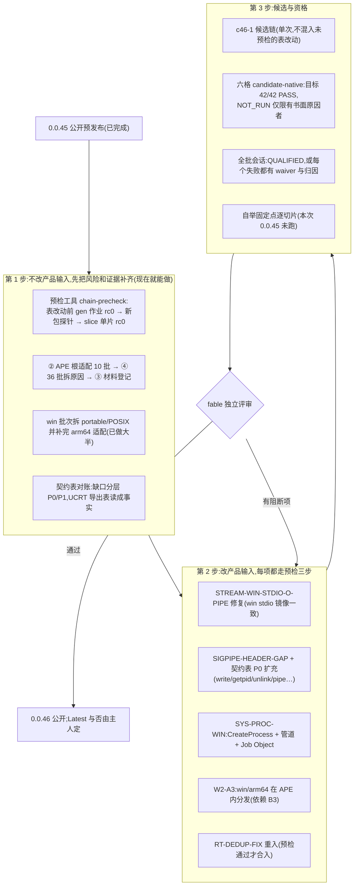
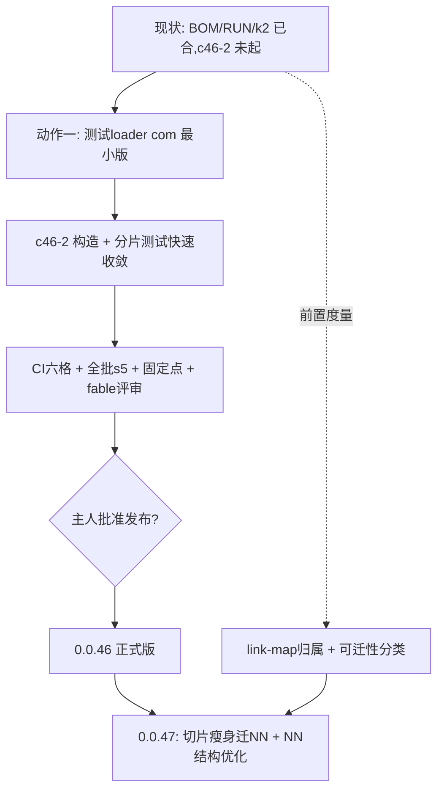
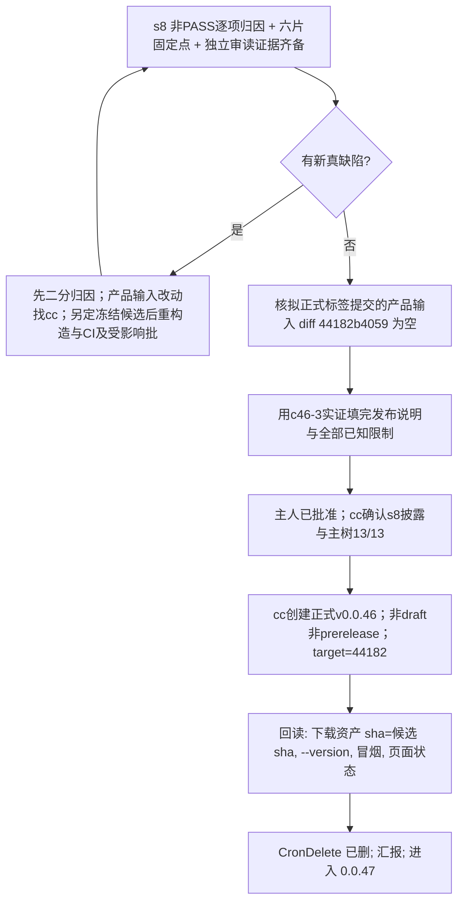

# 0.0.46 unisacc.com 本体计划（2026-11-06 cc；主人定：0.0.45 已公开收口，惯例是公开后进入下一版，已知缺陷的修复全部归入 0.0.46）

> 0.0.46 正式版门槛：六格 42 项无 FAIL（NOT_RUN 须有书面原因、portable 子集须标注）；全批会话对最终候选 QUALIFIED 或每个非 PASS 批次有归因与 waiver（SESSION-INFRA 不算已资格）；逐切片固定点；fable 独立评审。惯例：正式版才公开。不再发 `v0.0.45-stable`。

范围：只管 `unisacc.com` 本体的平台完整性、契约层、资格和清理。agent harness（cx-csih）是另一条线，归 csih 车道，见 [../archive/plans/2026-11-08b/v0.0.46.md](../archive/plans/2026-11-08b/v0.0.46.md)，本文不动它。

核心需求不变：六个 ISA 切片各有**同候选**原生证据；不降范围。

## 出发点（0.0.45 公开预发布留下的债，事实取自 plans/release-notes-0.0.45.md 与 ledger）

| 债 | 现状 | 条目 |
|---|---|---|
| win stream-pipe 缺陷 | 带 stdio 的程序 `-o` 与走 stream 管道产出的镜像不一致（win 两格 FAIL，lnx 相等） | STREAM-WIN-STDIO-O-PIPE |
| win 进程模型 | `cx/sys/proc.cx` 在 win 无 fork/waitpid/kill/F_SETFD/environ，stdio-crossunit 与 stream-pipe 只跑 portable 子集 | SYS-PROC-WIN |
| POSIX 头缺口 | `include/signal.h` 缺 `SIGPIPE`；契约表只有 8 行，审计工具报 323 个缺口 | SIGPIPE-HEADER-GAP、libc99posix-audit |
| APE 里没有 win/arm64 分发 | win/arm64 靠独立切片资产 + `pkg.bin` | W2-A3 |
| 全批会话 NOT_QUALIFIED | 215 PASS / 41 FAIL / 9 UNKNOWN / 162 无收据；85 项无 waiver | s2-class（② APE 根 10、④ 批次 36、③ 材料 85） |
| 构造链脆弱 | 一次表改动连续让链红了 3 轮（seed-gen 冲突、`no transition`、`SBCLR` 缺失），每轮约一小时 | 见下「预检」 |
| RT-DEDUP 已撤回 | 第 2–4 刀被撤，去重未做；每个对象各带一份运行库（约 264KB） | RT-DEDUP-FIX |
| 其余 | RES-STREAM-BUDGET 补丁待审、DECODE-SBOUT-STALE、ILLEGAL-ACTION-WRITES-ROOT、UNINIT 扫描器精度 | 各条目 |

## 先后与依赖（看 2～3 步）



## 预检（第 1 步的第一件事，直接来自这次教训）

0.0.45 最贵的损耗是「表改动提交后才发现链红」。预检工具 `tools/chain-precheck.cx`（待建，带 check、登记批次、prd 能力速查一行）：

1. 对改动涉及的网，只重跑受影响的 gen 作业，**逐作业读 `command.status`**，任一非 0 即红（外层 rc 不算）。
2. 用新生成的包做最小探针（相对/绝对/盘符 include、`#pragma unisa use`、对 `tools/entry-build.cx` 的 `-o` 编译）。
3. 对 lnx/x86_64 单片跑 `slice`，rc 0 才允许提交。

规则：没有预检通过记录的 `exec/pp`、`exec/parse2` 等表改动，不得提交；预检结果写入提交说明。

## 0.0.46 的发布门槛（草案）

| 项 | 门槛 |
|---|---|
| 六格原生证据 | 42 项全部有结果；PASS，或 NOT_RUN 且有书面原因；不得有 FAIL |
| portable 子集 | 矩阵格子必须标注「子集」及缺失的原语，不得默默显示 PASS |
| 全批会话 | 对**本候选**跑；QUALIFIED，或每个非 PASS 批次有归因与 waiver |
| 自举固定点 | 六个切片逐片比对，不是只比 lnx |
| 候选与源码 | tag 所在提交与候选源码的产品输入相同，核对差异为 0 |
| 评审 | spawn fable 独立评审，先写阻断项再发布 |

## 需要主人裁定的点

1. 0.0.46 是否按本文的顺序（先平台完整性与资格，harness 另线并行）？
2. 发布是否仍先走预发布？正式（Latest）的门槛是上表全部满足，还是另有要求？
3. win 的 fork 语义：是补 `fork` 的等价物（工作量大、影响面广），还是承认 Windows 用 `CreateProcess` 的子集模型、把需要 fork 的批次永久划为「POSIX 子集」？本文默认后者，因为前者没有原语可映射。

## 方向备忘（主人 2026-11-06）：libc99posix 之后的形态，类比 cosmopolitan/cosmocc

| cosmopolitan/cosmocc | unisacc 对应 | 现状 |
|---|---|---|
| APE：一个文件到处跑 | `unisacc.com` 本体已是 APE（六切片 + 模型包） | 已做；win/arm64 在 APE 内的分发未做（W2-A3） |
| 自带 libc（C 写，系统调用/NT API 直连） | libc99posix 的 `cx-own` 绑定（cx 写，在极小原语契约之上） | 只有 strdup/pread/pwrite 三个；其余 stdio 等仍前转宿主 libc |
| 对宿主 libc 无依赖 | 契约表 `host-export` 绑定 = 前转宿主 libc | 现在几乎全是这种；这正是 win 上反复踩到宿主差异的来源 |
| cosmocc 把 C 编成一个到处跑的程序 | 输出程序目前是每目标一个原生可执行文件（ELF/Mach-O/PE） | 输出程序做成 APE（fat）是另一步，未排 |

**两种模式共存（契约表的「绑定类型」列已经是这个机制）**：同一份 C/cx 源码，函数绑到 `cx-own` 就是 cosmo 式（行为六目标一致、不依赖宿主），绑到 `host-export` 就是兼容原生 C（可用宿主 libc 和宿主库）。按函数、按目标选，不是全有或全无。

**未解决的难点**：cosmopolitan 为在 Windows 上提供 `fork` 做了大量专门工程；我们的 win 进程模型目前是 CreateProcess 子集。若目标是「统一的 POSIX C99」，进程模型（fork/exec/信号/管道语义）是最难的一块，需要单独设计，不能靠加表行解决。

**验证方式**：先做小实验（stdio 最小子集用 cx 在 read/write/open/close/lseek 契约上实现），量程序体积、头文件体积、六目标是否同字节、编译时间，再决定是否全面推进。

## 把「TSV→网」的优势用足（主人 2026-11-06 指出的差异化，cc 依据 0.0.45 的实际经历整理）

事实依据：这轮 win 上最后一个阻断缺陷（`#include "C:/…"`）的修复是 `directive-body-result.tsv` 里加一个 `["SBCLR"]`，改动一行；但发现它花了多轮构造链。说明「改结构很灵活」成立，「验证改动」是瓶颈。

| 要做的 | 为什么 | 衡量 |
|---|---|---|
| **网的诊断可读性**：`run: no transition` 要打印网名、状态、观察字节、输入偏移（产品里 `cx/core/transition.cx` 的失败路径，A 类诊断改进） | 这轮三次「no transition」都只有这四个字，定位全靠手工二分 | 同一类缺陷从「多轮」降到「一条错误信息即可定位」 |
| **结构/权重改动的度量台**：改一处表之后，自动给出体积、推理步数、编译速度的前后对比，并核对与 gold 逐字节等价 | 「灵活优化权重」只有能量化才不会变成凭感觉；目前只有零散的速度基线 | 每次优化提交说明里带前后数字 |
| **预检（chain-precheck）**：见上文 | 灵活改网的前提是改错能在几分钟内发现，而不是一小时 | 表改动到发现错误的时间 |

另一个潜在优势：模型包是数据，原则上可以只换权重而不重造切片（本版没有验证，需要单独确认包版本与切片的耦合程度，P4 包版本就让参考实现无法读取，说明耦合不为零）。

## 排期决定（主人 2026-11-06）

NN 结构与权重优化（状态最小化、观察字节分类、子网共享、编码紧凑化、盘点各网体积/状态数/透传占比）**放在 0.0.46 甚至 0.0.47**，不进 0.0.45。0.0.45 只做稳定版门槛内的事（stream 目标联动修复、六格 42 项、全批归因与 waiver、固定点、评审）。前置工具（chain-precheck、表的静态检查、结构改动度量台）可以先做，因为它们不改网本身。

## 0.0.46 主线排序（cc 研判，2026-11-07；主人原话是方向和直觉，细节由我定）

主人提出两项：「完善 libc99posix 的 host abi 并做好 tape 的测试」与「把切片中的大部分逻辑迁成 nn（必要时新增 nn 甚至新 stream）」。这两项原先没排进 0.0.46，现补入，顺序与规模如下。

事实依据（本轮实测）：lnx/x86_64 切片 `entry.elf` 1,855,638 字节，对象里手写驱动单元很大：`cxmod.o` 700,560、`host.o` 523,632、`tapegate.o` 450,432、`driveroute.o` 402,912、`driveface.o` 353,728、`runexec.o` 325,648、`stages.o` 240,592、`driveunits.o` 237,456；另有两个模型对象 `m27.o` 1,328,264 与 `m22.o` 570,968。手写 cx 驱动逻辑约：`src` 5,872 行、`cx/compiler` 7,858、`cx/runtime` 5,811、`cx/sys` 3,842、`cx/driver` 2,357。可模型化的部分（纯字节流变换、表驱动的选择）值得迁；`host.o` 这类系统 I/O 属于不能模型化的核心，保留。

| 序 | 项 | 范围与门槛 | 理由 |
|---|---|---|---|
| 0 | 前置：`chain-precheck`、`tsv-lint`、结构度量台 | 已落地或在做 | 迁移要改表和网，没有这些就会重演 0.0.45 的三轮红 |
| 1 | **A. libc99posix 与 tape 测试**（主线 1） | ① 契约表按测试与工具实际调用到的函数补齐（P1：`fcntl` `dup2` 等，win 绑定名以 PE 导出表为证）；② **tape 一致性回归**：同一 C 源码对六目标，tape 的差异必须正好等于契约表绑定列的差异；③ stdio 最小子集用 cx 自带实现的小实验（体积、头文件体积、六目标同字节、编译时间） | 平台差异是这轮最大的损耗来源；增量、风险低，每项都能独立验证 |
| 2 | **B. 逻辑迁成 nn**（主线 2，须先有可证明收益再选试点） | 对象清单81项与机械标签已交付，但整.o含公共运行库、IR与非文件BSS，不能代表可回收镜像贡献。fable评审否决tapegate整体迁移，历史设计保留；旧entry.elf实查无节/符号/map，当前单元贡献明确UNATTRIBUTED，不能列可信libc副本及asmtext占比。**cc已将link-map边车推迟0.0.47 P3**，保留方案、不实施、不挡0.0.46；RT-DEDUP或CORE-MIN-ASMTEXT不能凭旧对象大小选定收益，须另有可证明数据和设计评审；cxmod/source_frame本版不动 | 不将LEB/随机池/33MB渲染机制搬成网中程序；执行器输入属性8倍放大及OOM panic先独立列P2。所有净收益、网增量与构造风险必须同候选实测，不用对象大小预报 |
| 3 | 新增 nn 或新 stream | 仅在盘点显示现有流表达不了时才做；先出设计页（哪段字节流、输入输出、如何用 gold 证明逐字节等价），fable 评审后才动 | 避免为迁移而造网 |

不做的：NN 结构与权重优化（状态最小化、观察字节分类等）仍放 0.0.46 之后，与「迁移」是两件事：迁移改变「逻辑放在哪」，优化改变「网长什么样」。

## 结构反思：为什么看不到收敛，以及两个结构动作（2026-11-07，主人提出方向，cc 研判）

### 症结（本版事实）

- 被测单元只有「整个候选 APE」，反馈慢且归因难（本版多次误归因：drv:1、E2 14 红其实是探针未绑 models）。
- 身份机制多套并存（SID/PC/GEN/context/pins/receipts），每轮靠预检和人工对账；这是 §9.1 已登记但未立项的「身份统一」。
- 切片体积大（lnx/x86_64 entry 1.86MB，手写驱动单元占大头），任何驱动逻辑改动都触发整片重构与重测。

### 动作一：测试专用 loader com（建议纳入 0.0.46，P1）
- 形态：同一份 loader 代码路径，只把字节来源由「APE 内嵌」换成「命令行/环境指定的独立文件」：`--slice FILE`、`--models DIR|pkg`、按需加载单个流/网文件。已有 `UNISA_CONTAINER`、`--models` 是雏形。
- 收益：测试按「片 × 阶段」拆开并行，单阶段/单网改动只重测相关片；E2/tape/stream 批不再依赖整 APE 重建。
- 红线（否则会重演假绿）：① 与产品 loader 共用同一实现，差别只在字节来源，禁止第二套加载逻辑；② 每个部件记 sha256，产品 APE = 确定性函数(loader, 切片, 包)，部件 sha 与 APE 内部件一致才算对该 APE 有效；③ 分片结果只算「开发证据」，正式资格仍须同候选 APE 原生运行；④ 显式绑定缺失必须报错，不得回落读 `./unisacc.com`（本版 E2 14 红的根因）。
- 顺带：为「内容寻址身份统一」铺路（部件即内容寻址对象）。

### 动作二：切片只留 ISA 对接，逻辑迁 NN（建议 0.0.47 主题；0.0.46 只做前置）
- 目标：切片＝执行器＋模型解码＋校验＋host syscall/ABI/FFI/dl 绑定；编译逻辑在「流+网」。unisacc.com 的重心回到 NN 设计，切片随 libc99posix 契约表收敛。
- 与 libc99posix 一致：契约表已是「host 绑定」的真源，切片内 host 部分可由它生成。
- 风险（须先判定，不得凭直觉承诺）：
  1. 可模型化范围未知：纯字节流变换、有限状态选择可迁；需要无界栈/符号表的解析与降低能否在现有网的有界状态里表达，未证明。fable 已否决 tapegate 整体迁移。
  2. 归属未知：旧 entry 无 map，当前单元贡献 UNATTRIBUTED，无法据此选试点。
  3. 自举：编译逻辑搬进网后，网由 gold 表确定性构造，gold 生成器本身仍需可运行环境，须保持构造链可重放。
- 0.0.46 前置（低风险，不改产品行为）：把 link-map 归属从 0.0.47 P3 提到 0.0.46 度量项；出「可迁性分类」（纯变换/有限状态/需无界状态/系统 I/O）；选 1 个试点出设计页并经 fable 评审，通过 gold 逐字节等价才动。

### 对 0.0.46 门槛与排期的影响

- 风险：动作一会推迟 c46-2 一个小窗口；折中是先做最小版（只支持 E2/stream 批与单切片），不阻塞 CI 候选链。
- **待主人裁定**：①动作一是否纳入 0.0.46；②动作二是否定为 0.0.47 主题、0.0.46 仅做前置度量；③身份统一是否随动作一一并立项。

### 主人裁定（2026-11-07）：测试loader与切片瘦身立即在0.0.46开工
- 优先度：分而治之类动作高于 c46-2 链条与其余收尾项；c46-2 候选在测试 loader 最小版可用后再起（避免再花一轮整链才发现问题）。
- 分工：omp-cdx → TEST-LOADER-COM；omp-grk → SLICE-SHRINK-PRE（link-map归属提到0.0.46，SLICE-CONTRIBUTION 由 P3-0.0.47 升为本版）。cc 总控、评审、fable 咨询。
- cc 追加的提速项（待排）：①（更正）作业复用按 ledger 2026-11-05 已定「日常开发开、发布链关」，无需再改，只要日常车道真的设了 UNISACC_WAVE_REUSE=1（SPEED-02 实测 226s→12.7s）；②全批会话按冲突域分片并行，随测试loader 落地；③身份统一随部件sha立项；④harness/探针显式绑定检查进 lint（缺绑定即拒），杜绝 E2 14 红类误归因。

### 迭代速度规则（主人 2026-11-07：迭代足够快才能更快收敛）
1. 反馈环≤15分钟：每个改动先过「当前部件级」检查（测试loader分片/单批/单网），整链候选与CI只在积累一批改动后跑一次。
2. 不整链试错：未经分片验证的改动不得触发候选链、CI、全批。
3. 出红先二分再归因：用最小复现定位，不凭推测写根因；同伴报告标未复跑。
4. 小步提交：一件事一提交，自己路径精确提交；验证绿即合，不攒。
5. 争议不开会：能用命令判定的，命令输出为准；判定不了的交 fable 一次性评审，不来回信件。
6. 每个新障碍先问「能否变成分片可测的一条检查」，是则先做检查再修。
fable 评审(2026-11-07,cc 转述,未复跑):①网=有限控制态+无界数据态寄存器机(cx/core/execute.cx:116-215),原理上能表达栈/符号表/重定位,但等价只能抽样证明;②可迁:asmtext/leword/codecgate/rtsharedname/driveargs;代价高:tapelink/cxmod/source_frame;不可迁:host/runexec/hostbind/peimport/runcache/execute/model_decode;③首试点 cx/compiler/asmtext.cx(at_dis/at_asm,单片.text 223,602B,gz 37,896B;76个.o+tools/asm-material.cx 逐字节cmp,at_asm往返,tools/check-asmtext-tables.cx 拒绝对比;是否与包内enc网重复未核实);④切片大头是运行库76份私有副本269KB+libc静态副本~478KB(RT-DEDUP)和APE内三份模型,与迁NN无关;⑤反对:范式漂移、执行器资源合同(8×属性/OOM panic)、收益归属错位、Python债(gold头写python3 -m unisa gold-export)未核实。

### fable 评审：asmtext 试点（2026-11-07，cc 转述，未复跑）
- 结论：**asmtext 不宜作首个试点**。①`as(dis(obj))==obj` 近乎恒真（解码器先重编，不等就退成 `.byte`），不区分正确反汇编与全退化；须改 gold 文本等价＋`at_nfall` 计数＋拒绝合同＋arm64/nm 路径。②代码确在每片镜像里，但只在 `as/nm/objdump/-S` 路径执行；迁网后网权重同样进包，收益可能为零或为负，现有工具对单元恒 UNATTRIBUTED，无法证明。③网内大对象：步数非瓶颈，内存（8B/输入字节，OOM 走 panic）与时间才是；每字节步数未实测。
- RT-DEDUP：分步 `-c` 构建零收益；多单元前转拼 TU 路径需新增 cmp/链接用例；osx/win 链接器语义未列，须五片各自举。
- 实测边界（grk b6db5a7944，未复跑）：单片 runtime 副本 [28471,90238]B、libc [1942,55947]B，合计上界约146KB，仅占 entry 1,860,142B 的约8%。**体积主体是编译逻辑单元**，试点应在默认编译路径上选，依据 grk 即将出的按单元全表。

### 分治矩阵（主人 2026-11-07：工作的中心是分而治之，分得好就能高速并行）
loader A+B 已合入（ae98779c6c），部件可独立替换与测试。切分维度与可并行单元：
| 维度 | 单元 | 现状 | 下一步 |
|---|---|---|---|
| 阶段（流） | e1/e2/e3/e4/prune/lower/elf | 仅 E2/stream 有分片对照 | 每流一个分片检查，用 test-loader 对整APE 逐字节对照 |
| 网 | 默认阶段包 42 张构造阈值网；经典参考另有 18 张构造事实网 | B 支持单网替换（p3-swap） | 逐网「同网等价＋变异必拒」批，网间并行；两类均非训练所得，不声称学习或泛化 |
| ISA 切片 | 6 | lnx/x86_64 有证据 | 每片独立 entry-build＋启动检查，片间并行 |
| 批次 | 435 | 失败分类并行二分已做 | 真缺陷逐个认领（rollup-open stream-e2 矩阵不一致等） |
| 体积 | 81 单元 | 全表已出 | 按类别（纯变换/有限/大状态/IO）分头评估 |
原则：每个单元独立输入身份、独立退出、独立证据，互不等待；汇总只读各单元收据。

### 索引树与分流工具（主人 2026-11-07：做好索引树和分流工具，平行流动工作）
- 已有分流底座：`tools/affected.cx`（改动文件→受影响批次，`--run -j N` 并行）；缺的是**产品单元层的索引树**。
- 新增 `agentwork/units.tsv`（由生成器从 `tests/batches.tsv`、`exec/pipeline/image-stages.tsv`、切片清单、`plans/unit-text.tsv` 生成，带 `--check`）：列 `unit_id, dim(stage|net|slice|batch|size), parent, inputs(sha或路径), check(命令), state(READY|RUNNING|PASS|FAIL|BLOCKED), owner, evidence`。树：dim 根→单元→子检查。
- 分流工具 `tools/fan.cx`（名称先 git log --all 查重，已查 fanout/unit-index/work-index/shard 均无历史）：读 units.tsv，按「inputs 变更」选 READY 单元，`-j N`（N=核数）并行跑各单元 check（经 test-loader 分片），每单元独立 deadline 与收据，汇总只读收据；失败自动二分到子检查。
- 约束：不缓存 PASS 当结论（缓存命中仍核输入身份）；单元收据不可互相改写；SESSION-INFRA 与 FAIL 分类不混。
- 负责人：grk（生成器与 fan.cx），cdx 提供 test-loader 接口；cc 评审。

### 反思：提速动作（cc，2026-11-07）
1. 瓶颈是单一集成者（我）：补丁往返（应用→自建二进制→复跑→棘轮→写基线）每块 3~5 轮。改为**自合入协议**：cdx/grk 在基于当前 main HEAD 的干净私有克隆里跑 ①自有检查 ②`tools/ratchets.cx` 13/13 ③`git commit -- 自有路径` 直接合 main，提交说明附命令与退出码；toolsloc 单块≤+100 行且写明理由可自写基线；cc 事后抽审，不再逐块代跑。红线不变（不放宽断言、不碰他人路径、不动 apps/csih、ujs）。
2. 新工具提交前自查 cxtrunc/toolsloc（本轮三次返工都因此）。
3. 关键路径别串行：c46-2 候选链与 loader/瘦身相互独立，**已并行开工**（产品输入已冻结在 BOM+k2），CI/s5 证据尽早到。
4. 信件换看板：状态以 agentwork/units.tsv 与 items 为准，信只报「哈希+命令结果」一行。
5. 假失败先排环境：副本缺 unisacc.com/.git 造成的 FAIL 占失败分类的大半，分类时先用带 .git 的克隆。

### 发布手册（c46-3当前线；主人已批准公开，实际动作仅由cc执行）

- 当前资产备份：c46-3 APE/pkg/slice-win-arm64/官方配对build.json、原始分片与收据、CI42353236985证据已存 `~/.unisacc-baselines/c46-3/`；APE `884adfef1815e87750c86c7036d3074552a66ce18dfa855588ab279c2aa99fcf`（6,163,990字节）。c46-2仅保留历史/负控，不能用旧资格替代新候选。
- 资产必须是 CI 验过的同一 sha，不重新构造；标签提交与候选提交的产品输入差异必须为空。
- 0.0.47 种子（不进 0.0.46）：切片瘦身（可迁性分类已出：大状态 74%，需先扩执行器资源合同）、link-map 归属、NN 结构与权重优化、身份统一、libc99 stdio 子集实验。

#### 已准备、尚未执行的公开命令

tag选择 **CI实际验证提交 `44182b4059d51191cb021241c666b521bf34b2ad`**，与配对build.json的commit完全一致，避免把后续工具/说明提交冒称CI源提交。`1d57fa479d12ca554ac3a69238e5f90e81ba21b4` 已实际执行产品输入差异核验，`src cx exec include seed ext kernel` 相对44182为空；即便当前main产品输入等价，也不必改变tag策略。以下命令由cc执行，cdx未执行正式发布。

前置：s8原始终态与非PASS披露填完，release-notes只剩的全批一处证据已处理；主树13/13；正式tag/release若已存在先核身份，不覆盖或删除。

先核对 `tools/release-layout.cx` 的固定布局合同，再由 cc 将同一 CI 候选整理到**尚不存在**的 `NEW_OUT`；工具不改 `SOURCE`，不重构造产品，也不授予 CI 资格。以下仅是待执行操作，不表示本节编写时已校验或发布：

```sh
R=. # 仓库根执行
SOURCE=~/.unisacc-baselines/c46-3
NEW_OUT=/tmp/unisacc-0.0.46-release-layout
sh "$R/unisacc.com" "$R/tools/release-layout.cx" -- "$SOURCE" "$NEW_OUT" &&
sh "$R/unisacc.com" "$R/tools/release-layout.cx" -- --check "$NEW_OUT" &&
(cd "$NEW_OUT" && sha256sum -c SHA256SUMS)
```

三步成功后才可使用该目录上传；失败不得继续。`SOURCE` 须含同候选的 `unisacc.com`、`pkg.bin`、`slice-win-arm64`、`unisacc.com.build.json`。工具复制前四项，把配对记录原样复制为 `build.json`，核对 `product_digest` 与 APE SHA256 一致，并生成真实文件哈希（不是占位清单）。正式发布资产清单固定为：

| 资产 | 合同 |
|---|---|
| `unisacc.com`、`pkg.bin`、`slice-win-arm64` | CI 验过的原字节 |
| `unisacc.com.build.json`、`build.json` | 同一配对构建记录，二者逐字节一致 |
| `unisacc-0.0.46-win-arm64.zip` | 固定四成员：`slice-win-arm64`、`pkg.bin`、`run.cmd`、`README-win-arm64.txt`；固定顺序与 ZIP 元数据 |
| `SHA256SUMS` | 覆盖上述六个发布文件，不含自身；`--check` 重建 ZIP 和清单并逐字节比较 |

当前工具**硬编码 0.0.46 资产名与包装**，不是任意版本发布器。Windows 包装只作布局/校验和检查，`run.cmd` **尚未在 Windows 原生运行验收**，不能把 CI 对原切片的资格冒称为包装验收。此文档改动不执行 `gh` 或触发发布。

```sh
R=. # 仓库根执行
NEW_OUT=/tmp/unisacc-0.0.46-release-layout # 必须已通过上述三步校验
git -C "$R" diff --quiet 44182b4059d51191cb021241c666b521bf34b2ad HEAD -- src cx exec include seed ext kernel
gh release create v0.0.46 "$NEW_OUT/unisacc.com" "$NEW_OUT/pkg.bin" "$NEW_OUT/slice-win-arm64" "$NEW_OUT/unisacc.com.build.json" "$NEW_OUT/build.json" "$NEW_OUT/unisacc-0.0.46-win-arm64.zip" "$NEW_OUT/SHA256SUMS" --repo partnernetsoftware/unisacc --target 44182b4059d51191cb021241c666b521bf34b2ad --draft=false --prerelease=false --latest=false --title 'unisacc 0.0.46 —— 发布说明' --notes-file "$R/plans/release-notes-0.0.46.md"
env READBACK_EXPECT_DRAFT=false "$R/tools/bound" 55 sh "$R/release/tools/c46-3-readback.sh" "$R" v0.0.46 /tmp/c46-3-public-readback ~/.unisacc-baselines/c46-2/unisacc-c46-2.com
```

`--latest=false` 不额外改变Latest；如cc决定设Latest，由其明确调整。现有读回入口正式模式要求非draft/非prerelease、target/tag均为44182，下载发布资产后自动对四项原始资产逐个SHA核验，再检查版本、实际默认运行/其它APE smoke及comm旧负控；它不替代上面的七资产布局检查，其余 ZIP、`build.json`、`SHA256SUMS` 下载后仍须另按清单核对。只读回，不调用发布/删除API。私有draft以 `READBACK_EXPECT_DRAFT=true` 实际完整烟测通过；默认正式模式读取同一私有draft实际拒绝（`release metadata mismatch`、rc1）。这不冒称公开路径已执行，公开tag分支须在cc发布后实跑。


### fable 独立评审 c46-2 产品输入差异（2026-11-07，cc 转述）
结论：**无阻断**；应修 3、建议 5。cc 本轮核查：①「C源+`-include`」与 `.cx`+`-include` 在 c46-2 上均 rc=7，未复现重复/丢失注入；②`check-stream-target` 已登记批次（`tests/batches.tsv` 1 行），非未登记；③`l99_fwdsym` 的 tgt 形态由 win 原生 CI（hello/run/strdup FFI，run 42332407482）间接覆盖，严格拒绝建议留 0.0.47。后续：sysx 超时路径单次 WNOHANG 可能留僵尸→并入 grk BOUNDED-WAIT 块；cx-flat 与 string.h 同步纳入棘轮→0.0.47；SIGUSR1 Darwin 10→30 已写入发布说明。fable 评审门槛项：已过（评审未发现阻断；若再有产品输入改动须重审）。

### 时间盒（主人 2026-11-07：时间最贵，每步以分钟为上限）
- 单条命令≤60s（原规则）；单步（一次改+验证）≤10分钟；一块≤30分钟；超时不拖：到点回一行「已完成/卡在/要什么」，卡住的二分或换路，不原地等。
- 并行优先：能分的立刻分给另一个窗口/子代理，不串行排队；等待产物时去做不依赖它的下一件事。
- 当前时间盒：grk s6 开会话≤10分钟、材料图并入≤10分钟；cdx 8材料先查 ri-flow+nnc-nets≤20分钟、fixedpoint checker 自合≤10分钟；cc 评审回信≤5分钟。

## 宏观设计审视（cc，2026-11-07，主人要求自上而下）
1. 产品定义缺位：「生产可用」未定义门槛。建议：①外部语料正确性（c-testsuite、gcc torture 子集、lua/sqlite 等真实程序）六目标原生通过；②自举固定点；③同 gcc/tcc 的差分测试；内部批次数不是质量信号。现状 `corpus.c-testsuite` BLOCKED、22 种约束违例静默接受（12 种可能产错代码）。
2. 金标循环：网=gold 表，gold=`seed/gold_*_label.c` 规则，规则=作者对 C 的理解；网与 gold 逐键一致只证明「实现=自己的规格」。外部预言（gcc/clang 差分）才是独立证据，现仅 `pp-differential` 一处。
3. 「NN」名实：现网是有界状态的全键穷举查表机（UNIKERN1 执行器是寄存器/栈/稀疏内存 VM）。真资产是「事实表→生成器→VM 程序」的模型驱动构造。切片 74% 的大状态逻辑可考虑编成同一 VM 的字节码而非查表网（cx→VM 字节码），切片缩成 VM＋host；代价是解释开销、执行器资源合同（8× 属性/OOM panic）须先修、VM 成为信任基。需主人裁定方向。
4. 身份/验证复杂度是症结：SID/PC/GEN/context/pins/receipts/session 是同一个「内容寻址构建图」的多个投影。目标形态：构建=内容寻址 DAG（部件 sha→节点），测试挂节点，受影响=图查询；test-loader/units/fan 是它的雏形。
5. 自举与信任：宿主 C 引导、Python 构造债仍在；固定点每片两代构造约 1 分钟/片，可接受，但原生（Windows/macOS）自举未声称。
6. 流程成本：多代理信件往返、基线竞态、假绿（units 32 pass）都是「证据口径不统一」的症状，应由第 4 点收敛。

### 决策记录（cc，2026-11-07；主人授权「你决策吧」后休息）
1. 0.0.46门槛不降低：当前c46-3冻结44182，CI42353236985已42/0（Windows portable限定），六片实构造及两代固定点已分别验证；新fd63变更由未参与产品改写的cdx独立审读，并实际验证旧目录替换负控与dirfd固定路径。fable旧c46-2评审仅属其原产品输入，不泛称新输入已获其评审。s8每项非PASS仍须归因，SESSION-INFRA不算合格；发布说明真实证据清零后仍不自行公开。候选和配对记录在 `~/.unisacc-baselines/c46-3/`，私有draft已建立。
2. 「生产可用」门槛定为 0.0.47 主题：外部语料（c-testsuite、gcc torture 子集、lua、sqlite）六目标原生通过＋gcc/tcc 差分；22 种约束违例静默接受须逐项关闭。0.0.46 在发布说明中如实披露现状，不宣称生产可用。
3. 切片大状态逻辑走「cx→VM 字节码」方向，0.0.47 起步：先修执行器资源合同（8× 属性/OOM panic），再 rtsharedname 试点，净收益用同候选实测判定（包增量<切片减量才做）。
4. 内容寻址构建 DAG 作为身份统一的目标形态：沿 test-loader/units/fan 渐进，不在 0.0.46 重构。
5. RI 参考运行器不认 P4（flow-data NOT_AVAILABLE）：记为已知缺口，0.0.46 披露，修复排 0.0.47。

## 前瞻计划(cc,2026-11-07)
- 当前发布路径：c46-3源44182、APE884adfef…、同候选原生CI42353236985已QUALIFIED42/0/0/0；集成提交8484436b0e相对44182的src/cx/exec/include/seed/ext/kernel输入diff已实核为空。剩grk冻结s8原始计数/非PASS归因、说明最后一处全批证据；公开须主人批准。
- 预置：s8及阶段边界新harness结果到齐后填最终说明；批准到位才操作正式 `v0.0.46`、公开状态与回读。私有draft、CI分支及其资产回读已授权执行，不再前置等批。
- 当前分工：cdx负责c46-3构造→私有APE→comm→CI→备份→说明到底；grk负责其独占c46-3 ROOT的s8全批，当前输入冻结，8484436b0e的四文件harness与新配对记录仅在阶段边界接入并刷新身份，不追填旧PASS；GCC K&R评估归grk，Lua留0.0.47。
- 冻结证据及c46-3备份保留，构造ROOT仍可能被s8材料引用，不清其共享或在用输入。旧c46-2备份和负控也保留；不以回收目录破坏证据链。
- 提速规则:任何一方报"跑完/无在途"时,同轮派下一项;自合入后由我事后审计,不设前置排队。

### 发布后收尾(cc,2026-11-07)
1. 读回通过(sha/--version/冒烟/进程名)后:`tools/install-ape.cx` 原子把 884adfef APE 装到仓根(保留旧脚本可回滚)。
2. 装完跑 `tools/identity-derive.cx -- ROOT --check`(grk 的批次),须 rc0;不等则按差异修派生记录,不手改。
3. 主树跑 `tools/ratchets.cx` 13/13;pins/root-identity/manifest 复跑转绿后补一行证据入 ledger。
4. 转 0.0.47:A12 八个错码(cdx 私有分支 c47-a12-cdx)→合入 main;README/glossary 措辞;identity-derive 全接线;s8c 补跑 84 批并更新发布说明(发布说明可编辑,须标明是发布后补充证据)。
