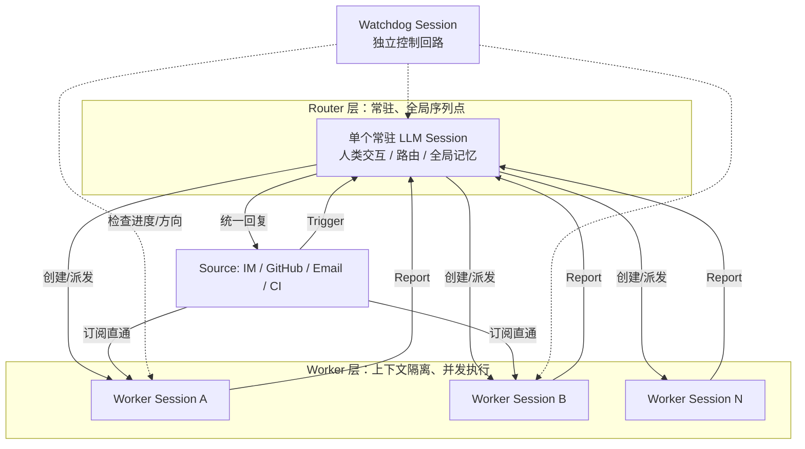
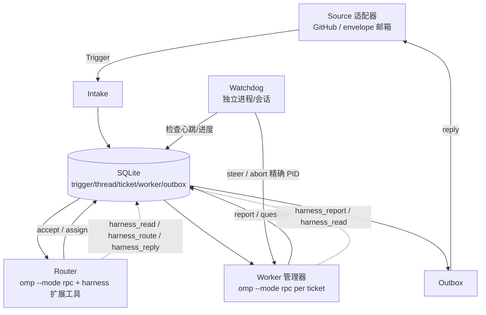

# Super-agent 研究与基于 omp 的 Harness 评估

日期：2026-11-02
作者：omp-go2（研究/杂务车道）
状态：结论型；原型未开工，本文只给评估与一周方案。

## 0. 结论摘要

- DeepSeek 产品部 / DeepSeek Harness 团队于 2026-10-31 发布《Super-agent 设计探索：迈向更自主的 Agent 系统》，并开源研究原型 `deepseek-ai/dsh-superagent-prototype`（MIT，明确声明“非官方产品、研究代码”）。
- 核心不是新模型，而是 **agent harness 的架构**：把 Agent 从“单 Session 工具”变成“持续在线实体”，四特性是 continuous / efficient / proactive / persistent；五模块是双层架构、事件驱动、人向交互、计算-状态-环境分离、Watchdog。
- omp 18.15.0 已具备大部分原子能力：`task` subagents、`--mode rpc`、`/goal`、plan/prewalk、extensions/hooks、skills/rules、async jobs、advisor、judge。**缺的是跨 Session 的 Source/Trigger/Thread/Ticket/Assignment 状态机、订阅直通、Outbox、政策门**这一层。
- 因此原型应做成“**基于 omp 的薄 harness**”：harness 持有状态与编排，omp 进程只做可丢弃的计算。一周内可跑通一个最小闭环：1 个 Source + SQLite 状态机 + RPC Router/Worker + Watchdog + 并发/深度硬上限。
- 最大风险不是模型，而是进程与 token：任何会 spawn 的路径必须内建并发上限、深度守卫、精确 PID 清理和预算；今天的 `.cx` 递归事故就是反例。

## 1. 原始来源与可信度

| 来源 | 类型 | URL | 置信度 | 说明 |
|---|---|---|---|---|
| DeepSeek 产品部 / Harness 团队《Super-agent 设计探索：迈向更自主的 Agent 系统》 | 官方设计文章（微信） | https://mp.weixin.qq.com/s/zoS7GlReWPhfCjENGxXCdg | 高（内容） | 本机被 CAPTCHA 拦截，未能直接抓正文；英文全文翻译与 GitHub 文档交叉一致 |
| `deepseek-ai/dsh-superagent-prototype` | 官方 GitHub 研究原型（MIT） | https://github.com/deepseek-ai/dsh-superagent-prototype | 高 | README + docs/000–008；代码与设计文章同源，但作者声明“已适配公开发布，不等同内部版本” |
| HTX 英文全文翻译 | 二手转载（全文） | https://www.htx.com/en-in/news/just-now-deepseek-unveils-its-next-generation-agent-harness-Zrx5BILY | 中高 | 用于补足被墙的正文；关键段落与 GitHub docs 一致 |
| CellCog、zglg、AgentsPulse、i-scoop、TPS | 二手解读 | 见搜索结果 | 中 | 只用于交叉核对“Router/Worker、事件驱动、300 消息/20 请求”等事实，不作为唯一依据 |

> 未核实项：设计文章中的定量实验（p50 12.4 min、p95 15.7 min、direct-pass 省约 37% read-cache token）只来自翻译与二手摘要，未拿到原始图表；引用时按“作者报告”而非独立复现。

## 2. 设计理念

一句话：**把人的注意力当成预算，把 Session 当成实现细节。**

四条基础特性：

| 特性 | 含义 | 设计后果 |
|---|---|---|
| Continuous | 用户可在 IM、GitHub 评论等熟悉界面持续交互，感觉始终只有一个 Agent | 跨 Session 的全局上下文与记忆；Session 不作为用户概念 |
| Efficient | 前台可随时接受新指令，多个复杂任务并行且互不干扰 | Router/Worker 双层；异步 ReAct；订阅直通 |
| Proactive | 不等用户逐条下指令，持续观察环境事件并主动推进 | 事件驱动；两级过滤；推测执行；明确“何时沉默” |
| Persistent | 始终在线，能接真实工作环境，长期运行可自愈 | 计算/状态/环境分离；设备侧 daemon；Watchdog |

与“单 Session + Subagent”的关键区别：Super-agent 的首要问题是**多任务并发下的上下文连续性与人的注意力**，不是单任务内的步骤分解。因此它把“全局连续性”和“高并发执行”拆成两层，而不是让主 Session 既聊天又干活。

## 3. 架构组成（五模块）

### 3.1 双层架构

- **Router 层**：常驻全局路由层，接收所有入口的人类交互，聚合跨任务信息与决策，是全局序列点、协调点和记忆。它不直接执行具体任务，甚至可以不配 Bash。
- **Worker 层**：每个 Worker 有隔离上下文、完整执行工具，专注单个任务；不直接与人类交互，只向 Router 汇报。多个 Worker 可订阅同一 Thread，从而自行发现并解决共享工作环境中的冲突。
- 与常见 Agent Teams 的区别：Teams 的 Lead 要深入任务细节、拆子任务、高频协调；Super-agent 的 Router 只做任务间的高层关联与派发，任务内分解交给 Worker（Worker 内部还可以再开 Subagent 或 Agent Team，对 Router 透明）。

### 3.2 事件驱动

- 环境事件（群聊、邮件、日历、代码评论、CI 结果）统一叫 **Trigger**。
- **两级过滤**：程序级 Fast Path（来源、群范围、白名单等确定性准入）+ 语义级 Slow Path（LLM 按 prompt 策略判断是否需要行动）。
- **订阅直通**：Thread（同一 PR / IM 主题 / 邮件串下的连续 Trigger）创建 Worker 后，后续事件由程序直接投递到订阅的 Worker，不再经过 Router；Router 仍可观察全局，但只处理未订阅的新事件。
- **Inline & Spill**：把上下文窗口当 Cache 管理；近期可能用到的信息内联，超预算的完整信息外置并保留引用/摘要；配合对象 ID 与引用图形成 **Chain of Recall**，按需逐跳召回。
- **推测执行**：在结果是否被采纳还不确定时，后台先做（如先复现、先起草回复），有价值再交付，无价值则沉默。

### 3.3 人向交互

- **异步 ReAct Loop**：耗时工具调用改为 `start()`/`stop()`，立即返回 Started，结果稍后作为新事件消息进入 Session；前台可继续响应人类输入。设计文章明确说该机制已在 DeepSeek Harness 实现但默认未开。
- **多通道适配**：IM 低打扰、单条回复建议 ≤100 词；GitHub/邮件/文档走结构化、高信息密度的异步交付。

### 3.4 计算、状态、环境分离

- 计算（Agent Loop）放无状态弹性容器；状态（Session）放数据库；执行环境留在用户设备，只部署轻量 daemon 执行命令并返回结果。
- 这样 Agent 不受单机生命周期约束，可跨设备、支持间歇在线设备；与 Anthropic “brain/hands 解耦”方向一致，但更强调接入用户日常、可能离线的个人机器。

### 3.5 Watchdog

- 在主体系统外放一个独立 Watchdog Session，用定时消息驱动，形成外部控制回路。
- 不只监控进程存活，还用模型判断每个 Worker 是否有实质进展、方向是否偏离目标；异常时介入修复，外部间歇故障则持续复查。
- Watchdog 本身有完整工具，可被维护者用自然语言询问故障原因，也可在线修正主系统行为（改 prompt、调触发规则）。

## 4. 与现有 Agent 框架的区别

| 维度 | 单 Session + Subagent | 常见 Agent Teams | Super-agent |
|---|---|---|---|
| 基本单位 | Session | 一个复杂任务 | 持续在线的实体 |
| 多任务 | 主 Session 串行，靠人切换 | Team Lead 高频协调 | Router 常驻 + Worker 隔离并发 |
| 上下文 | 单窗口，易被中断/稀释 | 任务内共享 | 跨 Session 的 Thread/订阅/召回 |
| 触发 | 人类 prompt | 人类 prompt | 环境 Trigger + 策略 |
| 人的角色 | 逐步监督 | 任务内指挥 | 高层决策与验收 |
| 失败恢复 | 进程内重试 | 任务内重试 | Watchdog + 持久状态 + 环境 daemon |
| 关键瓶颈 | 模型能力 | Lead 的推理负载 | 人的注意力与全局记忆 |

## 5. 开源实现与接口规范

- 仓库：`deepseek-ai/dsh-superagent-prototype`，MIT，Bun/TypeScript，作为 **DeepSeek Harness（DSH）的 bundle/plugin** 运行。
- 定位：面向**单个 GitHub 仓库**的主动 coding agent；监听 GitHub，可选飞书；被允许的人提出请求后，创建工单（Ticket），在独立 Session 与目录中执行，回到原会话回复（如 PR）。
- 领域模型（可直接借鉴，但不必全搬）：
  - `Source → Trigger → Thread → Eval → Decision → Ticket → Mandate → Assignment → Executor → Report → Outbox`
  - `Eval` 分 Gate（确定性准入）与 Assessment（模型研判）；`Ticket` 是授权工作单元；`Mandate` 记录授权强度/范围/政策版本；`Assignment` 是 Ticket 到 Executor 实例的绑定。
  - `Thread` 上同一时刻只跑一个 Eval；`Subscription` 是 Ticket 与 Thread 的多对多关系；订阅直通使后续人类消息绕过 Eval。
- 工程实现要点：
  - 单 SQLite 状态库（`orchestrator.sqlite`），Engine 是唯一写者；Effects 是持久副作用队列；Outbox 持有消息回执并按来源重试。
  - `WorkerSlots` 控制并发，人类消息可额外占 1 个槽；launch/delivery/relay/reply 各有并发与退避。
  - 每个 Ticket 一个 Executor Session + 一个目录；prepare 命令用 `git worktree` 类方式建检出。
  - `prompts/*.md` 承载大部分行为规则；Source skills 在 `skills/dsh-superagent-*/SKILL.md`。
- **没有公开的跨框架接口规范**；它是 DSH 的插件，不是通用协议。可复用的是领域模型与调度规则，不是 DSH 专有 API。

## 6. omp 18.15.0 对接面清单

以下路径均相对 `~/.bun/install/global/node_modules/@oh-my-pi/`。

### 6.1 扩展与钩子

| 能力 | 入口 / 源码 | 说明 |
|---|---|---|
| 扩展发现目录 | `pi-coding-agent/src/discovery/builtin.ts:61`（`getConfigDirs`）、`src/discovery/helpers.ts:847`（文件模式） | 只认 `*.ts`/`*.js`、`*/index.ts`、`*/package.json`；默认 `~/.omp/agent/extensions/` |
| 扩展 API | `pi-coding-agent/src/extensibility/extensions/types.ts:1795`（`ExtensionAPI`） | `on(...)` 事件、`registerTool`、`registerCommand`、`registerProvider`、`ui.setStatus`、`ui.*` |
| 扩展事件 | 同上 `:1819-1842` | `session_start/switch/branch/compact/shutdown`、`agent_start/end`、`turn_start`、`before_provider_request` 等 |
| 扩展加载器 | `src/extensibility/extensions/loader.ts:124` / `:239` / `:257` | `registerProvider` / `registerTool` / `registerCommand` 的具体实现 |
| 扩展运行器 | `src/extensibility/extensions/runner.ts:151-171`、`:442-457` | 每事件处理预算；`session_shutdown` 独立短预算 |
| Hook API | `src/extensibility/hooks/types.ts:470`（`HookAPI`） | `--hook` 加载；与扩展类似的事件面 |
| Hook 加载器 | `src/extensibility/hooks/loader.ts:92` | `on` / `registerCommand` / `exec` |

### 6.2 Skills / Rules

| 能力 | 入口 / 源码 | 说明 |
|---|---|---|
| Skills 运行时 | `src/extensibility/skills.ts`、`src/capability/skill.ts` | `--skills` 过滤、`--no-skills` 关闭；`skill` 命令/工具 |
| Skills 发现 | `src/discovery/skillshare.ts`、`src/discovery/builtin.ts` | 项目/用户/插件来源 |
| Rules | `src/capability/rule.ts`、`src/capability/rule-buckets.ts`、`src/discovery/builtin-rules/` | `--no-rules`；按 agent 角色分桶；规则可覆盖 |
| 上下文文件 | `src/discovery/agents-md.ts`、`claude-md.ts` | `--no-context-files` |

### 6.3 Subagents / 并发 / 深度

| 能力 | 入口 / 源码 | 说明 |
|---|---|---|
| `task` 工具与执行器 | `src/task/executor.ts`、`src/task/index.ts` | spawn、batch、sync/async fan-out、yield |
| 工作池 | `src/task/workpool.ts:151` | 按 `task.maxConcurrency` 动态调整 |
| 并发默认值 | `src/task/settings.ts:375` | `task.maxConcurrency` 默认 **32** |
| 深度默认值 | `src/task/settings.ts:411`、`src/task/types.ts:310` | `task.maxRecursionDepth` 默认 **2**；`canSpawnAtDepth` 判定 |
| spawn 策略 | `src/task/spawn-policy.ts` | 父 agent frontmatter 的 `spawns` 白名单 |
| 供应商并发 | `src/task/provider-concurrency.ts` | 仅包住单次 LLM HTTP 请求，避免深树自锁 |
| 异步作业 | `src/async/job-manager.ts`、`job-control.ts` | `wait`/`cancel`/snapshot；后台作业唤醒 |

### 6.4 RPC 模式（最关键的可编程接口）

| 能力 | 入口 / 源码 | 说明 |
|---|---|---|
| RPC 入口 | `src/modes/rpc/rpc-mode.ts` | `omp --mode rpc`；stdin JSON 命令，stdout JSON 事件/响应 |
| 命令类型 | `src/modes/rpc/rpc-types.ts:48`（`RpcCommand`） | `prompt`、`steer`、`follow_up`、`abort`、`new_session`、`open_session`、`goal`、`get_state`、`set_subagent_subscription`、`get_subagents`、`cancel_subagent`、`steer_subagent`、`bash` 等 |
| Goal 的 RPC 面 | `src/modes/rpc/rpc-goal.ts` | `goal` 命令：create/get/complete/resume/drop |
| Subagent 的 RPC 面 | `src/modes/rpc/rpc-subagents.ts` | 订阅级别、快照、消息、取消、steer |
| 线协议 schema | `src/modes/rpc/wire/rpc-wire.schema.json` | 可直接生成客户端校验 |
| 无 UI | `--no-ui`（`src/cli/args.ts:97`） | `rpc` 下扩展 headless；`rpc-ui` 保留工具 UI |

### 6.5 Goal / Plan / Prewalk

| 能力 | 入口 / 源码 | 说明 |
|---|---|---|
| Goal 状态 | `src/goals/state.ts:6`（`GoalModeState`） | `enabled`、`mode`、`goal`（objective/status/tokenBudget/tokensUsed） |
| Goal 运行时 | `src/goals/runtime.ts` | 预算、续跑、prompt 渲染 |
| Goal 工具 | `src/goals/tools/goal-tool.ts:62` | `goal` 工具：create/get/complete/resume/drop |
| `--goal` | `src/cli/args.ts:39`、`src/cli/flag-tables.ts:160` | 仅交互式、必须新 Session；`goal.enabled` |
| Plan 模式 | `src/plan-mode/`（`state.ts`、`plan-handoff.ts`、`plan-protection.ts`） | 只读规划、批准后交接 |
| Prewalk | `src/auto-prewalk/classifier.ts`、`src/task/prewalk.ts` | 首次 edit/write 后切到便宜模型；`--prewalk`/`--prewalk-into` |

### 6.6 其他可复用件

| 能力 | 入口 / 源码 | 说明 |
|---|---|---|
| Advisor（被动审查） | `src/advisor/runtime.ts` | 每轮被动 review，可注入 notes；与 Watchdog 的“方向检查”接近 |
| Judge | `src/judgment/` | 分类/打分；`auto-prewalk`、`auto-thinking` 用 |
| 内部 URI | `artifact://`、`history://`、`agent://`、`local://` | 对应 Chain of Recall 的“引用 + 按需读” |
| 会话存储/恢复 | `--session-dir`、`--resume`、`--restore`、`--continue` | harness 可为每个 Worker 指定独立 session dir |
| 安全/审批 | `--approval-mode`、`--tools`、`--no-tools`、`--auto-approve` | Worker 可在隔离目录自动批准，Router 收紧 |

## 7. 理念 → omp 机制映射表

图例：✅ 已有且可直接用；🟡 部分具备，需 harness 补；❌ omp 无，必须 harness 自建。

| Super-agent 理念 | omp 现有 | 判定 | 缺口 / harness 要做的事 |
|---|---|---|---|
| Router + Worker 双层 | `--mode rpc` 可驱动多个独立 omp 会话；`task` 可开子 agent | 🟡 | omp 没有“跨 Session 路由/订阅”概念；Router 会话与其状态需 harness 持有 |
| 事件源 / Trigger | extensions `on(...)`、RPC `prompt`、async job 唤醒 | ❌ | 无 Source、读位置、去重、Trigger 持久化；需 harness 的 intake + SQLite |
| 两级过滤（程序 + 模型） | `judge`、smol/fast 模型、`auto-prewalk` 分类器 | 🟡 | 确定性 gate、白名单、政策版本需 harness；模型研判可复用 omp |
| 订阅直通 | RPC `steer` / `follow_up` 可向指定会话注入；`agent://` 可发消息 | 🟡 | 无 Thread→Worker 订阅表与多对多扇出；需 harness 路由 |
| Inline & Spill / Chain of Recall | `read` 行段、`glob`/`grep`/`lsp`、内部 URI、archive | 🟡 | 对象 ID/引用图、注入预算、召回链需 harness 设计；omp 工具是执行面 |
| 推测执行 | async `task`/`bash`、`prewalk`、speculative-launch | 🟡 | 何时后台试跑、何时丢弃、成本核算需 harness |
| 异步 ReAct | async jobs + `wait` + 唤醒；`--wait-async` | 🟡 | omp 主循环仍有同步点；harness 应把长任务放后台作业并事件化 |
| 人向多通道输出 | Router 统一回复；`ask`；RPC 事件流 | 🟡 | IM ≤100 词、GitHub 结构化模板需 harness/提示词 |
| 计算/状态/环境分离 | session 文件可 resume；`--session-dir`；本地执行 | ❌ | 无云 stateless + 设备 daemon；MVP 不做，最多本地模拟 |
| Watchdog | `advisor`、`procguard`、`omp-dashboard`、`cleanse` | 🟡 | 需独立 watchdog 会话/进程检查“实质进展/方向”；omp 组件可复用 |
| 政策 / 授权（Mandate） | `--approval-mode`、`--tools`、rules | ❌ | 无 Policy 版本、Mandate、准入表；需 harness |
| Outbox / 回执 | RPC `prompt` 返回、envelope | 🟡 | 无持久 outbox、顺序、重试、去重；需 harness |
| 长期记忆 | sessions、archive、`history://` | 🟡 | 跨 worker 全局记忆、按需召回需 harness |

## 8. 基于 omp 的小 Harness 原型方案

### 8.1 形态与边界

- **形态**：一个独立的 Bun/TypeScript 进程 `superharness`，放在 `out/superharness/` 或独立目录；不碰 `unisacc/src`、`cx/`、`kernel/`。
- **角色**：外层调度器（harness），负责编排/状态/记忆/工具/安全护栏；omp 进程只做“可丢弃的计算”。
- **为什么不用 omp 扩展单独实现**：扩展运行在 omp 进程内，进程退出即失去编排；事件源、持久队列、跨会话路由、Outbox 都需要一个比单个 omp 进程活得更久的宿主。扩展适合做“Router/Worker 与 harness 之间的工具桥”，不适合做宿主。
- **语言选择**：Bun/TypeScript。理由：omp 本身是 Bun/TS，RPC 是 JSON Lines，复用 `bun:sqlite`、`Bun.spawn` 最省事；不在 unisacc 产品内新增 Python/shell 算法。

### 8.2 最小架构

### 8.3 输入输出

| 面 | 内容 |
|---|---|
| 输入 | ① Source 事件（MVP：GitHub issue/PR 评论与 CI，或 `out/superharness/inbox/` 下的 envelope 文件）；② 人类直接对 harness 的 CLI 指令；③ Worker 的 report/question |
| 输出 | ① 对 Source 的回复（GitHub 评论 / envelope 回信）；② 面板/状态文件（`out/superharness/state.db` + `status.json`）；③ 日志与审计 |
| 不输出 | 不直接改 unisacc 源码；MVP 只在测试仓/副本目录执行 |

### 8.4 与 omp 进程的关系

三种候选，推荐 B：

| 方案 | 做法 | 优点 | 缺点 |
|---|---|---|---|
| A. 纯 `-p` 批处理 | 每次 `omp -p "..."` | 简单 | 无会话连续性、无 steer、无法收事件 |
| **B. `--mode rpc` 常驻** | Router 一个常驻 RPC 进程；每个 Ticket 一个 Worker RPC 进程 | 可 `prompt`/`steer`/`follow_up`/`abort`；可订阅 subagent 事件；可恢复 | 需管理进程生命周期与 JSON 协议 |
| C. omp 扩展内编排 | 扩展里直接 spawn `task` | 最少胶水 | 宿主生命周期短；跨会话/持久化弱；易进程爆炸 |

推荐 B 的原因：RPC 的 `RpcCommand` 已覆盖 `prompt`、`steer`、`follow_up`、`abort`、`new_session`、`open_session`、`goal`、`get_state`、`set_subagent_subscription`、`get_subagents`、`cancel_subagent`、`steer_subagent`、`bash`，正好对应 Super-agent 的“前台继续对话 + 后台执行 + 取消/转向”。

**工具桥**：给 Router/Worker 各加载一个 harness 扩展（`-e out/superharness/extension.ts`），注册：
- `harness_read(resource, id)`：读 harness 的 ticket/thread/trigger/记忆；
- `harness_route(decisions[])`：Router 提交 accept/attach/stop/ignore；
- `harness_report(ticket, status, summary, question?)`：Worker 汇报；
- `harness_reply(channel, text)`：发消息（实际由 Outbox 执行）。
扩展工具通过 Unix socket / localhost HTTP 调 harness，避免解析自由文本。

### 8.5 状态与记忆放哪

| 状态 | 位置 | 说明 |
|---|---|---|
| 领域状态 | `out/superharness/state.db`（SQLite） | trigger/thread/ticket/worker/outbox/lease；单写者 |
| Router 记忆 | `out/superharness/router.md` + DB 摘要 | 全局连续上下文；Chain of Recall 的根 |
| Worker 会话 | `out/superharness/sessions/<ticket>/` | `--session-dir` 指定；可 `--resume`/`--restore` |
| Worker 工作目录 | `out/superharness/work/<ticket>/` | 用 `git worktree` 或 `git archive` 建副本；不共享主检出 |
| 事件/回执 | DB `trigger`、`outbox` | 去重、读位置、重试、审计 |
| 进程台账 | DB `worker` + `lease` | PID/PGID/session id；Watchdog 用精确句柄 |

记忆策略（MVP）：
- Router 只保留：最近 N 条 Trigger、活跃 Ticket 卡片、每个 Thread 的一句话摘要、全局政策。
- 更早历史只存 DB，通过 `harness_read` 按 ID/关键词召回。
- Worker 只拿自己的 Ticket、Thread 窗口、当前工作目录；不塞全局历史。

### 8.6 并发上限与深度守卫（硬内建）

这是本方案的第一优先级，直接吸收今天的 `.cx` 递归事故教训。

| 守卫 | 建议值（MVP） | 实现 |
|---|---|---|
| 最大活跃 Worker | 3 | harness 信号量；超出的 Ticket 排队 |
| 最大总 omp 进程 | 6（Router 1 + Worker 3 + Watchdog 1 + 余量 1） | 进程台账 + 启动前检查 |
| 嵌套深度 | 1 | Worker 不加载 harness 扩展的 spawn 能力；omp `task.maxRecursionDepth=1` |
| omp 子 agent 并发 | 2 | 每个 Worker 的 `--config` 覆盖 `task.maxConcurrency=2` |
| 单 Worker 时间 | 20 min | `--max-time` + harness 看门狗 |
| 单 Worker 成本 | 可配 USD | `--max-cost`；超限 abort |
| Trigger 速率 | 例如 10/min | 令牌桶；突发合并 |
| 清理 | 精确 PID/PGID | `kill -TERM -PGID`；**禁止** `pkill -f '\.cx'` 或任何模式杀 |
| 递归防护 | harness 不 spawn harness | 环境变量 `SUPERHARNESS_DEPTH`，>0 直接拒绝 |

Watchdog 规则：
- 每 60s 检查：Worker 进程存在、最后事件时间、最后 report 时间、token 花费。
- 超过 `stallMs`（如 10 min）无实质进展：先 `steer` 问状态，再 `abort`，记录。
- 只操作台账里的精确 PID/PGID；不按命令行模式杀。
- Watchdog 自身有总 deadline 和次数上限，不做无界轮询。

### 8.7 一周里程碑（建议）

| 天 | 目标 | 验收 |
|---|---|---|
| D1 | SQLite schema + intake（本地 inbox 伪 Source）+ CLI | 写入一条 Trigger，能查到 |
| D2 | Router RPC 进程 + harness 扩展工具桥 | 发一张候选卡，Router 调 `harness_route` 返回 accept |
| D3 | Worker 管理器：per-ticket RPC + 工作目录 + assignment | 一个 Ticket 能启动 Worker 并收到 report |
| D4 | 接一个真实 Source（GitHub 测试仓，只读 + 评论） | issue 评论触发，Worker 在副本目录执行 |
| D5 | Outbox + 回执 + Watchdog + 并发/深度上限 | 杀进程/重启/超时测试通过；无孤儿 |
| D6 | 影子模式：只记录不回复，跑 10 个真实 Trigger | 产出对照：人工 vs harness 决策 |
| D7 | 复盘 + runbook + 成本/延迟数据 | 一页报告；决定是否进入下一阶段 |

## 9. 风险与成本

| 风险 | 说明 | 缓解 |
|---|---|---|
| 进程爆炸 | 多 Worker × 多 omp × 子 agent；今天 `.cx` 递归是前车之鉴 | 8.6 的硬上限；进程台账；Watchdog；禁止模式杀 |
| Token 成本 | Router + N Worker 常驻；Super-agent 自己也承认 read-cache token 更高 | 每 Worker `--max-cost`；Router 用便宜模型/批量；先影子模式测 |
| 会话/进程孤儿 | RPC 进程崩溃、Session 锁、重启后残留 | lease 表 + 启动时核对 PID；`--restore`；定期 GC |
| RPC 协议变化 | omp 升级可能改 wire | 锁 omp 版本；用 `rpc-wire.schema.json`；升级跑回归 |
| 权限/安全 | Worker 自动批准可能执行危险命令 | 隔离目录；`--tools` 白名单；不注入凭据；先只读 |
| 注意力成本 | harness 自己也可能制造噪音 | 默认沉默；IM ≤100 词；只在一人必须行动时发言 |
| 与主线冲突 | Worker 改到 unisacc 主线 | MVP 只碰 `out/` 与测试仓；主线仍由 cc/omp-bdy 控制 |
| 误判“完成” | 模型报告 ready 但实际未验证 | report 必须带证据；Watchdog/人工验收；不缓存 PASS |

## 10. 与现有 cc + omp-* 协作的融合

### 10.1 现有痛点（可被工作流解决）

| 痛点 | 现状 | Super-agent 对应解法 |
|---|---|---|
| 会话恢复选错 | `-c`/`-r` 靠人记，窗口重开易丢上下文 | harness 持有 Ticket→Session 映射；Worker 用固定 `--session-dir` |
| envelope 回信地址漂移 | 回信依赖窗口名/会话名；fire-and-forget 无回执 | Outbox + 持久回执；Channel 与 Thread 绑定 |
| 谁拥有哪个任务靠人记 | cc 手工维护 bdy/go/ds 分工 | Thread→Worker 订阅表；订阅直通 |
| 进度在 scrollback | 无结构化状态 | Ticket/Assignment/Report 状态机 + 面板 |
| 卡住/跑偏无人发现 | procguard 只管 `.cx` 进程数 | Watchdog 检查实质进展与方向 |
| 跨 worker 重复读上下文 | 各自重新读仓 | Router 全局记忆 + Chain of Recall |
| 人的注意力瓶颈 | cc 只能跟 3–5 个窗口 | Router 批量处理 + 只在需要时发言 |
| 无授权/政策层 | 靠 prompt 与人工判断 | Gate + Mandate + Policy 版本（MVP 可简化） |

### 10.2 融合路径（不打断当前主线）

- **阶段 0（影子）**：harness 只读 `out/superharness/inbox/` 或复制 envelope 内容，不回复、不派活；与 cc 的人工调度对照，积累决策样本。
- **阶段 1（单车道）**：选一条低风险车道（如文档/issue 分类/测试材料准备），由 cc 明确授权；harness 的 Worker 只动 `out/` 或测试仓。
- **阶段 2（cc 委托）**：cc 仍是人类可见的 Router；harness 作为 cc 的“并发执行层”，通过 envelope 接收任务、回执结果。cc 保留 stop/accept 权。
- **阶段 3（可选）**：若稳定，harness 接管部分 Source（GitHub issue、CI），cc 退到验收与政策维护。

**通道适配**：
- envelope 作为 Source/Channel 之一：harness 监控一个 mailbox 目录；`bin/envelope <window> <title> @file` 写入；harness 回复也用 envelope。
- 现有 `1:cc`、`omp-bdy`、`omp-go`、`omp-ds` 窗口不变；harness 初期只增加一个 `out/` 目录和一个后台进程，不改窗口拓扑。

## 11. 待核实 / 开放问题

1. 设计文章的定量实验原始图表未拿到；p50/p95、direct-pass 省 token 的数字按“作者报告”引用。
2. omp RPC 的 `steer` / `follow_up` 在长任务中的实际语义（是否等价于订阅直通）需实测。
3. omp 的 `advisor` 是否能直接充当 Watchdog 的“方向检查”，还是需要独立会话。
4. GitHub/飞书凭据、速率限制与多账号身份映射；MVP 先单账号只读。
5. 长期记忆（月级）在 omp sessions/archive 上的检索质量；可能需要外部向量库，但一周内不做。
6. 是否直接复刻 dsh 的完整领域模型，还是只取 `Trigger/Thread/Ticket/Assignment/Outbox` 五件套；建议后者。
7. 许可证与合规：dsh 原型是 MIT，可参考；但它是 DSH 插件，不能直接搬到 omp，需重写胶水。

## 12. 建议的下一步

1. 先做 D1–D2 的“无 Source 冒烟”：本地 inbox 写入一条 Trigger，Router 通过 `harness_route` 接受，Worker 回一条 report。
2. 冒烟通过后再接 GitHub 测试仓；不要在 unisacc 主仓上跑 Worker。
3. 所有 spawn 路径先写死上限与 PID 台账，再谈功能。
4. 影子模式跑满 10 条真实 Trigger，再决定是否进入 cc 委托阶段。
