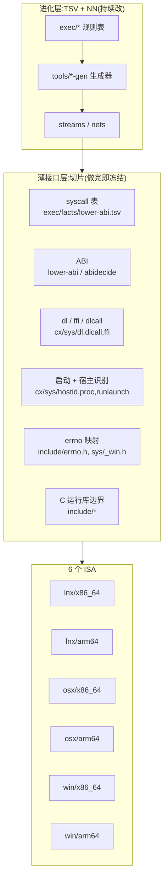

# 0.0.45 薄接口层(切片)完成度清单与冻结门(2026-11-06,omp-cc-opus;未提交)

依据:cc 转述的主人方针。切片是薄接口层(syscall + ABI + libdl/libffi + 进程启动/宿主识别 + errno + C 运行库边界),量少且固定，负责对接 6 个 ISA;逻辑都放在 TSV+NN(stream/net)。本文列出这一层"完成并冻结"之前还差什么，以及冻结之后用什么门拦住改动。
取证:scout SliceIface 只读收集(agent://SliceIface),关键几处由我抽查核对:`cx/sys/dl.cx:216-220`、`include/unisacc_ffi.h:133`、`exec/facts/pp-targets.tsv:6-7`、`include/sys/_win.h:37-44`、`.github/workflows/candidate-native.yml:127-129`。

## 分层

## 6×6 完成度

已有 = 表或代码存在且有批次实跑;未测 = 存在但没有该目标的实跑批次;缺口 = 不存在，或者实测是坏的。

| 目标 | syscall | ABI | dl/ffi | 启动+宿主 | errno | libc 边界 |
|---|---|---|---|---|---|---|
| lnx/x86_64 | 已有 `lower-abi.tsv:537-572`;`nets` | 已有 `lower-abi.tsv:537`;`nets` | 已有 `dl.cx:216-247`;`cx-l0-sys`、`cx-l0-sys-ffi` | 已有 `hostid.cx:5-6`、`host.cx:404-421`;`pp-targets-lines` | 已有 `errno.h:81-186`;`stream-e1-refusals-linux` | 已有 FTRIM 守卫;`library-cells`、`library-abi` |
| lnx/arm64 | 已有 `lower-abi.tsv:624-659`(poll 未选，见 `abi.tsv:200`) | 已有 `abidecide` 88 行;`stream-lower-target-lnx-arm64` | 未测(`cx-l0-sys` 平台写死 lnx/x86_64,`batches.tsv:263`) | 已有 CI-RUN-2 run PASS | 未测 | 未测 |
| osx/x86_64 | 已有 `lower-abi.tsv:711-746` | 已有;`stream-lower-target-osx-x86_64` | 未测(`dl.cx:236-245`,无 osx 批次) | 已有 `runlaunch.cx:13-22`;CI run PASS | 未测(`errno.h:20-79` 有 Apple 值) | 未测(只测容器 `formats-macho-pe`) |
| osx/arm64 | 已有 `lower-abi.tsv:798-833` | 已有;`stream-lower-target-osx-arm64` | 未测 | 已有;CI run PASS | 未测 | 未测 |
| win/x86_64 | 已有(winapi 门 `lower-abi.tsv:885-920`,IAT `enc-x86win.tsv`) | 未测(原生入口 argv 读错，根因候选 SA-POOL-SK) | **缺口**(`dl.cx:217-220` 返回 -ENOSYS;`unisacc_ffi.h:133` 在 win 上去掉了 uffi_call) | **缺口**(`pp-targets.tsv:6` run_launch=none,无 CreateProcess) | 未测(`_win.h:37-44` 只有 7 个码) | 未测(原生 --version 乱串) |
| win/arm64 | 已有(表 `lower-abi.tsv:972-1007`;`@abi` 段缺 exit_group 行) | 已有(表 `armwin-manifest`、`nativeabi/rules.tsv:6`),未测 | **缺口**(与 win/x86_64 相同) | **缺口**(run_launch=none;A3 派发没做) | 未测 | 未测 |

## 冻结前缺口(按依赖排序)

| # | 缺口 | 目标 | 落点 | 类 | 估计 | 依赖 |
|---|---|---|---|---|---|---|
| G4 | win 入口 argv/字符串错位 | win×2 | SA-POOL-SK:`exec/parse2/control-result.tsv` SA.* 段 | 表 | 5–20 行 | 无(P0,c45-2 第一项) |
| G1 | win dl/ffi 调用面:用 LoadLibrary/GetProcAddress 取代 ENOSYS;打开 uffi_call 的 Win64/ARM64 分派 | win×2 | `cx/sys/dl.cx:216-220`、`dlcall.cx:12-35`、`include/unisacc_ffi.h:133` | A(薄接口) | 40–80 行(复用 libffi 分派)/120–200 行(自研桥) | G4 |
| G3 | win 进程启动:CreateProcessW、-run 宿主启动 | win×2 | `cx/sys/proc.cx:273-281`、`runlaunch.cx:13-23`、`src/host.cx:369-373`;表 `pp-targets.tsv:6-7` | A | 150–250 行 + 表 2 行 | G4 |
| W2-A3 | win/arm64 单文件派发(IsWow64Process2 → 落盘第 6 片 → CreateProcessW) | win/arm64 | L0 `_os` 帮手 + `ape-pack` 头 | A | 80–150 行 | G3 |
| G2 | win errno 映射补全(ENOSPC 112、ENOTDIR 267、ENAMETOOLONG 206、EPIPE 109 等)并加批次 | win×2 | `include/sys/_win.h:37-44,66-79` | A | 12–20 行 + 批次 30–40 行 | G4 |
| G8 | `lower-abi.tsv` 的 `@abi` 段补 win/arm64 exit_group 行 | win/arm64 | 事实表 → 生成器 `--check` | 表 | 2 行 | 无 |
| G9 | 预定义 `_M_X64`/`_M_ARM64`(A2) | win×2 | `exec/pp/predefines.tsv:5-7` | 表 | 2 行 + 重生成 | 无 |
| G10 | PE DYNAMIC_BASE 但没有 .reloc | win×2 | `exec/facts/image-pe.tsv:11`(PE-DYNBASE 已在 c45-1 修为 0x8100,待最终安装确认) | 表 | 1 行 + 用例 | 已在途 |
| G5 | CI 中 win/arm64 恒为 NOT_RUN | win/arm64 | `candidate-native.yml:129` native_slice → 'yes',接 A3 产物 | CI | 5–15 行 | W2-A3 |
| G7 | lnx/arm64、osx 两目标的 dl/ffi/errno/libc 原生批次 | 3 目标 | `tests/batches.tsv:263,276` 平台列;CI 原生跑 `cx-l0-sys`、`cx-l0-sys-ffi`、`library-cells` | 测试 | 60–120 行 | 无 |
| — | tape-gap 回归只覆盖 2 个目标 | 6 目标 | `tools/check-tape-gap.cx:31-36` 扩到 6 个目标 | 测试 | 20–30 行 | 无 |

小计：薄接口代码(A 类)约 280–520 行;表约 10 行;测试和 CI 约 120–200 行。不在本层的项：流水线语义(RT-DEDUP-FIX、未定义引用检查、链接告警判据)归 B 类，迁到表和网。

宣告冻结的顺序:
1. lnx/x86_64 可以立即冻结，已有批次全覆盖。
2. lnx/arm64、osx×2 在 G7 的原生批次绿了就冻结。
3. win×2 在 G4 → G1/G3/G2 → (arm64 另加 A3、G5)全部绿了就冻结。

## 冻结门(最小方案)

做成工具 `tools/slice-freeze.cx`,配三件套:`tools/check-slice-freeze.cx`、用 `tools/register.cx` 登记批次 `slice-freeze`、在 prd 能力速查里补一行。

1. 冻结面清单:`tests/slice-freeze.tsv`,每行列出 `路径 | 冻结目标集 | 回归批次`。
   - 覆盖 `cx/sys/*`、`cx/core`、`cx/mem`、`cx/text`、`cx/driver`、`src/host.cx`、`include/unisacc_ffi.h`、`include/sys/_win.h`、`include/errno.h`。
   - 覆盖 `exec/facts/lower-abi.tsv`、`pp-targets.tsv`、`image-pe.tsv`。
2. 门判定:对比 `git diff --name-only <基线>..HEAD` 与清单。
   - 命中冻结路径的提交，必须同时满足:
     - a. 新增或修改至少一个 `tests/cases/` 回归用例，且在清单里登记的批次中;
     - b. 在提交说明或 `work/ledger.tsv` 里有一行 `SLICE-CHANGE <A/B>`,并写明 cc 批准;
     - c. 对未声明受影响的目标做切片字节对比：用 `release-build` 重出 `sl-*`,sha 与基线收据(`out/rc2-<rev>/` 下的 receipt)相同。
   - 三条都满足才 PASS。
3. 基线锚定在最近一次慢车道候选收据;每次换候选时，由慢车道更新基线(唯一写者)。
4. 这个门本身不放宽、不跳过：缺基线收据时报 UNMEASURED,不报 PASS。

先例：工作树守门(WAVE-DOMAIN 的 wt 门)在 s4 第一次抓到真实的测试违规(ILLEGAL-ACTION-WRITES-ROOT),说明"路径清单 + 会话信号"这种门在真实会话里有效。
