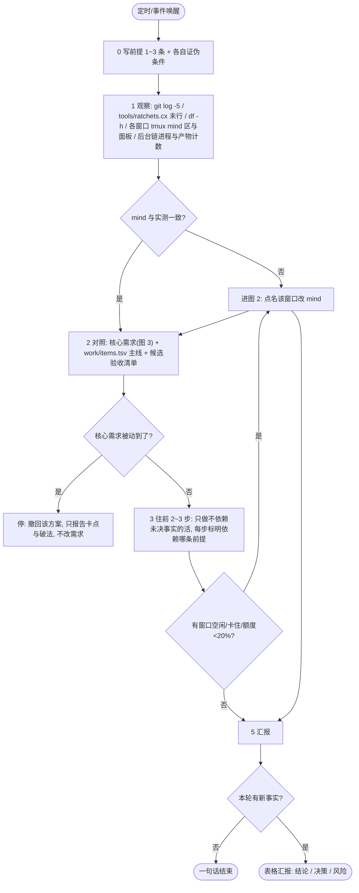
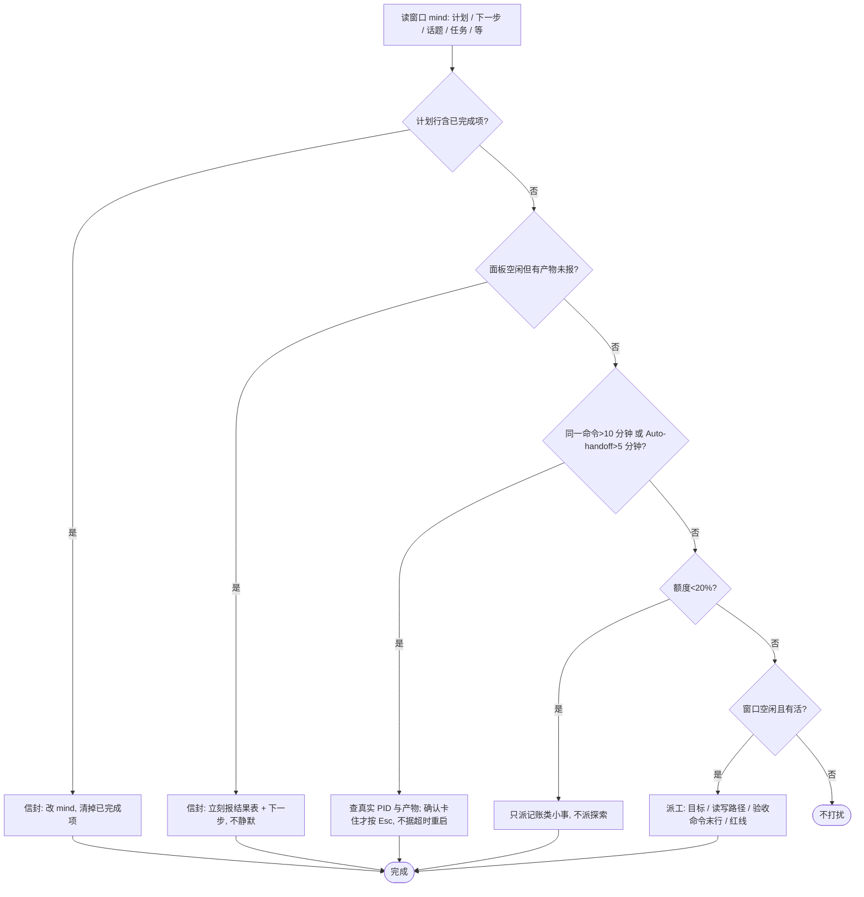
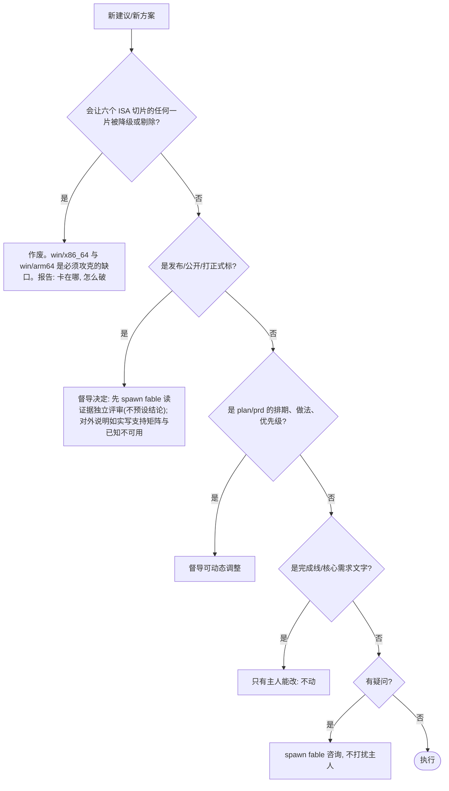
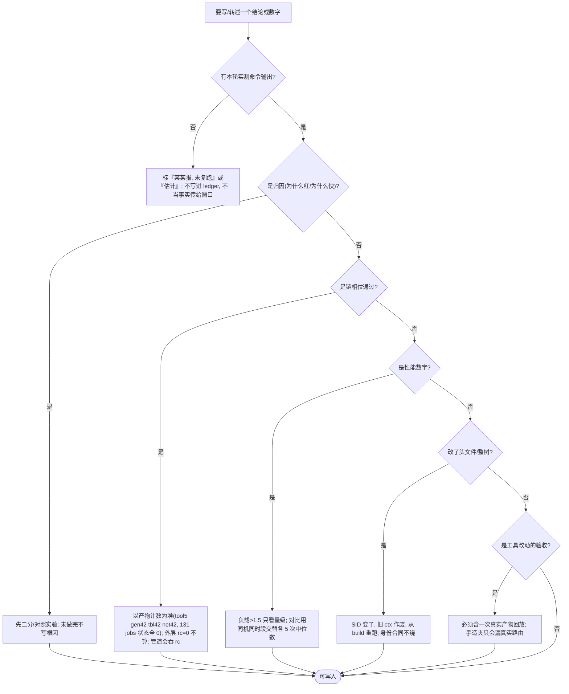
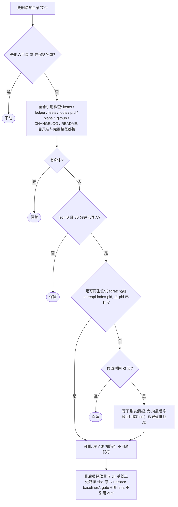
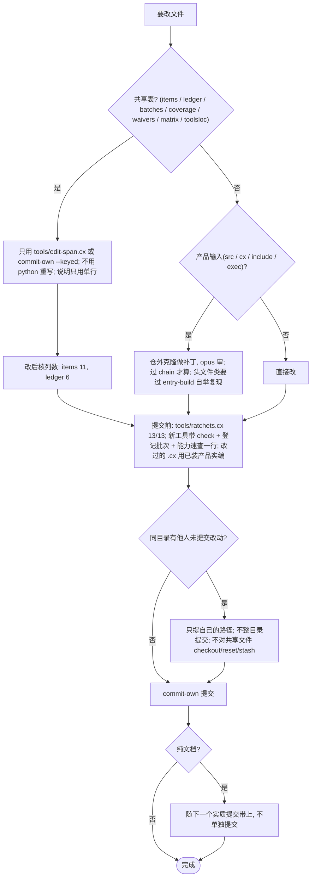

❯ /loop 7m 请积极主动与omp-cc-opus协同与推进:0.0.44发布与公开,开工0.0.45;要如下棋一样提前预见思考2至3步而不能干等,用mermaid-flowchart形式;
- 决策不了或有疑问的自己spawn subagent(model=fable)来咨询不要干扰用户,用户有想法自然会跟你说;
- 还要主动观察 omp-cc-opus, omp-bdy, omp-go 它们tmux window上的mind区域了解它们的mind内容;
- plan和prd 都有可能根据实际情况进行动态规划和调整的,不能太死板;

# goal-supervise-release：督导多窗口推进发布与下一版（流程图版）

用途：`/loop` 的复用提示词。来源是 2026-11-06 一整天的督导。非日期性文档，改了就原位改。每张图的节点都是可执行的判断或命令，不写口号。

## 提示词（粘贴即用）

```
按 plans/goal-supervise-release.md 的流程图 1 执行一轮；遇到分支进入对应图。每轮先写前提与证伪条件；没有新事实就一句话结束，不凑数。输出只用：结论一句 + 短表格（决策/结果/风险），段落≤400 字，数字须本轮实测或标“某某报，未复跑”。
```

## 图 1：一轮的主流程



## 图 2：窗口处置



## 图 3：核心需求与授权



## 图 4：证据闸门（数字、归因、链相位）



## 图 5：删除闸门



## 图 6：改共享文件与提交闸门



## 定时参数

- 间隔 10~15 分钟，或事件驱动（窗口报告/链相位完成才醒）；6 分钟太密，多数 tick 是“没有新问题”。
- 观察部分做成仓内 `.cx` 工具（待办 tools/observe-agents.cx，带 check 并登记），不把命令写死在提示词里。
