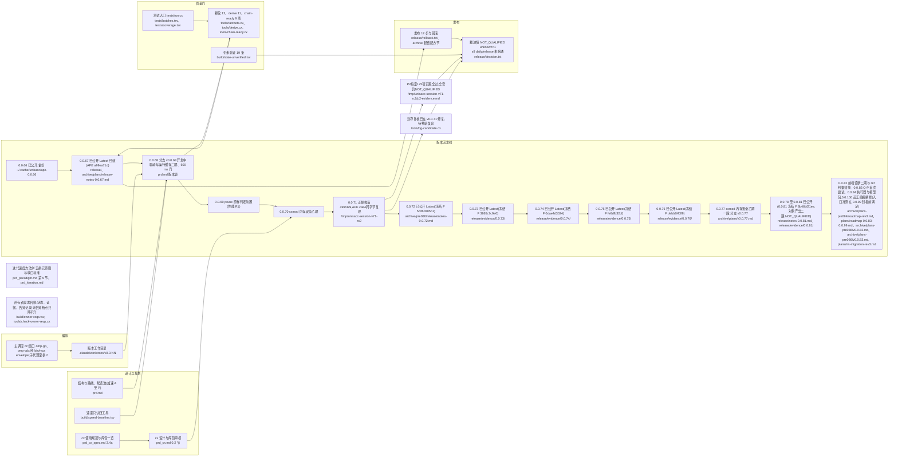

# prd_mempalace 地图段原文(2026-11-23 归档)

以下为 2026-11-23 从 prd_mempalace.md 地图段(原第 15-71 行)整段移出的流程图与节点原文,仅作历史。现行地图已改为指针(见 prd_mempalace.md 地图段)。

当前(2026-11-23 11:50):0.0.94 已公开(11:07,v0.0.94 Latest,APE e1408291,CI 45103237968,Y2 98f9f15532,本机 Root 已升 0.0.94);所有者裁定从 0.0.97 重新出发:0.0.95、0.0.96 两号跳过,下一发布 0.0.97 = main 上已有的 e2 重扫修复(原 0.0.95,ca2f342aab)加执行核每步成本(分支 v0.0.97,须先合入 main 再重跑 check-core-run-diff);进程生命周期(分支 v0.0.96)不进 0.0.97,做完按下一空号发;0.0.98 到 0.0.102 分支保留、暂停加活。发布方式改为'先证明再冻结':合入后后台出候选整链与预跑,冻结只登记已证明 APE(冻结行与 freeze_at 不进 APE,只有 release/candidate.tsv 版本串进,已核),冻结日只核对 SID 与 APE sha 并提升。入口:build/version-seq.tsv、research/2026-11-23/promote-not-rebuild.md、research/release-gotchas.md。

