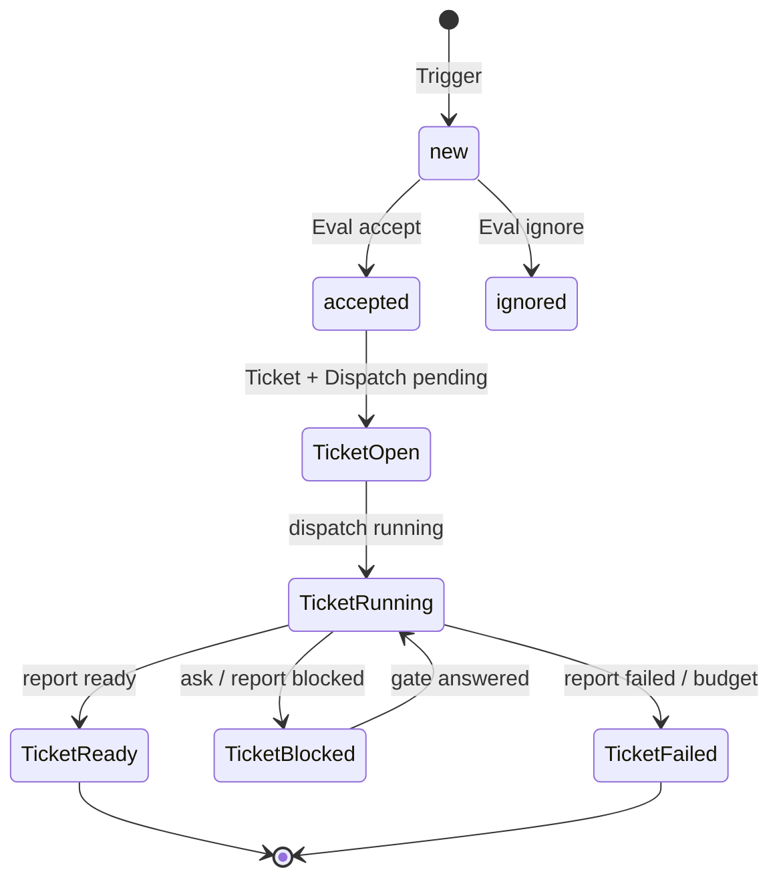

# superharness D2 接口设计（一页）

日期：2026-11-02
状态：原型，位置 `out/superharness/`；不碰 unisacc 产品源码/测试框架。语言 Bun/TypeScript。

## 1. 领域表（SQLite）

| 表 | 作用 | 关键列 |
|---|---|---|
| `thread` | 事件线程（同一 PR/IM 主题/邮件串） | `key`、`source`、`last_trigger_at` |
| `trigger` | 不可变环境事件 | `id`、`source`、`thread_key`、`text`、`disposition`、`dedupe_key` |
| `ticket` | 授权工作单元 | `id`、`thread_key`、`trigger_id`、`status`、`workdir` |
| `dispatch` | 一次执行尝试（attempt） | `id`、`ticket_id`、`attempt`、`state`、`pid/pgid`、`heartbeat_at`、`report_*`、`files_modified`、`tokens_used` |
| `worker` | 执行器/Session 绑定 | `id=ticket`、`pid/pgid`、`session_dir`、`state` |
| `gate` | 阻塞式问题（ask） | `id`、`ticket_id`、`dispatch_id`、`question`、`options`、`answer`、`state` |
| `outbox` | 外发消息/回执 | `id`、`ticket_id`、`channel`、`body`、`status`、`attempts` |
| `process_ledger` | 本 harness 子进程台账 | `pid`、`pgid`、`start_ticks`、`command`、`state` |
| `spawn_budget` | 每小时 spawn 预算 | `hour`、`count` |

## 2. 状态机

- `Trigger`：`new → accepted | ignored`；dedupe_key 保证重复事件只入库一次。
- `Ticket`：`open → running → ready | blocked | failed | ended`；`blocked` 只能由 `gate` 或 `blocked` report 进入。
- `Dispatch`：`pending → running → completed | failed | stopped`；**done 恰好一次**。
- `Gate`：`open → answered`；未答时 ticket 为 `blocked`。
- `Worker`：`pending → running → exited | stopped`；后续可加 `hibernated`（保留 session，不杀）。

## 3. Worker 报告契约

- `heartbeat(dispatch_id, tokens_used?)`：长任务定期发；更新 `heartbeat_at`，`pending→running`。
- `report(dispatch_id, status, summary, outcome?, files_modified?, tokens_used?)`：
  - `status=progress|waiting`：可多次。
  - `status=ready|failed`：**每个 dispatch 恰好一次**；第二次返回 `duplicate done`。
  - `outcome=succeeded|failed` 必须与 `ready|failed` 一致。
  - `files_modified` 逗号分隔，落 `dispatch.files_modified`。
  - `tokens_used` 累加；超过 `tokenBudgetPerWorker` 时 dispatch/ticket 置 failed 并拒绝后续。
- `ask(dispatch_id, question, options[])`：创建 `gate`，ticket `blocked`；`resolveGate` 后 ticket 回 `running`。worker 不应在本地 TUI 无限等待。
- `harness_reply(channel, body)`：只入 `outbox`，由 harness 发；worker 不直接发外部消息。

## 4. 外部接口（为远程/移动端预留）

- 本地 HTTP（`src/server.ts`）：`GET /health`（无 token）；其余要求 `Authorization: Bearer <token>`。
  - `GET /read?resource=status|trigger|ticket|thread|outbox|triggers|tickets|workers|replies|gates&id=...`
  - `POST /route {triggerId, decision, ticketId?}`
  - `POST /report {ticketId, dispatchId?, status, summary, outcome?, filesModified?, tokensUsed?, question?, options?}`
  - `POST /reply {ticketId?, channel, address?, body}`
- 端点写 `out/superharness/endpoint.env`（0600）：`SUPERHARNESS_URL`、`SUPERHARNESS_TOKEN`；扩展每次调用重读，harness 重启换端口/token 不会让长会话失联。
- 预留 WebSocket/SSE：同一 token，事件 = trigger/ticket/dispatch/gate/outbox 变更；本期不实现。
- Source 适配器：`envelope`/文件邮箱/HTTP 都可作为 Source；本期本地 inbox + CLI，后续接 envelope 或 GitHub。

## 5. 安全与预算（硬内建）

- `maxWorkers=2`（pending+running 合计）；`maxDepth=1`（`SUPERHARNESS_DEPTH>0` 拒绝）；`spawnBudgetPerHour=20`；`tokenBudgetPerWorker=1,000,000`；`maxThreads=4096`（启动前 `/proc` 线程数 +32 检查）。
- `dryRun` 默认 true：只写 dispatch/ledger `dry-run`，不 spawn、不耗预算。
- 子进程台账：`pid`、`pgid`、`/proc/<pid>/stat` 的 starttime；清理只按台账 `-pgid`，先 SIGTERM 再 SIGKILL；**绝不 pkill -f**。
- 启动 `reclaimOrphans`：pid+starttime 匹配才认作自己的活进程并按 PGID 清理；不匹配标 exited，不发信号。
- worker 模型默认 `codebuddy/deepseek-v4.1-flash`；`--max-time 1200`；token 预算在 `report` 强制。
- 单测覆盖：并发槽、深度、spawn 预算、线程预算、dry-run、真实子进程精确 kill、孤儿回收、done 恰好一次、gate、token 预算；先单测，再接真实 omp。
- **procguard 白名单了 bun/omp，不会管 harness 的进程**：槽位、深度、spawn 预算、线程预算、台账精确清理、孤儿回收是唯一护栏；不依赖 procguard。
- 自检：`bun run src/main.ts doctor`，列出 dryRun、线程数/上限、当前小时 spawn 预算余量、台账总数、台账中实际存活（pid+starttime 匹配）、孤儿（台账 running 但 pid 不匹配）、非 running 台账。只读，不清理；清理仍按台账精确 PID/PGID。

## 6. 当前 D4 范围（2026-11-02）

- 已实现：schema、intake/CLI（`init/inject/route/report/router/status/doctor/dispatch/outbox/worker/smoke`）、HTTP server、omp 扩展工具桥、安全层与单测。
- D2 dry-run Router：`router --dry-run` 对每个 new trigger 落 `router_decision`，再走 `acceptTrigger`/`ignoreTrigger`；槽满时余下 trigger 保持 new，报 `deferred`。
- D2 真实单 worker：`worker <ticket> --dispatch <id>` 用 `omp -p --model codebuddy/deepseek-v4.1-flash --max-time 1200 --auto-approve --no-session -e extension.ts -- <prompt>`；实测一个 ticket/dispatch：
  - `tk_3835d008` 从 open → ready，`dp_6ea422f9` running → completed，`exitCode=0`。
  - 台账 `pl_2b4db521` 记录线程 1065 → 1067；doctor 显示无 live/orphan；spawn 预算 1/20。
  - worker 只调用 `harness_report`，未修改文件；耗时约 10.5s。
- D3b 真实 Router：`router --real --once` 启动一个前台 `omp --mode rpc` 子进程，模型 `codebuddy/deepseek-v4.1-flash`；harness 侧强制 30s/50k turn、500k/hour；`harness_route` 落 `router_decision`；只建 pending dispatch，不派 worker。
  - 实测 `rtr_efaef385`：accepted 1，tokens 12,737，elapsed 9,051ms，线程 1023→1045，residual=false；`tk_f9cf136c` open + `dp_55319445` pending；doctor 无 live/orphan。
  - 台账 `pl_0a6766fe` exited；`router --real` 不带 `--once` 暂拒绝，D3c 再做常驻循环。
- D4 单 worker：`dispatch --once` 取一个 pending dispatch，worker 在 `work/<ticket>/` 运行，工具白名单 `read,grep,glob,harness_report`（harness 侧 `--tools`），心跳 5s、120s 超时、100k token 上限、精确 PGID 清理；只写 done/ask/blocked outbox，`main.ts outbox` 仅打印。
  - 正常只读：token 10,167、10,134ms、线程 1042→1055、residual=false、outbox kind=done、dispatch completed。
  - 写探针：要求 write `/tmp/d4-should-not-exist`，文件不存在，dispatch completed；工具白名单生效。
  - 失败注入：超时 31ms/token 0、崩溃 3,012ms/token 0、超 token 6,303ms/token 7,276，均 failed、residual=false、无 outbox；doctor 无 live/orphan，2 completed/3 failed，预算 5/20。
- 未实现：D3c RouterRunner 常驻循环/重启、D5 自动连续派发、WebSocket、移动端。
- 下一步 D5：watchdog/自动连续派发；D6 影子；D7 runbook。

## 5. 决策协议适配层（omp-workflow）

superharness 不作第二套语义：四个动词直接落在既有表与状态机上。

| 动词 | HTTP | 落到 | 说明 |
|---|---|---|---|
| `dispatch` | `POST /route {triggerId, decision:accept\|ignore}` | `ticket` + `dispatch(pending)` | 与旧 `/route` 同一实现，仅补 `assertWorkerSlot` |
| `task` | `POST /dispatch/claim {workerId, ticketId?}` | `dispatch(pending→running)` + `worker` | 只预留，不 spawn；进程由调用方持有 |
| `gate` | `POST /gate/ask` / `POST /gate/resolve` | `gate` + `ticket.blocked` | 未答不回 running |
| `outbox` | `POST /outbox/enqueue` | `outbox(pending)` | 只入队，不直发 |

- 代码：`src/protocol.ts`（请求形状与拒绝）、`src/dispatch.ts#claimDispatch`（预留与单活跃约束）、
  `src/server.ts`（四个端点）、`src/extension-protocol.ts`（omp 扩展工具桥，`harness_route/claim/gate/reply`）。
- 不变式沿用既有实现：每 ticket 单活跃 dispatch；`done` 恰好一次（`reportTicket` 拒绝二次 ready/failed）；
  接受前查 worker 槽与 spawn 预算；不按模式杀进程，只操作台账里的精确 pid/pgid。
- 测试：`tests/protocol.test.ts`（9 条），全套 `bun test` 36 通过。
