# 需求（强制）：`.cx` 逐步改造为无 `#include` 的模块 —— API 由 unisacc 提供，模块结构与内存安全参照 Rust

论文叙事归 **Paper D**（[research/paper-d-intent.md](../research/paper-d-intent.md)），不进 Paper A。

> 提出：2026-10-23（主人重申，强制要求，逐步实现）· 执行：cc · 依据：`docs/cx-spec-draft.md` v0.3、9df1417c（`.cx` 内置 prelude 已落地）

## 0. 一句话

`.cx` 是 POSIX C99 的**模块**：源码里不写 `#include`，所需 API 由 unisacc 按后缀内置提供（prelude，带版次）；模块间引用由 unisacc 解析（类 Rust `mod`/`use`），
内存安全由检查器而非新关键字保证。每一阶段都以**只降不升的棘轮闸**落地，不搞一次性大改。

## 1. 现状

2026-10-26：活树棘轮是 `tests/cxinclude.cx`（108 行 include，新文件必须为 0）、`tests/cxapis.cx`（strcpy/strcat/sprintf/gets 724 处，注释和字面量不计，只降不升）和 `tests/cxtrunc.cx`（被丢弃返回值、且长度可随输入变化的 snprintf/strncpy/memcpy；注释和字面量不计；新文件必须为 0，只降不升）。截断类首扫 4079。`examples/cx-lab/lex_table.cx` 的六处 `strncpy` 换成静态 `fit_field`（拷入上限并在终点写 NUL，与原先零填充数组上的 `strncpy` 字节相同）之后是 4073。同一输入仍打印 `lex_table: ok tokens=88 classes=9 rules=29`，token 文件字节不变。宿主 `gcc_cx`/`clang_cx` 用本仓库 `unisacc.com -cx-plan` 展开 `#pragma unisa use`，按每个单元自己的 include 列表交给系统 gcc/clang。产物仍是普通 C，不授予已检查身份。所有权检查仍是草案 §5，未实现。`examples/cx-lab/cxlab.h` 已改为同目录模块 `cxlab.cx`（enum 常量，导出 `cxlab_load_tsv` 与 `cxlab_timed_median`）；三个实验脚本改为 `use cxlab`。`cxlab_now` 没有搬过去：它依赖前奏尚未提供的 `sys/time.h`，而且没有调用者。`exec/`、`apps/csih`、`release/` 里剩余的 include 仍在原处。其后新增的 `tests/phase-timing.cx` 没有基线行，却带了 2 处 `strcpy` 和 4 处被丢弃的 `snprintf`，把无界闸和截断闸顶到 726 与 4077。这两处路径拷贝改为 `copy_fit`，收据文件名改为检查返回值的 `fit_print`，超长则具名拒绝。同一条 `ROOT PRODUCT ABS_OUT` 实测仍是 5 项断言、0 失败。基线文件当时没有改写，无界闸回到 724。截断回看原先只跳过空白，注释或标号后面的语句被漏计：`ujs/product/build-six.cx` 实际 4 处，旧基线记 3。修正后整树 4155 处（442 个文件，42 个文件上升，0 个下降），`tests/cxtrunc.tsv` 据此重写了一次。三元运算符的冒号仍然不算语句边界。在 `/* note */` 后面加一条真正的 `snprintf` 会让 `--check` 退出 1。include 仍是 108。2026-10-27：无界类再量是 724。`examples/cx-lab/lex_table.cx` 里给每个字节先写入 `OTHER` 的那处 `strcpy` 改为 `fit_field`（5 个字母写入 8 字节槽，和写入已清零数组的 `strcpy` 字节相同），活计数是 723。同一输入的 token 文件 sha256 仍是 `e43da7b4e70d7dc26ec0b44d2e1d66bd990b480be82642212e8e3dff28c393b2`，仍打印 `lex_table: ok tokens=88 classes=9 rules=29`。在该文件加回一条 `strcpy` 会让 `--check` 退出 1。截断闸仍是 4155。2026-10-27 模块边界：`tests/cxhost_mod.cx` 的导出函数调用一个文件内 `static` 助手。`unisacc.com -cx-interface` 只写出 `int cxhost_add(int a, int b);`，接口文本里没有这个助手。消费者 `tests/cxhost_main.cx` 在 `unisacc.com -run` 与宿主 `gcc_cx` 下都退出 42。只写一个不存在的模块名时，unisacc 按该名字拒绝，没有生成 gcc 二进制。gcc 产物仍是普通 C，不授予已检查身份。无界类本步改调用前是 461 个文件、757 处（基线 723，19 个文件高于基线）。没有把这次上升写进基线。`lex_table.cx` 里写入标识符种类 `ID` 的那处 `strcpy` 改为已有的 `fit_field`。同一输入的 token 文件 sha256 仍是 `e43da7b4e70d7dc26ec0b44d2e1d66bd990b480be82642212e8e3dff28c393b2`，仍打印 `lex_table: ok tokens=88 classes=9 rules=29`。同一时刻已经高于基线的其它 `strcpy`，以及被丢弃的截断调用，改成带长度的拷贝或检查返回值，使它们回到各自的基线行。无界基线据此只把 `lex_table.cx` 从 12 改到 11，整树 722。在该文件再加一条 `strcpy` 会让 `--check` 退出 1。截断类改调用前是 4210（基线 4155，17 个文件高于基线），收回之后仍是 4155，`tests/cxtrunc.tsv` 没有重写。include 仍是 108。2026-10-27 目录模块：`tests/cxdir_main.cx` 用 `#pragma unisa use cxdir.part`。现有旁边文件解析器把点号换成目录，读到 `tests/cxdir/part.cx`（模块名等于文件名 `part`）。`std` 与 `std.cx` 仍是前奏，没有第二条解析。提供方导出 `cxdir_fold`，它调用文件内 `static` 助手 `cxdir_pack`。`unisacc.com -cx-interface` 只写出 `int cxdir_fold(int a, int b);`，接口里没有这个助手。两次 `unisacc.com -run` 与两次宿主 `gcc_cx` 都退出 35，两次 gcc 编译退出 0。模块名 `cxdir.no_such_leaf` 在宿主编译之前被拒绝，stderr 含该名字和 `no file`，没有写出二进制。Node 与 Bun 的 `node_modules`、`package.json` 的 `exports`/`main` 和安装缓存仍不在这条解析器里。gcc 与 clang 的产物仍是普通 C，不授予已检查身份。无界类本步之前是 462 个文件、722 处；加上这两个 0 调用的新文件并改掉一处调用之后是 464 个文件、721 处（0 个高于基线）。`lex_table.cx` 写入种类 `NUM` 的 `strcpy` 改为已有的 `fit_field`。同一输入的 token 文件 sha256 仍是 `e43da7b4e70d7dc26ec0b44d2e1d66bd990b480be82642212e8e3dff28c393b2`，仍打印 `lex_table: ok tokens=88 classes=9 rules=29`。无界基线只把该行从 11 改到 10。截断类仍是 4155，`tests/cxtrunc.cx` 与 `tests/cxtrunc.tsv` 没有改。include 仍是 108。2026-10-27 两层 use：`tests/cxnest_main.cx` 只写 `#pragma unisa use cxnest.gate`，源码里没有内层名字。旁边文件解析器读到 `tests/cxnest/gate.cx`。外层模块自己 `#pragma unisa use leaf`，闭包把 `tests/cxnest/leaf.cx` 放进 `-cx-plan`。`std` 与 `std.cx` 仍是前奏。`-cx-interface` 对 gate 只写出 `int cxnest_fold(int a, int b);`，对 leaf 只写出 `int cxnest_leaf(int a, int b);`。文件内助手 `cxnest_wrap` 与 `cxnest_pack` 都不在接口里。外层助手调用内层导出。两次 `unisacc.com -run` 与两次 `gcc_cx` 都退出 36，两次 gcc 编译退出 0。模块名 `cxnest.no_such_leaf` 在宿主编译之前被拒绝，stderr 含该名字和 `no file`，没有写出二进制。Node 与 Bun 的 `node_modules`、`package.json` 的 `exports`/`main` 和安装缓存仍不在这条解析器里。gcc 与 clang 的产物仍是普通 C，不授予已检查身份。本步开始时无界类是 468 个文件、750 处（基线 721，4 个文件没有基线行），截断类是 4173（基线 4155，同样 4 个文件）。没有把这次上升写进基线。这 4 个文件收回之后，`lex_table.cx` 写入种类 `CHAR` 的 `strcpy` 改为已有的 `fit_field`。同一输入的 token 文件 sha256 仍是 `e43da7b4e70d7dc26ec0b44d2e1d66bd990b480be82642212e8e3dff28c393b2`，仍打印 `lex_table: ok tokens=88 classes=9 rules=29`。无界基线只把该行从 10 改到 9，整树 720。截断类仍是 4155，`tests/cxtrunc.cx` 与 `tests/cxtrunc.tsv` 没有改。include 仍是 108。

2026-10-27 互相 use：12:38 与 12:41 两次写入 `tools/hostseed-step-nativefirst.cx`、`tests/hostseed-chain-nativefirst.cx`、`tests/hostseed-independent-ident.cx`、`tests/hostseed-source-bind.cx` 的是本 cx 线。安全补丁停在 `8068f201e2`。`e3076abd21` 不回退。工具内容前缀仍是 `101ffc`。这四个路径的单写者窗口已经交给主线。`tests/cxcycle/ping.cx` 与 `tests/cxcycle/pong.cx` 互相 `#pragma unisa use`，没有 `#include`。两次 `unisacc.com -run` 与两次 `gcc_cx` 都在宿主编译之前拒绝，stderr 是 `module cycle: ping -> pong -> ping`，没有写出二进制。旁边文件解析器仍没有 `node_modules`、`package.json` 的 `exports` 和 Bun 安装缓存。gcc 与 clang 的产物仍是普通 C，不授予已检查身份。本步开始时无界类是 471 个文件、720 处，截断类是 4155。`lex_table.cx` 写入种类 `STR` 的 `strcpy` 改为已有的 `fit_field`。同一输入的 token 文件 sha256 仍是 `e43da7b4e70d7dc26ec0b44d2e1d66bd990b480be82642212e8e3dff28c393b2`，仍打印 `lex_table: ok tokens=88 classes=9 rules=29`。无界基线只把该行从 9 改到 8，加上两个 0 调用的新文件后整树 473 个文件、719 处。截断类仍是 4155，`tests/cxtrunc.cx` 与 `tests/cxtrunc.tsv` 没有改。include 仍是 108。

2026-10-27 前奏名：`tests/cxstd_main.cx` 写 `#pragma unisa use std` 和 `#pragma unisa use cxstd.mark`。`std` 是已有前奏，`-cx-plan` 列出 `tests/cxstd/mark.cx`，不为 `std` 列出文件。提供方导出 `cxstd_mark`，它调用文件内 `static` 助手 `cxstd_pack`。`-cx-interface` 只写出 `int cxstd_mark(int n);`，接口里没有 `cxstd_pack`。两次 `unisacc.com -run` 与两次 `gcc_cx` 都退出 11，两次 gcc 编译退出 0。`tests/cxstd_unknown.cx` 写 `std.absent`。unisacc 与 `gcc_cx` 都在宿主编译之前拒绝，stderr 含 `std.absent` 和 `unknown std module`，没有写出二进制。旁边文件解析器仍没有 `node_modules`、`package.json` 的 `exports` 和 Bun 安装缓存。gcc 与 clang 的产物仍是普通 C，不授予已检查身份。本步开始时无界类是 480 个文件、720 处（基线 719，`tests/pending/properties.cx` 没有基线行），截断类是 480 个文件、4172 处（基线 4155，`tests/pending/properties.cx`、`tools/p3-member-consume.cx`、`tools/p3-nn-asm-provenance.cx` 没有基线行）。没有把这次上升写进基线。这三处收回到 0 之后，`lex_table.cx` 回退路径上的 `strcpy(action, "bad")` 改为已有的 `fit_field(action, "bad", 23)`。同一输入的 token 文件 sha256 仍是 `e43da7b4e70d7dc26ec0b44d2e1d66bd990b480be82642212e8e3dff28c393b2`，仍打印 `lex_table: ok tokens=88 classes=9 rules=29`。无界基线只把该行从 8 改到 7，基线合计仍是 718，没有改写。干净树是 480 个文件：include 108 行；无界活计数 710（基线合计 718，0 个文件高于基线）；截断活计数 4138（基线合计 4155，0 个文件高于基线）。合计里的差额来自尚未进入该树的 `tests/hostseed-ancestry-controls.cx` 与 `tools/identity-material.cx` 两行。`tests/cxtrunc.cx` 与 `tests/cxtrunc.tsv` 没有改。`tests/pending/properties.cx` 与 `tools/p3-nn-asm-provenance.cx` 收回到 0 后进入提交，干净树不再有无基线行。`tools/p3-member-consume.cx` 有三行 `#include`，不能抬 include 基线，本步没有提交它。

2026-10-27 库成员批：`tests/p3-library-members.cx` 在 `5fd85c0130` 进入树，截断基线没有它的行。干净树因此失败：5 处被丢弃的调用（一处变长 `memcpy`，四处带增长格式的 `snprintf`）。这五处改为检查返回值的 `snprintf`，或按字节拷贝已有长度。无参数运行仍以 `usage ROOT PACK_CTX NEW_ABS_OUT` 拒绝，退出 2。基线没有改写。干净树是 481 个文件：include 108；无界活计数 710（基线合计 718，0 个高于基线）；截断活计数 4138（基线合计 4155，0 个高于基线）。gcc 与 clang 的产物仍是普通 C。

2026-10-27 前奏重跑：`tests/cxstd/mark.cx` 的 `-cx-interface` 只写出 `int cxstd_mark(int n);`，文件内助手 `cxstd_pack` 不在接口里。`tests/cxstd_main.cx` 的 `-cx-plan` 列出 `tests/cxstd/mark.cx`，不为前奏 `std` 列出文件。两次 `unisacc.com -run` 与两次 `gcc_cx` 都退出 11，两次 gcc 编译退出 0。`tests/cxstd_unknown.cx` 的 `std.absent` 在宿主编译之前被拒绝，stderr 含 `unknown std module`，没有写出二进制。旁边文件解析器仍没有 `node_modules`、`package.json` 的 `exports` 和 Bun 安装缓存。gcc 与 clang 的产物仍是普通 C。

2026-10-27 前奏重跑的棘轮：干净树 `48b5be2a4c` 上 include、无界、截断各退出 0，没有文件高于自己的行。481 个 `.cx` 文件，include 108 行（基线 108）；无界活计数 710（基线合计 718）；截断活计数 4138（基线合计 4155）。基线没有改写。旁边文件解析器仍没有 `node_modules`、`package.json` 的 `exports` 和 Bun 安装缓存。gcc 与 clang 的产物仍是普通 C。

2026-10-27 负例两文件：`tests/negative-diagnostics.cx` 与 `tests/negative-model-loader.cx` 在 `ebe891507c` 进入树，截断基线没有它们的行。诊断文件有 9 处被丢弃、格式会增长的 `snprintf`（27、28、66 行两处、70、76、79、81、103）。装载文件有 9 处同样的 `snprintf`（30、31、60、66 行两处、70、73、81、146）和一处变长 `memcpy(b, ape, apen)`。每处 `snprintf` 改为留下返回值，长度不够则 `die`。变长拷贝改为按已检查的 `apen` 逐字节写入，再异或一个字节。`path` 里已经检查过的 `snprintf`，以及装载文件里赋给 `n` 的那次 `snprintf`，没有改。夹具源字符串里的 `#include` 与 `strcpy` 没有改。基线没有改写，也没有为这两个文件加行。干净树在 `7d26c0a9f7` 上、只含这两处改动，include、无界、截断各跑两次，都退出 0，没有文件高于自己的行。483 个 `.cx` 文件，include 108 行（基线 108）；无界活计数 710（基线合计 718）；截断活计数 4138（基线合计 4155）。旁边文件解析器仍没有 `node_modules`、`package.json` 的 `exports` 和 Bun 安装缓存。gcc 与 clang 的产物仍是普通 C。

2026-10-27 负例回跑：`28a2912821` 之后，`tests/cxstd/mark.cx` 的 `-cx-interface` 仍只写出 `int cxstd_mark(int n);`，文件内助手 `cxstd_pack` 不在接口里。`tests/cxstd_main.cx` 的 `-cx-plan` 列出 `tests/cxstd_main.cx` 与 `tests/cxstd/mark.cx`，不为前奏 `std` 列出文件。两次 `unisacc.com -run` 与两次 `gcc_cx` 都退出 11，两次 gcc 编译退出 0。`tests/cxstd_unknown.cx` 的 `std.absent` 在宿主编译之前被拒绝，stderr 含 `unknown std module`，没有写出二进制。同一候选 `7a0cf28bba67f2394abaf783b886baeafe0687f4590c392dbd8611212a0f5f77` 上，`negative-diagnostics` 打印 `assertions=193 failed=0 known_gaps=3 archived_cases=17`，`negative-model-loader` 的 core 打印 `assertions=99 failed=0`。两批 `BATCH_RUN` 都是 PASS，rc 0，stderr 为空。基线没有改写。旁边文件解析器仍没有 `node_modules`、`package.json` 的 `exports` 和 Bun 安装缓存。gcc 与 clang 的产物仍是普通 C。

2026-10-27 调度回退：干净树 `6d9d5315a4` 的起点是 483 个 `.cx` 文件，include 108，无界活计数 710（基线合计 718），截断活计数 4138（基线合计 4155）。三闸退出 0，没有文件高于自己的行。`examples/cx-lab/lex_table.cx` 回退路径上的 `strcpy(next, "DISPATCH")` 改为已有的 `fit_field(next, "DISPATCH", 15)`。同一输入的 token 文件 sha256 仍是 `e43da7b4e70d7dc26ec0b44d2e1d66bd990b480be82642212e8e3dff28c393b2`，777 字节，仍打印 `lex_table: ok tokens=88 classes=9 rules=29`。无界活计数因此是 709，该文件低于自己的基线行。截断仍是 4138。两次复测都退出 0，没有文件高于自己的行。基线没有改写，`tests/hostseed-ancestry-controls.cx` 与 `tools/identity-material.cx` 的旧行还在。`tests/cxstd_main.cx` 写 `#pragma unisa use std` 和 `#pragma unisa use cxstd.mark`。`-cx-interface` 只写出 `int cxstd_mark(int n);`，助手 `cxstd_pack` 不在接口里。`-cx-plan` 列出 `tests/cxstd/mark.cx`，不为前奏 `std` 列出文件。两次 `unisacc.com -run` 与两次 `gcc_cx` 都退出 11，两次 gcc 编译退出 0。`std.absent` 在宿主编译之前被拒绝，stderr 含 `unknown std module`，没有写出二进制。旁边文件解析器仍没有 `node_modules`、`package.json` 的 `exports` / `main` / `imports`、`bun` 条件和 Bun 安装缓存。gcc 与 clang 的产物仍是普通 C。

2026-10-27 裸名拒绝：干净树 `d3735fc09b` 的起点是 483 个 `.cx` 文件，include 108，无界活计数 709（基线合计 718），截断活计数 4138（基线合计 4155）。三闸退出 0，没有文件高于自己的行。`examples/cx-lab/lex_table.cx` 里 `strcpy(state, nextst)` 改为已有的 `fit_field(state, nextst, 15)`。同一输入的 token 文件 sha256 仍是 `e43da7b4e70d7dc26ec0b44d2e1d66bd990b480be82642212e8e3dff28c393b2`，777 字节，仍打印 `lex_table: ok tokens=88 classes=9 rules=29`。无界活计数因此是 708。截断仍是 4138。两次复测都退出 0，没有文件高于自己的行。基线没有改写。`tests/cxstd_main.cx` 写 `#pragma unisa use std` 和 `#pragma unisa use cxstd.mark`。`-cx-interface` 只写出 `int cxstd_mark(int n);`，助手 `cxstd_pack` 不在接口里。`-cx-plan` 列出 `tests/cxstd/mark.cx`，不为前奏 `std` 列出文件。两次 `unisacc.com -run` 与两次 `gcc_cx` 都退出 11，两次 gcc 编译退出 0。`std.absent` 在宿主编译之前被拒绝，stderr 含 `unknown std module`，没有写出二进制。`archive/testing-c43-legacy/tests/cx/n1.cx` 写 `#pragma unisa use nosuch`。unisacc 与 `gcc_cx` 都在宿主编译之前拒绝，stderr 含 `nosuch` 和 `no file`，没有写出二进制，旁边也没有 `node_modules`。旁边文件解析器仍没有 `node_modules` 爬升、`package.json` 的 `exports` / `main` / `imports`、`bun` 条件和 Bun 安装缓存。gcc 与 clang 的产物仍是普通 C。

2026-10-27 格式批收回：已提交树 `de91e4c6af` 在仓外克隆上量过，没有在共享检出上 stash、pop、clean、reset 或 checkout 他人路径。486 个 `.cx` 文件。include 108，退出 0。无界活计数 708（基线合计 718），退出 0，没有文件高于自己的行。截断活计数 4154（基线合计 4155），退出 1：`tests/formats-elf-ape.cx` 有 16 处被丢弃的调用，且没有基线行。其中 4 处是已检查长度的变长 `memcpy`，12 处是格式会增长且被丢弃的 `snprintf`。`memcpy` 改为按该长度逐字节写入。`snprintf` 留下返回值，放不下则 `die`。源文件没有 `#include`。同一产品上，改前克隆与改后的 `unisacc.com -run`、以及 `gcc_cx` 编出的二进制，都打印 `FORMATS_ELF_APE assertions=68 failed=0`，退出 0。两次复测：include 108，无界 708，截断 4138，都退出 0，没有文件高于自己的行。基线没有改写。`tests/cxtrunc.cx` 没有改。四条 hostseed 路径没有改。旁边文件解析器仍没有 `node_modules` 爬升、`package.json` 的 `exports` / `main` / `imports`、`bun` 条件和 Bun 安装缓存。gcc 与 clang 的产物仍是普通 C。

2026-10-27 前奏与裸名重跑：`tests/cxstd_main.cx` 写 `#pragma unisa use std` 和 `#pragma unisa use cxstd.mark`。`-cx-interface` 只写出 `int cxstd_mark(int n);`，助手 `cxstd_pack` 不在接口里。`-cx-plan` 列出 `tests/cxstd/mark.cx`，不为前奏 `std` 列出文件。两次 `unisacc.com -run` 与两次 `gcc_cx` 都退出 11，两次 gcc 编译退出 0。`std.absent` 在宿主编译之前被拒绝，stderr 含 `unknown std module`，没有写出二进制。`archive/testing-c43-legacy/tests/cx/n1.cx` 写 `#pragma unisa use nosuch`。unisacc 与 `gcc_cx` 都在宿主编译之前拒绝，stderr 含 `nosuch` 和 `no file`，没有写出二进制，旁边也没有 `node_modules`。同一已提交树上 include 108、无界 708、截断 4138。基线没有改写。旁边文件解析器仍没有 `node_modules` 爬升、`package.json` 的 `exports` / `main` / `imports`、`bun` 条件和 Bun 安装缓存。gcc 与 clang 的产物仍是普通 C。

2026-10-23 实测：

- 已有：`.cx` 单元自动前置 `cx.h`（产品 `exec/c/compiler.c` 与经典参考 `src/front_parse.c` 均已实现；转发单元不带 prelude）。
- 仓内 77 个 `.cx`：`#include <cx.h>` 64 处（已冗余）；系统头 unistd/stdint/sys/stat/fcntl/dirent/stdio/string/stdlib/errno/limits/ctype/sys/types 共 ~70 处；
  本地头 `cxlab.h`×3、`snapbase.h`×2、`../exec/c/codec.h`×2、`../exec/c/bind.h`×1；`.cx` 文本包含 `.cx`×1（`librarycallbacklowercheck.cx`）。
- flownet W0 实测（`research/flownet-w0-feasibility.md`）：多单元 `-run A.cx B.cx` 可作模块引用；**未定义的外部对象被当作全零读取而不拒绝**（未定义函数则在首调用处具名拒绝 rc127）——这是内存安全缺口。

## 2. 阶段（每阶段独立 commit、独立棘轮）

| 阶段 | 内容 | 闸 | 动产品字节? |
|---|---|---|---|
| CX0 | 删除冗余 `#include <cx.h>` 及 prelude 已提供的系统头；新增 `tests/cxinclude.cx` + `tests/cxinclude.tsv`（模块 include 只降不升；新 `.cx` 必须 0）。`--write` 遇到新行或更高计数就拒绝落盘。`include/` 与 `tools/cxcc-hostinc/` 是对接 libc/POSIX 的单元，可以用 `#include`，不进模块棘轮。短记见 [cx-include-lint.md](cx-include-lint.md) | `cxinclude` 硬拒新债 | 否 |
| CX1 | prelude 补齐 `.cx` 实际所需 POSIX API（stdint/fcntl/errno/limits/ctype/sys/types 等），版次化（`cx edition`）；随后删除对应系统头 | 棘轮下降 + 产品重建 + 28/28 不退 | 是（`include/cx.h`） |
| CX2 | 模块引用：`#pragma unisa use <mod>`（spec §2）由 unisacc 解析——加入该模块单元、按其非 static 定义生成接口（CXIF）注入原型；取代本地头与 `.cx` 文本包含 | 本地头 include 归零；去掉 use 后必须具名红 | 是（前端） |
| CX2b | 包清单 `cxpack.tsv`：模块名钉到路径（点即目录）；公开名字是该文件非 static 定义的有序子集。`tests/cxpack.cx` 拒绝未知 `use`、跨模块调用未公开的名字、static 列入公开集、名字与路径不一致。短记见 [cx-pack.md](cx-pack.md) | 正例 `-run` 退出 5；四负例具名红 | 否 |
| CX2c | CXIF v0 文本文法：banner、守卫、类型、原型、`#endif`。`tests/cxif.cx` 对现场 `-cx-interface` 做检查。短记见 [cxif-v0.md](cxif-v0.md) | 两份现场接口通过；四份坏文本具名红 | 否 |
| CX3 | 严格模式：`.cx` 中 `#include` 为具名拒绝；未定义外部对象具名拒绝（修 W0 缺口） | 负例闸 | 是 |
| CX4 | 内存安全：检查器闸——禁无界 API（strcpy/strcat/sprintf/gets…）、prelude 提供带长度的切片/缓冲 API；所有权/借用规则按 spec §5 逐条以棘轮引入 | 违规计数棘轮 | 视规则 |

CX2/CX3 设计已采纳（cc 2026-10-23）：`research/cx2-module-design.md`——`#pragma unisa use NAME` 只在使用者所在目录解析（点号=子目录，`std.*` 保留），
CXIF 由单趟扫描导出非 static 函数原型与类型、按哈希写临时头并作为该单元的强制 include（`src/cxmod.c` 共享），`-cx-plan`/`-cx-interface` 两个旗标驱动系统 cc 对拍；
CX3 分三步：`.cx` 中 `#include` 拒绝 → `extern` 拒绝（prelude 接管 `environ`，以单文件规则封住「未定义外部对象读零」）→ 调用未声明函数拒绝（设计期实测：跨单元隐式声明调用目前被接受）。
CX2a = 共享 `src/cxmod.c` + 两端前端接线 + 两旗标 + `tests/flownetw0.cx` 改 `use`，闸 11 负例 + 9 正例（含 `.c` 输出逐字节不变）。

顺序：CX0 → CX2a → CX1 → CX2 迁移 → CX3；CX2b 包清单与 CX2c 的 v0 文法检查都不动产品字节；CX4 的 lint 棘轮可与 CX1 起并行。CX1 起的产品改动与 0.0.43 收口（ruling R10）冲突时，归 0.0.44；CX0、CX2b、CX2c 与 CX4 闸本身不动字节，0.0.43 内即可落。

### CX4 首批规则（实例驱动，2026-10-23）

1. **静默截断**：`snprintf`/`strncpy`/`memcpy` 写入固定大小数组且长度取决于输入，而返回值未检查（或截断后继续使用）——flownet 适配器 `emit_wat` 的 `char t[512]` 把 ≥500 位小数的字面量截成坏 WAT（W2fix 验证者实测），属此类。规则：`.cx` 里此类写入必须用 prelude 的可增长缓冲，或检查返回值并具名拒绝。活闸 `tests/cxtrunc.cx`（2026-10-26）：只计返回值被丢弃的调用；`snprintf`/`strncpy` 还要求长度参数是十进制常量或 `sizeof`，且来源可随输入变长；`memcpy` 在长度不是这类常量时计入，包括恰好拷满的调用。首扫 4079，`lex_table.cx` 六处改为 `fit_field` 后 4073。
2. **无界 API**：`strcpy`/`strcat`/`sprintf`/`gets` 计数只降不升。
3. **未定义外部对象读零**（CX3b 的 `extern` 拒绝封住）。

## 3. 红线

1. 不为迁就 `.cx` 改 C99 语义：`.c` 单元行为逐字节不变。
2. 每步 ≤60s；棘轮只降不升；新增 `.cx` 一律 0 include。
3. 系统 cc 仍是差分 oracle：`cc -x c -include include/cx.h` 路径须保持可用。

## 4. 2026-10-29 阶段边界

`cx/runtime/routespan.cx` 只选包路线上要跑的阶段，没有 `#include`。产品 `compiler.c` 定义 `UNISA_CX_ROUTESPAN` 后调用它。膨胀、计时和 `execute` 仍在 `exec/c/run.c`。`sh ./unisacc.com tools/check-compiler-units.cx` 两次退出 0，都打印 `CHECK_COMPILER_UNITS failed=0`。这不是产品安装、六目标或 `--all`。

## 5. 2026-10-29 阶段字节与交接

`cx/runtime/routestep.cx` 判定版本 3 的膨胀、CRC 和 `UNINETB1N`，并交出本阶段的输入缓冲。产品 `compiler.c` 定义 `UNISA_CX_ROUTESTEP` 后调用它。分配、`loadbytes`、计时和 `execute` 仍在 `exec/c/run.c`。`sh ./unisacc.com tools/check-compiler-units.cx` 又两次退出 0，两次 stdout 相同，都打印 `CHECK_COMPILER_UNITS failed=0`。这不是产品安装、六目标或 `--all`。

## 6. 2026-10-29 阶段计时行

`cx/runtime/routetime.cx` 生成 `runroute_range` 的两行 `RR_TIME`，并计算两端时钟的纳秒差。产品 `compiler.c` 定义 `UNISA_CX_ROUTETIME` 后调用它。读环境和 `clock_gettime` 仍在 `exec/c/run.c`。放不下的行仍走原来的 `fprintf`。`sh ./unisacc.com tools/check-compiler-units.cx` 又两次退出 0，两次 stdout 相同，都打印 `CHECK_COMPILER_UNITS failed=0`。这不是产品安装、六目标或 `--all`。`loadbytes` 和 `execute` 仍在 C。

## 7. 2026-10-29 模型装载顺序

`cx/runtime/modelload.cx` 的 `ml_load` 排产品 `loadbytes` 的解码、取走、绑定和失败文案。字节解析仍在 `cx/runtime/model_decode.cx`。产品 `compiler.c` 定义 `UNISA_CX_MODELLOAD`。未定义该宏的路径仍走原来的 `loadbytes`。`sh ./unisacc.com tools/check-compiler-units.cx` 又两次退出 0，两次 stdout 相同，都打印 `CHECK_COMPILER_UNITS failed=0`。这次检查注入解码和绑定，没有再解一张模型表。这不是产品安装、六目标或 `--all`。当时预算门和状态行还在 C。

## 8. 2026-10-29 执行门与状态行

`cx/runtime/runexec.cx` 的 `ex_budget` 和 `ex_lines` 接产品 `execute` 的步数预算门和三条状态行。产品 `compiler.c` 定义 `UNISA_CX_RUNEXEC`。`core_run` 仍在 C。未定义该宏的路径仍走原来的预算分支和 `fprintf`。`sh ./unisacc.com tools/check-compiler-units.cx` 又两次退出 0，两次 stdout 相同，两次 stderr 相同，都打印 `CHECK_COMPILER_UNITS failed=0`。这次检查直接调用这两个函数，没有跑 `core_run`。这不是产品安装、六目标或 `--all`。

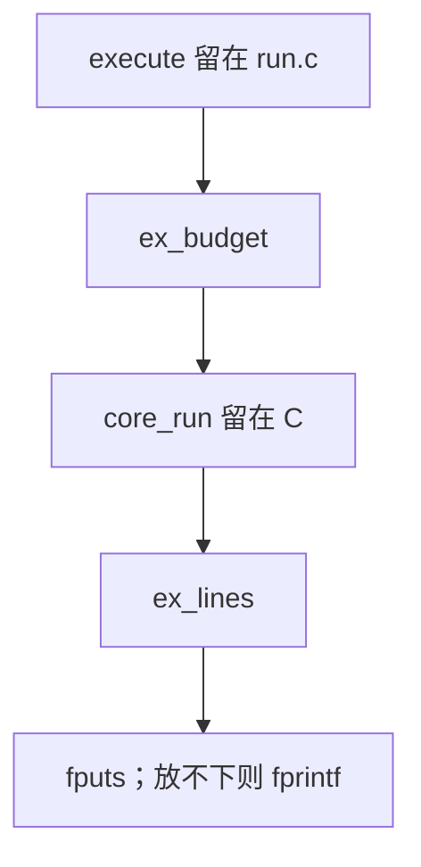

## 9. 2026-10-29 阶段槽交接

`cx/runtime/stagehandoff.cx` 的 `sh_apply` 接 `rt_open` 之后的绑定或装入顺序。产品仍定义 `UNISA_CX_ROUTESTEP`，没有新宏。未定义该宏的路径仍走原来的 C 分支。`sh ./unisacc.com tools/check-compiler-units.cx` 又两次退出 0，两次 stdout 相同，两次 stderr 相同，都打印 `CHECK_COMPILER_UNITS failed=0`。这次检查注入回调，没有跑 `loadbytes`。这不是产品安装、六目标或 `--all`。

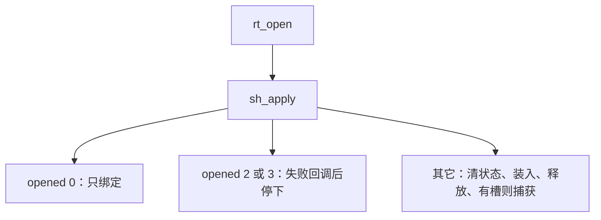

## 10. 2026-10-29 模型视图拷贝

`mv_clear`、`mv_capture`、`mv_bind` 写在已有的 `cx/runtime/model_lifetime.cx`。产品仍定义 `UNISA_CX_MODEL_LIFETIME`。构造表里本来就有这个模块，这次没有加参数。未定义该宏的路径仍走原来的逐字段赋值。`sh ./unisacc.com tools/check-compiler-units.cx` 又两次退出 0，两次 stdout 相同，两次 stderr 相同，都打印 `CHECK_COMPILER_UNITS failed=0`。这次检查直接调用这三个函数，没有跑 `loadbytes`。这不是产品安装、六目标或 `--all`。

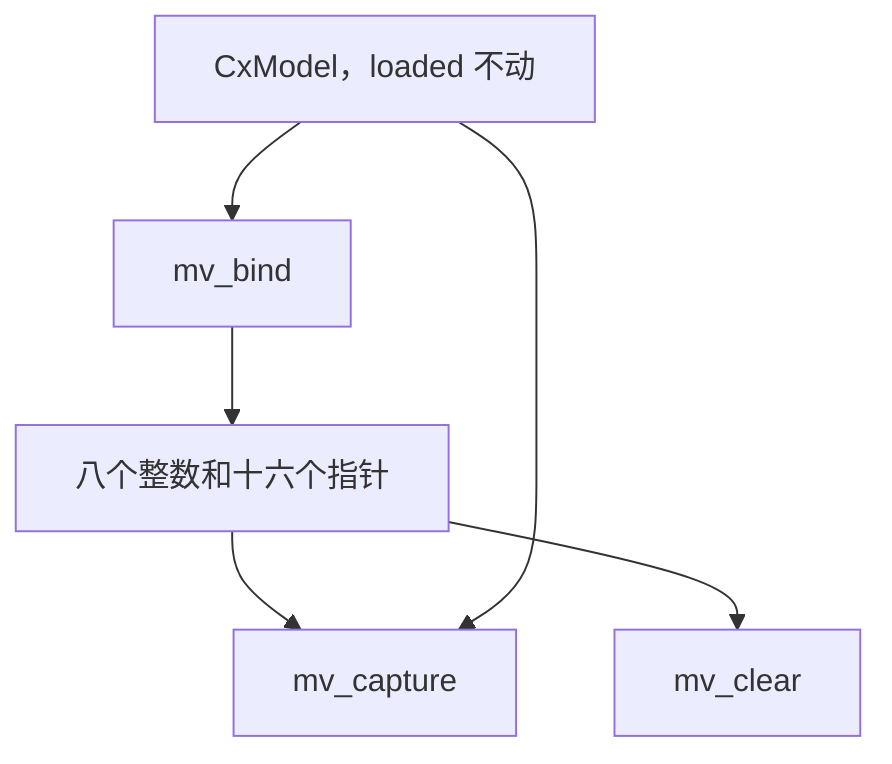

## 11. 2026-10-29 文件打开与读取判定

`cxsf_open_reason`、`cxsf_open_gate`、`cxsf_open_line`、`cxsf_read_cap`、`cxsf_read_grow`、`cxsf_read_take` 写在已有的 `cx/runtime/source_frame.cx`。产品仍定义 `UNISA_CX_SOURCE_FRAME`。构造表里本来就有这个模块，这次没有加参数。`io_open`、`io_read`、`io_close`、`io_stamp` 留在 `exec/c/run.c`。未定义该宏的路径仍走原来的打开和读取循环。`sh ./unisacc.com tools/check-compiler-units.cx` 又两次退出 0，两次 stdout 相同，两次 stderr 相同，都打印 `CHECK_COMPILER_UNITS failed=0`。这次检查直接调用这六个函数，没有跑 `io_open` 或 `io_read`。这不是产品安装、六目标或 `--all`。宿主切片空指针下标仍是 APE 54、本机 53。这次没有实跑 hostseed。

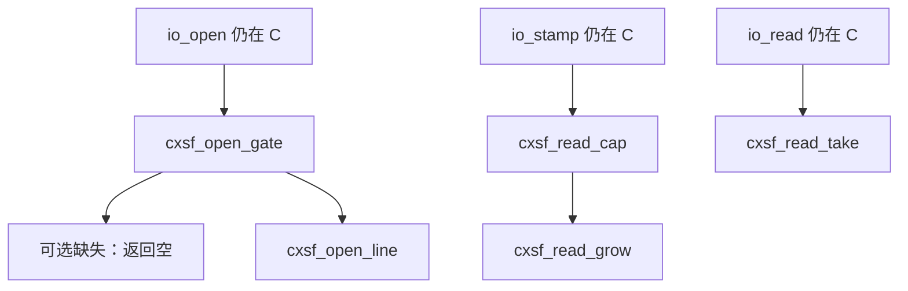

## 12. 2026-10-29 包打开行

`cxsf_package_gate` 写在已有的 `cx/runtime/source_frame.cx`。产品仍定义 `UNISA_CX_SOURCE_FRAME`。`fd < 0` 走 `cxsf_open_line` 的空原因行，文本是 `run: cannot open PATH` 加换行。没有可选缺失，也不附加原因。`io_open` 留在 `exec/c/run.c`。未定义该宏的路径仍直接 `fprintf`。`sh ./unisacc.com tools/check-compiler-units.cx` 又两次退出 0，两次 stdout 相同，两次 stderr 相同，都打印 `CHECK_COMPILER_UNITS failed=0`。这次检查直接调用 `cxsf_package_gate` 和 `cxsf_open_line`，没有跑 `io_open`。这不是产品安装、六目标或 `--all`。宿主切片空指针下标仍是 APE 54、本机 53。这次没有实跑 hostseed。

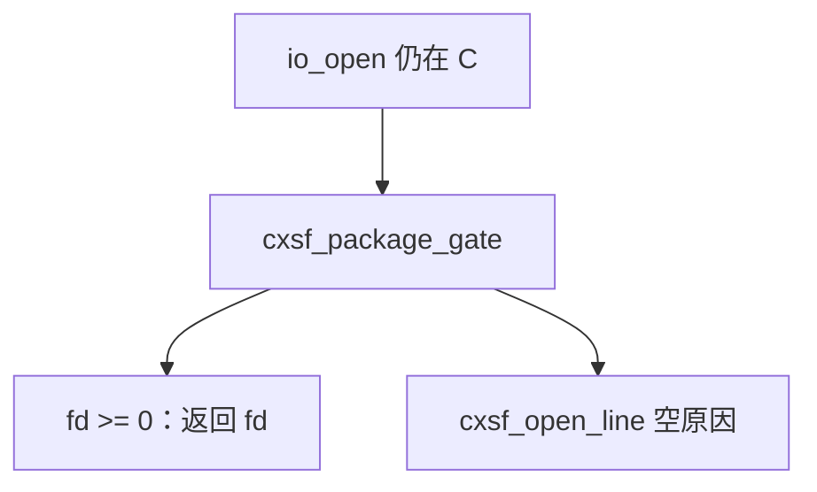

## 13. 2026-10-29 包缓存判定

`cxpl_stamp_match`、`cxpl_reuse`、`cxpl_settle`、`cxpl_slot` 写在已有的 `cx/runtime/package_lifetime.cx`。产品仍定义 `UNISA_CX_PACKAGE_LIFETIME`。构造表里本来就有这个模块，这次没有加参数。库在 `UNISA_PACKAGE_CACHE` 下调用命中和收尾。命令行产品不定义 `UNISA_PACKAGE_CACHE`，仍每次解析。槽选择两边都走 `cxpl_slot`。打开、戳记、解析和释放留在 `exec/c/run.c`。未定义 `UNISA_CX_PACKAGE_LIFETIME` 的路径仍走原来的比较。`sh ./unisacc.com tools/check-compiler-units.cx` 又两次退出 0，两次 stdout 相同，两次 stderr 相同，都打印 `CHECK_COMPILER_UNITS failed=0`。这次检查直接调用这四个函数，没有跑 `cache_package`，也没有打开文件。这不是产品安装、六目标或 `--all`。宿主切片空指针下标仍是 APE 54、本机 53。这次没有实跑 hostseed。

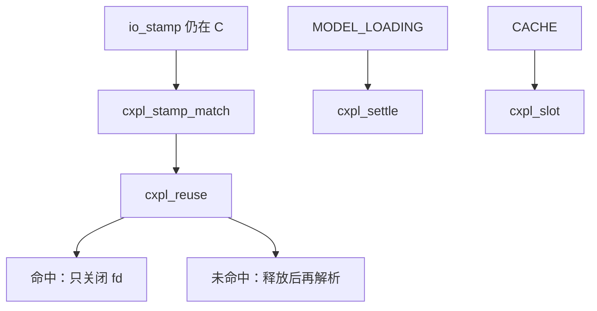

## 14. 2026-10-29 执行步进判定

`core_run_budget`、`core_run_key`、`core_run_stop`、`core_run_take` 写在已有的 `cx/core/transition.cx`。`cx/core/execute.cx` 的 `core_run` 循环调用它们。产品和库本来就同时链接这两个对象，这次没有加参数。分配、转换调用、动作循环和释放仍在 `execute.cx`。独立的 `exec/c/core.c` 仍是原来的内联循环。`sh ./unisacc.com tools/check-compiler-units.cx` 又两次退出 0，两次 stdout 相同，两次 stderr 相同，都打印 `CHECK_COMPILER_UNITS failed=0`。这次检查直接调用这四个函数，没有跑 `core_run`，也没有编译 `execute.cx`。这不是产品安装、六目标或 `--all`。宿主切片空指针下标仍是 APE 54、本机 53。这次没有实跑 hostseed。

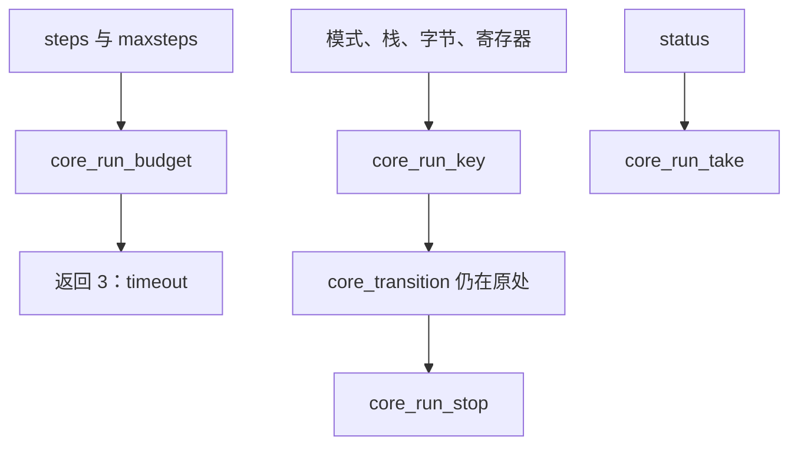

## 15. 2026-10-29 错误缓冲交出

`ex_err` 写在已有的 `cx/runtime/runexec.cx`。产品 `execute` 在 `UNISA_CX_RUNEXEC` 下调用它。构造表里本来就有这个模块，这次没有加参数。`n` 为 0 不写出，指针仍交给 `free`。`n` 非 0 且字节非空时由 `run.c` 做 `fwrite` 再 `free`。空槽或空字节加非 0 长度返回 4，并且不写槽。`fwrite` 和 `free` 留在 `exec/c/run.c`。未定义该宏的路径仍直接写出再释放。`sh ./unisacc.com tools/check-compiler-units.cx` 又两次退出 0，两次 stdout 相同，两次 stderr 相同，都打印 `CHECK_COMPILER_UNITS failed=0`。这次检查直接调用 `ex_err`，没有跑 `fwrite`、`free` 或 `core_run`。这不是产品安装、六目标或 `--all`。宿主切片空指针下标仍是 APE 54、本机 53。这次没有实跑 hostseed。

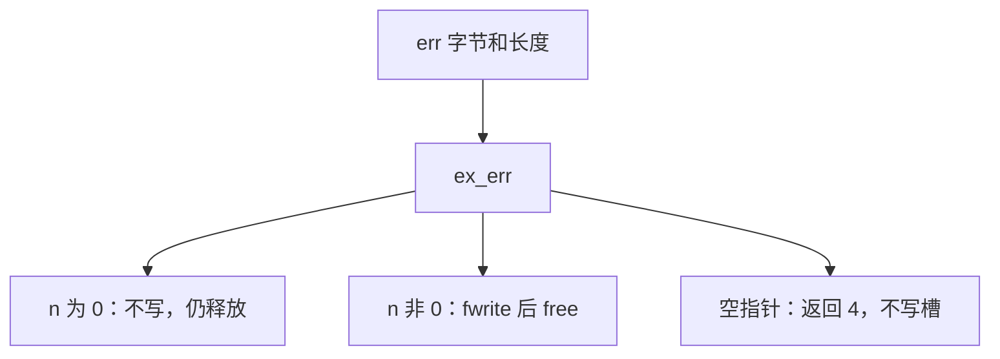

## 16. 2026-10-29 捕获写盘判定

`cxsf_cap_full`、`cxsf_cap_join`、`cxsf_cap_stage`、`cxsf_cap_line`、`cxsf_cap_reg`、`cxsf_cap_take`、`cxsf_cap_session`、`cxsf_cap_key`、`cxsf_cap_answer`、`cxsf_cap_hex`、`cxsf_cap_name`、`cxsf_cap_row` 写在已有的 `cx/runtime/source_frame.cx`。产品仍定义 `UNISA_CX_SOURCE_FRAME`。构造表里本来就有这个模块，这次没有加参数。目录创建、打开、写出、链接、删除和 SHA256 留在 `exec/c/run.c`。未定义该宏的路径仍走原来的 `snprintf` 和内联比较。`sh ./unisacc.com tools/check-compiler-units.cx` 又两次退出 0，两次 stdout 相同，两次 stderr 相同，都打印 `CHECK_COMPILER_UNITS failed=0`。这次检查直接调用这些函数，没有创建目录，也没有跑 `rf_cap_new_file`。这不是产品安装、六目标或 `--all`。宿主切片空指针下标仍是 APE 54、本机 53。这次没有实跑 hostseed。

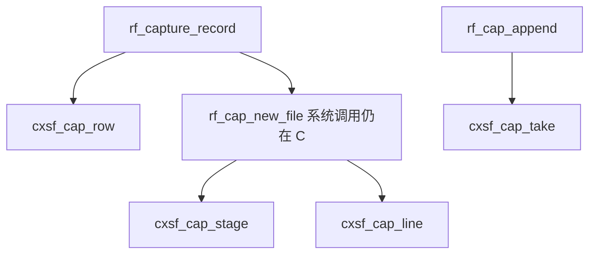

## 17. 2026-10-29 捕获目录与身份行

`cxsf_cap_args`、`cxsf_cap_ledger`、`cxsf_cap_dent`、`cxsf_cap_place`、`cxsf_cap_idline`、`cxsf_cap_dirline` 写在已有的 `cx/runtime/source_frame.cx`。e3 同伴行复用 `cxsf_cap_hex` 和 `cxsf_cap_row`。产品仍定义 `UNISA_CX_SOURCE_FRAME`。构造表里本来就有这个模块，这次没有加参数。`mkdir`、`lstat`、`opendir`、`readdir`、`closedir`、`rmdir`、`unlink` 和 SHA256 留在 `exec/c/run.c`。成功后的目录拷贝、计数清零、进程号和活动标记也留在 C。未定义该宏的路径仍走原来的 `snprintf`、`strcmp` 和 `line[3]='2'`。`sh ./unisacc.com tools/check-compiler-units.cx` 又两次退出 0，两次 stdout 相同，两次 stderr 相同，都打印 `CHECK_COMPILER_UNITS failed=0`。这次检查直接调用这些函数，没有创建目录，没有 `opendir`，也没有跑 `rf_identity_write_capture`。这不是产品安装、六目标或 `--all`。宿主切片空指针下标仍是 APE 54、本机 53。这次没有实跑 hostseed。

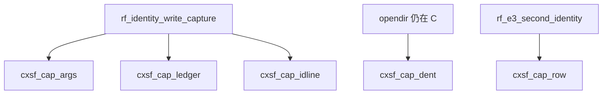

## 18. 2026-10-29 e3 同伴读取判定

`cxsf_e3_args`、`cxsf_e3_errno`、`cxsf_e3_span`、`cxsf_e3_line` 写在已有的 `cx/runtime/source_frame.cx`。路径复用 `cxsf_cap_join`。产品仍定义 `UNISA_CX_SOURCE_FRAME`。构造表里本来就有这个模块，这次没有加参数。`rl_readfile` 和 `free` 留在 `exec/c/run.c`。未定义该宏的路径仍走原来的 `snprintf`。`sh ./unisacc.com tools/check-compiler-units.cx` 又两次退出 0，两次 stdout 相同，两次 stderr 相同，都打印 `CHECK_COMPILER_UNITS failed=0`。这次检查直接调用这些函数，没有读文件。这不是产品安装、六目标或 `--all`。宿主切片空指针下标仍是 APE 54、本机 53。这次没有实跑 hostseed。

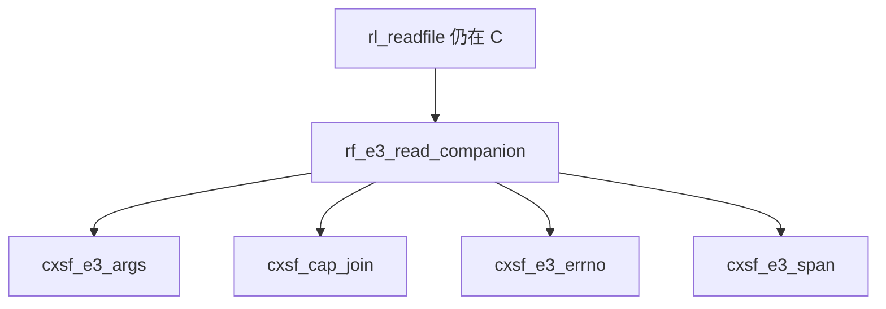

## 19. 2026-10-29 e3 严格字节比较

`cxsf_e3_ready`、`cxsf_e3_row`、`cxsf_e3_tail`、`cxsf_e3_match`、`cxsf_e3_same`、`cxsf_e3_id`、`cxsf_e3_cmp_line` 写在已有的 `cx/runtime/source_frame.cx`。产品仍定义 `UNISA_CX_SOURCE_FRAME`。构造表里本来就有这个模块，这次没有加参数。`rf_e3_read_companion`、`free` 和游标加一留在 `exec/c/run.c`。未定义该宏的路径仍走原来的 `memcmp` 和 `strcmp`。`sh ./unisacc.com tools/check-compiler-units.cx` 又两次退出 0，两次 stdout 相同，两次 stderr 相同，都打印 `CHECK_COMPILER_UNITS failed=0`。这次检查直接调用这些函数，没有读文件，也没有跑 `rf_e3_second_identity`。这不是产品安装、六目标或 `--all`。宿主切片空指针下标仍是 APE 54、本机 53。这次没有实跑 hostseed。

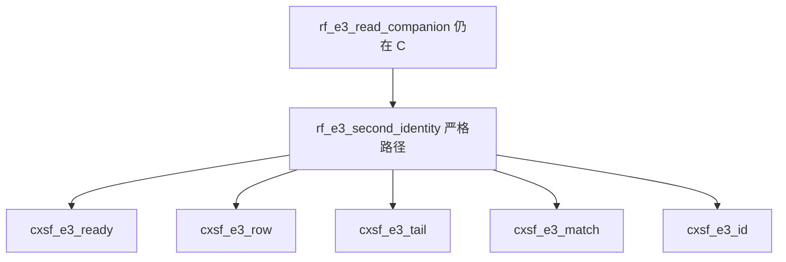

## 20. 2026-10-29 路线判定

`cxsf_route_gate`、`cxsf_route_e3`、`cxsf_route_line` 写在已有的 `cx/runtime/source_frame.cx`。产品仍定义 `UNISA_CX_SOURCE_FRAME`。构造表里本来就有这个模块，这次没有加参数。`fprintf` 和 `rf_stage_label` 留在 `exec/c/run.c`。未定义该宏的路径仍走原来的 `strstr`。`sh ./unisacc.com tools/check-compiler-units.cx` 又两次退出 0，两次 stdout 相同，两次 stderr 相同，都打印 `CHECK_COMPILER_UNITS failed=0`。这次检查直接调用这三个函数，没有跑 `rf_identity_gate`。这不是产品安装、六目标或 `--all`。宿主切片空指针下标仍是 APE 54、本机 53。这次没有实跑 hostseed。

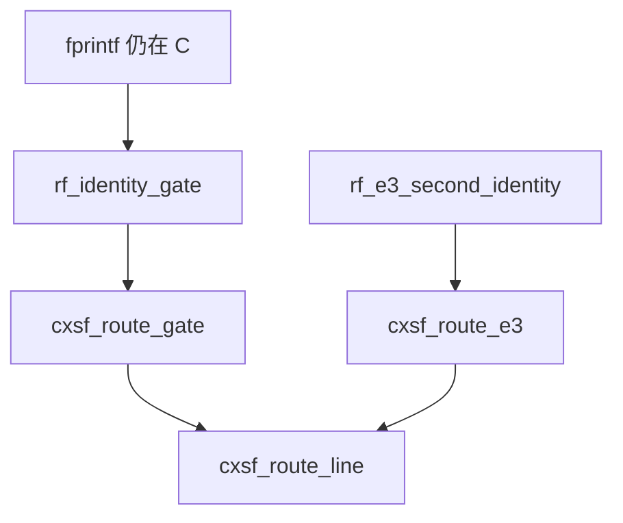

## 21. 2026-10-29 阶段标签拼接

`cxsf_stage_join` 写在已有的 `cx/runtime/source_frame.cx`。拼完交给已有的 `cxsf_stage_label`。产品仍定义 `UNISA_CX_SOURCE_FRAME`。构造表里本来就有这个模块，这次没有加参数。`fprintf` 留在 `exec/c/run.c`。未定义该宏的路径仍走原来的 `snprintf` 和 `rl_stage_label_ok`。`sh ./unisacc.com tools/check-compiler-units.cx` 又两次退出 0，两次 stdout 相同，两次 stderr 相同，都打印 `CHECK_COMPILER_UNITS failed=0`。这次检查直接调用 `cxsf_stage_join`，没有跑 `rf_identity_gate`。这不是产品安装、六目标或 `--all`。宿主切片空指针下标仍是 APE 54、本机 53。这次没有实跑 hostseed。

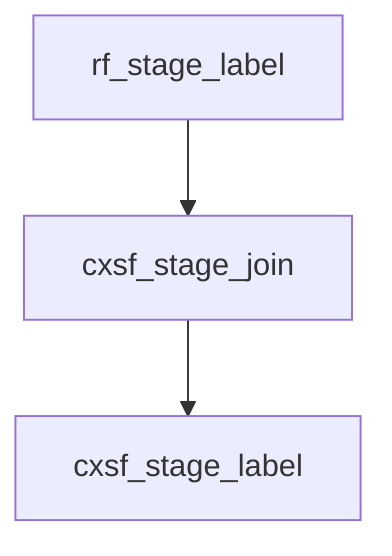

## 22. 2026-10-29 阶段标签错误行

`cxsf_stage_err` 写在已有的 `cx/runtime/source_frame.cx`。产品仍定义 `UNISA_CX_SOURCE_FRAME`。构造表里本来就有这个模块，这次没有加参数。语法检查仍走 `rl_stage_label_ok`。`rl_snapshot_write` 和身份写出留在 `exec/c/run.c`。未定义该宏的路径仍直接 `snprintf`。`sh ./unisacc.com tools/check-compiler-units.cx` 又两次退出 0，两次 stdout 相同，两次 stderr 相同，都打印 `CHECK_COMPILER_UNITS failed=0`。这次检查直接调用 `cxsf_stage_err`，没有跑 `rl_snapshot_write`。这不是产品安装、六目标或 `--all`。宿主切片空指针下标仍是 APE 54、本机 53。这次没有实跑 hostseed。

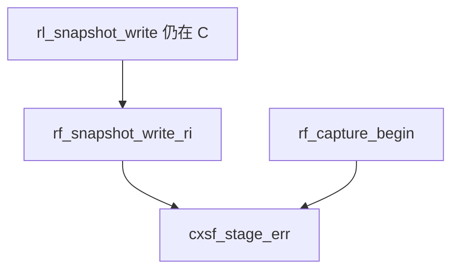

## 23. 2026-10-29 快照条数

`cxsf_snap_count`、`cxsf_snap_line` 写在已有的 `cx/runtime/source_frame.cx`。产品仍定义 `UNISA_CX_SOURCE_FRAME`。构造表里本来就有这个模块，这次没有加参数。行拷贝和 `rl_snapshot_write` 留在 C。`exec/c/resourceledger.h` 里另一处同一句错误行这次没有动。未定义该宏的路径仍直接比较并 `snprintf`。`sh ./unisacc.com tools/check-compiler-units.cx` 又两次退出 0，两次 stdout 相同，两次 stderr 相同，都打印 `CHECK_COMPILER_UNITS failed=0`。这次检查直接调用这两个函数，没有跑 `rl_snapshot_write`。这不是产品安装、六目标或 `--all`。宿主切片空指针下标仍是 APE 54、本机 53。这次没有实跑 hostseed。

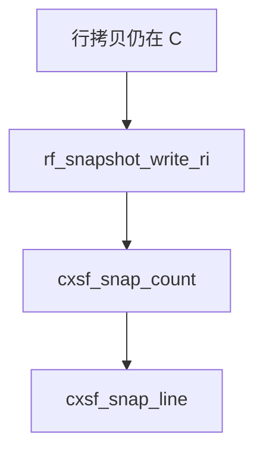

## 24. 2026-10-29 快照行交接

`cxsf_snap_slot` 写在已有的 `cx/runtime/source_frame.cx`。产品仍定义 `UNISA_CX_SOURCE_FRAME`。构造表里本来就有这个模块，这次没有加参数。`rl_snapshot_write` 留在 C。未定义该宏的路径仍直接赋值。`sh ./unisacc.com tools/check-compiler-units.cx` 又两次退出 0，两次 stdout 相同，两次 stderr 相同，都打印 `CHECK_COMPILER_UNITS failed=0`。这次检查直接调用 `cxsf_snap_slot`，没有跑 `rl_snapshot_write`。这不是产品安装、六目标或 `--all`。宿主切片空指针下标仍是 APE 54、本机 53。这次没有实跑 hostseed。

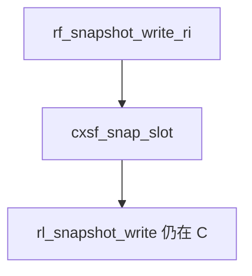

## 25. 2026-10-29 取键十六进制

`core_host_fetch` 的严格路径改调用已有的 `cxsf_cap_hex`。没有新函数，也没有新宏。`n > 512` 的 `die`、账本查找和 `MISSING_EXPLICIT_RESOURCE` 留在 `exec/c/run.c`。未定义该宏的路径仍走原来的半字节循环。`sh ./unisacc.com tools/check-compiler-units.cx` 又两次退出 0，两次 stdout 相同，两次 stderr 相同，都打印 `CHECK_COMPILER_UNITS failed=0`。这次检查直接调用 `cxsf_cap_hex`，没有跑 `core_host_fetch`。这不是产品安装、六目标或 `--all`。宿主切片空指针下标仍是 APE 54、本机 53。这次没有实跑 hostseed。

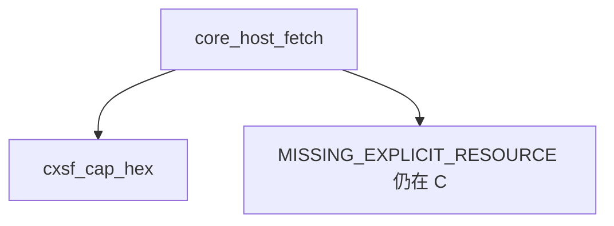

## 26. 2026-10-29 缺失资源行

`cxsf_fetch_miss` 写在已有的 `cx/runtime/source_frame.cx`。产品仍定义 `UNISA_CX_SOURCE_FRAME`。构造表里本来就有这个模块，这次没有加参数。`die` 和 `resource-trace-key-mismatch` 留在 `exec/c/run.c`。未定义该宏的路径仍直接 `snprintf`。`sh ./unisacc.com tools/check-compiler-units.cx` 又两次退出 0，两次 stdout 相同，两次 stderr 相同，都打印 `CHECK_COMPILER_UNITS failed=0`。这次检查直接调用 `cxsf_fetch_miss`，没有跑 `core_host_fetch`。这不是产品安装、六目标或 `--all`。宿主切片空指针下标仍是 APE 54、本机 53。这次没有实跑 hostseed。

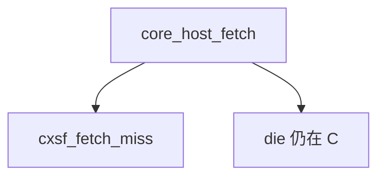

## 27. 2026-10-29 键不配行

`cxsf_fetch_mismatch` 写在已有的 `cx/runtime/source_frame.cx`。产品仍定义 `UNISA_CX_SOURCE_FRAME`。构造表里本来就有这个模块，这次没有加参数。`die` 和在场字节交接留在 `exec/c/run.c`。未定义该宏的路径仍直接 `snprintf`。`sh ./unisacc.com tools/check-compiler-units.cx` 又两次退出 0，两次 stdout 相同，两次 stderr 相同，都打印 `CHECK_COMPILER_UNITS failed=0`。这次检查直接调用 `cxsf_fetch_mismatch`，没有跑 `core_host_fetch`。这不是产品安装、六目标或 `--all`。宿主切片空指针下标仍是 APE 54、本机 53。这次没有实跑 hostseed。

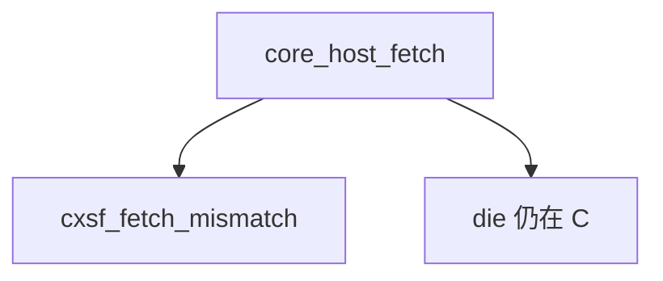

## 28. 2026-10-29 在场字节交接

`cxsf_fetch_hand` 写在已有的 `cx/runtime/source_frame.cx`。产品仍定义 `UNISA_CX_SOURCE_FRAME`。构造表里本来就有这个模块，这次没有加参数。严格路径和快照路径都调用它。`rf_capture_record`、`die` 和 `rf_default_fetch` 留在 `exec/c/run.c`。未定义该宏的路径仍直接赋值。`sh ./unisacc.com tools/check-compiler-units.cx` 又两次退出 0，两次 stdout 相同，两次 stderr 相同，都打印 `CHECK_COMPILER_UNITS failed=0`。这次检查直接调用 `cxsf_fetch_hand`，没有跑 `core_host_fetch`。这不是产品安装、六目标或 `--all`。宿主切片空指针下标仍是 APE 54、本机 53。这次没有实跑 hostseed。

```mermaid
flowchart TD
  fetch["core_host_fetch"] --> hand["cxsf_fetch_hand"]
  fetch --> rec["rf_capture_record 仍在 C"]
```

## 29. 2026-10-29 默认表匹配

`cxsf_fetch_row` 写在已有的 `cx/runtime/source_frame.cx`。产品仍定义 `UNISA_CX_SOURCE_FRAME`。构造表里本来就有这个模块，这次没有加参数。`RI` 循环和 `RES` 循环都把已解析的名字指针和数据指针交进去。`PB` 加偏移、`\0inc/` 剥离、`\0hdr/` 路径和 `readfile` 留在 `exec/c/run.c`。未定义该宏的路径仍直接 `memcmp` 并赋值。`sh ./unisacc.com tools/check-compiler-units.cx` 又两次退出 0，两次 stdout 相同，两次 stderr 相同，都打印 `CHECK_COMPILER_UNITS failed=0`。这次检查直接调用 `cxsf_fetch_row`，没有跑 `rf_default_fetch`。这不是产品安装、六目标或 `--all`。宿主切片空指针下标仍是 APE 54、本机 53。这次没有实跑 hostseed。

```mermaid
flowchart TD
  def["rf_default_fetch"] --> row["cxsf_fetch_row"]
  def --> path["inc 与 hdr 路径仍在 C"]
```

## 30. 2026-10-29 默认路径

`cxsf_fetch_path` 写在已有的 `cx/runtime/source_frame.cx`。产品仍定义 `UNISA_CX_SOURCE_FRAME`。构造表里本来就有这个模块，这次没有加参数。`readfile`、`record_file_read` 和 `record_file_absent` 留在 `exec/c/run.c`。未定义该宏的路径仍走原来的 `snprintf` 和长度核对。`sh ./unisacc.com tools/check-compiler-units.cx` 又两次退出 0，两次 stdout 相同，两次 stderr 相同，都打印 `CHECK_COMPILER_UNITS failed=0`。这次检查直接调用 `cxsf_fetch_path`，没有跑 `rf_default_fetch`，也没有读文件。这不是产品安装、六目标或 `--all`。宿主切片空指针下标仍是 APE 54、本机 53。这次没有实跑 hostseed。

```mermaid
flowchart TD
  def["rf_default_fetch"] --> path["cxsf_fetch_path"]
  def --> file["readfile 仍在 C"]
```

## 31. 2026-10-29 读文件结果

`cxsf_fetch_file` 写在已有的 `cx/runtime/source_frame.cx`。产品仍定义 `UNISA_CX_SOURCE_FRAME`。构造表里本来就有这个模块，这次没有加参数。产品把 `record_file_read` 和 `record_file_absent` 当回调传进去。这两个函数的去重和 `xrealloc` 留在 `exec/c/run.c`。`readfile` 也留在那里。未定义该宏的路径仍直接调用并返回 2 或 0。`sh ./unisacc.com tools/check-compiler-units.cx` 又两次退出 0，两次 stdout 相同，两次 stderr 相同，都打印 `CHECK_COMPILER_UNITS failed=0`。这次检查注入回调，直接调用 `cxsf_fetch_file`，没有跑 `readfile`。这不是产品安装、六目标或 `--all`。宿主切片空指针下标仍是 APE 54、本机 53。这次没有实跑 hostseed。

```mermaid
flowchart TD
  def["rf_default_fetch"] --> file["cxsf_fetch_file"]
  file --> rec["record_file_read 或 record_file_absent"]
  def --> io["readfile 仍在 C"]
```

## 32. 2026-10-29 读文件去重

`cxsf_file_keep` 写在已有的 `cx/runtime/source_frame.cx`。产品仍定义 `UNISA_CX_SOURCE_FRAME`。构造表里本来就有这个模块，这次没有加参数。`record_file_read` 和 `record_file_absent` 把 `xrealloc` 当分配回调传进去。`xrealloc` 失败仍 `die("out of memory")`。`readfile` 留在 `exec/c/run.c`。未定义该宏的路径仍走原来的循环。`sh ./unisacc.com tools/check-compiler-units.cx` 又两次退出 0，两次 stdout 相同，两次 stderr 相同，都打印 `CHECK_COMPILER_UNITS failed=0`。这次检查注入分配器，直接调用 `cxsf_file_keep`，没有跑 `record_file_read`，也没有跑 `xrealloc`。这不是产品安装、六目标或 `--all`。宿主切片空指针下标仍是 APE 54、本机 53。这次没有实跑 hostseed。

```mermaid
flowchart TD
  rec["record_file_read 与 record_file_absent"] --> keep["cxsf_file_keep"]
  keep --> alloc["xrealloc 仍在 C"]
```

## 33. 2026-10-29 读文件编排

`cxsf_readfile` 写在已有的 `cx/runtime/source_frame.cx`。产品仍定义 `UNISA_CX_SOURCE_FRAME`。构造表里本来就有这个模块，这次没有加参数。`io_open`、`io_close`、`fputs`、`fprintf`、`die` 和 `readstream` 留在 `exec/c/run.c`。未定义该宏的 `readfile` 仍是原来的打开和 `fprintf`。`sh ./unisacc.com tools/check-compiler-units.cx` 又两次退出 0，两次 stdout 相同，两次 stderr 相同，都打印 `CHECK_COMPILER_UNITS failed=0`。这次检查注入回调，直接调用 `cxsf_readfile`，没有跑 `io_open`。这不是产品安装、六目标或 `--all`。宿主切片空指针下标仍是 APE 54、本机 53。这次没有实跑 hostseed。

```mermaid
flowchart TD
  rf["readfile"] --> go["cxsf_readfile"]
  go --> io["io_open 与 readstream 仍在 C"]
```

## 34. 2026-10-29 读流循环

`cxsf_readstream` 和 `cxsf_read_err` 写在已有的 `cx/runtime/source_frame.cx`。产品仍定义 `UNISA_CX_SOURCE_FRAME`。构造表里本来就有这个模块，这次没有加参数。`readstream_with` 经 `rf_stamp`、`rf_read`、`rf_read_say`、`rf_read_raw` 和 `die` 调用它。`io_stamp` 和 `io_read` 留在 `exec/c/run.c`。未定义该宏的 `readstream_with` 仍是原来的循环。`sh ./unisacc.com tools/check-compiler-units.cx` 又两次退出 0，两次 stdout 相同，两次 stderr 相同，都打印 `CHECK_COMPILER_UNITS failed=0`。这次检查直接调用 `cxsf_readstream`，没有跑 `readstream_with`。这不是产品安装、六目标或 `--all`。宿主切片空指针下标仍是 APE 54、本机 53。这次没有实跑 hostseed。

```mermaid
flowchart TD
  rs["readstream_with"] --> loop["cxsf_readstream"]
  loop --> io["io_stamp 与 io_read 仍在 C"]
```

## 35. 2026-10-29 盖章字段

`cxsf_stamp_reg` 写在已有的 `cx/runtime/source_frame.cx`。产品仍定义 `UNISA_CX_SOURCE_FRAME`。构造表里本来就有这个模块，这次没有加参数。宿主 `io_stamp` 仍调用 `fstat` 或 `_fstat64`，再把是否成功、是否普通文件和各字段交进来。`__UNISA__` 的 `lseek` 盖章没有动。未定义该宏的宿主路径仍直接赋值。`io_read` 留在 `exec/c/run.c`。`sh ./unisacc.com tools/check-compiler-units.cx` 又两次退出 0，两次 stdout 相同，两次 stderr 相同，都打印 `CHECK_COMPILER_UNITS failed=0`。这次检查直接调用 `cxsf_stamp_reg`，没有跑 `fstat`。这不是产品安装、六目标或 `--all`。宿主切片空指针下标仍是 APE 54、本机 53。这次没有实跑 hostseed。

```mermaid
flowchart TD
  st["宿主 io_stamp"] --> reg["cxsf_stamp_reg"]
  reg --> io["fstat 与 io_read 仍在 C"]
```

## 36. 2026-10-29 读长度符号

`cxsf_read_errno` 写在已有的 `cx/runtime/source_frame.cx`。产品仍定义 `UNISA_CX_SOURCE_FRAME`。构造表里本来就有这个模块，这次没有加参数。宿主 `io_read` 仍调用 `read`，再把返回值和 `errno` 交进来。`__UNISA__` 的 `io_read` 没有动。未定义该宏的宿主路径仍自己做 `-errno`。`io_open` 和 `io_close` 留在 `exec/c/run.c`。`sh ./unisacc.com tools/check-compiler-units.cx` 又两次退出 0，两次 stdout 相同，两次 stderr 相同，都打印 `CHECK_COMPILER_UNITS failed=0`。这次检查直接调用 `cxsf_read_errno`，没有跑 `read`。这不是产品安装、六目标或 `--all`。宿主切片空指针下标仍是 APE 54、本机 53。这次没有实跑 hostseed。

```mermaid
flowchart TD
  rd["宿主 io_read"] --> en["cxsf_read_errno"]
  en --> io["read 仍在 C"]
```

## 37. 2026-10-29 打开符号

`cxsf_open_errno` 写在已有的 `cx/runtime/source_frame.cx`。产品仍定义 `UNISA_CX_SOURCE_FRAME`。构造表里本来就有这个模块，这次没有加参数。宿主 `io_open` 仍调用 `open`，再把描述符和 `errno` 交进来。`O_RDONLY` 和 Windows 的 `O_BINARY` 留在 `exec/c/run.c`。`__UNISA__` 的 `io_open` 没有动。未定义该宏的宿主路径仍自己做 `-errno`。`io_close` 仍直接返回 `close`。`sh ./unisacc.com tools/check-compiler-units.cx` 又两次退出 0，两次 stdout 相同，两次 stderr 相同，都打印 `CHECK_COMPILER_UNITS failed=0`。这次检查直接调用 `cxsf_open_errno`，没有跑 `open`。这不是产品安装、六目标或 `--all`。宿主切片空指针下标仍是 APE 54、本机 53。这次没有实跑 hostseed。

```mermaid
flowchart TD
  op["宿主 io_open"] --> en["cxsf_open_errno"]
  en --> io["open 与 O_BINARY 仍在 C"]
```

## 38. 2026-10-29 打开标志

`cxsf_open_flags` 写在已有的 `cx/runtime/source_frame.cx`。产品仍定义 `UNISA_CX_SOURCE_FRAME`。构造表里本来就有这个模块，这次没有加参数。宿主 `io_open` 把 `O_RDONLY` 和 Windows 的 `O_BINARY` 交进来，再拿返回值去 `open`。非 Windows 的第二个参数传 0。`__UNISA__` 的 `io_open` 没有动。未定义该宏的宿主路径仍自己拼标志。`io_close` 留在 `exec/c/run.c`。`sh ./unisacc.com tools/check-compiler-units.cx` 又两次退出 0，两次 stdout 相同，两次 stderr 相同，都打印 `CHECK_COMPILER_UNITS failed=0`。这次检查直接调用 `cxsf_open_flags`，没有跑 `open`。这不是产品安装、六目标或 `--all`。宿主切片空指针下标仍是 APE 54、本机 53。这次没有实跑 hostseed。

```mermaid
flowchart TD
  op["宿主 io_open"] --> fl["cxsf_open_flags"]
  fl --> io["open 仍在 C"]
```

## 39. 2026-10-29 UNISA 盖章

`cxsf_stamp_unisa` 写在已有的 `cx/runtime/source_frame.cx`。产品仍定义 `UNISA_CX_SOURCE_FRAME`。构造表里本来就有这个模块，这次没有加参数。`__UNISA__` 的 `io_stamp` 用 `us_seek` 和 `us_read` 把 `__lseek`、`__read` 交进去，失败回调是 `die`。未定义该宏时，`stamp_tag` 和原来的循环仍在 `exec/c/run.c`。宿主的 `fstat` 盖章不走这个函数。`io_close` 留在 `exec/c/run.c`。`sh ./unisacc.com tools/check-compiler-units.cx` 又两次退出 0，两次 stdout 相同，两次 stderr 相同，都打印 `CHECK_COMPILER_UNITS failed=0`。这次检查注入定位和读，直接调用 `cxsf_stamp_unisa`，没有跑 `__lseek`。这不是产品安装、六目标或 `--all`。宿主切片空指针下标仍是 APE 54、本机 53。这次没有实跑 hostseed。

```mermaid
flowchart TD
  st["__UNISA__ io_stamp"] --> tag["cxsf_stamp_unisa"]
  tag --> io["__lseek 与 __read 仍在 C"]
```

## 40. 2026-10-29 关闭结果

`cxsf_close_rc` 写在已有的 `cx/runtime/source_frame.cx`。产品仍定义 `UNISA_CX_SOURCE_FRAME`。构造表里本来就有这个模块，这次没有加参数。宿主 `io_close` 仍调用 `close`，再把返回值和 `errno` 交进来。返回值原样交回，不改成 `-errno`。`__UNISA__` 的 `io_close` 没有动。未定义该宏的宿主路径仍直接返回 `close` 的结果。`io_close(fd) < 0` 后的 `die("close failed")` 留在 `exec/c/run.c`。`sh ./unisacc.com tools/check-compiler-units.cx` 又两次退出 0，两次 stdout 相同，两次 stderr 相同，都打印 `CHECK_COMPILER_UNITS failed=0`。这次检查直接调用 `cxsf_close_rc`，没有跑 `close`。这不是产品安装、六目标或 `--all`。宿主切片空指针下标仍是 APE 54、本机 53。这次没有实跑 hostseed。

```mermaid
flowchart TD
  cl["宿主 io_close"] --> rc["cxsf_close_rc"]
  rc --> io["close 仍在 C"]
```

## 41. 2026-10-29 关闭失败

`cxsf_close_fail` 写在已有的 `cx/runtime/source_frame.cx`。产品仍定义 `UNISA_CX_SOURCE_FRAME`。构造表里本来就有这个模块，这次没有加参数。`package_parse` 和包缓存复用分支把 `io_close` 的结果和 `die` 交进来。未定义该宏时这两处仍是原来的 `if`。未定义该宏的 `readfile` 仍自己判断关闭失败。`io_close` 留在 `exec/c/run.c`。`sh ./unisacc.com tools/check-compiler-units.cx` 又两次退出 0，两次 stdout 相同，两次 stderr 相同，都打印 `CHECK_COMPILER_UNITS failed=0`。这次检查注入失败回调，直接调用 `cxsf_close_fail`，没有跑 `io_close`。这不是产品安装、六目标或 `--all`。宿主切片空指针下标仍是 APE 54、本机 53。这次没有实跑 hostseed。

```mermaid
flowchart TD
  pp["package_parse 与缓存复用"] --> fail["cxsf_close_fail"]
  fail --> io["io_close 与 die 仍在 C"]
```

## 42. 2026-10-29 读文件关闭失败

宿主 `cxsf_readfile` 和没定义 `UNISA_CX_SOURCE_FRAME` 的 `readfile` 都改调用已有的 `cxsf_close_fail`。没有新函数，没有新宏，构造表也没加参数。没定义宏的那份 `readfile` 不再自己写关闭失败的 `if`。单独编译 `exec/c/run.c` 时要链上这个符号。`io_close` 和 `die` 留在 `exec/c/run.c`。`sh ./unisacc.com tools/check-compiler-units.cx` 又两次退出 0，两次 stdout 相同，两次 stderr 相同，都打印 `CHECK_COMPILER_UNITS failed=0`。这次检查直接调用 `cxsf_readfile`，没有跑没定义宏的 `readfile`。这不是产品安装、六目标或 `--all`。宿主切片空指针下标仍是 APE 54、本机 53。这次没有实跑 hostseed。

```mermaid
flowchart TD
  rf["cxsf_readfile 与宏关闭的 readfile"] --> fail["cxsf_close_fail"]
  fail --> io["io_close 与 die 仍在 C"]
```

## 43. 2026-10-29 当前进程按页

`cx/runtime/winprocess.cx` 是新骨架。当前进程映像的按页下扫判定在这里：`wp_u32`、`wp_page`、`wp_down`、`wp_keep`、`wp_mz`、`wp_pe`。没有 `#include`。产品 `exec/c/winprocess.c` 没有接上，仍自己下扫并 `die`。`pei_imports` 仍在 `peimport`。没有新宏，构造表也没加参数。`sh ./unisacc.com tools/check-compiler-units.cx` 又两次退出 0，两次 stdout 相同，两次 stderr 相同，都打印 `CHECK_COMPILER_UNITS failed=0`。这次检查直接调用这六个函数，没有跑 `process_own_imports`。这不是产品安装、六目标或 `--all`。整棵重构还没完成。宿主切片空指针下标仍是 APE 54、本机 53。这次没有实跑 hostseed。

```mermaid
flowchart TD
  walk["process_own_imports 仍在 exec/c/winprocess.c"] --> gate["wp_page wp_down wp_keep wp_mz wp_pe wp_u32"]
  gate --> pei["pei_imports 仍在 peimport"]
  walk --> die["映射 xrealloc 与 die 仍在 C"]
```

## 44. 2026-10-29 符号流临时路径

`cx/compiler/bindtemp.cx` 是新骨架。Apple/Linux 上临时符号流名字的判定在这里：`bx_tmp_name`、`bx_tmp_why`。没有 `#include`。产品 `exec/c/bind.c` 没有接上，仍自己 `snprintf` 出 `%s.XXXXXX`，放不下就 `clierror`。`mkstemp` 仍在 C。其它宿主不拼这个名字。没有新宏，构造表也没加参数。`sh ./unisacc.com tools/check-compiler-units.cx` 又两次退出 0，两次 stdout 相同，两次 stderr 相同，都打印 `CHECK_COMPILER_UNITS failed=0`。这次检查直接调用这两个函数，没有跑 `host_side_write`。这不是产品安装、六目标或 `--all`。整棵重构还没完成。宿主切片空指针下标仍是 APE 54、本机 53。这次没有实跑 hostseed。

```mermaid
flowchart TD
  side["host_side_write 仍在 exec/c/bind.c"] --> name["bx_tmp_name 与 bx_tmp_why"]
  name --> io["snprintf mkstemp 与 clierror 仍在 C"]
```

## 45. 2026-10-29 路径键长度

`cx/compiler/bindkey.cx` 是新骨架。Apple/Linux 上 `host_path_key` 的两处长度判定在这里：`bx_key_len`、`bx_key_fit`。没有 `#include`。产品 `exec/c/bind.c` 没有接上。`realpath`、斜杠拆分和空 base 仍在 C。`parent` 仍是 4096 字节。没有新宏，构造表也没加参数。`sh ./unisacc.com tools/check-compiler-units.cx` 又两次退出 0，两次 stdout 相同，两次 stderr 相同，都打印 `CHECK_COMPILER_UNITS failed=0`。这次检查直接调用这两个函数，没有跑 `host_path_key`。这不是产品安装、六目标或 `--all`。整棵重构还没完成。宿主切片空指针下标仍是 APE 54、本机 53。这次没有实跑 hostseed。

```mermaid
flowchart TD
  key["host_path_key 仍在 exec/c/bind.c"] --> len["bx_key_len 与 bx_key_fit"]
  key --> io["realpath 与斜杠拆分仍在 C"]
```

## 46. 2026-10-29 路径键拆分

`cx/compiler/bindsplit.cx` 是新骨架。Apple/Linux 上 `host_path_key` 的最后斜杠拆分在这里：`bx_key_split`。没有 `#include`。产品 `exec/c/bind.c` 没有接上。`realpath` 和空 base 的拒绝仍在 C。没有新宏，构造表也没加参数。`sh ./unisacc.com tools/check-compiler-units.cx` 又两次退出 0，两次 stdout 相同，两次 stderr 相同，都打印 `CHECK_COMPILER_UNITS failed=0`。这次检查直接调用 `bx_key_split`，没有跑 `host_path_key`。这不是产品安装、六目标或 `--all`。整棵重构还没完成。宿主切片空指针下标仍是 APE 54、本机 53。这次没有实跑 hostseed。

```mermaid
flowchart TD
  key["host_path_key 仍在 exec/c/bind.c"] --> split["bx_key_split"]
  key --> io["realpath 与空 base 仍在 C"]
```

## 47. 2026-10-29 阶段名是否存在

`cx/compiler/bindstage.cx` 是新骨架。`host_stage_present` 的路线和名字是否同时相等在这里：`bx_stage_present`。没有 `#include`。产品 `exec/c/bind.c` 没有接上。`STAGES` 和 `PS` 仍在 C。没有新宏，构造表也没加参数。`sh ./unisacc.com tools/check-compiler-units.cx` 又两次退出 0，两次 stdout 相同，两次 stderr 相同，都打印 `CHECK_COMPILER_UNITS failed=0`。这次检查交进行，直接调用 `bx_stage_present`，没有跑 `host_stage_present`。这不是产品安装、六目标或 `--all`。整棵重构还没完成。宿主切片空指针下标仍是 APE 54、本机 53。这次没有实跑 hostseed。

```mermaid
flowchart TD
  ask["host_stage_present 仍在 exec/c/bind.c"] --> hit["bx_stage_present"]
  ask --> tab["STAGES 与 PS 仍在 C"]
```

## 48. 2026-10-29 空路径过滤掩码

`cx/compiler/bindfilter.cx` 是新骨架。`host_filter_file` 在路径指针为空时把掩码写成 15：`bx_filter_none`。没有 `#include`。产品 `exec/c/bind.c` 没有接上。`fopen` 仍在 C。没有新宏，构造表也没加参数。`sh ./unisacc.com tools/check-compiler-units.cx` 又两次退出 0，两次 stdout 相同，两次 stderr 相同，都打印 `CHECK_COMPILER_UNITS failed=0`。这次检查直接调用 `bx_filter_none`，没有跑 `host_filter_file`。这不是产品安装、六目标或 `--all`。整棵重构还没完成。宿主切片空指针下标仍是 APE 54、本机 53。这次没有实跑 hostseed。

```mermaid
flowchart TD
  fil["host_filter_file 仍在 exec/c/bind.c"] --> mask["bx_filter_none"]
  fil --> io["fopen 与 host_provider_filter 仍在 C"]
```

## 49. 2026-10-29 依赖路径长度

`cx/compiler/binddep.cx` 是新骨架。空 `deps` 且不是 `deponly` 时的点号、词干起点和 `dot - b + 3 > cap` 在这里：`bx_dep_mark`、`bx_dep_len`、`bx_dep_why`。没有 `#include`。产品 `exec/c/compiler.c` 没有接上。`memcpy` 仍在那里。没有新宏，构造表也没加参数。`sh ./unisacc.com tools/check-compiler-units.cx` 又两次退出 0，两次 stdout 相同，两次 stderr 相同，都打印 `CHECK_COMPILER_UNITS failed=0`。这次检查直接调用这三个函数，没有跑那段循环。这不是产品安装、六目标或 `--all`。整棵重构还没完成。宿主切片空指针下标仍是 APE 54、本机 53。这次没有实跑 hostseed。

```mermaid
flowchart TD
  dep["空 deps 的 .d 名仍在 exec/c/compiler.c"] --> len["bx_dep_mark 与 bx_dep_len"]
  dep --> io["memcpy 仍在 C"]
```

## 50. 2026-10-29 deponly 依赖名

`cx/compiler/bindonly.cx` 是新骨架。空 `deps` 且 `deponly` 非 0 时选 `out` 或 `-`：`bx_dep_only`。没有 `#include`。产品 `exec/c/compiler.c` 没有接上。`.d` 的 `memcpy` 和 `cxd_write` 仍在 C。没有新宏，构造表也没加参数。`sh ./unisacc.com tools/check-compiler-units.cx` 又两次退出 0，两次 stdout 相同，两次 stderr 相同，都打印 `CHECK_COMPILER_UNITS failed=0`。这次检查直接调用 `bx_dep_only`，没有跑那两处赋值。这不是产品安装、六目标或 `--all`。整棵重构还没完成。宿主切片空指针下标仍是 APE 54、本机 53。这次没有实跑 hostseed。

```mermaid
flowchart TD
  sel["deponly 的 out 或 - 仍在 exec/c/compiler.c"] --> only["bx_dep_only"]
  sel --> io["memcpy 与 cxd_write 仍在 C"]
```

## 51. 2026-10-29 依赖写出门槛

`cx/compiler/bindgate.cx` 是新骨架。依赖是否进入写出块在这里：`bx_dep_gate`。没有 `#include`。产品 `exec/c/compiler.c` 没有接上。门槛仍是 `deps && (deponly || (mode!=1 && mode!=4 && !runit))`。`cxd_write` 仍在 C。没有新宏，构造表也没加参数。`sh ./unisacc.com tools/check-compiler-units.cx` 又两次退出 0，两次 stdout 相同，两次 stderr 相同，都打印 `CHECK_COMPILER_UNITS failed=0`。这次检查直接调用 `bx_dep_gate`，没有跑那个 `if`。这不是产品安装、六目标或 `--all`。整棵重构还没完成。宿主切片空指针下标仍是 APE 54、本机 53。这次没有实跑 hostseed。

```mermaid
flowchart TD
  gate["依赖写出 if 仍在 exec/c/compiler.c"] --> ask["bx_dep_gate"]
  gate --> io["cxd_write 仍在 C"]
```

## 52. 2026-10-29 依赖目标选择

`cx/compiler/bindtarget.cx` 是新骨架。依赖目标用 `out` 还是默认名在这里：`bx_dep_target`。没有 `#include`。产品 `exec/c/compiler.c` 没有接上。`cxd_default_target` 和 520 字节缓冲仍在 C。没有新宏，构造表也没加参数。`sh ./unisacc.com tools/check-compiler-units.cx` 又两次退出 0，两次 stdout 相同，两次 stderr 相同，都打印 `CHECK_COMPILER_UNITS failed=0`。这次检查直接调用 `bx_dep_target`，没有跑 `cxd_default_target`。这不是产品安装、六目标或 `--all`。整棵重构还没完成。宿主切片空指针下标仍是 APE 54、本机 53。这次没有实跑 hostseed。

```mermaid
flowchart TD
  pick["dep_target 仍在 exec/c/compiler.c"] --> ask["bx_dep_target"]
  pick --> io["cxd_default_target 与 520 字节缓冲仍在 C"]
```

## 53. 2026-10-29 deponly 写完即返回

`cx/compiler/bindret.cx` 是新骨架。依赖写出成功后是否立刻返回在这里：`bx_dep_ret`。没有 `#include`。产品 `exec/c/compiler.c` 没有接上。`free` 和 `clierror` 仍在 C。没有新宏，构造表也没加参数。`sh ./unisacc.com tools/check-compiler-units.cx` 又两次退出 0，两次 stdout 相同，两次 stderr 相同，都打印 `CHECK_COMPILER_UNITS failed=0`。这次检查直接调用 `bx_dep_ret`，没有跑 `cxd_write`，也没有跑 `free`。这不是产品安装、六目标或 `--all`。整棵重构还没完成。宿主切片空指针下标仍是 APE 54、本机 53。这次没有实跑 hostseed。

```mermaid
flowchart TD
  ret["if (deponly) return 0 仍在 exec/c/compiler.c"] --> ask["bx_dep_ret"]
  ret --> io["free 与 clierror 仍在 C"]
```

## 54. 2026-10-29 默认产品名

`cx/compiler/bindimage.cx` 是新骨架。依赖块之后的默认文件名在这里：`bx_image_name`。没有 `#include`。产品 `exec/c/compiler.c` 没有接上。`_WIN32` 仍在 C 里决定 `a.exe` 还是 `a.out`。符号流那一行还要 `!runit`，并且总是 `a.out`，仍在 C。没有新宏，构造表也没加参数。`sh ./unisacc.com tools/check-compiler-units.cx` 又两次退出 0，两次 stdout 相同，两次 stderr 相同，都打印 `CHECK_COMPILER_UNITS failed=0`。这次检查直接调用 `bx_image_name`，没有跑那两处赋值。这不是产品安装、六目标或 `--all`。整棵重构还没完成。宿主切片空指针下标仍是 APE 54、本机 53。这次没有实跑 hostseed。

```mermaid
flowchart TD
  img["默认 a.out 或 a.exe 仍在 exec/c/compiler.c"] --> ask["bx_image_name"]
  img --> io["_WIN32 与符号流 effective_out 仍在 C"]
```

## 55. 2026-10-29 runit 进入运行

`cx/compiler/bindrun.cx` 是新骨架。依赖块之后是否调用 `memory_enter` 在这里：`bx_run_enter`。没有 `#include`。产品 `exec/c/compiler.c` 没有接上。`memory_enter` 仍在 C。`execrun` 和 `forward_exec` 也仍在 C。没有新宏，构造表也没加参数。`sh ./unisacc.com tools/check-compiler-units.cx` 又两次退出 0，两次 stdout 相同，两次 stderr 相同，都打印 `CHECK_COMPILER_UNITS failed=0`。这次检查直接调用 `bx_run_enter`，没有跑 `memory_enter`。这不是产品安装、六目标或 `--all`。整棵重构还没完成。宿主切片空指针下标仍是 APE 54、本机 53。这次没有实跑 hostseed。

```mermaid
flowchart TD
  run["if (runit) return memory_enter 仍在 exec/c/compiler.c"] --> ask["bx_run_enter"]
  run --> io["memory_enter 与 forward_exec 仍在 C"]
```

## 56. 2026-10-29 execrun 进入转发

`cx/compiler/bindexec.cx` 是新骨架。Linux 上是否调用 `forward_exec` 在这里：`bx_exec_forward`。没有 `#include`。产品 `exec/c/compiler.c` 没有接上。`forward_exec` 仍在 C。检查文件已有 32 个 `use`，再加一条会拒绝。`bindrun.cx` 用 `#pragma unisa use bindexec` 把这个模块带进同一次检查，自己不调用它。没有新宏，构造表也没加参数。`sh ./unisacc.com tools/check-compiler-units.cx` 又两次退出 0，两次 stdout 相同，两次 stderr 相同，都打印 `CHECK_COMPILER_UNITS failed=0`。这次检查直接调用 `bx_exec_forward`，没有跑 `forward_exec`。这不是产品安装、六目标或 `--all`。整棵重构还没完成。宿主切片空指针下标仍是 APE 54、本机 53。这次没有实跑 hostseed。

```mermaid
flowchart TD
  fwd["if (execrun) return forward_exec 仍在 exec/c/compiler.c"] --> ask["bx_exec_forward"]
  fwd --> io["forward_exec 与 __linux__ 仍在 C"]
  cap["检查文件 32 个 use"] --> pull["bindrun.cx 的 use bindexec"]
```

## 57. 2026-10-29 runargs 是否分配

`cx/compiler/bindargs.cx` 是新骨架。`runit` 或 Linux 上的 `execrun` 是否分配 `runargs` 在这里：`bx_run_args`。没有 `#include`。产品 `exec/c/compiler.c` 没有接上。`xrealloc` 仍在 C。检查文件仍是 32 个 `use`。`bindexec.cx` 用 `#pragma unisa use bindargs` 把这个模块带进同一次检查，自己不调用它。没有新宏，构造表也没加参数。`sh ./unisacc.com tools/check-compiler-units.cx` 又两次退出 0，两次 stdout 相同，两次 stderr 相同，都打印 `CHECK_COMPILER_UNITS failed=0`。这次检查直接调用 `bx_run_args`，没有跑 `xrealloc`。这不是产品安装、六目标或 `--all`。整棵重构还没完成。宿主切片空指针下标仍是 APE 54、本机 53。这次没有实跑 hostseed。

```mermaid
flowchart TD
  args["runit 或 execrun 的 runargs 仍在 exec/c/compiler.c"] --> ask["bx_run_args"]
  args --> io["xrealloc 与向量填充仍在 C"]
  cap["检查文件 32 个 use"] --> pull["bindexec.cx 的 use bindargs"]
```

## 58. 2026-10-29 runargs 槽数

`cx/compiler/bindcount.cx` 是新骨架。运行参数向量的槽数在这里：`bx_run_count`，算式是 `1 + argc - argstart`。没有 `#include`。产品 `exec/c/compiler.c` 没有接上。`xrealloc` 仍在 C。检查文件仍是 32 个 `use`。`bindargs.cx` 用 `#pragma unisa use bindcount` 把这个模块带进同一次检查，自己不调用它。没有新宏，构造表也没加参数。`sh ./unisacc.com tools/check-compiler-units.cx` 又两次退出 0，两次 stdout 相同，两次 stderr 相同，都打印 `CHECK_COMPILER_UNITS failed=0`。这次检查直接调用 `bx_run_count`，没有跑 `xrealloc`。这不是产品安装、六目标或 `--all`。整棵重构还没完成。宿主切片空指针下标仍是 APE 54、本机 53。这次没有实跑 hostseed。

```mermaid
flowchart TD
  cnt["count = 1 + argc - argstart 仍在 exec/c/compiler.c"] --> ask["bx_run_count"]
  cnt --> io["xrealloc 与向量填充仍在 C"]
  cap["检查文件 32 个 use"] --> pull["bindargs.cx 的 use bindcount"]
```

## 124. 2026-10-29 -c 后再 -b 保持 mode=2，as/nm 开始读写

构造脚本不改。`-b` 在 `sawc` 或 `sawS` 已经是 1 时只写 target。`step-c-b` 先红：检查退出 1，stdout 3427，第 125 行 `FAIL step-c-b`，`failed=1`。改 `cxc_step` 后检查退出 0，stdout 3427，第 125 行 `PASS step-c-b`，`failed=0`。入口 `-c -b lnx/x86_64 a.c` 退出 0，stdout 47，`mode=2`。单独 `-b` 仍是 `mode=0`。`-S -b lnx/arm64 a.c` 是 `mode=2`。一行 `# unisacc -S lnx/x86_64` 经 `as` 写出 728 字节对象，退出 0。`nm` 该对象 stdout 0。`objdump -d` stdout 95。没有产品安装，没有 hostseed，没有 `--all`。整棵重写还没完成。

```mermaid
flowchart TD
  cflag["-c 或 -S 先把 mode 写成 2"] --> bflag["后面的 -b 只写 target"]
  bflag --> keep["mode 留在 2"]
  bareb["单独 -b"] --> image["mode 写成 0"]
  ascmd["as FILE.s"] --> atasm["at_asm 写出对象"]
  ncmd["nm 与 objdump -d"] --> atnm["at_nm 与 at_dis"]
```

## 123. 2026-10-29 入口去掉七流名单和 tool N

构造脚本不改。无参数退出 1，stderr 48，`expected a C source file`。`ar` 退出 2，stderr 44，是用法行。`ar zzz lib.a` 退出 2，stderr 35。`as` 退出 2，stderr 63。`as -b nope x.s` 退出 2，stderr 72。`as x.s` 和 `nm a.o` 退出 2，stdout 0，stderr 0，文件读写还在归档 C。`nm` 退出 2，stderr 25。`objdump` 退出 2，stderr 33。单独 `-c a.c` 退出 0，stdout 38，`mode=2`。`-c -b lnx/x86_64 a.c` 退出 0，stdout 47，`mode=0`，因为 `-b` 覆盖了 `-c` 的 mode。`--version` 仍是 stdout 15。没有产品安装，没有 hostseed，没有 `--all`。整棵重写还没完成。

```mermaid
flowchart TD
  entry["src/unisacc.cx"] --> nosrc["无源文件则 expected a C source file"]
  entry --> ar["ar/as/nm/objdump 的用法和操作检查"]
  entry --> cmode["-c a.c 的 mode=2"]
  cmode --> miss["后面再 -b 时 mode 变成 0"]
```

## 122. 2026-10-29 入口改走 driver.cli 的选项行走

构造脚本不改。`src/driver` 指向 `../cx/driver`。`src/unisacc.cx` 调用 `cxc_default_run` 和 `cxc_step`。未知 `-z` 退出 1，stderr 是 `option not migrated`。已有源文件后再遇 `-z` 用长拒绝。缺 `-o` 参数退出 1，stderr 是 `missing output path`。`-o out a.c` 退出 0，stdout 40：`out=out`、`src=a.c`、`mode=0`、`runit=0`。`-c -b lnx/x86_64 a.c` 退出 0，`target=lnx/x86_64`，`mode=0`，因为后面的 `-b` 把 mode 写成 0。版本、帮助、`ar`、无参数仍按上一刀。这还不编译源文件。没有产品安装，没有 hostseed，没有 `--all`。整棵重写还没完成。

```mermaid
flowchart TD
  entry["src/unisacc.cx"] --> cli["cx/driver/cli.cx 的 cxc_step"]
  cli --> known["-o -b -c 等记下 out target mode"]
  cli --> bad["未知减号经 bx_opt_why 拒绝"]
  entry --> stop["还不编译源文件"]
```

## 121. 2026-10-29 入口按归档编译器回答版本和帮助

构造脚本不改。`src/unisacc.cx` 的 `us_version` 交出 `0.0.43`。`us_help` 交出归档 `compiler.c` 的三行帮助。第一个词是工具时返回 2，打印 `tool N`。`--version` 和 `-version` 打印 `unisacc 0.0.43`。改前 `--version` 的 stdout 是 `--version 11`。改后 `--version` 退出 0，stdout 15，stderr 0。`--help` 退出 0，stdout 191，stderr 0。`ar` 退出 2，stdout 7。无参数仍是七流，stdout 28。`a.c --version` 也打印版本。没有产品安装，没有 hostseed，没有 `--all`。整棵重写还没完成。

```mermaid
flowchart TD
  entry["src/unisacc.cx"] --> tool["argv1 是 ar/as/nm 则 tool N 并返回 2"]
  entry --> ver["us_version 打印 unisacc 0.0.43"]
  entry --> help["us_help 打印三行帮助"]
  build["构造脚本"] --> later["cx 写完再改"]
```

## 120. 2026-10-29 编译器入口放在 src/unisacc.cx

`cx/` 放架构。编译器源码放 `src/unisacc.cx`。`src/compiler` 指向 `../cx/compiler`。无参数实跑退出 0，stdout 28，stderr 0。五个命令词实跑退出 0，stdout 39，stderr 0。构造脚本不改。没有产品安装，没有 hostseed，没有 `--all`。整棵重写还没完成。

```mermaid
flowchart TD
  src["src/unisacc.cx"] --> link["src/compiler 指向 cx/compiler"]
  link --> host["bindhost"]
  cxdir["cx/ 只放架构"] --> link
```

## 119. 2026-10-29 入口开始分辨命令词

构造脚本先不改。`cx/unisacc.cx` 用已有 `bindhost` 的 `bx_tool`、`bx_cli_word`、`bx_more_src`。`us_word` 对 `ar` 返回 1，`--help` 返回 12，`a.c` 返回 20，`objdump` 返回 3，其它返回 0。无参数仍打印七流。无参数实跑退出 0，stdout 28，stderr 0。带五个词实跑退出 0，stdout 39，stderr 0。没有产品安装，没有 hostseed，没有 `--all`。整棵重写还没完成。

```mermaid
flowchart TD
  entry["cx/unisacc.cx"] --> words["us_word"]
  words --> host["已有 bindhost"]
  entry --> streams["无参数时打印七流"]
  build["构造脚本"] --> later["等 cx 写完再改"]
```

## 118. 2026-10-29 旧编译器 C 归档，入口改到 cx/unisacc.cx

`unisacc.c` 和 `exec/c/compiler.c` 挪到 `archive/reference-c/`。`src/*.c` 和产品驱动收进来的 C 一起过去。新入口 `cx/unisacc.cx` 只报论文 A 的七段字节流。`sh ./unisacc.com cx/unisacc.cx` 退出 0，stdout 28 字节，stderr 0，七行是 `e2`、`e1`、`e3`、`e4`、`prune`、`lower`、`elf`。构造表没改。没有 hostseed，没有产品安装，没有 `--all`。整棵重写还没完成。提交 `e16028ffa1`，27 个文件，增加 33 行。父提交 `b902c8fbfb`。

```mermaid
flowchart TD
  old["unisacc.c 与 compiler.c"] --> arc["archive/reference-c 只供对照"]
  neu["cx/unisacc.cx"] --> streams["e2 e1 e3 e4 prune lower elf"]
  build["构造脚本仍写 exec/c/asmcompiler.c"] --> wait["这次没有替换已装产品"]
```

## 117. 2026-10-29 prune 的根名字和落穿边收进 prunegate

没有新模块，没有新的 `use`。这次不改 C。`pg_root` 交出四个根名字。空指针返回 4。越界返回 2。`pg_fall` 对 ret、jump、exit 返回 0，其它返回 1。先红：检查退出 1，`pg_root` 和 `pg_fall` 未定义。补上后再两次 `pg-root` 退出 0，stdout 25995，stderr 103，相同，`^FAIL` 为 0。第 126 行 `PASS pg-root`，第 1314 行 `failed=0`。检查没有编译 `tapeprune.c`。五份表没改。没有 hostseed，没有产品安装，没有 `--all`。整棵重构还没完成。提交 `855e9ca475`，2 个文件，增加 21 行。父提交 `d7a7fa7fe7`。

```mermaid
flowchart TD
  analyze["tp_analyze 仍在 src/tapeprune.c"] --> stay["这次不改它"]
  cx["prunegate.cx"] --> root["pg_root"]
  cx --> fall["pg_fall"]
  check["check-compiler-units.cx"] --> root
  check --> fall
```

## 116. 2026-10-29 prune 的 tp_getop 改走 pg_span

没有新模块，没有新的 `use`。`tp_getop` 调用 `pg_span`。返回 4 才回到 `tp_opnames` 扫描。空的 `tp_input` 返回 -1。宿主 `gcc` 把 `prunegate.cx` 和 `src/tapeprune.c` 链在一起，退出 0，stderr 0。`pg_span` 在 `0x2bd0`，`tp_getop` 在 `0x3400`，都是 T。`0x341e` 调用 `pg_span`。`0x3455` 是 4 的回退，调用 `tp_same`。程序退出 0，打印 `tp_getop wired`。`add64` 得 2，短跨度得 -1，负长度得 -1，`callm` 得 68，`mov` 得 1。检查两次 `pg-wire` 退出 0，stdout 25982，stderr 103，相同，`^FAIL` 为 0。第 125 行 `PASS pg-span`，第 1313 行 `failed=0`。这次单元检查没有编译 `tapeprune.c`。五份表没改。没有 hostseed，没有产品安装，没有 `--all`。整棵重构还没完成。提交 `2dd5a7cb0c`，1 个文件，增加 2 行，删 1 行。父提交 `4c1ebed01a`。

```mermaid
flowchart TD
  getop["src/tapeprune.c 的 tp_getop"] --> span["pg_span"]
  getop --> back["返回 4 时仍扫 tp_opnames"]
  check["check-compiler-units"] --> span
  check --> note["这次检查不编译 tapeprune.c"]
```

## 115. 2026-10-29 prune 流的操作码跨度收进已有 prunegate

没有新模块，没有新的 `use`。检查行首 `use` 仍是 32。这刀是论文 A 的 prune 字节流，不是 18 张决策网。`pg_span` 按 `src/tapeprune.c` 的 69 个 `tp_opnames` 返回下标。空指针或负长度返回 4。空跨度或未知名字返回 -1。`tp_getop` 仍在 C 里扫描。先跑检查，退出 1，stderr 是 `undefined function 'pg_span'`。补上函数后两次 `pg-span` 退出 0，stdout 25982，stderr 103，相同，`^FAIL` 为 0。第 125 行 `PASS pg-span`，第 1313 行 `failed=0`。检查没有编译 `tapeprune.c`。五份表没改。没有 hostseed，没有产品安装，没有 `--all`。整棵重构还没完成。提交 `1411273345`，2 个文件，增加 28 行。父提交 `04c360af26`。

```mermaid
flowchart TD
  prune["论文 A 的 prune 字节流"] --> names["tapeprune.c 的 69 个 tp_opnames"]
  names --> span["prunegate.cx 的 pg_span"]
  getop["tp_getop"] --> stay["仍在 src/tapeprune.c"]
  nets["18 张决策网"] --> other["这刀不问它们"]
```

## 114. 2026-10-29 puff 读字节和长度写入收进已有 codecgate

没有新模块，没有新的 `use`。检查行首 `use` 仍是 32。`cd_in_byte` 和 `cd_len_put` 进 `codecgate.cx`。输入耗尽返回 2。空指针或越过末尾返回 4。成功写出字节和 `incnt+1`。长度 0 到 32767 写入短整型表。空表、负下标或越界返回 4。返回 4 不从 `bits`、`stored`、`decode`、`fixed`、`dynamic` 返回。`fastdecode` 不采用下一位置。写出 `s->out`、霍夫曼循环和 `construct` 仍在 `codec.h`。宿主链接退出 0，程序 21888 字节，stderr 539 字节，是原有格式警告。两个新符号是 T。`codeccheck.py` 对这份程序退出 0，1655 条向量，stdout 103 字节，stderr 0。没有跑产品 `UA`。检查两次 `check-io` 退出 0，stdout 25957，stderr 103，相同，`^FAIL` 为 0。第 141 行 `PASS cd-io`，第 1311 行 `failed=0`。检查没有编译 `codec.h`。五份表没改。没有 hostseed，没有产品安装，没有 `--all`，没有再跑库构造。整棵重构还没完成。提交 `fd3a0d93e7`，2 个文件，增加 107 行，删 32 行。父提交 `fb6903cabb`。检查和库清单没有提交。

```mermaid
flowchart TD
  bits["codec.h 的 bits、stored、decode"] --> inb["cd_in_byte"]
  lens["fixed 与 dynamic 的 lengths"] --> put["cd_len_put"]
  outb["写出 s->out"] --> stay["仍在 codec.h"]
  cons["decode 霍夫曼循环与 construct"] --> stay
```

## 113. 2026-10-29 puff 取位和长度填充收进已有 codecgate

没有新模块，没有新的 `use`。检查行首 `use` 仍是 32。`cd_bits_more`、`cd_bits_end`、`cd_bits_join`、`cd_bits_add`、`cd_bits_keep`、`cd_bits_left`、`cd_bits_mask`、`cd_len_step` 进 `codecgate.cx`。`bitcnt < need` 返回 1。输入耗尽返回 2。拼字、加 8、右移、减位数、掩码在返回 0 时写出结果。返回 4 时 `bits` 仍走原来的移位，4 不是 `bits` 的返回。`cd_len_step` 对 0 返回 0，对正数返回 1 并写出下一步。返回 4 不从 `dynamic` 返回。读字节和长度数组的写入仍在 `codec.h`。`malloc` 和图遍历仍在 `librarybindings.h`。宿主链接退出 0，程序 21808 字节，stderr 539 字节，是原有格式警告。八个新符号是 T。`codeccheck.py` 对这份程序退出 0，1655 条向量，stdout 105 字节，stderr 0。没有跑产品 `UA`。检查两次 `check-bits` 退出 0，stdout 25946，stderr 103，相同，`^FAIL` 为 0。第 140 行 `PASS cd-bits`，第 1310 行 `failed=0`。检查没有编译 `codec.h`。五份表没改。没有 hostseed，没有产品安装，没有 `--all`，没有再跑库构造。整棵重构还没完成。提交 `0331863d83`，2 个文件，增加 99 行，删 9 行。父提交 `9de6d12676`。检查和库清单没有提交。

```mermaid
flowchart TD
  bits["codec.h 的 bits"] --> more["cd_bits_more 与 cd_bits_end"]
  bits --> join["cd_bits_join 与 cd_bits_add"]
  bits --> take["cd_bits_keep、cd_bits_left、cd_bits_mask"]
  fill["dynamic 的长度填充"] --> step["cd_len_step"]
  io["读字节与 lengths 写入"] --> stay["仍在 codec.h"]
```

## 112. 2026-10-29 puff 块循环收进已有 codecgate

没有新模块，没有新的 `use`。检查行首 `use` 仍是 32。`cd_block_pick`、`cd_puff_more`、`cd_puff_keep`、`cd_stored_byte`、`cd_room` 进 `codecgate.cx`。类型 0、1、2 原样返回。其它非负类型返回 -1。负类型的 4 不从 `puff` 返回，收成 -1。只有 `err` 和 `last` 都是 0 才继续。`err<=0` 才写回长度。stored 两个补码字节对不上返回 -2。第一字节失败不读第二字节。输入不够返回 2，输出不够返回 1。坏参数的 4 不从 `stored` 返回。`bits` 和长度填充仍在 `codec.h`。`malloc` 和图遍历仍在 `librarybindings.h`。宿主链接退出 0，程序 21520 字节，stderr 539 字节，是原有格式警告。五个新符号是 T。`codeccheck.py` 对这份程序退出 0，1655 条向量，stdout 106 字节，stderr 0。没有跑产品 `UA`。检查两次 `check-block` 退出 0，stdout 25933，stderr 103，相同，`^FAIL` 为 0。第 139 行 `PASS cd-block`，第 1309 行 `failed=0`。检查没有编译 `codec.h`。五份表没改。没有 hostseed，没有产品安装，没有 `--all`，没有再跑库构造。整棵重构还没完成。提交 `5ca4f07190`，2 个文件，增加 66 行，删 15 行。父提交 `8068d87cd7`。检查没有提交。

```mermaid
flowchart TD
  loop["codec.h 的 puff 循环"] --> pick["cd_block_pick"]
  loop --> more["cd_puff_more"]
  loop --> keep["cd_puff_keep"]
  stored["stored 补码与长度"] --> byte["cd_stored_byte"]
  stored --> room["cd_room"]
  bits["bits 位流"] --> stay["仍在 codec.h"]
```

## 111. 2026-10-29 puff 长度重复收进已有 codecgate

没有新模块，没有新的 `use`。检查行首 `use` 仍是 32。`cd_len_rep` 和 `cd_len_room` 进 `codecgate.cx`。符号 16 且下标 0 返回 -5。16 是位数 2、底数 3、复制上一条。17 是位数 3、底数 3、填 0。其它符号含 18 是位数 7、底数 11、填 0。空指针或负数返回 4。越界返回 -6。`dynamic` 只在返回 -5 或 -6 时沿用旧出口。返回 4 不从 `dynamic` 返回。`bits` 和 `while (symbol--)` 仍在 `codec.h`。`puff` 块循环仍在这份头里。`malloc` 和图遍历仍在 `librarybindings.h`。`codeccheck` 与 `codecgate.cx` 链接退出 0，程序 21336 字节，stderr 539 字节，是原有格式警告。`cd_len_rep`、`cd_len_room`、`cd_puff_type` 是 T。检查两次 `check-len` 退出 0，stdout 25919，stderr 103，相同，`^FAIL` 为 0。第 138 行 `PASS cd-len`，第 1308 行 `failed=0`。检查没有编译 `codec.h`。五份表没改。没有 hostseed，没有产品安装，没有 `--all`，没有再跑库构造。整棵重构还没完成。提交 `7b1d7b0592`，2 个文件，增加 43 行，删 11 行。父提交 `696641d427`。检查没有提交。库清单混着别人的 memlayout、bindstage、libgate，没有整文件提交。

```mermaid
flowchart TD
  dyn["codec.h 的 dynamic"] --> rep["cd_len_rep"]
  dyn --> room["cd_len_room"]
  bits["bits 与长度填充"] --> stay["仍在 codec.h"]
  puff["puff 块循环"] --> stay
  malloc["malloc 与图遍历"] --> bind["仍在 librarybindings.h"]
```

## 110. 2026-10-29 库链接补上已有 coregate

没有新模块，没有新的 `use`。检查文件没改，这次没有再跑检查。`coregate.cx` 已有 `cr_cmp`、`cr_cmpu`、`cr_rld`。上一份 `out/cx-library-fold-01` 上这三个是未定义。这次把 `coregate.o` 放进库清单，紧跟 `core_execute.o`。`av[64]` 不动。固定写入 32 次。最多 16 个链接参数时空结尾在下标 50。实跑是 `-lffi` 和 `-ldl`，空结尾下标 36。五份表没改。没有 hostseed，没有产品安装，没有 `--all`。单独编译退出 0，stderr 0，3320 字节，三个符号是 T。完整库构造 `out/cx-library-fold-02` 退出 0，stdout 114 字节，stderr 0。包身份不变，`artifacts=4`。`libunisacc.so` 288832 字节，`libunisacc.a` 416274 字节。coregate 98 毫秒，library-compile 3584 毫秒，ar 60 毫秒，动态链接 71 毫秒，都是 rc=0。`.so` 上三个符号是本地 `t`。`nm -u` 里没有不带版本号的本仓符号。glibc 和 libffi 仍在。整棵重构还没完成。库清单没有提交。

```mermaid
flowchart TD
  exe["core_execute.o 调用 cr_cmp"] --> so["libunisacc.so"]
  gate["已有 coregate.o"] --> so
  glibc["带版本号的 glibc 与 libffi"] --> stay["nm -u 仍有它们"]
```

## 109. 2026-10-29 库链接收进 libsig、libtype、leword、memgate

没有新模块，没有新的 `use`。检查行首 `use` 仍是 32。`ls_bytes` 进 `libsig.cx`。图相等的标量差、16384、成员上限和签名上限进 `libtype.cx`。返回 4 在图相等里收成不相等。`malloc`、`calloc`、遍历和 `free` 仍在 `librarybindings.h`。`libunisacc.c` 改走 `mem_field`。`memory.c` 只加声明。定义在已有 `memlayout.cx`。puff 位流仍在 `codec.h`。库走已有 `cxcodec_inflate`，动态库上是本地 `t`，地址 `0x23c30`。`cx-library-build.cx` 把 `libsig.o`、`leword.o`、`libtype.o`、`memgate.o` 放进两行 `link`、四次编译、`ar` 和动态 `av`。`av[64]`。固定写入 31 次。最多 16 个链接参数时空结尾在下标 49。这次实跑是 `-lffi` 和 `-ldl`，空结尾下标 35。五份构造表没改。没有 hostseed，没有产品安装，没有 `--all`。单独编库翻译单元退出 0，250256 字节，stderr 8320 字节，6 条都是 `librarylatebind.h` 第 106 行的格式截断。完整库构造退出 0，stdout 114 字节，stderr 0。包身份 `830ded79869bb6beb42fe12dd68570f99da86094ff9027455c180cba8d155f55`，`artifacts=4`。`libunisacc.so` 288496 字节，`libunisacc.a` 412746 字节。步骤毫秒 rc=0：libsig 100，leword 128，libtype 119，memgate 130，library-compile 3655，ar 57，动态链接 58。`.so` 上 `ls_bytes`、`ls_wire_base`、`lt_type_diff`、`lt_graph_cap`、`lw_put`、`mem_field`、`mm_reserve_size`、`mr_rows`、`mw_over_why`、`rs_take` 是本地 `t`。`nm -u` 里本仓符号仍有 `cr_cmp`、`cr_cmpu`、`cr_rld`。检查两次 `check-fold` 退出 0，stdout 25907，stderr 103，相同，`^FAIL` 为 0。第 140 行 `PASS ls-bytes`，第 141 行 `PASS lt-graph`，第 1307 行 `failed=0`。检查没有编译这份 C。整棵重构还没完成。提交 `77389c3afa`，3 个文件，增加 133 行，删 18 行。父提交 `6dc1b4fec8`。库清单、检查、`libunisacc.c` 和 `memory.c` 没有提交。

```mermaid
flowchart TD
  sig["libsig.o 的 ls_bytes"] --> so["libunisacc.so"]
  typ["libtype.o 的 lt_graph_cap"] --> so
  lew["leword.o"] --> so
  mem["memgate.o 与已有 memlayout.o 的 mem_field"] --> so
  puff["codec.h 的 puff 位流"] --> stay["不进这次清单"]
  codec["已有 codec.o 的 cxcodec_inflate"] --> so
  left["cr_cmp cr_cmpu cr_rld"] --> still["nm -u 仍有这三项"]
```

## 108. 2026-10-29 库路线比较改走 routespan

没有新模块，没有新的 `use`。检查行首 `use` 仍是 32。`libunisacc.c` 不自己定义 `UNISA_CX_ROUTESPAN`。`cx-library-build.cx` 的 `library-compile` 增加这个 `-D`。清单 `define` 和两行 `link` 增加 `routespan.o`。源、目标、`routespan-compile`、静态 `ar` 和动态 `av` 都带上它。`av[48]` 固定写入 27 次，最多 16 个链接参数，空结尾在下标 45。这是源码计数。不带这个宏时预处理有 3 处 `strcmp(STAGES`。带上之后没有这 3 处，有 `rs_take`。库参数编译 `libunisacc.c` 退出 0，stderr 8679 字节，7 条警告，目标文件 248976 字节。`nm -u` 有 `rs_ok`、`rs_reset`、`rs_take`。`routespan.cx` 退出 0，stderr 0，1712 字节，三个符号是 T。`ld -r` 退出 0，合份后没有 `rs_`。完整库构造没有跑。`ls_wire_`、`lw_put`、`lt_`、`mm_`、`mw_` 仍是未定义。检查两次 `check-span` 退出 0，stdout 25879，stderr 103，相同，`^FAIL` 为 0，第 46 行 `span-whole-route`，第 52 行 `span-null-cursor`，第 1305 行 `failed=0`。检查没有编译这份 C。整棵重构还没完成。这两份文件没有提交。

```mermaid
flowchart TD
  def["library-compile 的 -DUNISA_CX_ROUTESPAN"] --> walk["runroute 走 rs_take"]
  obj["routespan.o"] --> link["ar 与动态 av"]
  other["ls_wire 与 mw 仍未定义"] --> nolib["完整库构造没有跑"]
```

## 107. 2026-10-29 库阶段比较接到已有 cx

没有新模块，没有新的 `use`。`libunisacc.c` 的库合同改走已有 `bx_stage_present`，`nativeabi` 改走已有 `bx_stage_route`。只有返回 1 才记命中。返回 4 不记，这不是旧的 `strcmp`。库没有定义 `UNISA_CX_ROUTESPAN`。产品 `compiler.c` 定义了它，产品走 `rs_take`。库清单有 `bindstage.o`，没有 `routespan.o`，所以库的 `runroute` 比较仍留在 C。`gcc -std=c11 -O2 -w -fPIC -c exec/c/libunisacc.c` 退出 0，stderr 0，目标文件 291712 字节。`nm -u` 有 `bx_stage_present` 和 `bx_stage_route`，没有 `rs_`。库链接没有跑。没有再跑检查。整棵重构还没完成。这份 C 没有提交。

```mermaid
flowchart TD
  contract["库合同一行"] --> present["已有 bx_stage_present"]
  abi["nativeabi 一行"] --> route["已有 bx_stage_route"]
  libwalk["库 runroute"] --> cstrcmp["仍是 strcmp"]
  product["产品 compiler.c"] --> rstake["已有 rs_take"]
```

## 106. 2026-10-29 USBIND 线格式接到已有 cx

没有新模块，没有新的 `use`。检查行首 `use` 仍是 32。`libsig.cx` 增加 `ls_wire_base`、`ls_wire_type`、`ls_wire_tail`、`ls_wire_rec`、`ls_wire_tag`、`ls_wire_flags`。头长 16，类型步长 48。尾长负种类 4，非 0 是 86，否则 77。记录长负值 4，放不进 `int` 是 1。实跑 `(3,0,1)` 是 128，`(3,1,0)` 是 89。标记字节 85、49、10。`librarybindings.h` 的小端写出改走 `lw_put`，头、记录、标记、标志和类型步长改走这些函数。返回 1 或 4 仍走原来的溢出句。标记或标志失败仍走原来的分配失败句。`malloc` 和图相等仍在 C。`gcc -std=c11 -O2 -w -fPIC -c exec/c/libunisacc.c` 退出 0，stderr 0，目标文件 291576 字节。`nm -u` 有五个 `ls_wire_` 和 `lw_put`。库链接没有跑。五份构造表没有 `libsig`。没有产品链接，没有 hostseed。检查两次 `check-wire4` 退出 0，stdout 25879 字节相同，stderr 103 字节相同，`^FAIL` 为 0，第 139 行 `PASS ls-wire`，第 1305 行 `failed=0`。检查没有编译 `libunisacc.c`。整棵重构还没完成。提交 `f79d10e5b1`，2 个文件，增加 57 行，删 7 行。父提交 `a1c5a435d3`。

```mermaid
flowchart TD
  wire["USBIND1 头、记录、标志"] --> sig["已有 libsig"]
  put["us_binding_put64"] --> le["已有 leword 的 lw_put"]
  cap["检查 32 个 use"] --> nounit["没有新 use"]
```

## 105. 2026-10-29 codec、绑定和 bound 接到已有 cx

没有新模块，没有新的 `use`。检查行首 `use` 仍是 32。`codec.h` 改走 `cd_inflate`、`cd_puff_type`、`cd_bits_err`、`cd_crc_step`。产品 `compiler.c` 开着 `UNISA_CX_CODEC`，不包含这份头。`codeccheck.c` 与 `codecgate.cx` 一起链接，退出 0，程序 21264 字节，四个 `cd_` 是 T。stderr 485 字节是原有格式警告。`librarybindings.h` 改走 `lt_name`、`lt_type_ok`、`lt_supported`、`lt_count`、`lt_args`、`ls_data`、`ls_sig`。`libunisacc.c` 编译退出 0，目标文件 290560 字节，这七个符号是 U。库链接没有跑。`bound.c` 改走 `bg_seconds`、`bg_scale`、`bg_reap_step`、`bg_reap_cause`、`bg_combine`、`bg_reason_enum`、`bg_reason_deadline`、`bg_stop`、`bg_tree_room`、`bg_ps_room`。`tools/bound` 把 `boundgate.cx` 和 `bound.c` 链在一起，退出 0，stderr 0，程序 31160 字节，十个 `bg_` 是 T。`fork`、`waitpid`、`malloc` 和图相等仍在 C。五份构造表没有这四个模块。没有产品链接，没有 hostseed。检查两次 `check-wire3` 退出 0，stdout 25866 字节相同，stderr 103 字节相同，`^FAIL` 为 0，含 `bg-reap`、`lt-name`、`cd-crc`、`ls-sig`，`failed=0`。检查没有编译这三份 C。整棵重构还没完成。提交 `ceb89ed703`，5 个文件，增加 67 行，删 54 行。父提交 `8c86bc8882`。

```mermaid
flowchart TD
  codec["codec.h"] --> cd["已有 codecgate"]
  bindh["librarybindings.h"] --> lt["已有 libtype 与 libsig"]
  bound["tools/bound.c"] --> bg["已有 boundgate"]
  cap["检查 32 个 use"] --> nounit["没有新 use"]
```

## 104. 2026-10-29 四份 C 编译和拒绝句

没有新模块，没有新的 `use`。检查行首 `use` 仍是 32。`compiler.c` 的 `fwd_emit`、`fwd_emit_var`、`bx_stage_out` 原型补齐后，`/usr/bin/gcc -O2 -w -c exec/c/compiler.c` 退出 0，stderr 0，目标文件 203312 字节。`libunisacc.c` 用 `-std=c11 -O2 -fPIC` 退出 0。`memory.c` 的拒绝句改走已有 `mw_*`。超限句 `mw_over_why` 加在 `memgate.cx`。宿主 `mmap` 宏仍在 C。UNISA 数字改走已有 `mm_*`。`-D__UNISA__ -D__linux__` 再编退出 0，这不是产品命令行。宿主再编后 `compiler.c` 目标文件 203576 字节，`libunisacc.c` 289192 字节，stderr 都是 0。五份构造表没有这两个模块。没有产品链接，没有 hostseed，没有库构造。检查两次 `check-die` 退出 0，stdout 25866 字节相同，stderr 103 字节相同，`^FAIL` 为 0，含 `mw-why`，`failed=0`。检查没有编译这四份 C。整棵重构还没完成。提交 `c10c841c32`，1 个文件，增加 3 行。父提交 `71d13290b4`。四份 C 和检查没有提交。

```mermaid
flowchart TD
  proto["fwd_emit 与 bx_stage_out 原型"] --> gcc["gcc -O2 compiler.c 退出 0"]
  die["memory.c 的 die 与 UNISA 数字"] --> mem["已有 memgate"]
  over["mw_over_why"] --> mem
  cap["检查 32 个 use"] --> nounit["没有新 use"]
```

## 103. 2026-10-29 映射调用改走已有 cx

没有新模块，没有新的 `use`。检查文件行首 `use` 仍是 32。`resource_u64` 从 `memory.c` 删了。`compiler.c`、`bind.c`、`libunisacc.c` 改调用 `lw_put`。宿主槽用 `mr_host_n`、`mr_host_at`、`mr_host_cli`。数据地址加 `mr_apple`。库行数用 `mr_rows`，长度用 `mr_rec_len`。宿主 Windows 的保护结果走 `mw_flush`。两句保护失败走 `mw_protect_why` 和 `mw_lib_protect_why`。UNISA 的 `__mprotect` 仍直接返回。这四份 C 没有提交。五份构造表没有 `leword` 和 `memgate`。没有跑产品链接，没有跑 hostseed，没有跑库构造，没有产品安装。检查两次 `check-wire` 退出 0，stdout 25866 字节相同，stderr 103 字节相同，`^FAIL` 为 0，含 `mm-map`、`lw-put`、`mw-why`、`mr-slot`，`failed=0`。检查没有编译这四份 C。整棵重构还没完成。这次没有提交。

```mermaid
flowchart TD
  cap64["程序单元上限 64"] --> nounit["没有新 use"]
  call["compiler.c bind.c libunisacc.c memory.c"] --> fn["已有 lw_put mr_* mw_*"]
  os["mmap VirtualAlloc mprotect die"] --> stay["仍在 C"]
  ck["check-wire 两次 failed=0"] --> fn
  tbl["五份构造表"] --> none["没有 leword 和 memgate，这次没有链接"]
```

## 102. 2026-10-29 映射拒绝句和资源行

没有新模块。`memgate.cx` 增加 `mw_*`，`leword.cx` 增加 `mr_*`。`bindhost.cx` 没有新的 `use`。检查文件行首 `use` 仍是 32。多挂两个 use 时检查退出 1，stderr 是 `more than 64 units in one program`。函数改放进已有模块后再检查两次，退出 0，stdout 25866 字节相同，stderr 103 字节相同，`^FAIL` 为 0，含 `mw-why` 和 `mr-slot`，`failed=0`。镜像码 3 和 2 用原来的两句，其它非 0 用 `bad memory image`。资源行 17，文本槽 7，宿主槽 4 个，下标 3 的字节偏移 24。C 没有改成调用。五份构造表没有新名字。没有跑 hostseed，没有跑库构造，没有产品安装。检查没有编译 `memory.c`。整棵重构还没完成。提交 `7ccec09d16`。父提交 `3a67d71a` 没有这些函数。检查没有提交。

```mermaid
flowchart TD
  cap64["程序单元上限 64"] --> nounit["不能再给 bindhost 加 use"]
  mc["memory.c bind.c compiler.c libunisacc.c 仍自己 die 和填行"] --> stay["mmap 与 resource_u64 调用仍在 C"]
  old["已有 memgate.cx 与 leword.cx"] --> fn["mw_* 与 mr_*"]
  ck["check-mwhy 两次 failed=0"] --> fn
  tbl["五份构造表"] --> none["这次没有新名字"]
```

## 101. 2026-10-29 内存映射标志和小端存储骨架

新模块 `cx/compiler/memgate.cx` 和 `cx/compiler/leword.cx`。`bindhost.cx` 增加 `use memgate` 和 `use leword`。检查文件行首 `use` 仍是 32。`exec/c/memory.c` 没有改成调用。宿主平台返回 2，不写输出。未知平台返回 4。预留字节数是 2147467264。UNISA Windows 映射保护 12288、标志 4。UNISA Linux 映射标志 34、文件号 -1。代码保护在 UNISA Windows 是 32，在 UNISA 其它是 5。`lw_put` 对 513 写出字节 1、2。模块还没被调用，五份构造表没有新名字。没有跑 hostseed，没有跑库构造，没有产品安装。检查两次 `check-mem` 退出 0，stdout 25841 字节相同，stderr 103 字节相同，`^FAIL` 为 0，含 `mm-map` 和 `lw-put`，`failed=0`。检查没有编译 `memory.c`。整棵重构还没完成。提交 `830fb4a6d8`。父提交 `45ea1830` 没有这两个模块。检查没有提交。

```mermaid
flowchart TD
  mc["memory.c 仍自己 mmap 和 resource_u64"] --> os["VirtualAlloc mprotect die 仍在 C"]
  use["bindhost.cx use memgate 和 leword"] --> mods["memgate.cx 与 leword.cx"]
  ck["check-mem 两次 failed=0"] --> mods
  cap["检查文件 32 个 use"] --> use
  tbl["五份构造表"] --> none["还没被 C 调用，这次没有新名字"]
```

## 100. 2026-10-29 codec 返回码和签名魔数骨架

新模块 `cx/compiler/codecgate.cx` 和 `cx/compiler/libsig.cx`。`bindhost.cx` 增加 `use codecgate` 和 `use libsig`。检查文件行首 `use` 仍是 32。`codec.h` 和 `librarybindings.h` 没有改成调用。已有的 `cx/runtime/codec.cx` 仍放 inflate 和 CRC 表。缺缓冲返回 -12。类型 3 返回 -1。长度不符返回 3。CRC 一步对 `1` 得到 3988292384。缺绑定和空签名返回 4。范围 0 或短于宽度返回 1。`USLSIG2` 与 `USLSIG3` 长度 16 返回 0。没有改五份构造表。没有跑 hostseed，没有跑库构造，没有产品安装。检查两次 `check-codec` 退出 0，stdout 25817 字节相同，stderr 103 字节相同，`^FAIL` 为 0，含 `cd-crc` 和 `ls-sig`，`failed=0`。检查没有编译 `codec.h`。整棵重构还没完成。提交 `a779720233`。父提交 `f8066c8300` 没有这两个模块。检查没有提交。

```mermaid
flowchart TD
  ch["codec.h 仍自己做 puff 和 CRC 表"] --> stay["cx/runtime/codec.cx 已有移植，这次不复制"]
  lh["librarybindings.h 仍自己判断范围和魔数"] --> heap["malloc 与图相等仍在 C"]
  use["bindhost.cx use codecgate 和 libsig"] --> mods["codecgate.cx 与 libsig.cx"]
  ck["check-codec 两次 failed=0"] --> mods
  cap["检查文件 32 个 use"] --> use
  tbl["五份构造表"] --> none["这次没有新名字"]
```

## 99. 2026-10-29 绑定名字和类型骨架

新模块 `cx/compiler/libtype.cx`。`bindhost.cx` 增加 `use libtype`。检查文件行首 `use` 仍是 32。`exec/c/librarybindings.h` 没有改成调用。空名字和缺类型返回 4，不是旧的 0。名字 1024 通过，1025 拒绝。检查把指针宽度传成 8。条数 4096 返回 1。参数 1025 或可变参数 2 返回 1。没有改五份构造表。没有跑 hostseed，没有跑库构造，没有产品安装。检查两次 `check-libtype` 退出 0，stdout 25793 字节相同，stderr 103 字节相同，`^FAIL` 为 0，含 `lt-long` 和 `lt-name`，`failed=0`。检查没有编译 `librarybindings.h`。整棵重构还没完成。提交 `99c9507576`。父提交 `a128dda7e6` 没有这个模块。检查没有提交。

```mermaid
flowchart TD
  h["librarybindings.h 仍自己判断"] --> stay["malloc 与 snprintf 仍在 C"]
  use["bindhost.cx use libtype"] --> mod["libtype.cx"]
  ck["check-libtype 两次 failed=0"] --> mod
  cap["检查文件 32 个 use"] --> use
  tbl["五份构造表"] --> none["这次没有新名字"]
```

## 98. 2026-10-29 bound 纯判断骨架

新模块 `cx/compiler/boundgate.cx`。`bindhost.cx` 增加 `use boundgate`。检查文件行首 `use` 仍是 32。`tools/bound.c` 没有改成调用。秒数 1 到 60 通过，拒绝返回 0，空指针返回 4。刻度只在 `true` 且一位 `1` 到 `5` 时相乘。收割步 0 到 4 沿用旧枚举。停步返回 142。树满 4096 和 `ps` 顶满返回 1。没有改五份构造表。没有跑 hostseed，没有跑库构造，没有产品安装。检查两次 `check-bound` 退出 0，stdout 25767 字节相同，stderr 103 字节相同，`^FAIL` 为 0，含 `bg-reap`，`failed=0`。检查没有编译 `tools/bound.c`。整棵重构还没完成。提交 `a128dda7e6`。父提交 `374eebb7a0` 没有这个模块。检查没有提交。

```mermaid
flowchart TD
  c["tools/bound.c 仍自己判断"] --> stay["fork waitpid 时钟 信号 ps 仍在 C"]
  use["bindhost.cx use boundgate"] --> mod["boundgate.cx"]
  ck["check-bound 两次 failed=0"] --> mod
  cap["检查文件 32 个 use"] --> use
  tbl["五份构造表"] --> none["这次没有新名字"]
```

## 97. 2026-10-29 十六进制和字符类接到已有 cx

`ishexc` 的定义删了。`lex_numeric_valid` 的两处十六进制扫描走 `pp_ishex`。`isal` 走 `sg_isal`，`isdi` 走 `sg_isdi`，`idch` 走 `pp_idch`。十进制和指数位仍走 `isdi`。没有新模块。`frontpp.cx` 和 `srcgate.cx` 这次没有改。这次没有再编整份 `unisacc.c`。去掉 `opt.c` 和 `main.c` 的 include 退出 0。`pp_ishex`、`pp_idch`、`sg_isal`、`sg_isdi` 从 U 链成 T。没有 `ishexc`。没有执行。检查两次 `check-hex` 退出 0，stdout 25754 字节相同，stderr 103 字节相同，`^FAIL` 为 0，含 `pp-hex`，`failed=0`。检查没有编译 `front_pp.c`。没有库构造，没有 hostseed，没有产品安装。整棵重构还没完成。提交 `35de51d1c5`。父提交 `1bf66b2743` 没有这次调用。检查没有提交。

```mermaid
flowchart TD
  num["lex_numeric_valid 的 0x 扫描"] --> hex["pp_ishex"]
  al["isal / isdi"] --> sg["sg_isal / sg_isdi"]
  id["idch"] --> ch["pp_idch"]
  dec["十进制和指数位"] --> di["仍走 isdi"]
  unit["去掉 opt.c 与 main.c 的 include"] --> t["四个符号从 U 链成 T"]
  ck["check-hex 两次 failed=0"] --> hex
  ck --> ch
```

## 96. 2026-10-29 UCN 跨度和种类接到 frontpp

`pp_ucn_span` 的 C 循环删了，调用走 `frontpp.cx`，再走 `sg_ucn_span`。空指针返回 0。`ucnlen` 改为把 `src`、下标和 `nsrc` 交给 `pp_ucn_span`。`lex_ucnlen` 的种类走 `pp_ucn_kind`，表仍是生成的 `unisa_ucn_ranges`，条数用 `sizeof`。同一表达式的宿主小程序打印 248。生成文件的循环上界也是 248。`unisa_ucn_kind` 还在生成文件里，没有调用。空表或负条数返回 4。`ishexc` 仍在 C。没有新模块。这次没有再编整份 `unisacc.c`。去掉 `opt.c` 和 `main.c` 的 include 退出 0。`pp_ucn_span` 和 `pp_ucn_kind` 从 U 链成 T，`sg_ucn_span` 由 `srcgate.o` 提供。没有执行。检查两次 `check-span` 退出 0，stdout 25742 字节相同，stderr 103 字节相同，`^FAIL` 为 0，含 `pp-span`，`failed=0`。`pp-span` 用 3 行小表，没有喂 248 行生成表。检查没有编译 `front_pp.c`。没有库构造，没有 hostseed，没有产品安装。整棵重构还没完成。提交 `aa6599b15a`。父提交 `91348534d5` 没有这次调用。检查没有提交。

```mermaid
flowchart TD
  inc["unisacc.c 包含 front_pp.c"] --> span["pp_ucn_span / ucnlen"]
  span --> sg["sg_ucn_span"]
  lex["lex_ucnlen"] --> kind["pp_ucn_kind"]
  kind --> table["生成表 unisa_ucn_ranges，sizeof 为 248"]
  old["unisa_ucn_kind"] --> stay["仍在生成文件，没有调用"]
  ck["check-span 两次 failed=0"] --> kind
  ck --> span
```

## 95. 2026-10-29 UCN 判断接到 front_pp

`unisacc.c` 包含 `src/front_pp.c`。`pp_ucn_value` 的 C 定义删了，同名调用走 `frontpp.cx`。`lex_ucnlen` 走 `pp_ucn_value`、`pp_ucn_bad` 和 `pp_ucn_gate`。`pp_ucn_bad` 返回 1 时返回 -1。gate 小于 0 才返回 -2 或 -3。gate 返回 2 时仍返回跨度 `n`。`lex_ucn_reason` 走 `pp_ucn_why`。`pp_ucn_span`、`ucnlen`、`unisa_ucn_kind` 仍在 C。没有新模块。这次没有再编整份 `unisacc.c`。去掉 `opt.c` 和 `main.c` 的 include 含 `front_pp.c`，`bound 55` 退出 0。四个符号从 U 链成 T。没有执行。检查两次 `check-ucn` 退出 0，stdout 25729 字节相同，stderr 103 字节相同，`^FAIL` 为 0，含 `pp-ucn` 和 `pp-why`，`failed=0`。检查没有编译 `front_pp.c`。没有库构造，没有 hostseed，没有产品安装。整棵重构还没完成。提交 `91348534d5`。父提交 `05dbbde36d17` 没有这次调用。

```mermaid
flowchart TD
  inc["unisacc.c 包含 front_pp.c"] --> call["pp_ucn_value / lex_ucnlen / lex_ucn_reason"]
  call --> cx["frontpp.cx 的 pp_ucn_value / bad / gate / why"]
  cx --> bad["pp_ucn_bad 返回 1 时返回 -1"]
  cx --> gate["gate 小于 0 才返回 -2 或 -3"]
  span["pp_ucn_span 与 ucnlen"] --> stay["仍在 C"]
  unit["去掉 opt.c 与 main.c 的 include"] --> obj["四个符号从 U 链成 T"]
  ck["check-ucn 两次 failed=0"] --> cx
```

## 94. 2026-10-29 重定位类接到 back_encode

`unisacc.c` 包含 `src/back_encode.c`。`a_relf` 与 `x_rel` 改走 `be_rel_miss`、`be_arm_class`、`be_rel_class`。缺重定位或 x86 类不对返回 1 才 exit。arm 类不对返回 -1 才 exit。26 和 19 走原来的字段。`rel32` 返回 0，走 `x_d32`。空指针返回 4，不退出。没有新模块。`front_pp.c` 仍未改。这次没有再编整份 `unisacc.c`。去掉 `opt.c` 和 `main.c` 后的 include 到 `back_encode.c` 为止，`bound 55` 退出 0。三个符号从 U 链成 T。没有执行。检查两次 `check-rel` 退出 0，stdout 25729 字节相同，stderr 103 字节相同，`^FAIL` 为 0，含 `be-rel`，`failed=0`。检查没有编译 `back_encode.c`。没有跑库构造，没有 hostseed，没有产品安装。整棵重构还没完成。提交 `db475ede87`。父提交 `0d4748f7a4a9` 没有这次调用。

```mermaid
flowchart TD
  inc["unisacc.c 包含 back_encode.c"] --> call["a_relf 与 x_rel"]
  call --> be["be_rel_miss / be_arm_class / be_rel_class"]
  be --> one["1 或 arm 的 -1 才 exit"]
  unit["去掉 opt.c 与 main.c 的 include"] --> obj["三个 be_* 从 U 链成 T"]
  ck["check-rel 两次 failed=0"] --> be
  pp["front_pp.c 同名"] --> stay["UCN 仍在 C"]
```

## 93. 2026-10-29 数据区容量接到 back_lower

`unisacc.c` 包含 `src/back_lower.c`。四处容量出口改走 `bl_sym_room`、`bl_zero_merge`、`bl_zero_room`、`bl_data_room`、`bl_blob_room`。返回 1 才 `exit`。返回 4 不退出。`n<=0` 仍返回 0。`bknz==0` 不读上一条。没有新模块。整份 `unisacc.c` 用宿主 gcc、`bound 55` 编了两次，都退出 1：`opt.c` 第 897 行的 `#ifndef` 跨进 `main.c` 第 481 行的 `#endif`，`cxm_rd` 缺 `errno.h`。预处理器没有走到 `back_lower.c`。去掉这两份文件后的同一条 include，到 `back_lower.c` 为止，`bound 55` 退出 0。单元目标文件里五个 `bl_*` 是 U，`backlower.o` 里是 T。`--unresolved-symbols=ignore-all` 链接退出 0，链上后仍是 T。没有执行。检查两次 `check-lower` 退出 0，stdout 25729 字节相同，stderr 103 字节相同，`^FAIL` 为 0，含 `bl-room`，`failed=0`。检查没有编译 `back_lower.c`。P2 库构造再跑一次，退出 0，stdout 114 字节，包身份 `830ded79869bb6beb42fe12dd68570f99da86094ff9027455c180cba8d155f55`，`artifacts=4`，stderr 0。两条 link 有 `bindstage.o libgate.o`，没有 `backlower.o`。分步毫秒 UNMEASURED。没有 FFI，没有产品安装，没有 hostseed。整棵重构还没完成。提交 `9033867dc7`。父提交 `62b115f53cb5` 没有这次调用。

```mermaid
flowchart TD
  inc["unisacc.c 包含 back_lower.c"] --> call["bk_dsym / bk_zeros / bk_bytes / bk_repack"]
  call --> bl["bl_sym_room / bl_zero_merge / bl_zero_room / bl_data_room / bl_blob_room"]
  bl --> one["返回 1 才 exit"]
  full["整份 unisacc.c 宿主 gcc"] --> stop["opt.c 与 main.c 的条件编译，退出 1"]
  unit["去掉这两份后的 include"] --> obj["五个 bl_* 从 U 链成 T"]
  ck["check-lower 两次 failed=0"] --> bl
  lib["P2 库构造退出 0"] --> nobl["清单没有 backlower.o"]
```

## 92. 2026-10-29 库链接和数据区容量

工作区库构造实跑一次，包是 `out/cx-package-reference-p2.pkg`，`bound 55`，退出 0。stdout 是 `CXLIBRARY1`，包身份 `830ded79869bb6beb42fe12dd68570f99da86094ff9027455c180cba8d155f55`，`artifacts=4`，stderr 0 字节。P2 没有 payload 审计。`bindstage.o` 和 `libgate.o` 进了编译、`ar` 和 `-shared`，这四步都是 rc=0。动态库里阶段和所有权符号是本地符号，`nm -u` 没有它们。没有 FFI，没有产品安装。构造文件没有改，也没有提交。随后 `backlower.cx` 增加五个数据区容量判断。`src/back_lower.c` 仍被 `unisacc.c` 包含，没有改成调用。没有新模块。检查两次 `check-room` 退出 0，stdout 相同，stderr 相同，`^FAIL` 为 0，含 `bl-room`，stderr 103 字节。检查没有编译 `back_lower.c`，也没有再跑库构造。整棵重构还没完成。提交 `0c76db0a6e`。父提交 `3d3c96d6a2` 没有这五个函数。

```mermaid
flowchart TD
  lib["cx-library-build 工作区清单"] --> so["libunisacc.so 本地符号"]
  room["bl_sym_room / bl_zero_room / bl_blob_room"] --> c["back_lower.c 仍 exit"]
  merge["bl_zero_merge 与 bl_data_room"] --> c
  ck["check-room 两次 failed=0"] --> room
  ck --> merge
```

## 91. 2026-10-29 包阶段活路径和重定位类

产品和库都开着 `UNISA_CX_PACKAGE_DECODE`。`run.c` 的 `#else` 不进活路径。`package_decode.cx` 改走 `bx_stage_model_ok`、`bx_stage_present`、`bx_stage_join`。符号链接 `cx/runtime/compiler/bindstage.cx` 指向 `../../compiler/bindstage.cx`。返回 1 和 4 都进原来的 `bad` 句子。4 不是旧的 `strcmp`。`librarylatebind.h` 改走 `lg_own_bits` 和 `lg_own_dup`，4 和 -1 仍 panic。`front_pp.c` 因 `unisacc.c` 包含且同名，没有改。`backencode.cx` 增加 `be_rel_class`、`be_arm_class`、`be_rel_miss`。没有新模块。检查行首 `use` 仍是 32。`x_rel` 和 `a_relf` 仍在 C。工作区库构造加了 `bindstage.o` 和 `libgate.o`，动态链接空指针下标按源码是 44。该文件没有提交。库构造、hostseed、link 都没有实跑。探针退出 0，没有调用 `cxpk_decode`。`check-wire-1` 与 `check-wire-2` 两次退出 0，stdout 相同，stderr 相同，`^FAIL` 为 0，含 `be-rel`，stderr 103 字节。检查没有编译这些 C。整棵重构还没完成。提交 `c2a941e50b`。父提交 `43a159d55e` 没有这次的调用。

```mermaid
flowchart TD
  live["package_decode.cx 活循环"] --> bx["bx_stage_model_ok / present / join"]
  late["librarylatebind.h"] --> own["lg_own_bits 与 lg_own_dup"]
  pp["front_pp.c 同名且被 unisacc.c 包含"] --> stay["pp_ucn_value 仍在 C"]
  rel["be_rel_class / be_arm_class / be_rel_miss"] --> enc["x_rel 与 a_relf 仍在 back_encode.c"]
  ck["check-wire 两次 failed=0"] --> rel
  lib["库构造清单在脏文件里"] --> gap["没有实跑，没有提交"]
```

## 90. 2026-10-29 阶段衔接、UCN 原因和库所有权

同一批改三份已有 cx：`bx_stage_join`、`bx_stage_model_ok`、`pp_ucn_why`、`lg_own_bits`、`lg_own_dup`。没有新模块。检查文件的 `use` 仍是 32。衔接不相等返回 1，模型越界返回 1，未知所有权名字返回 -1。这三档不是旧返回。空指针返回 4。`run.c`、`librarylatebind.h` 和 `lex_ucn_reason` 没有改成调用。这次没有改 `fwdstub.cx`，没有改五份构造表，没有再跑 hostseed，也没有再跑 link。`sh ./tools/bound 55 sh ./unisacc.com tools/check-compiler-units.cx` 又两次退出 0，两次 stdout 相同，两次 stderr 相同，`^FAIL` 为 0，都打印 `CHECK_COMPILER_UNITS failed=0`，含 `bind-join`、`pp-why`、`lg-own`。所有权位实跑是 1、3、7、11、15。日志是 `check-wide-1` 与 `check-wide-2`。这次检查没有编译那三份 C。整棵重构还没完成。提交 `6924e0fa18`。父提交 `f456b0ac74` 没有这五个函数。检查没有提交。

```mermaid
flowchart TD
  join["bx_stage_join 与 bx_stage_model_ok"] --> run["run.c 仍 die"]
  why["pp_ucn_why"] --> pp["lex_ucn_reason 仍在 front_pp.c"]
  own["lg_own_bits 1 3 7 11 15"] --> late["librarylatebind.h 仍 panic"]
  ck["check-wide 两次 failed=0"] --> join
  ck --> why
  ck --> own
```

## 89. 2026-10-29 阶段路线是否存在

同一份 `bindstage.cx` 增加 `bx_stage_route`。没有新模块。检查文件的 `use` 仍是 32。只比 route。空 route、空表、空行或负条数返回 4，这不是旧的 `strcmp`。`libunisacc.c` 的 `nativeabi` 循环和 `run.c` 的重复阶段、`out`/`in` 衔接没有改成调用。这次没有改五份构造表，没有再跑 hostseed，也没有再跑 link。`sh ./tools/bound 55 sh ./unisacc.com tools/check-compiler-units.cx` 又两次退出 0，两次 stdout 相同，两次 stderr 相同，`^FAIL` 为 0，都打印 `CHECK_COMPILER_UNITS failed=0`，含 `bind-route`。`compile` 命中。下一行是空指针时 `host-symbols` 仍返回 1。`nope` 返回 0。空 route、负条数、空行返回 4。零行且表指针为空返回 0。空串没有单独断言。日志是 `check-route-1` 与 `check-route-2`。这次检查没有编译 `libunisacc.c`。整棵重构还没完成。提交 `b6a689ba9c`。父提交 `154a4bd9dc` 没有这个函数。检查没有提交。

```mermaid
flowchart TD
  route["bx_stage_route 只比 route"] --> row["注入的 route 行"]
  lib["libunisacc.c 的 nativeabi 循环"] --> gap["仍是 strcmp，检查没编译它"]
  ck["check-route 两次 failed=0"] --> route
```

## 88. 2026-10-29 阶段 in/model 和 UCN 标量

同一份 `bindstage.cx` 增加 `bx_stage_in` 和 `bx_stage_model`。同一份 `frontpp.cx` 增加 `pp_ucn_null`、`pp_ucn_value`、`pp_ucn_bad`。没有新模块。检查文件的 `use` 仍是 32。`run.c` 仍直接读 `STAGES[i].model` 和 `s->in`。`src/front_pp.c` 没有改成调用。`unisa_ucn_kind` 仍在 C。构造表没有新名字。names 仍是 82，`link` 仍是 81，`linkv` 仍到 `objs[80]`。这次没有再跑 hostseed，也没有再跑 link。`sh ./tools/bound 55 sh ./unisacc.com tools/check-compiler-units.cx` 又两次退出 0，两次 stdout 相同，两次 stderr 相同，`^FAIL` 为 0，都打印 `CHECK_COMPILER_UNITS failed=0`，含 `bind-field` 和 `pp-ucn`。`bind-field` 把 model 写成 7，空 in 与空 route 返回 4，槽仍是 7。`pp-ucn` 对 `\u0041` 得到 65。坏标量实跑了 65、55296、1114112。36 和 160 返回 0。没命中和 64、96、57343 没有单独断言。日志是 `check-field-1` 与 `check-field-2`。这次检查没有编译 `compiler.c`、`run.c` 或 `front_pp.c`。整棵重构还没完成。提交 `154a4bd9dc`。父提交 `ca34d06167` 没有这五个函数。检查没有提交。

```mermaid
flowchart TD
  inn["bx_stage_in 与 bx_stage_model"] --> row["注入的 route name in model"]
  ucn["pp_ucn_value 与 pp_ucn_bad"] --> kind["unisa_ucn_kind 仍在 C"]
  src["front_pp.c 与 run.c 仍读原字段"] --> gap["检查没编译这两份 C"]
  ck["check-field 两次 failed=0"] --> inn
  ck --> ucn
```

## 87. 2026-10-29 浮点行走和长除

同一份 `floatgate.cx` 增加 `fg_hex_bits` 和 `fg_dec_bits`，以及空指针门槛 `fg_hex_null`、`fg_dec_null`。没有新模块。检查文件的 `use` 仍是 32。`src/front_parse.c` 没有改成调用，因为 `unisacc.c` 包含它。构造表没有新名字。names 仍是 82，`link` 仍是 81，`linkv` 仍到 `objs[80]`。这次没有再跑 hostseed，也没有再跑 link。`sh ./tools/bound 55 sh ./unisacc.com tools/check-compiler-units.cx` 又两次退出 0，两次 stdout 相同，两次 stderr 相同，`^FAIL` 为 0，都打印 `CHECK_COMPILER_UNITS failed=0`，含 `fg-walk`。实跑位型：`0x1p0` 的 binary64 是 4607182418800017408，binary32 是 1065353216；`0x1.8p1` 是 4613937818241073152；十进制 `1` 与前者相同；`1.5` 是 4609434218613702656；`0.5` 是 4602678819172646912。日志是 `check-fgw-1` 与 `check-fgw-2`。这次检查没有编译 `front_parse.c`。整棵重构还没完成。提交 `938c2f449b`。父提交 `9221f4b8ba` 没有这四个函数。检查没有提交。

```mermaid
flowchart TD
  walk["fg_hex_bits 与 fg_dec_bits"] --> pm["parsemore 的 pm_mul 等"]
  walk --> fit["已有的 fg_prec 等判断"]
  src["front_parse.c 仍有自己的行走"] --> gap["unisacc.c 包含它，没有改调用"]
  ck["check-fgw 两次 failed=0"] --> walk
```

## 86. 2026-10-29 浮点舍入和下溢

新增 `floatgate.cx`，18 个 `fg_*`。`bindhost.cx` 增加 `use floatgate`。检查文件的 `use` 仍是 32。`src/front_parse.c` 没有改成调用。精度、emin、e10 截断、s、keep、无穷常数和指数符号是旧赋值。下溢、舍入、进位、溢出、十六进制无穷、次正规、宽移位、tie、十六进制进位、指数房间和十六进制房间返回 0 或 1，这不是旧函数的返回。移位宽度超出范围返回 4。names 82 项，`floatgate` 下标 75，`parsemore` 下标 74，`link` 下标 81，扫描 `i<82`。对象、收据和 `step<81` 是 81。`step==81` 有 3 处。第 15 行身份校验仍是 `i<64`。`linkv` 到 `objs[80]`。`sh ./tools/bound 55 sh ./unisacc.com tools/cx-driver-build.cx` 不带参数，退出 2，stderr 是用法拒绝，link 步没有进入。两份 hostseed 仍是 `v[96]`。slice `v[n++]` 都是 85。空指针下标按源码是本机 90、APE 91。`sh ./tools/bound 55 sh ./unisacc.com tools/hostseed-step.cx` 不带参数，退出 1，stderr 是 tape domain 第 23122 行 unknown opcode。去掉这次插入后同样退出 1。bootstrap 没有进入。`sh ./tools/bound 55 sh ./unisacc.com tools/check-compiler-units.cx` 又两次退出 0，两次 stdout 相同，两次 stderr 相同，`^FAIL` 为 0，都打印 `CHECK_COMPILER_UNITS failed=0`，含 `fg-fit`。这一行调用了 `fg_prec`、`fg_emin`、`fg_e10_cap`、`fg_under`、`fg_s_floor`、`fg_keep_floor`、`fg_round`、`fg_ovf`、`fg_inf`、`fg_shift_wide`、`fg_esign`。其余函数没有单独断言。日志是 `check-fg-1` 与 `check-fg-2`。这次检查没有编译 `front_parse.c`，也没有跑构造表。整棵重构还没完成。提交 `9221f4b8ba`。父提交 `ec1b9eb2b2` 里没有 `floatgate.cx`。五份构造表没有提交。

```mermaid
flowchart TD
  fg["floatgate 18 个判断"] --> bh["bindhost 的 use floatgate"]
  fg --> five["五份构造表列入"]
  five --> lv["linkv 到 objs80 入口退出 2 未进 link"]
  five --> hs["v96 slice 85 次 空指针下标 本机90 APE91 入口退出 1"]
  src["front_parse.c 行走和长除仍在 C"] --> gap["检查没编译 front_parse.c"]
  ck["check-fg 两次 failed=0"] --> fg
```

## 85. 2026-10-29 字面量和大数肢

新增 `parsemore.cx`。`bindhost.cx` 增加 `use parsemore`。检查文件的 `use` 仍是 32。`src/front_parse.c` 没有改成调用。names 81 项，`parsemore` 下标 74，`link` 下标 80，扫描 `i<81`。对象、收据和 `step<80` 是 80。`step==80` 有 3 处。第 15 行身份校验仍是 `i<64`。`linkv` 到 `objs[79]`。两份 hostseed 仍是 `v[96]`。slice `v[n++]` 都是 84。空指针下标按源码是本机 89、APE 90。没有实跑 hostseed，也没有实跑 link。`sh ./tools/bound 55 sh ./unisacc.com tools/check-compiler-units.cx` 又两次退出 0，两次 stdout 相同，两次 stderr 相同，`^FAIL` 为 0，都打印 `CHECK_COMPILER_UNITS failed=0`，含 `pm-esc`。这一行调用了 `pm_bits`、`pm_bit`、`pm_esc`、`pm_base`、`pm_strsame`、`pm_strpre`、`pm_f_mbits`。其余函数没有单独断言。日志是 `check-pm-1` 与 `check-pm-2`。这次检查没有编译 `front_parse.c`，也没有跑构造表。整棵重构还没完成。提交 `ec1b9eb2b2`。父提交 `8c5f2f00c8` 里没有 `parsemore.cx`。五份构造表没有提交。

```mermaid
flowchart TD
  pm["parsemore 17 个判断"] --> bh["bindhost 的 use parsemore"]
  pm --> five["五份构造表列入"]
  five --> lv["linkv 到 objs79 未实跑"]
  five --> hs["v96 slice 84 次 空指针下标 本机89 APE90 未实跑"]
  src["front_parse.c 浮点行走仍在 C"] --> gap["检查没编译 front_parse.c"]
  ck["check-pm 两次 failed=0"] --> pm
```

## 84. 2026-10-29 归档头和目标机器

新增 `linkmore.cx`。`bindhost.cx` 增加 `use linkmore`。检查文件的 `use` 仍是 32。`src/tapelink.c` 没有改成调用。names 80 项，`linkmore` 下标 73，`optmore` 下标 72，`link` 下标 79，扫描 `i<80`。对象、收据和 `step<79` 是 79。`step==79` 有 3 处。第 15 行身份校验仍是 `i<64`。`linkv` 到 `objs[78]`。两份 hostseed 仍是 `v[96]`。slice `v[n++]` 都是 83。空指针下标按源码是本机 88、APE 89。没有实跑 hostseed，也没有实跑 link。`sh ./tools/bound 55 sh ./unisacc.com tools/check-compiler-units.cx` 又两次退出 0，两次 stdout 相同，两次 stderr 相同，`^FAIL` 为 0，都打印 `CHECK_COMPILER_UNITS failed=0`，含 `lm-ar`。这一行调用了 `lm_ar_dec`、`lm_ar_op`、`lm_isobject`、`lm_objnum`、`lm_elf_magic`、`lm_unit_line`。其余函数没有单独断言。日志是 `check-lm-1` 与 `check-lm-2`。这次检查没有编译 `tapelink.c`，也没有跑构造表。整棵重构还没完成。提交 `8c5f2f00c8`。父提交 `2c7fca049c` 里没有 `linkmore.cx`。五份构造表没有提交。

```mermaid
flowchart TD
  lm["linkmore 24 个判断"] --> bh["bindhost 的 use linkmore"]
  lm --> five["五份构造表列入"]
  five --> lv["linkv 到 objs78 未实跑"]
  five --> hs["v96 slice 83 次 空指针下标 本机88 APE89 未实跑"]
  src["tapelink.c 行走仍在 C"] --> gap["检查没编译 tapelink.c"]
  ck["check-lm 两次 failed=0"] --> lm
```

## 83. 2026-10-29 opt 槽位和基本块

新增 `optmore.cx`。`bindhost.cx` 增加 `use optmore`。检查文件的 `use` 仍是 32。`src/opt.c` 没有改成调用。names 79 项，`optmore` 下标 72，`link` 下标 78，扫描 `i<79`。对象、收据和 `step<78` 是 78。`step==78` 有 3 处。第 15 行身份校验仍是 `i<64`。`linkv` 到 `objs[77]`。两份 hostseed 仍是 `v[96]`。slice `v[n++]` 都是 82。空指针下标按源码是本机 87、APE 88。没有实跑 hostseed，也没有实跑 link。`sh ./tools/bound 55 sh ./unisacc.com tools/check-compiler-units.cx` 又两次退出 0，两次 stdout 相同，两次 stderr 相同，`^FAIL` 为 0，都打印 `CHECK_COMPILER_UNITS failed=0`，含 `om-hash`。这一行调用了 `om_hash`、`om_op_slot`、`om_ctl`、`om_block_room`、`om_frame_reg`、`om_lab_line`。其余函数没有单独断言。日志是 `check-optmore-1` 与 `check-optmore-2`。这次检查没有编译 `opt.c`，也没有跑构造表。整棵重构还没完成。提交 `2c7fca049c`。父提交 `29a90b023a` 里没有 `optmore.cx`。五份构造表没有提交。

```mermaid
flowchart TD
  om["optmore 16 个判断"] --> bh["bindhost 的 use optmore"]
  om --> five["五份构造表列入"]
  five --> lv["linkv 到 objs77 未实跑"]
  five --> hs["v96 slice 82 次 空指针下标 本机87 APE88 未实跑"]
  src["opt.c 行缓冲仍在 C"] --> gap["检查没编译 opt.c"]
  ck["check-optmore 两次 failed=0"] --> om
```

## 82. 2026-10-29 映像头和签名页

新增 `imagegate.cx`。`bindhost.cx` 增加 `use imagegate`。检查文件的 `use` 仍是 32。`src/back_image.c` 没有改成调用。names 78 项，`imagegate` 下标 71，`link` 下标 77，扫描 `i<78`。对象、收据和 `step<77` 是 77。`step==77` 有 3 处。第 15 行身份校验仍是 `i<64`。`linkv` 到 `objs[76]`。两份 hostseed 仍是 `v[96]`。slice `v[n++]` 都是 81。空指针下标按源码是本机 86、APE 87。没有实跑 hostseed，也没有实跑 link。`sh ./tools/bound 55 sh ./unisacc.com tools/check-compiler-units.cx` 又两次退出 0，两次 stdout 相同，两次 stderr 相同，`^FAIL` 为 0，都打印 `CHECK_COMPILER_UNITS failed=0`，含 `ig-elf`。这一行调用了 `ig_s_room`、`ig_sign_pages`、`ig_elf_phnum`、`ig_elf_etype`、`ig_elf_shentsize`、`ig_elf_shstrsz`。其余函数没有单独断言。日志是 `check-igelf-1` 与 `check-igelf-2`。这次检查没有编译 `back_image.c`，也没有跑构造表。整棵重构还没完成。提交 `29a90b023a`。父提交 `49301e6962` 里没有 `imagegate.cx`。五份构造表没有提交。

```mermaid
flowchart TD
  ig["imagegate 27 个判断"] --> bh["bindhost 的 use imagegate"]
  ig --> five["五份构造表列入"]
  five --> lv["linkv 到 objs76 未实跑"]
  five --> hs["v96 slice 81 次 空指针下标 本机86 APE87 未实跑"]
  src["back_image.c 写出仍在 C"] --> gap["检查没编译 back_image.c"]
  ck["check-igelf 两次 failed=0"] --> ig
```

## 81. 2026-10-29 main 纯判断

新增 `maingate.cx`。`bindhost.cx` 增加 `use maingate`。检查文件的 `use` 仍是 32。`src/main.c` 没有改成调用。工作区 `bind.c` 的提供者过滤改走 `bp_prov_rc`，检查没有编译 `bind.c`。names 77 项，`maingate` 下标 70，`link` 下标 76，扫描 `i<77`。对象、收据和 `step<76` 是 76。`step==76` 有 3 处。第 15 行身份校验仍是 `i<64`。`linkv` 到 `objs[75]`。两份 hostseed 仍是 `v[96]`。slice `v[n++]` 都是 80。空指针下标按源码是本机 85、APE 86。没有实跑 hostseed，也没有实跑 link。`sh ./tools/bound 55 sh ./unisacc.com tools/check-compiler-units.cx` 又两次退出 0，两次 stdout 相同，两次 stderr 相同，`^FAIL` 为 0，都打印 `CHECK_COMPILER_UNITS failed=0`，含 `mg-full`。这一行调用了 `mg_fwd_full`、`mg_wr_diff`、`mg_tool`、`mg_fwd_maxargs`。其余函数没有单独断言。日志是 `check-maingate-1` 与 `check-maingate-2`。这次检查没有跑构造表。整棵重构还没完成。提交 `e0b266450c`。父提交 `62aa23dbd4` 里没有 `maingate.cx`。五份构造表没有提交。

```mermaid
flowchart TD
  mg["maingate 55 个判断"] --> bh["bindhost 的 use maingate"]
  mg --> five["五份构造表列入"]
  five --> lv["linkv 到 objs75 未实跑"]
  five --> hs["v96 slice 80 次 空指针下标 本机85 APE86 未实跑"]
  bd["bind.c 改走 bp_prov_rc"] --> gap["检查没编译 bind.c"]
  ck["check-maingate 两次 failed=0"] --> mg
```

## 80. 2026-10-29 core 比较和 bind 纯判断

新增 `coregate.cx` 和 `bindpure.cx`。`bindhost.cx` 增加 `use bindpure`。检查文件的 `use` 仍是 32。`coregate` 在 `cx/core`，短名从 `cx/compiler` 解析不到。工作区 `transition.cx` 增加 `use coregate`，这一行没有提交。`execute.cx` 的 `CMP`、`CMPI`、`C64` 改走 `cr_cmp`，`C64U` 改走 `cr_cmpu`，`RLD` 改走 `cr_rld`。`compiler.c` 的回调声明改走 `cg_cb_count` 和 `cg_cb_cap`。检查没有编译这两个产品文件。`bind.c` 没有改调用。names 76 项，`coregate` 下标 68，`bindpure` 下标 69，`link` 下标 75，扫描 `i<76`。对象、收据和 `step<75` 是 75。`step==75` 有 3 处。第 15 行身份校验仍是 `i<64`。`linkv` 到 `objs[74]`。两份 hostseed 仍是 `v[96]`。slice `v[n++]` 都是 79。空指针下标按源码是本机 84、APE 85。没有实跑 hostseed，也没有实跑 link。`sh ./tools/bound 55 sh ./unisacc.com tools/check-compiler-units.cx` 又两次退出 0，两次 stdout 相同，两次 stderr 相同，`^FAIL` 为 0，都打印 `CHECK_COMPILER_UNITS failed=0`，含 `cr-cmp` 和 `bp-prov`。其余函数没有单独断言。日志是 `check-bindpure-1` 与 `check-bindpure-2`。这次检查没有跑构造表。整棵重构还没完成。提交 `62aa23dbd4`。父提交 `2add222cc5` 里没有这两个新文件。五份构造表没有提交。

```mermaid
flowchart TD
  cg["coregate 与 bindpure"] --> bh["bindhost 的 use bindpure"]
  cg --> tr["工作区 transition 的 use coregate"]
  cg --> five["五份构造表列入"]
  five --> lv["linkv 到 objs74 未实跑"]
  five --> hs["v96 slice 79 次 空指针下标 本机84 APE85 未实跑"]
  ex["execute 的比较改走 cr_cmp"] --> gap["检查没编译 execute.cx"]
  ck["check-bindpure 两次 failed=0"] --> cg
```

## 79. 2026-10-29 编译器尾部和运行入口

新增 `compilergate.cx` 和 `rungate.cx`。`bindhost.cx` 增加两行 `use`。检查文件的 `use` 仍是 32。产品没有改调用。names 74 项，`compilergate` 下标 66，`rungate` 下标 67，`link` 下标 73，扫描 `i<74`。对象、收据和 `step<73` 是 73。`step==73` 有 3 处。第 15 行身份校验仍是 `i<64`。`linkv` 仍到 `objs[43]`。两份 hostseed 仍是 `v[96]`。slice `v[n++]` 都是 77。空指针下标按源码是本机 82、APE 83。没有实跑 hostseed，也没有实跑 link。`sh ./tools/bound 55 sh ./unisacc.com tools/check-compiler-units.cx` 又两次退出 0，两次 stdout 相同，两次 stderr 相同，`^FAIL` 为 0，都打印 `CHECK_COMPILER_UNITS failed=0`，含 `cg-count` 和 `rg-mode`。其余函数没有单独断言。日志是 `check-crrun-1` 与 `check-crrun-2`。这次检查没有编译 `compiler.c` 或 `run.c`，也没有跑构造表。整棵重构还没完成。提交 `6cb21c60b0`。父提交里没有这两个文件。五份构造表没有提交。

```mermaid
flowchart TD
  cr["compilergate 与 rungate"] --> bh["bindhost 的 use"]
  cr --> five["五份构造表列入"]
  five --> gap["linkv 仍只到 objs43"]
  five --> hs["v96 slice 77 次 空指针下标 本机82 APE83 未实跑"]
  ck["check-crrun 两次 failed=0"] --> cr
```

## 78. 2026-10-29 库镜像范围和调用帧

新增 `libgate.cx`。`bindhost.cx` 增加一行 `use libgate`。检查文件的 `use` 仍是 32。空指针和负条数返回 4，不是旧路径。产品没有改调用。names 72 项，`libgate` 下标 65，`link` 下标 71，扫描 `i<72`。对象、收据和 `step<71` 是 71。`step==71` 有 3 处。第 15 行身份校验仍是 `i<64`。`linkv` 仍到 `objs[43]`。两份 hostseed 仍是 `v[96]`。slice `v[n++]` 都是 75。空指针下标按源码是本机 80、APE 81。没有实跑 hostseed，也没有实跑 link。`sh ./tools/bound 55 sh ./unisacc.com tools/check-compiler-units.cx` 又两次退出 0，两次 stdout 相同，两次 stderr 相同，`^FAIL` 为 0，都打印 `CHECK_COMPILER_UNITS failed=0`，含 `lg-region`。这一行调用了 `lg_region`、`lg_image_head`、`lg_gen_full`、`lg_frame_bad`。其余函数没有单独断言。日志是 `check-lib-1` 与 `check-lib-2`。这次检查没有编译 `libunisacc.c`，也没有跑构造表。整棵重构还没完成。提交 `da61d34ac3`。父提交里没有 `libgate.cx`。五份构造表没有提交。

```mermaid
flowchart TD
  lg["libgate 的区间 头 调用帧"] --> bh["bindhost 的 use"]
  lg --> five["五份构造表列入"]
  five --> gap["linkv 仍只到 objs43"]
  five --> hs["v96 slice 75 次 空指针下标 本机80 APE81 未实跑"]
  ck["check-lib 两次 failed=0"] --> lg
```

## 77. 2026-10-29 六个前后端骨架

新增 `frontparse.cx`、`frontpp.cx`、`backlower.cx`、`backimage.cx`、`optgate.cx`、`backencode.cx`。`bindhost.cx` 增加六行 `use`。检查文件的 `use` 仍是 32。`frontpp` 自己 `use srcgate`。每个模块只断言了一个函数。其余函数编进了检查，但没有逐项断言，不能记 PASS。产品 C 没有改调用。names 71 项，`backencode` 下标 64，`link` 下标 70，扫描 `i<71`。对象、收据和 `step<70` 是 70。`step==70` 有 3 处。第 15 行身份校验仍是 `i<64`。`linkv` 仍到 `objs[43]`。两份 hostseed 改成 `char *v[96]`。slice `v[n++]` 都是 74。空指针下标按源码是本机 79、APE 80。没有实跑 hostseed，也没有实跑 link。`sh ./tools/bound 55 sh ./unisacc.com tools/check-compiler-units.cx` 又两次退出 0，两次 stdout 相同，两次 stderr 相同，`^FAIL` 为 0，都打印 `CHECK_COMPILER_UNITS failed=0`，含 `fp-size`、`pp-wsc`、`bl-zero`、`bi-le`、`og-pow`、`be-alias`。日志是 `check-encode-1` 与 `check-encode-2`。这次检查没有编译 `compiler.c`，也没有跑构造表。`check-breadth-1` 与 `check-breadth-2` 在 `backencode` 列入之前，不含 `be-alias`。整棵重构还没完成。提交 `861d359af6`，9 个文件，增加 2810 行。父提交里没有这八个新 `.cx`。`bindhost.cx` 增加 8 行 `use`。五份构造表没有提交。

```mermaid
flowchart TD
  six["frontparse frontpp backlower backimage optgate backencode"] --> bh["bindhost 的 use"]
  six --> five["五份构造表列入"]
  five --> gap["linkv 仍只到 objs43"]
  five --> id["第15行 i小于64 仍是身份校验"]
  five --> hs["v96 slice 74 次 空指针下标 本机79 APE80 未实跑"]
  ck["check-encode 两次 failed=0"] --> six
```

## 76. 2026-10-29 磁带引用和裁剪判断

新增 `tapegate.cx` 和 `prunegate.cx`。`bindhost.cx` 增加两行 `use`。检查文件的 `use` 仍是 32。失败返回 1，不设全局 `tb_bad`。空指针返回 4。`pg_op` 的 100 到 105 不是旧下标。`pg_shape` 只返回核对过的长度，其它是 -1。产品 C 还没有改调用。列入当时 names 65 项，`tapegate` 57，`prunegate` 58，`link` 64，扫描 `i<65`。对象和收据是 64，`step<64`。第 15 行身份校验的 `i<64` 是全局替换带上的，不是对象循环。`linkv` 仍到 `objs[43]`。两份 hostseed 的 slice `v[n++]` 都是 68。空指针下标按源码是本机 73、APE 74。当时 `v[80]` 放得下。没有实跑 hostseed，也没有实跑 link。`sh ./tools/bound 55 sh ./unisacc.com tools/check-compiler-units.cx` 又两次退出 0，两次 stdout 相同，两次 stderr 相同，`^FAIL` 为 0，都打印 `CHECK_COMPILER_UNITS failed=0`，含 `tb-quote`、`tb-pool`、`pg-reg`、`pg-op`、`pg-pro`、`pg-misc`、`pg-len`。`tb2_uleb`、`tb2_sleb`、`pg_shape` 没有断言。这次检查没有编译 `compiler.c`，也没有跑构造表。整棵重构还没完成。提交 `861d359af6` 把这两个整文件和上一节的六个骨架一次放进 main。父提交里没有它们。

```mermaid
flowchart TD
  tb["tapegate 与 prunegate"] --> bh["bindhost 的 use"]
  tb --> five["五份构造表列入"]
  five --> gap["linkv 仍只到 objs43"]
  five --> id["第15行 i小于64 是身份校验 不是对象循环"]
  five --> hs["slice 68 次 空指针下标 本机73 APE74 未实跑"]
  ck["check-fanout 两次 failed=0"] --> tb
```

## 75. 2026-10-29 打开模式和环境空值

`bindhost.cx` 增加 `bx_file_mode`、`bx_open_miss`、`bx_env_temp`、`bx_env_dot`、`bx_env_set`、`bx_env_blank`。没有新模块。`use` 仍是 32。构造表没有新参数。种类 0、1、2 是 `rb`、`wb`、`w`。其它种类返回空指针。已经打开返回 0。读失败在 `enoent` 非 0 时是 -1，否则 -3。写失败是 1。转发文件失败是 -1。未知种类是 4。非空目录不再读 `TEMP`。空指针目录收成 `.`，空串保持空串。空串环境收成空指针。`compiler.c` 在包含 `run.c` 之前定义 `UNISA_CX_FILEMODE`。产品的 `fopen` 模式、`open` 失败码、`freopen` 的 `w`、`TEMP` 选择改走这些函数。第二次 `jobs>64` 收口已删，前面有 `bx_jobs_pool`。`bind.c` 和 `runreuse.h` 的 `rb` 改走 `bx_file_mode(0)`。`run.c` 只在这个宏下改捕获写、属性非空和属性写出。`libunisacc.c` 不定义该宏。`getenv`、`fopen`、`open`、`freopen` 仍在 C。`resourceledger.h` 没改。`sh ./tools/bound 55 sh ./unisacc.com tools/check-compiler-units.cx` 又两次退出 0，两次 stdout 相同，两次 stderr 相同，`^FAIL` 为 0，都打印 `CHECK_COMPILER_UNITS failed=0`，含 `file-mode`、`open-read`、`open-write`、`env-temp`、`env-dot`、`env-set`、`env-blank`。这次检查直接调用这些函数，没有编译 `compiler.c`，也没有调用 `fopen`。整棵重构还没完成。提交 `44742be476`，只含 `bindhost.cx`，增加 29 行。

```mermaid
flowchart TD
  c["compiler.c 的 fopen 模式与 TEMP 选择"] --> m["bx_file_mode 与 bx_open_miss"]
  c --> e["bx_env_temp 与 bx_env_dot"]
  r["run.c 仅在 UNISA_CX_FILEMODE 下"] --> e2["bx_env_set 与 bx_env_blank"]
  lib["libunisacc.c 不定义该宏"] --> old["仍用原来的 if 和 wb"]
  io["getenv fopen open freopen 仍在 C"] --> c
```

## 74. 2026-10-29 四个系统调用号

`srcgate.cx` 增加 `sg_fx_nr`。没有新模块。`use` 仍是 32。构造表没有新参数。种类 0 到 3 是 memfd、execveat、close、write。`arm` 1 是 279、281、57、64。`arm` 0 是 319、322、3、1。其它 `arm` 或种类返回 -1，这不是旧宏。`compiler.c` 的四次系统调用改走 `sg_fx_nr(FX_ARM, 种类)`。`FX_ARM` 在 `__aarch64__` 是 1，否则是 0。`bx_loader_why` 改走 `sg_interp(FX_ARM)`。回退句仍拼接 `FX_LOADER` 字面量。`syscall` 和 `__syscall6` 仍在 C。`sh ./tools/bound 55 sh ./unisacc.com tools/check-compiler-units.cx` 又两次退出 0，两次 stdout 相同，两次 stderr 相同，`^FAIL` 为 0，都打印 `CHECK_COMPILER_UNITS failed=0`，含 `fx-arm`、`fx-x86`、`fx-bad`。这次检查直接调用 `sg_fx_nr`，没有编译 `compiler.c`，也没有调用 `fx_sys`。整棵重构还没完成。提交 `14b9555475`，只含 `srcgate.cx`，增加 16 行。

```mermaid
flowchart TD
  c["forward_exec 四个号与装载器路径"] --> n["sg_fx_nr"]
  c --> p["sg_interp"]
  c --> lit["回退句仍拼接 FX_LOADER 字面量"]
  c --> io["syscall 与 __syscall6 仍在 C"]
```

## 73. 2026-10-29 srcgate 列入构造表

工作区把已提交的 `srcgate.cx` 列进五份构造表。`buildcompiler.sh` 两条命令都写入 `cx/compiler/srcgate.cx`，出现 2 次。`product-build.cx` 里 `srcgate_module` 出现 5 次，`v[]` 和 `legacy[]` 都夹在 `bindhost_module` 与 `bindtemp_module` 之间。`cx-driver-build.cx` 的 names 有 63 项，`srcgate` 下标 56，`link` 下标 62。名字扫描是 `i<63`。对象数组仍是 `objs[62]`，循环 `i<62`。sources 62 槽，`step<62` 才取源文件。`linkv` 仍只到 `objs[43]`，这条链接向量不含 `srcgate`。两份 hostseed 各含 `srcgate` 8 次：flags 一次、bootstrap 一次路径、slice 的声明和 `v[n++]`。slice 内 `v[n++]` 66 次。空指针下标按源码是本机 71、APE 72。`v[80]` 放得下。没有实跑 hostseed，也没有实跑 `link` 步。名字扫描改成 `i<63` 之后，`sh ./tools/bound 55 sh ./unisacc.com tools/check-compiler-units.cx` 又两次退出 0，两次 stdout 相同，两次 stderr 相同，`^FAIL` 为 0，都打印 `CHECK_COMPILER_UNITS failed=0`。这次检查没有编译 `compiler.c`，也没有跑构造表。`FX_LOADER`、四个系统调用号、`fopen`、`getenv` 仍在 C。九个 `.c` 主体还在。五份表没有提交。整棵重构还没完成。下一刀把 `FX_LOADER` 改走 `sg_interp`。

```mermaid
flowchart TD
  sg["srcgate.cx 已提交"] --> sh["buildcompiler.sh 两条命令"]
  sg --> pb["product-build 的 v 与 legacy"]
  sg --> hs["两份 hostseed 的 flags bootstrap slice"]
  sg --> cd["cx-driver-build 编译步 i 小于 63 才能选中 link"]
  cd --> gap["linkv 仍只到 objs43"]
  hs --> idx["源码空指针下标 本机71 APE72 未实跑"]
```

## 72. 2026-10-29 九个 src 纯判断

新增 `srcgate.cx`。`bindhost.cx` 增加 `use srcgate`。检查文件的 `use` 仍是 32。提交当时构造表还没有列 `srcgate`，宿主切片下标当时是 APE 71、本机 70。这次没有实跑 hostseed。列入之后的计数见上一节。九个文件各有纯判断进 cx：`back_encode` 重定位槽，`back_image` 装载器和 ELF 号，`back_lower` 头长度、十六进制、寄存器和 `__ccw_`，`front_parse` 位域，`front_pp` 标识和源位置，`main` 转发参数，`opt` 控制行和标号，`tapebin` 小端和目标号，`tapeprune` 名字。空指针返回 4。FFI 槽返回 2，不写。九个 `.c` 还在。`compiler.c` 这一刀没有改调用。`sh ./unisacc.com tools/check-compiler-units.cx` 又两次退出 0，两次 stdout 相同，两次 stderr 相同，都打印 `CHECK_COMPILER_UNITS failed=0`。这次检查直接调用这些函数，没有编译 `compiler.c`。这不是产品安装、六目标或 `--all`。整棵重构还没完成。提交 `4b59ac69c9`。

```mermaid
flowchart TD
  nine["src 九个尚无 cx 的文件"] --> g["srcgate.cx 纯判断"]
  g --> h["bindhost.cx 的 use srcgate"]
  h --> ck["check-compiler-units.cx 直接调用"]
  lists["提交当时构造表尚未列入 srcgate"] --> gap["当时产品链接还没单独列出这个模块"]
```

## 71. 2026-10-29 调试行和转发路径

`bindhost.cx` 增加 `bx_fwd_path`、`bx_dbg_probe`、`bx_dbg_hexfail`、`bx_dbg_lookup`、`bx_dbg_host`、`bx_dbg_stub`、`bx_loader_why`。没有新模块。`use` 仍是 32。构造表没有新增参数。六处调试开关走已有 `rr_wanted`。宿主复用失败仍先看 `hs`。Windows 空目录允许，空指针目录返回 4。其它平台忽略目录。十六进制小写，0 打出 `0`，没有 `0x`，没有前导零。产品先收成 `unsigned long`。装不下返回 1，不写，产品仍用原来的 `snprintf` 或 `fprintf`。未知调试种类返回 2。空路线、空装载器返回 4。装载器这句没有换行。`getenv`、`fopen`、`fputs` 仍在 C。`FX_LOADER` 仍在 C。宿主切片下标仍是 APE 71、本机 70。这次没有实跑 hostseed。`sh ./unisacc.com tools/check-compiler-units.cx` 又两次退出 0，两次 stdout 相同，两次 stderr 相同，都打印 `CHECK_COMPILER_UNITS failed=0`。这次检查直接调用这些函数，没有编译 `compiler.c`。这不是产品安装、六目标或 `--all`。整棵重构还没完成。提交 `a622c0136f`，只含 `bindhost.cx`，增加 94 行。

```mermaid
flowchart TD
  c["exec/c/compiler.c 调试行 转发路径 装载句"] --> h["bx_fwd_path 与 bx_dbg_probe 与 bx_loader_why"]
  c --> io["装不下仍 snprintf 或 fprintf；getenv fopen 仍在 C"]
  lists["构造表已有 bindhost"] --> mod["bindhost.cx"]
```

## 70. 2026-10-29 环境选择和路线拼写

`bindhost.cx` 增加 `bx_temp_dir`、`bx_jobs`、`bx_jobs_pool`、`bx_unit_cache`、`bx_two_pass`、`bx_pkg_env`、`bx_pkg_path`、`bx_copy_fit`、`bx_s_line`、`bx_route_line`、`bx_unit_file`、`bx_pid_file`。没有新模块。`use` 仍是 32。构造表没有新增参数。`UNISA_FWD_REPLAY` 走已有 `rr_wanted`。空指针作业数是 8。超过 `int` 收到两端饱和值，这不是旧 `atoi` 溢出。装不下返回 1，不写，产品仍用原来的 `snprintf`。未知路线种类返回 2。`getenv`、`clock_gettime`、`rl_load` 仍在 C。宿主切片下标仍是 APE 71、本机 70。这次没有实跑 hostseed。`sh ./unisacc.com tools/check-compiler-units.cx` 又两次退出 0，两次 stdout 相同，两次 stderr 相同，都打印 `CHECK_COMPILER_UNITS failed=0`。这次检查直接调用这些函数，没有编译 `compiler.c`。这不是产品安装、六目标或 `--all`。整棵重构还没完成。

```mermaid
flowchart TD
  c["exec/c/compiler.c 环境与 snprintf 路线"] --> h["bx_temp_dir 与 bx_jobs 与 bx_route_line"]
  c --> io["装不下仍 snprintf；getenv clock_gettime rl_load 仍在 C"]
  lists["构造表已有 bindhost"] --> mod["bindhost.cx"]
```

## 69. 2026-10-29 资源账本、内存镜像和 RR_TIME

`routetime.cx` 增加六处 `RR_TIME` 行、账本四句、内存镜像句和 `UNISA_JOBS` 行。`bindhost.cx` 增加 `bx_ledger_word`。没有新模块。`use` 仍是 32。构造表没有新增参数。开关走已有 `rr_wanted`，纳秒差走已有 `rr_ns`，目录长度走已有 `bx_name_fit`。装不下返回 1，不写，产品仍用原来的 `fprintf`。未知输出种类返回 2。`getenv`、`clock_gettime`、`snprintf`、`rl_load` 仍在 C。宿主切片下标仍是 APE 71、本机 70。这次没有实跑 hostseed。`sh ./unisacc.com tools/check-compiler-units.cx` 又两次退出 0，两次 stdout 相同，两次 stderr 相同，都打印 `CHECK_COMPILER_UNITS failed=0`。这次检查直接调用这些函数，没有编译 `compiler.c`。这不是产品安装、六目标或 `--all`。整棵重构还没完成。提交 `7966899542`。父提交里没有 `routetime.cx`，这次把工作区里已有的整文件放进 main，新函数在文件末尾。`bindhost.cx` 只增加 6 行。

```mermaid
flowchart TD
  c["exec/c/compiler.c 账本 内存镜像 RR_TIME"] --> r["rr_construct 与 rr_output_line 与 rr_mem_image"]
  c --> w["bx_ledger_word 与已有 rr_ns rr_wanted bx_name_fit"]
  c --> io["getenv clock_gettime snprintf rl_load 仍在 C"]
  lists["构造表已有 routetime 与 bindhost"] --> mods["routetime.cx 与 bindhost.cx"]
```

## 68. 2026-10-29 读文件和工具拒绝句

`bindhost.cx` 增加 `bx_read_die`、`bx_read_open_line`、`bx_read_fail_line`、`bx_cli_line`，以及 `as`/`ar`/`nm`/`objdump`/链接的固定句和一行拼写。没有新模块。`use` 仍是 32。构造表没有新增参数。`source_read`、`clierror`、`product_as`、`product_ar`、`product_view` 和链接器改走这些函数。装不下返回 1，不写，产品仍用原来的 `fprintf`。空指针返回 4。`exit`、`die`、`fputs`、`fopen` 仍在 C。宿主切片下标仍是 APE 71、本机 70。这次没有实跑 hostseed。`sh ./unisacc.com tools/check-compiler-units.cx` 又两次退出 0，两次 stdout 相同，两次 stderr 相同，都打印 `CHECK_COMPILER_UNITS failed=0`。这次检查直接调用这些函数，没有编译 `compiler.c`。这不是产品安装、六目标或 `--all`。整棵重构还没完成。

```mermaid
flowchart TD
  c["exec/c/compiler.c source_read 与 ar as nm 链接"] --> h["bx_read_die 与各行函数"]
  c --> io["装不下仍 fprintf；die exit fputs fopen 仍在 C"]
  lists["构造表已有 bindhost"] --> mod["bindhost.cx"]
```

## 67. 2026-10-29 未定义函数行

`fwdsig.cx` 增加 `fw_side_head`、`fw_side_bad`、`fw_side_why`、`fw_undef`、`fw_emit_miss`、`fw_undef_line`。没有新模块。`use` 仍是 32。构造表没有新增参数。侧车头和未定义函数三处改走这些函数。`us_fw_u64` 仍在 C 里短路。`fputs` 仍在 C。宿主切片下标仍是 APE 71、本机 70。这次没有实跑 hostseed。`sh ./unisacc.com tools/check-compiler-units.cx` 又两次退出 0，两次 stdout 相同，两次 stderr 相同，都打印 `CHECK_COMPILER_UNITS failed=0`。这次检查直接调用这些函数，没有编译 `compiler.c`。这不是产品安装、六目标或 `--all`。整棵重构还没完成。

```mermaid
flowchart TD
  c["exec/c/compiler.c fwd_sidecar"] --> u["fw_undef 与 fw_undef_line 与 fw_side_head"]
  c --> io["us_fw_u64 fputs fopen 仍在 C"]
  lists["构造表已有 fwdsig"] --> mod["fwdsig.cx"]
```

## 66. 2026-10-29 回调声明符

`fwdsig.cx` 增加 `fw_decl`。没有新模块。`use` 仍是 32。构造表没有新增参数。`fwd_callback_decl` 改为调用它。装不下返回 1，不写缓冲。空指针和负条数返回 4。`us_forward_callback_decode`、`fprintf` 和 `die` 仍在 C。宿主切片下标仍是 APE 71、本机 70。这次没有实跑 hostseed。`sh ./unisacc.com tools/check-compiler-units.cx` 又两次退出 0，两次 stdout 相同，两次 stderr 相同，都打印 `CHECK_COMPILER_UNITS failed=0`。这次检查直接调用 `fw_decl`，没有编译 `compiler.c`。这不是产品安装、六目标或 `--all`。整棵重构还没完成。

```mermaid
flowchart TD
  c["exec/c/compiler.c fwd_callback_decl"] --> d["fw_decl"]
  c --> io["us_forward_callback_decode fprintf die 仍在 C"]
  lists["构造表已有 fwdsig"] --> mod["fwdsig.cx"]
```

## 65. 2026-10-29 转发类型拼写和命令名

`fwdsig.cx` 增加 `fw_simple_type`。`bindhost.cx` 增加 `bx_tool`、`bx_cli_word`、`bx_more_src`、`bx_read_act`、`bx_read_stdin`、`bx_as_arch`、`bx_native_arm`。没有新模块。`use` 仍是 32。构造表没有新增参数。声明符的 `snprintf` 和 `die` 仍在 C。宿主切片下标仍是 APE 71、本机 70。这次没有实跑 hostseed。`sh ./unisacc.com tools/check-compiler-units.cx` 又两次退出 0，两次 stdout 相同，两次 stderr 相同，都打印 `CHECK_COMPILER_UNITS failed=0`。这次检查直接调用这些函数，没有编译 `compiler.c`。这不是产品安装、六目标或 `--all`。整棵重构还没完成。提交 `d064d3a8b8`。父提交里没有 `fwdsig.cx`，这次把工作区里已有的整文件放进 main，新函数在文件末尾。

```mermaid
flowchart TD
  c["exec/c/compiler.c 类型与命令名"] --> f["fw_simple_type"]
  c --> h["bx_tool 与 bx_cli_word 与 bx_more_src 与 bx_read_act"]
  c --> io["snprintf die fprintf 仍在 C"]
  lists["构造表已有 fwdsig 与 bindhost"] --> mods["fwdsig.cx 与 bindhost.cx"]
```

## 64. 2026-10-29 编译器纯拒绝接到 bindhost

`compiler.c` 里剩余的纯拒绝改走已有的 `bindhost`。新函数是 `bx_compat_why`、`bx_opt_dash`、`bx_opt_why`、`bx_src_why`、`bx_mix_why`、`bx_tape_need`、`bx_tape_why`、`bx_tapebin_bad`、`bx_tapebin_why`、`bx_name_fit`、`bx_name_why`、`bx_cache_why`、`bx_frame_fit`、`bx_frame_why`、`bx_encode_bad`、`bx_encode_why`、`bx_route_why`、`bx_model_why`。没有新模块。`use` 仍是 32，构造表没有新增参数。`snprintf`、解码、编码和 `clierror` 仍在 C。宿主切片下标仍是 APE 71、本机 70。这次没有实跑 hostseed。`sh ./unisacc.com tools/check-compiler-units.cx` 又两次退出 0，两次 stdout 相同，两次 stderr 相同，都打印 `CHECK_COMPILER_UNITS failed=0`。这次检查直接调用这些函数，没有编译 `compiler.c`。这不是产品安装、六目标或 `--all`。整棵重构还没完成。

```mermaid
flowchart TD
  c["exec/c/compiler.c 纯拒绝"] --> h["bindhost 的 bx_compat_why 到 bx_model_why"]
  c --> io["snprintf tbc_decode tbc_encode clierror 仍在 C"]
  lists["构造表已有 bindhost"] --> mod["bindhost.cx"]
```

## 63. 2026-10-29 对象路线阶段扫描接到 bindstage

`compiler.c` 里两处 `strcmp` 扫 `STAGES` 改走已有的 `bindstage`。`tape_domain_available` 调 `bx_stage_present` 找 `tapecheck`。对象路线用 `bx_stage_present` 认 `lower`，用新函数 `bx_stage_out` 认 `elf` 且 `out` 为 `object-v1`。没有新模块，没有新的 `use`，构造表没有新增参数。宿主切片下标仍是 APE 71、本机 70。这次没有实跑 hostseed。`sh ./unisacc.com tools/check-compiler-units.cx` 又两次退出 0，两次 stdout 相同，两次 stderr 相同，都打印 `CHECK_COMPILER_UNITS failed=0`。这次检查直接调用 `bx_stage_out`，没有编译 `compiler.c`。这不是产品安装、六目标或 `--all`。整棵重构还没完成。

```mermaid
flowchart TD
  c["exec/c/compiler.c STAGES 扫描"] --> st["bx_stage_present 与 bx_stage_out"]
  c --> io["unpackage 与 clierror 仍在 C"]
  lists["构造表已有 bindstage"] --> mod["bindstage.cx"]
```

## 62. 2026-10-29 已有骨架接到 bind.c

`exec/c/bind.c` 改为调用 `bx_stage_present`、`bx_filter_none`、`bx_key_len`、`bx_key_split`、`bx_key_fit`、`bx_tmp_name`、`bx_tmp_why`。`realpath`、`errno`、`snprintf` 的成功写出、`mkstemp` 和文件读写仍在 C。这五个模块补进产品构造表。检查文件仍是 32 个 `use`。按源码计数，APE 空指针下标是 71，本机是 70。这次没有实跑 hostseed。`sh ./unisacc.com tools/check-compiler-units.cx` 又两次退出 0，两次 stdout 相同，两次 stderr 相同，都打印 `CHECK_COMPILER_UNITS failed=0`。这次检查仍直接调用这些函数，没有编译 `bind.c`。这不是产品安装、六目标或 `--all`。整棵重构还没完成。

```mermaid
flowchart TD
  b["exec/c/bind.c"] --> sk["bx_stage_present 与 bx_filter_none 与 bx_key_* 与 bx_tmp_*"]
  b --> io["realpath mkstemp fopen fread 仍在 C"]
  lists["buildcompiler product-build cx-driver-build hostseed"] --> mods["bindtemp bindkey bindsplit bindstage bindfilter"]
```

## 61. 2026-10-29 宿主编译判断接到 bind.c

`cx/compiler/bindhost.cx` 接上 `host_symbol_stream` 和 `host_compile` 里的纯判断。`exec/c/bind.c` 改为调用 `bx_sym_model`、`bx_sym_span`、`bx_sym_bytes`、`bx_sym_head`、`bx_host_skip`、`bx_host_from`、`bx_host_side`、`bx_host_kind`、`bx_host_fill`、`bx_host_bit`、`bx_host_keyn`、`bx_host_elf`。阶段表、分配、磁带拷贝、路线和 `host_dl_slot` 仍在 C。检查文件仍是 32 个 `use`，由 `bindsym` 再 `use bindhost`。构造表加了这一个模块。按源码计数，APE 空指针下标是 66，本机是 65。这次没有实跑 hostseed。`sh ./unisacc.com tools/check-compiler-units.cx` 又两次退出 0，两次 stdout 相同，两次 stderr 相同，都打印 `CHECK_COMPILER_UNITS failed=0`。这次检查仍直接调用这些函数，没有编译 `bind.c`。这不是产品安装、六目标或 `--all`。整棵重构还没完成。

```mermaid
flowchart TD
  b["exec/c/bind.c host_compile"] --> h["bx_host_* 与 bx_sym_model 与 bx_sym_head"]
  b --> io["阶段表 xrealloc memcpy runroute host_dl_slot 仍在 C"]
  lists["buildcompiler product-build cx-driver-build hostseed"] --> mod["bindhost.cx"]
```

## 60. 2026-10-29 符号流输出名接到产品编译器

`cx/compiler/bindsym.cx` 接上 `effective_out` 以及旁边的诊断、转发门槛和非 Linux 对象路线。产品 `compiler.c` 改为调用 `bx_sym_out`、`bx_diag_opt`、`bx_diag_run`、`bx_same_why`、`bx_sym_need`、`bx_fwd_want`、`bx_fwd_maxargs`、`bx_obj_foreign`、`bx_obj_route`。`host_same_output`、`clierror`、阶段表和 `fwd_set_maxargs` 仍在 C。检查文件仍是 32 个 `use`，由 `bindcount` 再 `use bindsym`。构造表加了这一个模块。按源码计数，APE 空指针下标是 65，本机是 64。这次没有实跑 hostseed。`sh ./unisacc.com tools/check-compiler-units.cx` 又两次退出 0，两次 stdout 相同，两次 stderr 相同，都打印 `CHECK_COMPILER_UNITS failed=0`。这次检查仍直接调用这些函数，没有编译 `compiler.c`。这不是产品安装、六目标或 `--all`。整棵重构还没完成。

```mermaid
flowchart TD
  c["exec/c/compiler.c 符号流"] --> sym["bx_sym_out 与诊断 与转发 与对象路线"]
  c --> io["host_same_output clierror 阶段表 fwd_set_maxargs 仍在 C"]
  lists["buildcompiler product-build cx-driver-build hostseed"] --> mod["bindsym.cx"]
```

## 59. 2026-10-29 依赖尾部接到产品编译器

这一波把已经落地的判断接进 `exec/c/compiler.c`：`bx_dep_only`、`bx_dep_mark`、`bx_dep_len`、`bx_dep_gate`、`bx_dep_target`、`bx_dep_ret`、`bx_run_enter`、`bx_exec_forward`、`bx_image_name`、`bx_run_args`、`bx_run_count`。`memcpy`、`xrealloc`、`cxd_default_target`、`cxd_write`、`free`、`clierror`、`memory_enter`、`forward_exec` 仍在 C。符号流的 `effective_out` 没有接。十个模块进了产品构造表。宿主切片数组改为 `char *v[80]`。按源码计数，APE 空指针下标是 64，本机是 63。这次没有实跑 hostseed。`sh ./unisacc.com tools/check-compiler-units.cx` 又两次退出 0，两次 stdout 相同，两次 stderr 相同，都打印 `CHECK_COMPILER_UNITS failed=0`。这次检查仍直接调用这些函数，没有编译 `compiler.c`。这不是产品安装、六目标或 `--all`。整棵重构还没完成。

```mermaid
flowchart TD
  c["exec/c/compiler.c 尾部"] --> ask["bx_dep_* 与 bx_run_* 与 bx_image_name 与 bx_exec_forward"]
  c --> io["memcpy xrealloc cxd_write memory_enter forward_exec 仍在 C"]
  lists["buildcompiler product-build cx-driver-build hostseed"] --> mods["十个 bind 模块"]
```
