# 需求（强制）：`.cx` 逐步改造为无 `#include` 的模块 —— API 由 unisacc 提供，模块结构与内存安全参照 Rust

论文叙事归 **Paper D**（[research/paper-d-intent.md](../research/paper-d-intent.md)），不进 Paper A。

§1 与 §4–§132（10-23 至 10-29 的逐刀记录）已原样移到 [archive/plans/cx-modules-history-20261030.md](../archive/plans/cx-modules-history-20261030.md)；节号不变，新节接着编号。

> 提出：2026-10-23（主人重申，强制要求，逐步实现）· 执行：cc · 依据：`docs/cx-spec-draft.md` v0.3、9df1417c（`.cx` 内置 prelude 已落地）

## 产品面（2026-10-30）

对照已装产品的入口路径。三档：已通、骨架、未做。没实跑的不写已通。临时入口是 `/tmp/grk-cx-line/entry-o2`，驱动对象重编后再接原来的 `exec.o` 和 `src/hostnative.o`，944191 字节，sha256 `4fa89d4c5fde27d988db25dd4ece2d561076a2af4ef1daa266bf29eb96b77bc2`。上一只是 939895 字节，sha256 `600ae023cafa6ef4194ac9b7d5824dd5ce992635bb896bedf05334836bddf9f0`。已装产品 3035300 字节。12 面那张表是上一只 873487 字节入口的，`out/grk-face-01/cx-entry-matrix-2026-10-30.tsv`：表头加 48 行，48 行都是 SAME，进度起点 100、下一格 148。按面计 SAME：ar 5、as 7、nm 3、objdump 4、-c 2、tape 2、tapebin 2、cx-plan 6、cx-interface 2、dump-tokens 1、emit-host-symbols 2、-O1 2、-O2 2、-D 7、lib 1。候选整表在第 157 节，139 格 SAME。上一只整表仍是 `/tmp/grk-cx-line/o2mx/cx-entry-matrix-2026-10-30.tsv`，第 143 节。对象抽查在 `out/grk-obj-01/recheck.tsv`，第 145 节。12 面在第 146 节。摘要这一刀在第 147 节。目录行这一刀在第 148 节。解码这一刀在第 149 节，对拍表是 `out/grk-tapebin-02/cmp.tsv`。热循环这一刀在第 150 节。自身尾部候选在第 151 节，文件在 `out/grk-self-01/candidate`。库调用对拍在第 152 节。e2 四项分解在第 153 节。模块边界五项在第 154 节。`-l`/`-L`/`-x` 这一刀在第 155 节。候选构造在第 156 节。整表和自举第一步在第 157 节。

- **ar：已通。** 检查器五行和产品相同：用法、`ar z`、缺成员、空归档、两成员。空归档 8 字节，两成员 146 字节，权限都是 0644。大归档、替换成员、符号表没跑。
- **as：已通。** 七行相同：用法、`-z`、坏 `-b`、头和 `-b` 冲突、一行汇编、加 `ret`、缺文件。一行汇编 728 字节，加 `ret` 744 字节，权限 0644。缺文件两边 stderr 都是 86 字节。Mach-O、COFF、大汇编没跑。
- **nm：已通。** 用法、坏文件、728 字节对象三行相同。
- **objdump：已通。** 用法、少 `-d`、坏文件、`objdump -d` 四行相同。
- **-c 对象：已通。** 没有 `main` 时两边都拒绝，stderr 106 字节。有 `main` 的 `-c` 两边都写出 2216 字节，权限 0755。Mach-O、COFF、多文件没跑。
- **.tape / .tapebin 输入：已通（检查器那四行仍是上一只入口的表；这只入口另有解码对拍）。** 检查器里三行 `_start` 的 `.tape` 两边都是 4096 字节，权限 0755。内容是 `?` 的 `.tape`，两边 stderr 都是 71 字节。内容是 `XXXX` 的 `.tapebin`，两边 stderr 都是 65 字节。`UTAPEBIN` 后面再跟 128 个 0，两边都是 `invalid tapebin or origin target mismatch`。这只入口上，三行手写 `.tape` 的 `-S` 仍是原文 26 字节，`-o` 镜像 4096 字节和产品相同。已装产品从 C 源生成的包，`-S` 文本和 `-o` 镜像都和产品逐字节相同：`return 7` 文本 663、镜像 4096、退出 7；arith 文本 1118、镜像 4096、退出 7；loop 文本 1824、镜像 4096、退出 5；call-str 文本 1964、镜像 4103、退出 7；global-bss 文本 1379、镜像 4096、退出 9。拒绝类各一，两边退出 1，stderr 都是 65 字节那句：魔数、固定字段、节数、origin、`-b lnx/arm64`、摘要、目录行、补零、结尾、名字、池个数、记录种类、opcode、第四节、空节 dirok。`-run` 仍走原来的 C 内存路径。库接口没动。
- **-cx-plan / -cx-interface：已通。** 计划、接口、两个旗、缺文件、只有旗、`-include` 八行相同。多个模块的 `use` 没跑。
- **-dump-tokens：已通。** `int x;` 两边 stdout 都是 25 字节。别的源文件没跑。
- **--emit-host-symbols：已通。** 配 `-c -b` 两边 stderr 73 字节，配 `-S -b` 两边 106 字节，都是拒绝，退出 1。没有一格写出符号文件。
- **-O1 / -O2：已通（限检查器这些格），性能红项另记。** 检查器这 4 格是 `-O1 -E`、`-O2 -E`、`-O1 -c`、`-O2 -c`，都是 SAME。`-E` 对 `int x;`。有 `main` 的 `-c` 两边都是 2216 字节，权限 0755。`dev-run` 的 8 格超时不在这 4 格里。这一轮把 `core_run` 里每步四次外部调用按原来的语义写进循环，`hello.c` 和 `fib.c` 的 `-S` 文本与产品逐字节相同。`dev-run.cx -S` 这只入口墙钟 25.200 秒，产品 4.189 秒，仍超过检查器 18 秒，性能红项还在。数字在第 150 节。第 153 节把 `hello.c` 和 `fib.c` 的 e2 拆开：循环缝约一半，转移约两成半，输出约两成，稀疏内存不到百分之一。热循环没有再改。
- **-D / -U / -I / -include：已通。** `-DFOO`、`-UFOO`、先定义再取消、`-I` 引号、`-I` 尖括号、`-include`、`-iquote` 七行相同。多个目录、缺参数没跑。
- **库接口：已通（检查器那一格，外加一份把 `library_abi_values` 里的库调用写在一起的 `.c`）。** `int abs(int); int main(void){return abs(-3);}` 默认执行，两边退出 3，stdout 和 stderr 都是空的。这一轮另写一份 `/tmp/grk-lib-01/lib.c`，里面有 `qsort`、`bsearch`、`snprintf`、`memchr`、`memcmp`、`strtol`、`strtoul`、`strtod`、`calloc`、`realloc`、`free`、`memmove`、`strcmp`。`-S` 两边 342381 字节，逐字节相同。`-o` 两边 65596 字节，逐字节相同。两个镜像都退出 200。第 154 节另写一份 `/tmp/grk-lib-02/drv.cx`，跨模块调用八个 int64、整数和 double 混排、结构体进出、可变参数、`va_copy`。`-S` 两边 569153 字节，逐字节相同。`-o` 两边 106708 字节，逐字节相同。两个镜像都退出 0，stdout 都是六行：`204`、`1`、`-4294967294`、`-4294967293`、`4294967310`、`36`。`tests/library-abi.cx` 整份没跑。`us_*` 没有另接一条入口。`dup.c` 的 `strdup` 没跑。数字在第 152 节和第 154 节。
- **-l / -L / -x：已通（这几条窄检查）。** 单独 `-l`、`-L`、`-x` 两边退出 1，stderr 都是少参数那句。`a.c -l` 是带 `prog.c -- -x` 的长句。显式 `-run a.c -l` 是短句。`-lm t.c` 两边都跑起来，退出 7。`-l -c t.c` 两边都写出 4096 字节的 `a.out`，逐字节相同，stdout 和 stderr 都是空的。`-c t.c` 和 `-b lnx/x86_64 -lz -S t.c` 的 stdout 都是 592 字节，逐字节相同。环境变量那一刀还没接。数字在第 155 节。

## 0. 一句话

`.cx` 是 POSIX C99 的**模块**：源码里不写 `#include`，所需 API 由 unisacc 按后缀内置提供（prelude，带版次）；模块间引用由 unisacc 解析（类 Rust `mod`/`use`），
内存安全由检查器而非新关键字保证。每一阶段都以**只降不升的棘轮闸**落地，不搞一次性大改。

## 2. 阶段（每阶段独立 commit、独立棘轮）

| 阶段 | 内容 | 闸 | 动产品字节? |
|---|---|---|---|
| CX0 | 删除冗余 `#include <cx.h>` 及 prelude 已提供的系统头；新增 `tests/cxinclude.cx` + `tests/cxinclude.tsv`（模块 include 只降不升；新 `.cx` 必须 0）。`--write` 遇到新行或更高计数就拒绝落盘。`include/` 与 `tools/cxcc-hostinc/` 是对接 libc/POSIX 的单元，可以用 `#include`，不进模块棘轮。短记见 [cx-include-lint.md](cx-include-lint.md) | `cxinclude` 硬拒新债 | 否 |
| CX1 | prelude 补齐 `.cx` 实际所需 POSIX API（stdint/fcntl/errno/limits/ctype/sys/types 等），版次化（`cx edition`）；随后删除对应系统头 | 棘轮下降 + 产品重建 + 28/28 不退 | 是（`include/cx.h`） |
| CX2 | 模块引用：`#pragma unisa use <mod>`（spec §2）由 unisacc 解析——加入该模块单元、按其非 static 定义生成接口（CXIF）注入原型；取代本地头与 `.cx` 文本包含 | 本地头 include 归零；去掉 use 后必须具名红 | 是（前端） |
| CX2b | 包清单 `cxpack.tsv`：模块名钉到路径（点即目录）；公开名字是该文件非 static 定义的有序子集。`tests/cxpack.cx` 拒绝未知 `use`、跨模块调用未公开的名字、static 列入公开集、名字与路径不一致。短记见 [cx-pack.md](cx-pack.md) | 正例 `-run` 退出 5；四负例具名红 | 否 |
| CX2c | CXIF v0 文本文法：banner、守卫、类型、原型、`#endif`。`tests/cxif.cx` 对现场 `-cx-interface` 做检查。短记见 [cxif-v0.md](cxif-v0.md) | 两份现场接口通过；四份坏文本具名红 | 否 |
| CX3 | 严格模式：`.cx` 中 `#include` 为具名拒绝；未定义外部对象具名拒绝（修 W0 缺口） | 负例闸 | 是 |
| CX4 | 内存安全：检查器闸——禁无界 API（strcpy/strcat/sprintf/gets…）、prelude 提供带长度的切片/缓冲 API；所有权/借用规则按 spec §5 逐条以棘轮引入 | 违规计数棘轮 | 视规则 |

CX2/CX3 设计已采纳（cc 2026-10-23）：`research/cx2-module-design.md`——`#pragma unisa use NAME` 只在使用者所在目录解析（点号=子目录，`std.*` 保留），
CXIF 由单趟扫描导出非 static 函数原型与类型、按哈希写临时头并作为该单元的强制 include（`src/cxmod.c` 共享），`-cx-plan`/`-cx-interface` 两个旗标驱动系统 cc 对拍；
CX3 分三步：`.cx` 中 `#include` 拒绝 → `extern` 拒绝（prelude 接管 `environ`，以单文件规则封住「未定义外部对象读零」）→ 调用未声明函数拒绝（设计期实测：跨单元隐式声明调用目前被接受）。
CX2a = 共享 `src/cxmod.c` + 两端前端接线 + 两旗标 + `tests/flownetw0.cx` 改 `use`，闸 11 负例 + 9 正例（含 `.c` 输出逐字节不变）。

顺序：CX0 → CX2a → CX1 → CX2 迁移 → CX3；CX2b 包清单与 CX2c 的 v0 文法检查都不动产品字节；CX4 的 lint 棘轮可与 CX1 起并行。CX1 起的产品改动与 0.0.43 收口（ruling R10）冲突时，归 0.0.44；CX0、CX2b、CX2c 与 CX4 闸本身不动字节，0.0.43 内即可落。

### CX4 首批规则（实例驱动，2026-10-23）

1. **静默截断**：`snprintf`/`strncpy`/`memcpy` 写入固定大小数组且长度取决于输入，而返回值未检查（或截断后继续使用）——flownet 适配器 `emit_wat` 的 `char t[512]` 把 ≥500 位小数的字面量截成坏 WAT（W2fix 验证者实测），属此类。规则：`.cx` 里此类写入必须用 prelude 的可增长缓冲，或检查返回值并具名拒绝。活闸 `tests/cxtrunc.cx`（2026-10-26）：只计返回值被丢弃的调用；`snprintf`/`strncpy` 还要求长度参数是十进制常量或 `sizeof`，且来源可随输入变长；`memcpy` 在长度不是这类常量时计入，包括恰好拷满的调用。首扫 4079，`lex_table.cx` 六处改为 `fit_field` 后 4073。
2. **无界 API**：`strcpy`/`strcat`/`sprintf`/`gets` 计数只降不升。
3. **未定义外部对象读零**（CX3b 的 `extern` 拒绝封住）。

## 3. 红线

1. 不为迁就 `.cx` 改 C99 语义：`.c` 单元行为逐字节不变。
2. 每步 ≤60s；棘轮只降不升；新增 `.cx` 一律 0 include。
3. 系统 cc 仍是差分 oracle：`cc -x c -include include/cx.h` 路径须保持可用。

## 133. 2026-10-30 -run 在 e3 后接一次转发

`st_span` 增加 `first` 和 `last`。空指针表示这一端不截。`st_extra_pop` 去掉最后一条额外资源。`st_attr_exchange` 交换属性表。`-S` 和 `-o` 仍整段跑，不发布 `\0cli/run-forward`。

`-run` 在编译路线上发布 `\0cli/run-forward`（1 字节，值 1），`st_span` 停在 e3，然后弹出这一条。侧车魔数是 `USLFW1`。没有记录时从 `prune` 接着跑（`level` 大于 0 时从 `e4`）。有记录时生成桩，调用 `fwd_incremental` 一次。桩自己的磁带路线会再走 e1 和 e3。主程序不调用第二次 `main`。`fwd_incremental` 返回 0 时写 `forwarding increment refused` 并停，不重跑整程序 e3。回调参数直接拒绝。入口 `use` 了 `compiler.fwdsig`、`compiler.fwdstub`、`compiler.fwdmerge`、`compiler.fwdincrement`。

`cx/compiler/fwdmerge.cx` 的类型名从 `Buf` 改成 `FwmBuf`。布局没变：两个指针，然后两个 int。原来的名字和 `core.execute` 的 `Buf` 撞车，入口闭包编不过。`tools/check-compiler-units.cx` 只改了这个类型名。这份检查这次没重跑。

`sh ./tools/bound 55 sh ./unisacc.com -o /tmp/grk-cx-line/entry src/unisacc.cx` 退出 0，stdout 和 stderr 都是 0。产物 985206 字节。冷耗时 37485744965 纳秒。没设 `UNISACC_RR_TIME`。

非仓根 `/tmp/notrepo`，没设 `UNISA_CONTAINER`。这只上 `examples/hello.c -run` 退出 0，stdout 13 字节，正文是 `from hello.c\n`，stderr 0，墙钟 2294 毫秒。这只没有再对已装产品。

最小复现 `dup.c`：

```c
#include <string.h>
int main(void) { char *s = strdup("ab"); return s && s[0]=='a' ? 3 : 1; }
```

已装产品此前退出 3，stdout 和 stderr 都是 0。985206 这只 `-run` 退出 139，stdout 0，stderr 0，墙钟 1596 毫秒。随后一只有三行诊断，989381 字节，同一条 `-run` 先写出桩源 734 字节，`fwd_incremental` 返回 1，stderr 打出紧挨在 `hs_enter` 之前的那一行，然后退出 139。`LD_PRELOAD` 回溯落在 `dlsym`，返回地址 `0x40250f`，是入口里六参数宿主调用块 `call *%r11` 的下一条。没有第二遍主程序 e3。诊断行已从源码去掉。

具名红项 `FWD-DLSYM`。`strdup` 这条在进入内存之后于 `dlsym` 崩溃。六目标列和整表没在这只上跑。这不是产品安装。

## 134. 2026-10-30 入口矩阵改由 check-cx-entry.cx 对拍

`tools/check-cx-entry.cx` 是验收程序。命令是 `sh ./unisacc.com tools/check-cx-entry.cx -- ENTRY OUTDIR`。产品侧是仓库根的 `unisacc.com`，新侧是参数 ENTRY。语料和 100 行顺序写在这个文件里：`examples/` 下 9 个 `.c`、`tests/cxstd_main.cx`、`tools/dev-run.cx`，每个先 `-E`、`-S`、`-run`（目标列 `lnx/x86_64`），再 `-o` 六个目标 `lnx/x86_64`、`lnx/arm64`、`osx/x86_64`、`osx/arm64`、`win/x86_64`、`win/arm64`。最后一行是 `dup.c -run`。`dup.c` 的正文在文件里的 `cxe_dup`，运行时写到 `OUTDIR/dup.c`。这一行只实测，不写死裁决。

每一侧经 `tools/bound`。普通格 12 秒，`dev-run.cx` 18 秒。子进程的 cwd 是 `/tmp/notrepo`，环境里去掉 `UNISA_CONTAINER`。`-o` 比映像字节和 `stat` 权限。stderr 含 `NOT_IMPLEMENTED` 记 `NOT_IMPLEMENTED`。退出码大于等于 128 时，142 或墙钟贴近 bound 记 `TIMEOUT`，否则记 `CRASH`。stdout、stderr、退出码一致，且 `-o` 的映像和权限也一致，记 `SAME`，两边都没有映像也记 `SAME`。其余记 `DIFF`。表是 `OUTDIR/cx-entry-matrix-2026-10-30.tsv`。进度是 `OUTDIR/cx-entry-matrix.progress`。没有进度文件就清空表重头写。一次调用在 main 里超过 18 秒就不再开普通格；`dev-run.cx` 只在这次调用的第一秒内开一格。stdout 最后一行是 `LEFT:N`。没跑完退出 2。

这次提交前的探针用的是 `/tmp/grk-cx-line/entry`（985206 字节）和 `/tmp/grk-cx-line/mxrun/probe-out`。那次命令退出 2，墙钟 27194960757 纳秒，写出 8 行，都是 `do.c` 的 `SAME`，`LEFT:92`。探针表不是正式表。正式表用这次提交的程序重跑，旧的 `cells.sh` 行不作数。这不是产品安装。

## 135. 2026-10-30 use 展开与模型 stderr

入口在源收集之后、路线决定之前调用已有 `cxm_bind` 和 `cxm_plan`。宿主回调是 `src/host.cx` 的 `hs_cxm_rd`、`hs_cxm_wr`、`hs_cxm_say`、`hs_cxm_sha`、`hs_cxm_tmpdir`。有 `.cx` 才展开，闭包路径写回源列表。`src/stages.cx` 在 `cxm_on` 且该单元有接口头时，把 `cx.h` 和 `cxm_incpath` 放进 `\0cli/includes`。没有 use 时仍只放 `cx.h`。`-E` 且展开后多于一个单元，仍由已有路线句拒绝，不另写解析器。

`src/executor.cx` 的 `ex_exec` 按产品 `execute` 把 `result.err` 写到 stderr。状态 1 且 `reason_n` 大于 0 时写 `reject:`，状态 2 写 `run:`，状态 3 写步数用尽。已经写出诊断时，驱动不再补 `unisacc: model driver:`。阶段失败返回模型状态，不再把 1 收成 2。

本只入口 `/tmp/grk-cx-line/entry` 1122568 字节，构造退出 0，stdout 和 stderr 都是 0。对拍 cwd 是 `/tmp/notrepo`，环境去掉 `UNISA_CONTAINER`。`tools/cxlib/netpack.cx -S` 两边退出 1，stdout 0，stderr 111 字节相同，正文是 `not covered: no main`。`examples/hello.c -run` 两边退出 0，stdout 13 字节，stderr 0。`tests/cxstd_main.cx -E` 两边退出 1，stdout 0，stderr 67 字节相同。这三格只说明这三格。`tools/dev-run.cx -S` 没在这只上重跑。对上之后再用 `UNISACC_RR_TIME` 记最慢相位，作为性能红项，这一波不深挖。`dup.c` 的 `FWD-DLSYM` 没改。985206 的正式表不能算到 1122568。这不是产品安装。

## 136. 2026-10-30 入口 -O2 冷构造超 55 秒

已装产品的驱动按 `exec/c/buildcompiler.sh` 的 `$via -O2` 构造。本入口此前是 `sh ./unisacc.com -o /tmp/grk-cx-line/entry src/unisacc.cx`，没有 `-O`，级别是 0。`tests/cxstd_main.cx` 的 `-S`、`-run` 和六个 `-o` 在 12 秒 bound 下被记 `TIMEOUT`：产品 `-S` 墙钟 69241699 ns 退出 0，新侧退出 142、stdout 0。

整只 `-O2 -o /tmp/grk-cx-line/entry src/unisacc.cx` 用 `tools/bound 55`。退出 142，stdout 0，stderr 0，墙钟 55069059812 ns。入口文件仍是 1122568 字节，没有临时产物留下。这是构造红项。

分开的一步：`sh ./unisacc.com -O2 -c -b lnx/x86_64 -funit -o /tmp/grk-cx-line/objs/u00.o src/unisacc.cx` 退出 0，墙钟 54473614395 ns，对象 5081760 字节，ELF relocatable，里面有 `main`、`dv_main`、`core_run`、`ex_exec`。产品再 `-o` 这个对象，退出 1，stderr 是 `link: undefined reference to clock_gettime`。不带 `-funit` 的 `-O2 -c -b lnx/x86_64` 退出 1，墙钟 23285541657 ns，stderr 是 `reject: not covered: cc interop call signature (requires a prototype and at most six integer/pointer arguments)`。没有可运行的 -O2 入口。O0 那只 `examples/hello.c -run` 仍退出 0，stdout 13 字节。正式表不在 -O2 上重跑。这不是产品安装。

## 137. 2026-10-30 tapebin 容器头收进 tapegate

`src/tapebin.c` 里容器头、节目录、填充和名字池边界的纯判断改走已有的 `tapegate`。新函数是 `tb2_magic`、`tb2_fixed`、`tb2_nsec`、`tb2_origin`、`tb2_align`、`tb2_row`、`tb2_zeros`、`tb2_extra`、`tb2_end`、`tb2_name_byte`、`tb2_name_empty`、`tb2_span`。没有新模块，没有新的 `use`，构造表没有新增参数。哈希、记录正文和读文件仍在 C。`sh ./unisacc.com tools/check-compiler-units.cx` 两次退出 0，两次 stdout 相同，两次 stderr 相同，都打印 `CHECK_COMPILER_UNITS failed=0`。这次检查直接调用这些函数，没有编译 `tapebin.c`。这不是产品安装、六目标或 `--all`。整只 `-O2` 入口冷构造仍是构造红项。整棵重构还没完成。

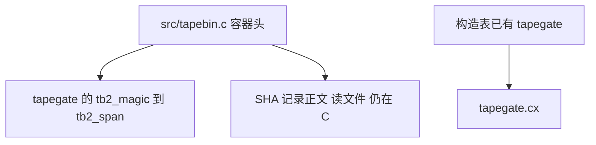

## 138. 2026-10-30 入口 ar 接上归档成员

`src/drive.cx` 的 `dv_ar` 原先认出 r/q/t/x 之后仍返回 2。现在 r 和 q 用已有的 `cxr_append` 把成员写入归档，t 和 x 用已有的 `cxr_member` 列出或抽出。缺文件沿用读源的那几句。短语放在 `src/entrybind.cx`，入口不把整条 bindhost 链拉进来。没有新模块，构造表没有新增参数。

临时入口是 `sh ./unisacc.com -o /tmp/grk-cx-line/entry src/unisacc.cx`，没有 `-O`。退出 0，stdout 0，stderr 0，墙钟 40232777969 ns。文件 1126911 字节，sha256 `8b2e87a31b491af41f86031e202f5535fe6cae761d5997503218405c9890c5ef`。已装 `unisacc.com` 仍是 3035300 字节。

对拍在 `/tmp/grk-cx-line/arwork`，环境去掉 `UNISA_CONTAINER`。用法、`ar z`、缺文件、`ar t` 坏归档：两边退出码、stdout、stderr 相同。两个成员的 `ar r` 和 `ar q`，以及没有成员的 `ar r`，归档字节相同，`file` 认成 ar。`ar t` 的名单相同。`ar x` 抽出的两个文件和原件字节相同。写出的权限这边是 0755，产品是 0644，因为走的是已有的 `hs_write_out`。大归档、替换已有成员、符号表没有跑。整只 `-O2` 入口冷构造仍是构造红项。这不是产品安装。

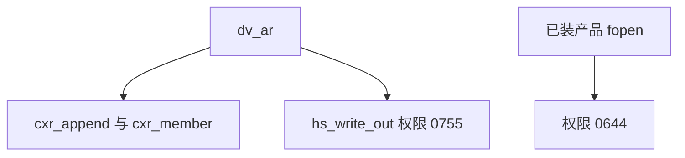

## 139. 2026-10-30 产品面窄对拍（as、nm、objdump、-c、几个旗）

没有改入口。用的就是上一节那只 1126911 字节的临时入口，对已装产品。环境去掉 `UNISA_CONTAINER`。工作目录在 `/tmp`。

`as` 的用法、`as -z`、`as -b nope`、头是 `lnx/x86_64` 再写 `-b lnx/arm64`，退出码和 stderr 相同。一行 `# unisacc -S lnx/x86_64` 两边都写出 728 字节对象，退出 0，权限都是 0644，`file` 都认成 x86-64 ELF。再加上一行 `  ret`，两边都是 744 字节。缺文件两边退出 1：产品是 `unisacc: error: cannot open …/nope.s: ENOENT`，入口是 `as: cannot read …/nope.s`。

`nm` 少了文件、`objdump` 少了文件或少了 `-d`，两边退出 2，stderr 相同。拿一份不是对象的文件给 `nm` 和 `objdump -d`，两边退出 1，stderr 相同。对那份 728 字节对象，`nm` 两边 stdout 都是 0；`objdump -d` 两边 stdout 都是 95 字节。入口自己编出的那份同样如此。

`int x;` 走 `-c -b lnx/x86_64` 或 `-S -b lnx/x86_64`，两边退出 1，stderr 都是 63 字节，说没有 `main`。`int main(void) { return 0; }` 走 `-c -b lnx/x86_64 -o`，产品退出 0，写出 2216 字节对象，权限 0755。入口退出 2，stderr 是 `route=lnx/x86_64/object/O0` 和 `NOT_IMPLEMENTED object`，没有对象文件。

`-dump-tokens` 对 `int x;`：产品退出 0，stdout 25 字节。入口退出 2，印 `route=tokens` 和 `NOT_IMPLEMENTED tokens`。

`-cx-plan` 对一份 `int x;` 的 `.cx`：产品退出 0，stdout 12 字节。入口退出 1，印 `option not migrated`。`-cx-interface` 对同一份：产品退出 1，说这个模块导出了对象；入口仍是 `option not migrated`。

`--emit-host-symbols` 配 `-c -b`：两边退出 1，stderr 都是 73 字节，`diagnostic option mode/target not supported`。配 `-S -b` 时两边先报没有 `main`，都没有写出符号文件。

`-E` 和 `-O1 -E` 对 `int x;`：两边退出 0，stdout 都是 7 字节。`-DFOO=1 -E`：产品退出 0，stdout 仍是源文；入口退出 1，印 `bad argument`。

`.tape`、`.tapebin`、库接口没跑。整只 `-O2` 入口冷构造仍是构造红项。这不是产品安装。

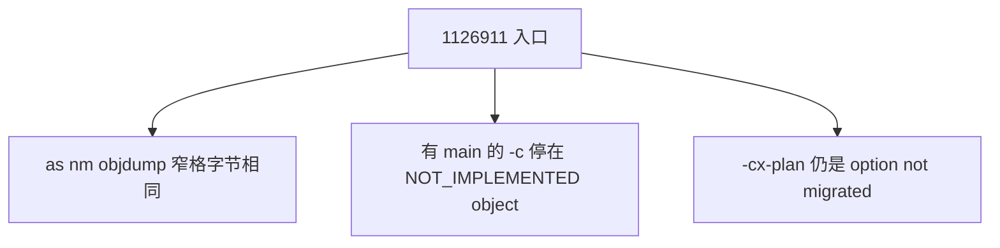

## 140. 2026-10-30 入口接上 -cx-plan 和 -cx-interface

`src/drive.cx` 看见这两个旗就交给已经在入口里的 `cxm_plan`、`cxm_planprint` 和 `cxm_interface`，然后返回。没有新模块，没有新的 `use`。`-include` 仍走原来的命令行记录，这条还没接，所以计划行上还不会出现 `-include` 的文件。

临时入口重新构造，没有 `-O`。退出 0，stdout 0，stderr 0，墙钟 38741812839 ns。文件仍是 1126911 字节，sha256 `90f11a4cf090176e49e1ff956161621d74e96c4a08c76e78f34c107459dddc31`。已装产品仍是 3035300 字节。

对拍在 `/tmp/grk-cx-line/planwork`，环境去掉 `UNISA_CONTAINER`。`int x;` 的 `.cx`：`-cx-plan` 两边退出 0，stdout 12 字节；`-cx-interface` 两边退出 1，stderr 76 字节。`int id_n(int n) { return n; }`：`-cx-plan` stdout 13 字节，`-cx-interface` stdout 168 字节，都相同。`.c` 的 `-cx-plan` stdout 6 字节，相同。缺文件的 `-cx-plan` 两边退出 0，stdout 15 字节；缺文件的 `-cx-interface` 两边退出 1，stderr 24 字节。只有旗、没有文件，两边退出 1，stderr 48 字节。两个旗一起用时走接口，stdout 168 字节，相同。`-include extra.h -cx-plan`：产品退出 0，计划行里有 `extra.h`；入口退出 1，印 `bad argument`。不带这些旗的 `-E` 仍是 7 字节源文。`as` 用法仍退出 2。一行汇编头仍是 728 字节，权限 0644。多个模块的 `use` 没有跑。这不是产品安装。

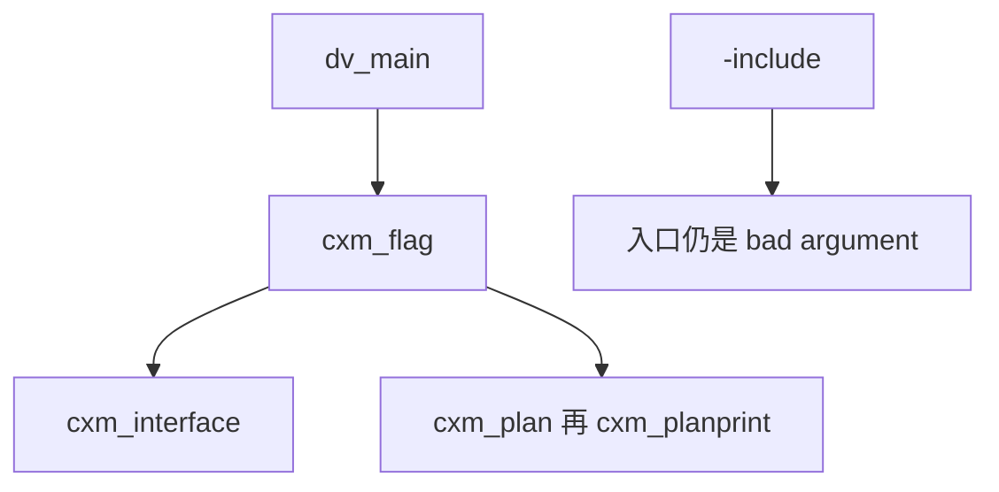

## 141. 2026-10-30 入口接上 -D 族、.tape 和坏 .tapebin

`src/drive.cx` 增加 `use driver.args` 和 `use driver.path`。命令行把 `cxa_record`、`cxa_line`、`cxa_cancel` 填进调用方的 `CxcOps`。长度大于 0 才放入 defines、undefines、include-dir、quote-dir、error-limit。`.cx` 的 includes 仍是 `cx.h`，后面再接 `-include`。`-cx-plan` 把这些 `-include` 记录交给 `cxm_planprint`。`.tape` 先跑 `tapecheck`，O0 再从 `prune` 跑到路线尾，写出仍走 `hs_write_out`。`.tapebin` 在入口上认后缀。短文件或魔数不对，用产品那句拒绝。魔数在、长度不少于 136 时停在 `tapebin decode`，因为 `tbc_decode` 仍在 C。没有新模块。没有改 `cli.cx`。

临时入口重新构造，没有 `-O`。退出 0，stdout 0，stderr 0，墙钟 39513201919 ns。文件 1156319 字节，sha256 `e215b2eb76924b1ee04d8f679a8c8b8a842064381d19b5b0e758216c685a3787`。已装产品仍是 3035300 字节。这只入口是本机 ELF，直接执行。已装产品仍用 `sh`。

对拍在 `/tmp/grk-cx-line/tri`，环境去掉 `UNISA_CONTAINER`。上面清单里这三面的窄格，退出码和字节与产品相同。`UTAPEBIN` 加 128 个 0 这一格不同：产品 65 字节仍是 invalid，入口 38 字节是 `tapebin decode`。有效 `.tapebin` 没跑，这一面不标已通。`abs(-3)` 两边退出 3。整份 `tests/library-abi.cx` 没跑。整只 `-O2` 入口冷构造仍是构造红项。这不是产品安装。

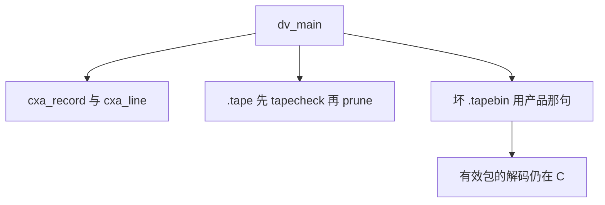

## 142. 2026-10-30 入口按两只 -O2 对象构造

整只 `src/unisacc.cx` 的 `-O2 -funit` 是 54.5 秒，再链接缺 `clock_gettime`。现在拆开。`src/entryexec.cx` 使用 `executor` 和 `packmodel`。`src/drive.cx` 和 `src/stages.cx` 不再 `use` 这两份，改成函数里声明后按名字调用。宿主符号放在 `src/hostnative.cx`，只链进这只入口。`cx/runtime/process_group.cx` 没有改，仍只有 `setpgid`。`hostnative` 定义 `clock_gettime`、`mmap`、`mprotect`、`munmap`。`dlopen`、`dlsym`、`dlclose`、`dlerror` 不能在对象文件里写成 host FFI 槽，所以调用时从已经映射的 libc 符号表里找。

三只都是 `sh ./unisacc.com -O2 -c -b lnx/x86_64 -funit`，退出 0，stdout 0，stderr 0。执行器对象 1254152 字节，墙钟 16698966748 ns。驱动对象 3998448 字节，墙钟 38656618611 ns。`hostnative` 对象 68888 字节，墙钟 2532400590 ns。

链接是 `sh ./unisacc.com -b lnx/x86_64` 加上驱动、执行器、`hostnative` 这三个对象，没有 `process_group.o`。退出 0，stdout 0，stderr 0，墙钟 4787732468 ns。产物 `/tmp/grk-cx-line/entry-o2`，869311 字节，sha256 `fb4021bc90f1c1847a6ce254737ff552f797b517062567a31e2888515a6bb311`。`file` 看是静态链接的 ELF。直接执行，不经过 `sh`。

`int x;` 的 `-E`：这只入口和已装产品都是退出 0，stdout 7 字节，stderr 0，内容相同。`dlopen` 没实跑。没有对拍优化后的对象。`-O1` 没在这只上重跑。这一面仍是骨架。已装产品仍是 3035300 字节。这不是产品安装。

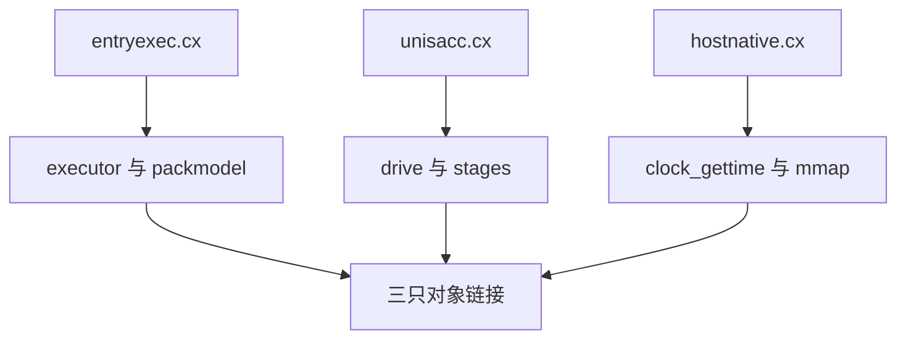

## 143. 2026-10-30 用这只 -O2 入口跑完 148 格

`tools/check-cx-entry.cx` 在原来 100 格后面加了 48 格，12 面各有自己的对拍行。入口是上面那只 869311 字节的 `/tmp/grk-cx-line/entry-o2`。表在 `/tmp/grk-cx-line/o2mx/cx-entry-matrix-2026-10-30.tsv`。进度走到 148，stdout 是 `LEFT:0`。没有一面改成已通。

100 格语料里，`do.c` 到 `cxstd_main.cx` 都和产品相同。`dev-run.cx` 的 `-E` 相同，两边退出 1，stderr 67 字节。`-S`、`-run` 和六个 `-o` 都是入口撞上 18 秒上限，退出 142，stderr 0。产品这边 `-S` 用 4.4 秒退出 1，stderr 是 `undefined function 'strdup'` 和 `setpgid`。`-run` 用 0.1 秒退出 2，stderr 是用法拒绝。六个 `-o` 里四个写出对象，两个 Windows 目标退出 1。`dup.c` 的 `-run`：产品退出 3；入口退出 127，stderr 是 `unisacc: no host function strdup`。

12 面里和产品相同的行：`nm` 三行，`objdump` 四行，`-cx-plan`/`-cx-interface` 八行，`--emit-host-symbols` 两行，`-D` 族七行，`abs(-3)` 一行，`as` 除缺文件外的六行，`.tape` 好文件和坏文件，坏 `.tapebin`，没有 `main` 的 `-c`，`-O1 -E` 和 `-O2 -E`。

还红的行：`ar` 空归档和两成员，字节相同，权限 0755 对 0644。`as` 缺文件，句子不同。有 `main` 的 `-c`、`-O1 -c`、`-O2 -c`，入口停在 `NOT_IMPLEMENTED object`。`UTAPEBIN` 加 128 个 0，句子不同。`-dump-tokens` 停在 `NOT_IMPLEMENTED tokens`。按红格数量，`dev-run` 8 格，`-O` 和 `ar` 各 2 格，其余各 1 格。这不是产品安装。

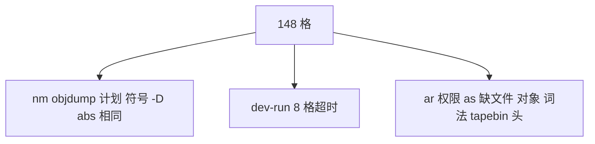

## 144. 2026-10-30 ar 权限和 as 缺文件改成和产品一样

`src/drive.cx` 的归档写完之后把权限改成 0644。`.tape` 仍走原来的写出，权限保持 0755。`as` 打不开文件时，ENOENT、EACCES、ENOTDIR 用已有的 `bx_read_open_line`，其它读失败仍是 `as: cannot read`。没有新模块。`process_group.cx` 没有改。

驱动对象重新按 `-O2 -c -b lnx/x86_64 -funit` 编译，退出 0。再和原来的执行器对象、`hostnative` 对象链接，没有 `process_group.o`。产物仍是 `/tmp/grk-cx-line/entry-o2`，869391 字节，sha256 `59b9f33a06d6d9dcec4fb8c11ea2496628b5c383bf70b682b1b3dabe55f410e3`。直接执行。

空归档两边 8 字节，权限 0644。两成员两边 146 字节，权限 0644。缺文件的 `as` 两边退出 1，stderr 都是 `unisacc: error: cannot open …: ENOENT`。一行汇编仍是相同对象，权限 0644。三行 `.tape` 仍是相同的 4096 字节，权限 0755。`int x;` 的 `-E` 仍相同。148 格整表没有用这只新入口重跑。这不是产品安装。

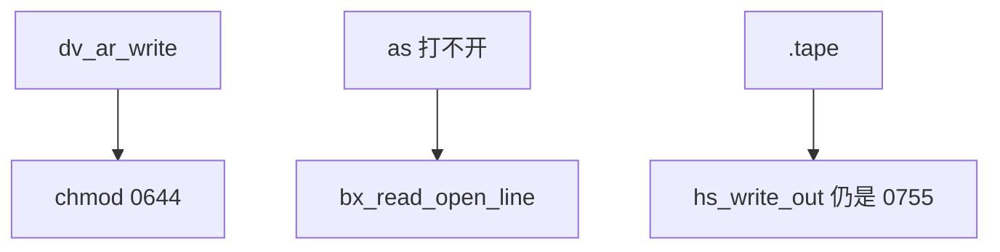

## 145. 2026-10-30 对象、词法和坏 tapebin 头

`src/drive.cx` 在路线跑完之后，模式 4 把 tokenpp、tokenlex 的结果写到标准输出。模式 5 且不是汇编路径时，把 lower 之后的对象 ELF 用原来的 `hs_write_out` 写出，权限仍是 0755。汇编 `-S` 仍停在原来的 `NOT_IMPLEMENTED`。没有新模块，没有改 `hs_write_out` 的 0755。

坏的 `UTAPEBIN` 头先对固定字段：主版本、次版本、opset、flags、target、节数、头长、来源目标。对不上就用产品那句 `invalid tapebin or origin target mismatch`。字段能过的头仍停在 `tapebin decode`，记录解码还在 C。没有把 `tbc_decode` 整份搬过来。

驱动对象重新按 `-O2 -c -b lnx/x86_64 -funit` 编译，再和原来的执行器对象、`hostnative` 对象链接。产物 `/tmp/grk-cx-line/entry-o2`，873487 字节，sha256 `313206b1c4761f2fa56ecc7245087ec0a39b3e811253daace609f6b44efbaf92`。直接执行。

`int main(void){return 0;}` 的 `-c`、`-O1 -c`、`-O2 -c` 都退出 0，对象 2216 字节，权限 0755，和已装产品逐字节相同。`-dump-tokens` 对 `int x;` 两边 stdout 25 字节相同。没有 `main` 的 `-c` 两边仍是 `not covered: no main`。`-E` 仍相同。三行 `.tape` 仍是 4096 字节，权限 0755。`UTAPEBIN` 加 128 个 0，两边退出 1，stderr 都是那句 invalid。`XXXX` 仍是同一句。固定字段能过的 136 字节头，入口仍是 `tapebin decode`。重测表在 `out/grk-obj-01/recheck.tsv`。148 格整表没有用这只新入口重跑。`dev-run` 8 格和 `dup.c` 的 `strdup` 没动。这不是产品安装。没有一面改成已通。

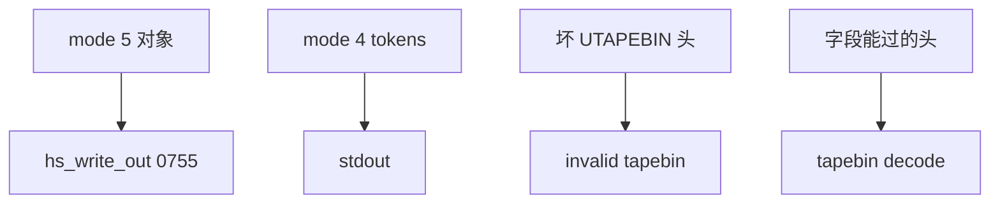

## 146. 2026-10-30 十二面在这只入口上检查器全绿

`tools/check-cx-entry.cx` 在没有进度文件时可以多带一个起点，从那一格开始，并截断表。进度文件写成两行：起点、下一格。只有一个整数的旧进度仍表示起点 0。之后再带起点，必须和文件里的起点相同。不带起点时，用法和以前一样。`use` 仍是 1 条。

这一轮起点是 100。入口是 `/tmp/grk-cx-line/entry-o2`，873487 字节，sha256 `313206b1c4761f2fa56ecc7245087ec0a39b3e811253daace609f6b44efbaf92`。表 `out/grk-face-01/cx-entry-matrix-2026-10-30.tsv` 是表头加 48 行，48 行判词都是 SAME。进度文件是 100 和 148。stdout 最后一行是 `LEFT:0`。再跑同一条命令仍是 `LEFT:0`。带起点 0 会被拒绝，因为和已有起点不符。只有一个整数 `100` 的进度，再带起点 100 也会被拒绝。只有一个整数 `148` 时直接 `LEFT:0`。语料前 100 格没有跑。驱动没有改。

十二面按这张表的 SAME 从骨架改成已通。格数是 ar 5、as 7、nm 3、objdump 4、-c 2、tape 2、tapebin 2、cx-plan 6、cx-interface 2、dump-tokens 1、emit-host-symbols 2、-O1 2、-O2 2、-D 7、lib 1。-O1/-O2 写成已通（限检查器这些格），性能红项另记：`dev-run` 的 8 格超时不在这 4 格里。有效 `.tapebin` 包仍没跑，字段能过的头仍停在 `tapebin decode`，解码仍在 C。库接口这一格两边退出 3，`us_*` 没接到入口，`tests/library-abi.cx` 没跑。`--emit-host-symbols` 两格都是两边拒绝，没有写出符号文件。`dev-run` 8 格和 `dup.c` 没跑。这不是产品安装。

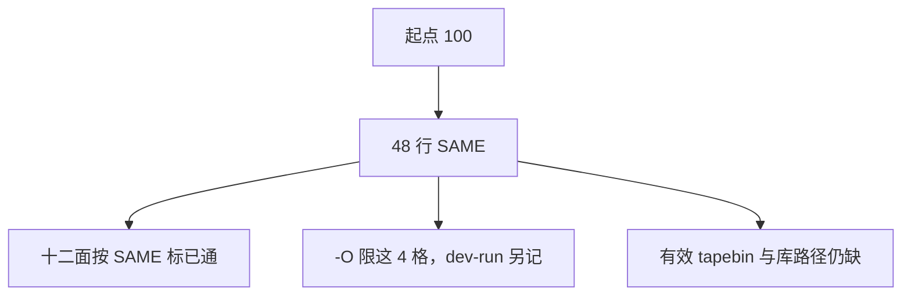

## 147. 2026-10-30 摘要对不上的 tapebin 头用产品那句

`src/drive.cx` 在固定字段通过之后，用前奏里的 `cx_sha256` 对头后面的字节做摘要，和头内 32 字节比较。对不上就用产品那句 `invalid tapebin or origin target mismatch`。对得上仍停在 `tapebin decode`。没有新模块，没有走目录行，没有搬记录文本。

驱动对象重新按 `-O2 -c -b lnx/x86_64 -funit` 编译，再和原来的执行器对象、`hostnative` 对象链接。产物 `/tmp/grk-cx-line/entry-o2`，877583 字节，sha256 `135139bdd4e48992a9baf3dd635e93e4f8204d0f3a75dd7a8e8772ca89add7a3`。直接执行。

固定字段能过、摘要是 0 的 `out/grk-tapebin-01/shaped.tapebin`，两边退出 1，stderr 65 字节，逐字节相同。检查器里的 `XXXX` 和 `UTAPEBIN` 加 128 个 0 仍是这句。摘要对得上、目录行是 0 的 `out/grk-tapebin-01/goodsha.tapebin`，产品退出 1，入口退出 2，stderr 是 `tapebin decode`。三行 `.tape` 仍是 4096 字节，权限 0755，逐字节相同。48 行检查器没有整表重跑。库接口没动。这不是产品安装。

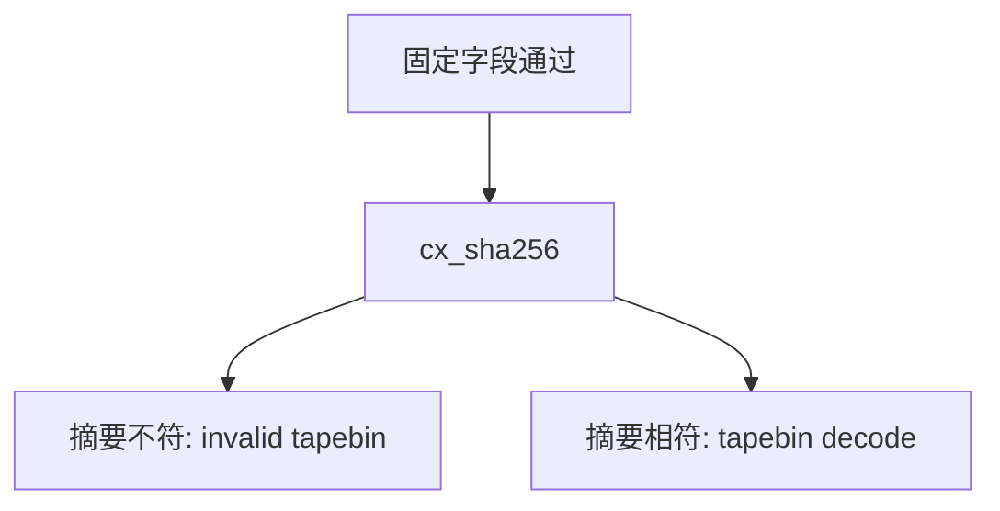

## 148. 2026-10-30 目录行对不上的 tapebin 用产品那句

`src/drive.cx` 多了 `use compiler.tapegate`。摘要通过之后，用已有的 `tb2_nsec`、`tb2_align`、`tb2_row`、`tb2_zeros`、`tb2_extra`、`tb2_end` 看目录。行种类、对齐、补零、第四节长度或结尾对不上，就用产品那句 `invalid tapebin or origin target mismatch`。目录能过仍停在 `tapebin decode`。没有新模块，没有搬记录文本。

驱动对象重新按 `-O2 -c -b lnx/x86_64 -funit` 编译，再和原来的执行器对象、`hostnative` 对象链接。产物 `/tmp/grk-cx-line/entry-o2`，889911 字节，sha256 `f6c4431dd26873fe60d7a1d4fd91ad25da843dc42eb7dbaec58654081cae22e6`。直接执行。

`out/grk-tapebin-01/goodsha.tapebin` 摘要对、目录是 0，两边退出 1，stderr 65 字节，逐字节相同。摘要是 0 的 `shaped.tapebin`，以及检查器里的 `XXXX` 和全零头，仍是这句。`out/grk-tapebin-01/dirok.tapebin` 三行对齐、三节长度为 0，产品退出 1，入口退出 2，stderr 是 `tapebin decode`。三行 `.tape` 仍是 4096 字节，权限 0755，逐字节相同。48 行检查器没有整表重跑。库接口没动。这不是产品安装。

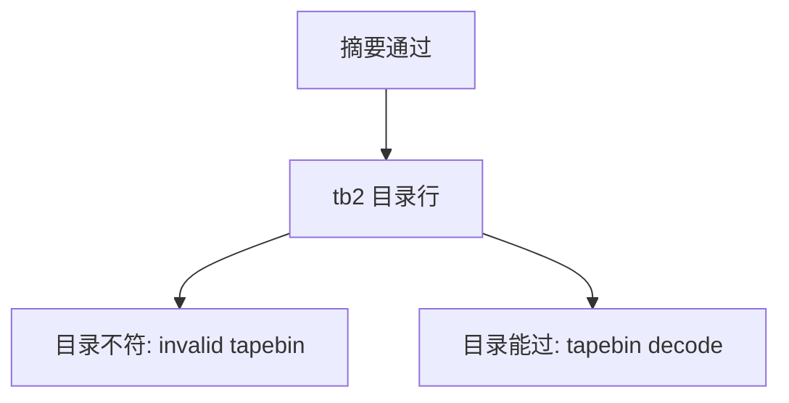

## 149. 2026-10-30 tapebin 一次校验并解码成规范文本

`src/drive.cx` 用 `cx/compiler/tapegate.cx` 里已有的 `tb2_magic`、`tb2_fixed`、`tb2_nsec`、`tb2_origin`、`tb2_align`、`tb2_row`、`tb2_zeros`、`tb2_extra`、`tb2_end`，加上原来的 `cx_sha256`，一次看完头、摘要和目录。通过之后 `tb2_text` 按 `exec/c/tapebin.h` 的规范打印把记录解成 tape 文本，再走原来的 `.tape` 路线（`-S` 经 tapecheck 原文写出，`-o` 经 prune 出镜像）。opcode 名字和 shape 与 `src/tapebin_shape.inc` 的 72 项相同。没有新模块，没有搬编码器。失败仍是产品那句 `invalid tapebin or origin target mismatch`。

驱动对象重新按 `-O2 -c -b lnx/x86_64 -funit` 编译，再和原来的执行器对象、`hostnative` 对象链接。产物 `/tmp/grk-cx-line/entry-o2`，939879 字节，sha256 `c95ae71a60000180bb2762d8d1206cbf0480e92598480d26ac5586cc16ccd397`。直接执行。

对拍表 `out/grk-tapebin-02/cmp.tsv`。正例是已装产品自己生成的包。`-S` 文本和 `-o` 镜像都逐字节相同，镜像退出码是 return 7 → 7、arith → 7、loop → 5、call-str → 7、global-bss → 9。三行手写 `.tape` 的 `-S` 仍是 26 字节原文，镜像 4096 字节和产品相同。反例十五个都是退出 1、stderr 65 字节、逐字节相同，其中包括以前停在 `tapebin decode` 的空节 dirok。`-run` 仍走 C 的内存路径，这一刀没有改。48 行检查器没有整表重跑。库接口没动。这不是产品安装。

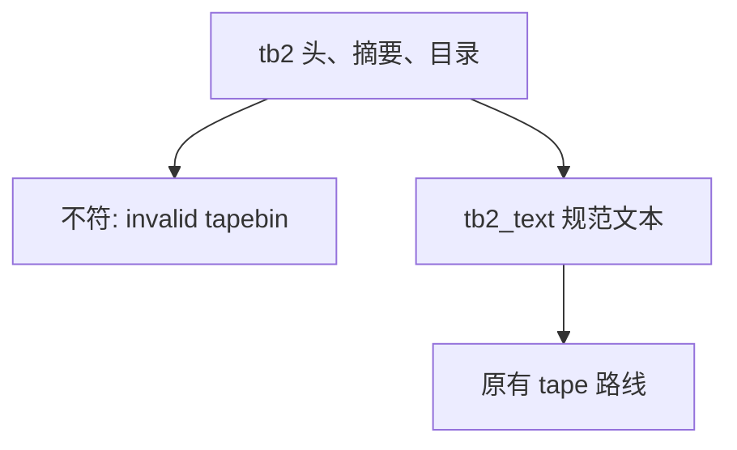

## 150. 2026-10-30 core_run 热循环少四次每步调用

`cx/core/execute.cx` 的 `core_run` 循环原来每步调用 `core_run_budget`、`core_run_key`、`core_run_stop`，结束时调用 `core_run_take`。这四个函数仍留在 `cx/core/transition.cx`，检查器还是直接调用它们。循环里按这四个函数原来的返回值写开：步数到顶就写 `timeout` 并把状态设为 3；模式 1 用栈顶，模式 0 用当前字节，其它模式用寄存器；转换函数返回原因或下一状态小于 0 就停，状态设为 2；状态是 0 才把输出交出去。模型和阈值没有改。转换调用和动作函数还在。

执行器对象按 `sh ./unisacc.com -O2 -c -b lnx/x86_64 -funit` 重编，17.630 秒，1254648 字节，stdout 和 stderr 都是 0。再和原来的驱动对象、`hostnative` 对象链接，4.931 秒。入口 `/tmp/grk-cx-line/entry-o2`，939895 字节，sha256 `600ae023cafa6ef4194ac9b7d5824dd5ce992635bb896bedf05334836bddf9f0`。直接执行。重编第二次哈希相同。

对拍参数是 `-b lnx/x86_64 -S`，cwd `/tmp/notrepo`，环境去掉 `UNISA_CONTAINER`。改之前这只入口：`hello.c` 的 e2 推理 150635389 纳秒，墙钟 848589185 纳秒；`fib.c` 的 e2 推理 160916703 纳秒，墙钟 864127870 纳秒。改之后：`hello.c` e2 137543957 纳秒，墙钟 754880835 纳秒；`fib.c` e2 138096783 纳秒，墙钟 766198976 纳秒。两边退出 0。文本和产品逐字节相同：`hello.c` 172298 字节，`fib.c` 173580 字节。产品同一参数的 e2 推理是 `hello.c` 41894569 纳秒、`fib.c` 40134193 纳秒。

`tools/dev-run.cx -S` 改之后墙钟 25199846579 纳秒，退出 1，stdout 0。e2 推理三次：7441975848、7574697974、4692268174 纳秒。然后 e3 推理 4295289320 纳秒，stderr 是 `undefined function 'strdup'` 和 `undefined function 'setpgid'`。已装产品同一条命令墙钟 4189426592 纳秒，退出 1，stdout 0，没有 e2 行；units 推理 226170457 纳秒，e3 推理 1202077024 纳秒，stderr 是同样两句。检查器给 `dev-run.cx` 的上限是 18 秒。25.200 秒仍会记超时。这 8 格没有转绿。48 行检查器没有整表重跑。这不是产品安装。

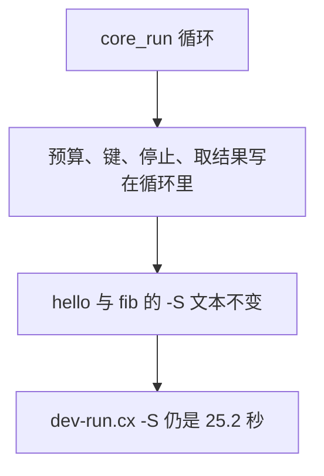

## 151. 2026-10-30 入口读自身尾部的 P3

`src/host.cx` 的 `hs_container` 本来就是：没设 `UNISA_CONTAINER` 时，先看自己的文件尾是不是 `UNIPKG1`，是就用自己，否则才找旁边的 `unisacc.com`。这一刀没有改这段，也没有改五份构造脚本，没有覆盖仓库根的 `unisacc.com`。

已装产品 3035300 字节，尾部 16 字节是 `UNIPKG1` 加小端长度 1636004。包从偏移 1399280 开始，连尾一共 1636020 字节，开头是 `P 3 32 1`。把第 150 节那只 939895 字节的静态 ELF 后面接上这一段，写出 `out/grk-self-01/candidate`。拼接墙钟 29506675 纳秒。候选 2575915 字节，权限 0755，sha256 `1038cc9706a88d6adcf8c8e4ef6d5fa1cd3fcb4a1c2f55c87ecdd6aef09d24c5`。`file` 仍是静态链接 ELF。同目录没有 `unisacc.com`。

冷跑：cwd `/tmp/notrepo`，环境去掉 `UNISA_CONTAINER`，命令是这只候选 `-b lnx/x86_64 -S examples/hello.c`。退出 0，stdout 172298 字节，和已装产品逐字节相同，墙钟 775247915 纳秒，stderr 0。这只说明自身尾部能当包用。没有换掉已装产品。

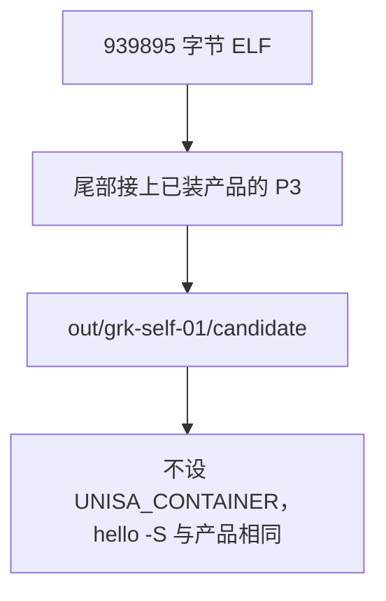

## 152. 2026-10-30 库调用从 abs 一格扩到一份对照

检查器原来只有 `abs(-3)`，两边退出 3。`tests/library-abi.cx` 里 `library_abi_values` 用到的库函数，写进 `/tmp/grk-lib-01/lib.c` 一份：`qsort`、`bsearch`、`snprintf`、`memchr`、`memcmp`、`strtol`、`strtoul`、`strtod`、`calloc`、`realloc`、`free`、`memmove`、`strcmp`。源文件不在仓库里。

cwd `/tmp/notrepo`，环境去掉 `UNISA_CONTAINER`。入口是第 150 节那只 `/tmp/grk-cx-line/entry-o2`。参数 `-b lnx/x86_64 -S`：两边退出 0，stderr 0，stdout 都是 342381 字节，逐字节相同。参数 `-b lnx/x86_64 -o`：两边退出 0，stderr 0，镜像都是 65596 字节，逐字节相同。两个镜像直接执行，退出码都是 200。

`tests/library-abi.cx` 整份没跑。它核对的是仓库根 `unisacc.com` 的身份，不是这只入口。模块边界那几项没跑：八个 int64 参数、整数和 double 混排、结构体当参数和返回值、可变参数、`va_copy`。`us_*` 没有新接线。`dup.c` 的 `strdup` 没跑。这不是产品安装。

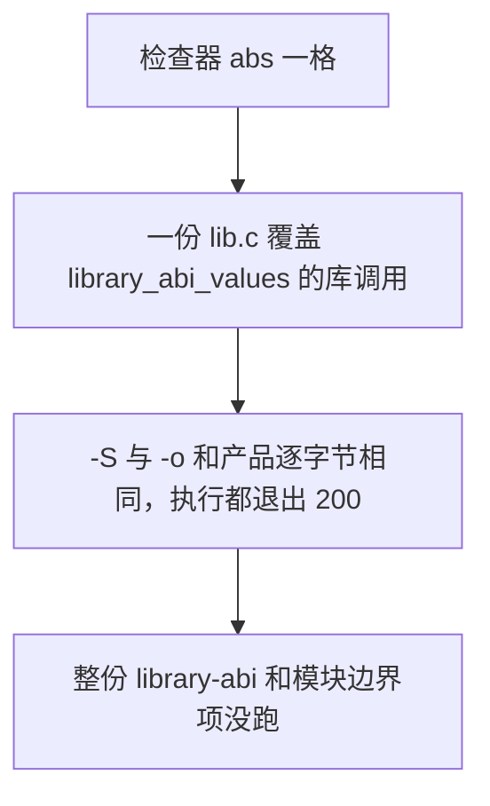

## 153. 2026-10-30 hello 和 fib 的 e2 分解

`tools/core-transition-profile.cx` 只数转移形状，不计时间，也不碰动作、内存和输出。这一张表用 `out/grk-e2-split-01/` 里的私有副本。仓库里的 `cx/core/execute.cx` 没有改。已装产品和 `/tmp/grk-cx-line/entry-o2` 都没有换。

副本在每次换档时读一次时间戳计数器的低 32 位。换档会把运行拉长，所以下面的比例不能拿去减未插桩的 138 毫秒。空读一次的成本，hello 这次是 34，fib 这次是 44，两次校准不一样。扣掉这个成本之后，各档的先后顺序没有变。

五档是这样分的。循环缝：预算判断、动作函数的进出、两个动作之间的缝。转移求值：取键，加上 `core_transition`。动作执行：既不是内存也不是写出的那些动作。内存读写：只有 `LDX` 和 `STX`。输出缓冲：写出、整段复制、裁剪、交换输出；里面 `core_buffer_put` 的次数另计。

私有入口 `out/grk-e2-split-01/entry`，964735 字节。旁边有一个指向已装产品的 `unisacc.com`，包从那里来。cwd `/tmp/notrepo`，环境去掉 `UNISA_CONTAINER`。参数 `-b lnx/x86_64 -S`。`hello.c` 退出 0，stdout 172298 字节，和产品逐字节相同。`fib.c` 退出 0，stdout 173580 字节，和产品逐字节相同。

`hello.c` 的 e2：进入循环 907729 次，转移 907729 次，其它动作 956615 次，内存 13129 次，写出类动作 813850 次，`core_buffer_put` 1035760 次。原始计数份额：循环缝 48.1%，转移 25.6%，其它动作 7.4%，内存 0.6%，输出 18.4%。扣掉空读之后：47.5%、28.2%、4.3%、0.7%、19.4%。这一次 `core_run` 墙钟 315678754 纳秒，同一次 RR_TIME 的 e2 推理是 319304297 纳秒。未插桩的那只入口，同一文件的 e2 推理是 137543957 纳秒。

`fib.c` 的 e2：进入循环 909452 次，转移 909452 次，其它动作 958555 次，内存 13171 次，写出类动作 815107 次，`core_buffer_put` 1037520 次。原始计数份额：循环缝 48.2%，转移 25.4%，其它动作 7.4%，内存 0.6%，输出 18.3%。扣掉空读之后：47.5%、29.1%、3.0%、0.8%、19.7%。`core_run` 墙钟 320033991 纳秒，RR_TIME 的 e2 推理是 324446248 纳秒。未插桩的 e2 推理是 138096783 纳秒。

两份源的 e2 形状一样。时间大头是动作函数进出和转移求值。稀疏内存可以忽略。输出大约两成，因为 e2 在往外抄文本。同一次 hello 的 e3 不是这个形状：循环缝 46.3%，转移 31.6%，其它动作 17.5%，内存 2.2%，输出 2.4%。e3 的绝对时间更长，但 `dev-run.cx` 超时的大头仍是多趟 e2。

决定：不改模型和阈值，也不再改 `core_run` 的热循环。再减调用或加扁表快路径已经试过，没有把 25 秒压进 18 秒。下一刀如果要动，得少做动作函数的进出，并让转移求值的生成代码变短。这一轮没有动。`dev-run.cx` 没有重跑。这不是产品安装。

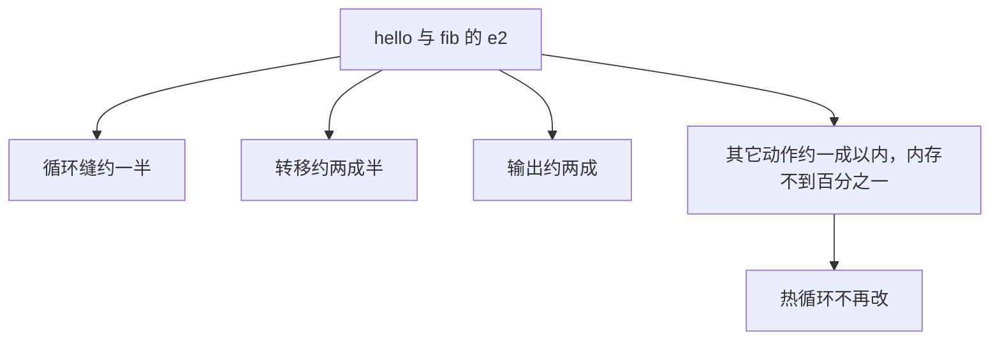

## 154. 2026-10-30 模块边界五项和产品逐字节相同

第 152 节对过 `library_abi_values` 里的库调用。这一节对模块边界。源在 `/tmp/grk-lib-02/drv.cx`，不进仓库。它 `use` 的是 `tests/cases/library_abi.cx` 的一个符号链接。调用的五个函数都写在那个模块里，不写在 `drv.cx` 里：八个 int64 相加应得 204；整数和 double 混排应得 110，这里只打印等于 110 与否；结构体进去再出来，两个字段应得 -4294967294 和 4294967293；可变参数应得 4294967310；`va_copy` 应得 36。

cwd `/tmp/notrepo`，环境去掉 `UNISA_CONTAINER`。入口仍是 `/tmp/grk-cx-line/entry-o2`。参数 `-b lnx/x86_64 -S`：两边退出 0，stderr 0，stdout 都是 569153 字节，逐字节相同。参数 `-b lnx/x86_64 -o`：两边退出 0，stderr 0，镜像都是 106708 字节，逐字节相同。两个镜像直接执行，都退出 0，stderr 0，stdout 都是这六行：`204`、`1`、`-4294967294`、`-4294967293`、`4294967310`、`36`。

`tests/library-abi.cx` 整份没跑。它还要核对仓库根 `unisacc.com` 的身份。`us_*` 没有新接线。`dup.c` 的 `strdup` 没跑。这不是产品安装。

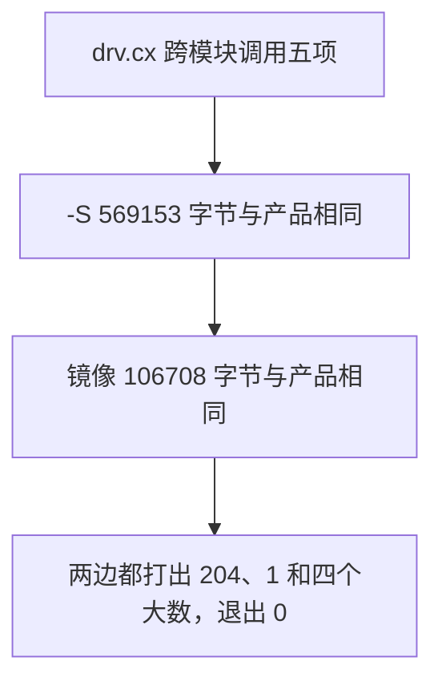

## 155. 2026-10-30 活入口接上 -l -L -x

`cx/driver/compat.cx` 原来只有检查，活入口没调用。这一刀在 `src/drive.cx` 的参数循环里调用 `cxp_step`，位置在 `cxc_step`、版本、帮助、`--` 和程序参数断开之后，`cxm_flag` 之前。库名表用已有的 `fwd_lib_slot`，上限 16。缺参数的句子补进 `src/entrybind.cx` 的 `bx_compat_why`。没有改 `cli.cx`，没有把 `-l` 放进预扫跳过表。没有 `-o`、也不是默认运行、mode 仍是 0 时，写出 `a.out`。

临时入口换成 `/tmp/grk-cx-line/entry-o2`，944191 字节，sha256 `4fa89d4c5fde27d988db25dd4ece2d561076a2af4ef1daa266bf29eb96b77bc2`。驱动对象 4453152 字节。`exec.o` 和 `hostnative.o` 没重编。上一只入口是 939895 字节。

cwd `/tmp/notrepo`，环境去掉 `UNISA_CONTAINER`。和已装产品比过：单独 `-l`、`-L`、`-x` 退出 1，stderr 相同；`a.c -l` 长句相同；`-run a.c -l` 短句相同；`-z` 仍是 `option not migrated`，相同。`t.c` 的 `main` 返回 7。`-lm t.c` 两边退出 7。`-l -c t.c` 两边都写出 4096 字节的 `a.out`，逐字节相同，stdout 和 stderr 都是空的，退出 0。`-c t.c` 的 stdout 592 字节，逐字节相同。`-b lnx/x86_64 -lz -S t.c` 的 stdout 592 字节，逐字节相同。

`cx/driver/environment.cx` 还没接到入口。hello、fib、库接口、`dev-run` 和 12 面没有在这只入口上重跑。这不是产品安装。

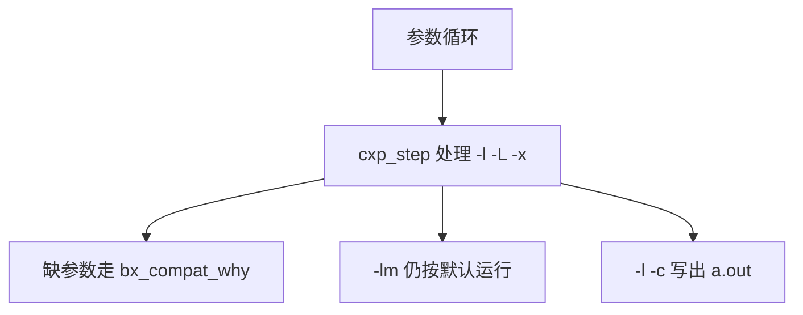

## 156. 2026-10-30 候选构造收成 tools/entry-build.cx

第 151 节那只 `out/grk-self-01/candidate` 是手工把静态 ELF 和已装产品尾部 P3 接起来的。这一刀把同一串收成 `tools/entry-build.cx`。参数是 `ROOT`、`P3`、`OUT`。编译器和包都用仓库根的 `unisacc.com`，没有换掉它，也没有改五份旧构造脚本。三只对象都是 `-O2 -c -b lnx/x86_64 -funit`，分别来自 `src/unisacc.cx`、`src/entryexec.cx`、`src/hostnative.cx`。链接不带 `-O2`。每一步走 `tools/bound`：编译 55 秒，链接 40 秒。包从 P3 文件的 `UNIPKG1` 尾切出来，接在 `entry.elf` 后面，权限 0755。收据写在 `OUT/receipt.txt`，有每个对象、入口和候选的 sha256、字节数和这一步的耗时。

第一次写到 `out/grk-entry-build-01`。`drive.o` 4453152 字节，sha256 `786c010399023b161d6c9781c8fa892f1be9aecfe4c0ffb335aeef2653a2e993`，43764674096 纳秒。`exec.o` 1254648 字节，sha256 `c97386e299c15066519aad0a29bb3e6d1197b2a1ec17cacaf7cdbda76d19a6f0`，16687117864 纳秒。`hostnative.o` 68888 字节，sha256 `6ecaef47eaea7cb6b147c47dcb9cfb7d198e5cc4d92050b79a581ff8412942c2`，2655989528 纳秒。`entry.elf` 944191 字节，sha256 `4fa89d4c5fde27d988db25dd4ece2d561076a2af4ef1daa266bf29eb96b77bc2`，4978153998 纳秒。包从偏移 1399280 起，1636020 字节。候选 2580211 字节，sha256 `ccb79895952219323f9236253f00aa2067565996ab47463cfe294751e15783ba`，拼接 14018399 纳秒。

第二次写到 `out/grk-entry-build-02`。五份产物和第一次逐字节相同，收据里的 sha256 和字节数也相同。两份收据的耗时不一样，所以收据文件本身不是同一个字节串。

冷跑：cwd `/tmp/notrepo`，去掉 `UNISA_CONTAINER`。`t.c` 的 `main` 返回 7。参数 `-b lnx/x86_64 -S`：候选和已装产品都退出 0，stderr 0，stdout 都是 592 字节，逐字节相同。hello、fib、库接口、`dev-run` 和 12 面没有用这只候选重跑。这不是产品安装。

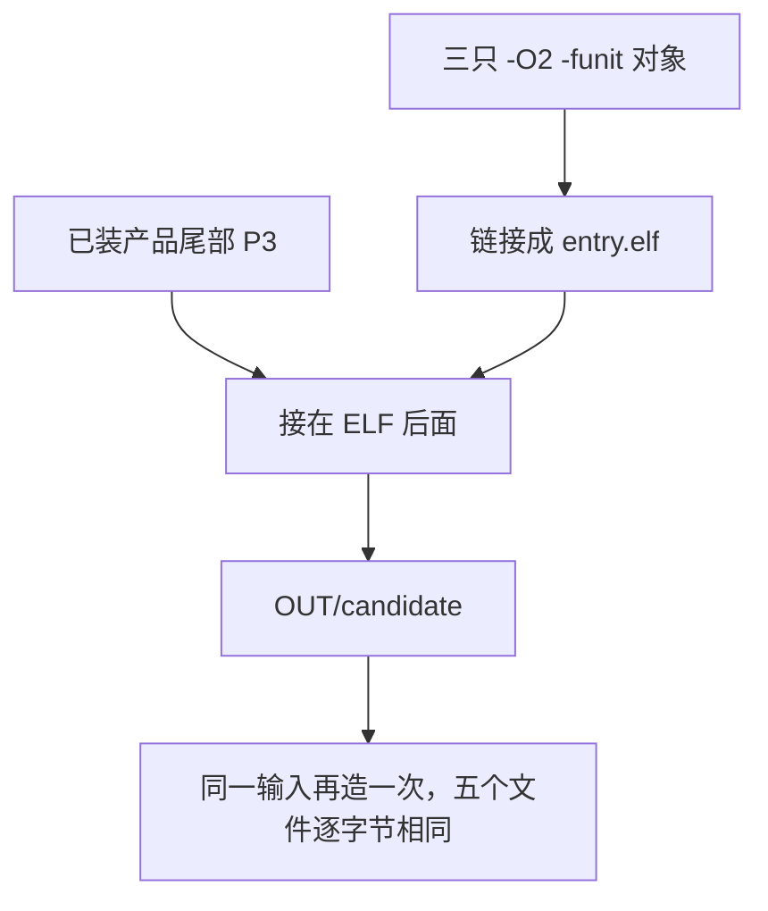

## 157. 2026-10-30 候选整表，第二代停在 drive.o

候选是 `out/grk-entry-build-01/candidate`，2580211 字节，sha256 `ccb79895952219323f9236253f00aa2067565996ab47463cfe294751e15783ba`。检查器是 `tools/check-cx-entry.cx`。每一片外层是 `tools/bound 55`。格子里面仍是普通 12 秒，`dev-run.cx` 18 秒。子进程的 cwd 是 `/tmp/notrepo`，环境里去掉 `UNISA_CONTAINER`。候选直接执行。表是 `out/grk-cand-mx-01/cx-entry-matrix-2026-10-30.tsv`，表头加 148 行。进度文件是 0 和 148。stdout 最后一行是 `LEFT:0`。一共 20 片，片与片的间隔最长 27 秒，最后一片约 6 秒。没有一片被外层 55 秒杀掉。

139 行 SAME。这 139 格按上面的候选 sha 记已通。前 100 格是 91 个 SAME、8 个 TIMEOUT、1 个 DIFF。后面 12 面 48 行全是 SAME。

8 个 TIMEOUT 都是 `dev-run.cx`：`-S`、`-run`，再加 `lnx/x86_64`、`lnx/arm64`、`osx/x86_64`、`osx/arm64`、`win/x86_64`、`win/arm64` 的 `-o`。候选退出码都是 142，墙钟大约 18.05 秒。产品都在 18 秒内结束。`-S` 产品用了 4.326 秒。六个 `-o` 里产品最慢的是 `osx/x86_64`，8.321 秒。`dev-run.cx -E` 两边退出 1，stdout 是 0，stderr 是 67 字节，判 SAME。热循环没改。`dup.c -run` 是 DIFF：产品退出 3，候选退出 127。这是 `strdup` 转发，这轮没改。

`tools/entry-build.cx` 可以多带一个构造器。不带时仍用 `sh` 启动仓库根的 `unisacc.com`。带上路径就直接执行那个文件。这轮没有再跑不带构造器的那条。第二代目录是 `out/grk-entry-build-03`。构造器就是上面那只候选。P3 仍是仓库根 `unisacc.com`，sha256 `79fb84e65a10b55ce40be5f68746748acbd38f441944046c0a5dfa5718bc0c32`。`drive.o` 这一步走 `tools/bound 55`，退出 142，耗时 55049618747 纳秒。收据里这一步是 TIMEOUT。目录里没有 `drive.o`、`exec.o`、`hostnative.o`、`entry.elf`。没有和第一代比字节。停住的相位是 `drive.o` 编译。没有换掉已装产品，没有改五份旧构造脚本，bound 没有加长。

```mermaid
flowchart TD
  cand["候选 sha ccb79895"] --> mx["148 格，外层 bound 55"]
  mx --> same["139 SAME"]
  mx --> red["dev-run 八格超时，dup.c 退出 127"]
  cand --> gen2["候选再编译 drive.o"]
  gen2 --> stop["55 秒退出 142，没有第二代对象"]
```

## 158. 2026-10-30 38 只对象，两代逐字节相同

`drive.cx` 不再把整段驱动闭包编成一只对象。`src/driveface.cx` 和 `src/driveroute.cx` 是从它挪出去的。`tools/entry-build.cx` 现在编 38 只 `-funit` 对象。第 38 只是 `src/compiler/tapelink.cx`，单独成 `tapelink.o`。`drive.cx` 用块内声明调用 `tl_*`，没有 `#pragma unisa use compiler.tapelink`。

`-c -funit` 会把 `\0cli/object` 和 `\0cli/funit` 放进模型资源，值是单字节 1。没有这两键时，别的对象里的函数会被报成 undefined function。

`.o`、`.obj`、`.a` 不再把文件字节送进 e2。先要求每个输入都是对象，再用 tapelink 把 unit tape 接成一条文本，源个数收成 1，然后走 `{目标}/image/O{level}`。链接命令没有 `-O`，level 是 0，从 prune 走到 elf。`out/grk-entry-build-09` 是修这个之前的第二代：37 只对象在盘上，链接失败，e2 打出 `reject: NUL byte in preprocessing input`，rc 1，不是超时。09 没有 candidate，这轮没有覆盖它。

正式第一代是 `out/grk-entry-build-10`。构造器是仓库根 `unisacc.com`，sha256 `79fb84e65a10b55ce40be5f68746748acbd38f441944046c0a5dfa5718bc0c32`，3035300 字节，via=sh。38 只对象都成功。`drive.o` sha256 `f29d42cf917d22100987f71fdc264424d1ac25de4eb9dd9fa08db05e0c5b1b10`，460640 字节，ns=3818703482，最慢 e4 推理 ns=1429277276。`tapelink.o` sha256 `5c775c5a45b0121b43f40583b6e15e5d20662bcac0be5fc19017731fbc691560`，172296 字节，ns=1258903985，最慢 e4 推理 ns=474498514。`entry.elf` sha256 `5b3ac328a505d42c4774508513a1b8e3680c6eadb59266b0fb3ee7f44d33c3eb`，1036192 字节，ns=5682763632，最慢 lower 推理 ns=2254913489。package_offset 1399280，package_bytes 1636020。候选 sha256 `c85447d8386c7bd4df34f60969fd7545e08328a0a55e9520e59478a2f079c4aa`，2672212 字节。拼接 ns=13371511，slow_kind=UNMEASURED。

同一组 38 只对象，产品链出的 ELF 和这只候选再链出的 ELF 逐字节相同，都是上面的 `entry.elf` sha。候选那次走了 tapecheck、prune、lower、elf，最慢是 lower 推理，ns=6455972660，`tools/bound 40` 内退出 0。

第二代是 `out/grk-entry-build-11`。构造器就是 10 的候选，2672212 字节，via=exec。38 只 `.o`、`entry.elf`、候选和第一代逐字节相同：same 40，diff 0，miss 0。候选 sha 与第一代相同。候选侧 `drive.o` ns=11608953444，最慢 e4 推理 ns=4019976213。`tapelink.o` ns=3859911462，最慢 e4 推理 ns=1463634371。最慢的对象是 `driveface.o`，sha256 `b6c590c3ee2eccfe9604892bd9f48931d428a16726f55d69d32c3b5ac98672d3`，1626584 字节，ns=34415356768，最慢 e4 推理 ns=14840487407，低于 55 秒。`entry.elf` ns=13406527014，最慢 lower 推理 ns=6759420788，低于链接的 40 秒上限。

`dup.c` 和 `hello.c` 在 10 的候选和已装产品上实跑过。cwd 是 `/tmp/notrepo`，去掉 `UNISA_CONTAINER`，外层 `tools/bound 12`。`dup.c -run` 两边退出 3，stdout 0，stderr 0。`examples/hello.c -run` 两边退出 0，stdout 13 字节 `from hello.c`，stderr 0。148 格这轮没重跑，旧表仍只绑定旧候选 sha `ccb79895…`。热循环没改。bound 没有加长。没有换掉已装产品。

```mermaid
flowchart TD
  prod["已装产品 via=sh"] --> g1["10：38 只对象 + entry.elf"]
  g1 --> cand["候选 sha c85447d8"]
  cand --> g2["11：直接执行这只候选"]
  g2 --> same["40 个文件与 10 逐字节相同"]
  cand --> run["dup 退出 3，hello 退出 0"]
```

## 159. 2026-10-30 入口改走汇编核心

`src/executor.cx` 改为 `#pragma unisa use core.kernel`。`core_run` 走包里的 UNIKERN1 汇编核心，签名仍是 `cx/core/execute.cx` 那份。`ex_touch` 只留 `core_run_take` 和 `core_run_budget`，所以 `transition.o` 还在。`alu`、`stack`、`output`、`sparse`、`bytes` 只给旧的 `core.execute` 用，已从 `tools/entry-build.cx` 拿掉。表里本来没有单独的 `execute`、`coregate`、`memory` 对象。对象数从 38 收到 33。`cx/core/execute.cx` 和 `cx/core/kernel.cx` 正文没改。

第一代是 `out/grk-entry-build-12`。构造器是仓库根 `unisacc.com`，sha256 `79fb84e65a10b55ce40be5f68746748acbd38f441944046c0a5dfa5718bc0c32`，3035300 字节，via=sh。33 只对象都成功。`executor.o` sha256 `7e43832ce6f40fd34bd6c22bd1e812ddef09f843d1b588b4d175d4db9e3216bc`，308632 字节，ns=2646934991，最慢 e4 推理 ns=1001281213。`entry.elf` sha256 `8ec81c4d2f3746e662610ff8dd31ea2dec4fa3165dd99b748978b05251fb0f1f`，995040 字节，ns=5492598339，最慢 lower 推理 ns=2084739749。package_offset 1399280，package_bytes 1636020。候选 sha256 `11b7a23ad760970590a28350da189f8391cde3649c8053f936b3756b7715747d`，2631060 字节。拼接 ns=16494322，slow_kind=UNMEASURED。

第二代是 `out/grk-entry-build-13`。构造器就是 12 的候选，via=exec。33 只 `.o`、`entry.elf`、候选和第一代逐字节相同：same 35，diff 0，miss 0。候选 sha 与第一代相同。候选侧 `drive.o` sha256 仍是 `f29d42cf917d22100987f71fdc264424d1ac25de4eb9dd9fa08db05e0c5b1b10`，ns=3864793742，最慢 e4 推理 ns=1403011081。上一只 CX 核心候选（11）编同一只 `drive.o` 是 ns=11608953444，e4 推理 ns=4019976213。`driveface.o` sha256 `b6c590c3ee2eccfe9604892bd9f48931d428a16726f55d69d32c3b5ac98672d3`，ns=11794761865，最慢 e4 推理 ns=5386000902；11 上是 ns=34415356768，e4 推理 ns=14840487407。`driveroute.o` ns=4877628028，最慢 e4 推理 ns=1650756112；11 上是 ns=14037410263，e4 推理 ns=4933233568。`entry.elf` ns=4939334180，最慢 lower 推理 ns=2296916595；11 上是 ns=13406527014，lower 推理 ns=6759420788。最慢对象仍是 `driveface.o`，低于 55 秒。链接低于 40 秒。

`dup.c` 和 `hello.c` 在 12 的候选和已装产品上实跑过。cwd 是 `/tmp/notrepo`，去掉 `UNISA_CONTAINER`，外层 `tools/bound 12`。`dup.c -run` 两边退出 3，stdout 0，stderr 0。`examples/hello.c -run` 两边退出 0，stdout 13 字节 `from hello.c`，stderr 0。148 格这轮没重跑。热循环源码没改。bound 没有加长。没有换掉已装产品。10 和 11 没有覆盖。

```mermaid
flowchart TD
  prod["已装产品 via=sh"] --> g1["12：33 只对象，core.kernel"]
  g1 --> cand["候选 sha 11b7a23a"]
  cand --> g2["13：直接执行这只候选"]
  g2 --> same["35 个文件与 12 逐字节相同"]
  g2 --> fast["driveface 34.4s 降到 11.8s"]
```

## 160. 2026-10-30 汇编核心候选的 148 格

检查器是 `tools/check-cx-entry.cx`。候选是 `out/grk-entry-build-13/candidate`，2631060 字节，sha256 `11b7a23ad760970590a28350da189f8391cde3649c8053f936b3756b7715747d`，和 12 逐字节相同。表是 `out/grk-cand-mx-02/cx-entry-matrix-2026-10-30.tsv`，表头加 148 行。进度文件是 0 和 148。最后一片 stdout 是 `LEFT:0`，退出 0。格子里面仍是普通 12 秒，`dev-run.cx` 18 秒。子进程的 cwd 是 `/tmp/notrepo`，环境里去掉 `UNISA_CONTAINER`。候选直接执行。没有一片被外层 55 秒杀掉。旧表 `out/grk-cand-mx-01` 仍只绑定旧候选 sha `ccb79895…`。

143 行 SAME，5 行 DIFF，没有 TIMEOUT，没有 CRASH，没有 NOT_IMPLEMENTED。这 143 格按上面的候选 sha 记已通。`dup.c -run` 两边退出 3，stdout 0，stderr 0，判 SAME。上一只候选这一格是 DIFF（候选退出 127）。

原来 8 个 TIMEOUT 都是 `dev-run.cx`。这一只上：`-E` SAME（两边退出 1，stderr 67 字节）。`-S` SAME（两边退出 1，stderr 109 字节；产品墙钟 4513807171 ns，候选 9098663210 ns）。两个 Windows `-o` SAME（两边退出 1，stderr 2770 字节）。剩下 5 格是 DIFF，不是超时：

`dev-run.cx -run`：产品退出 2，stderr 81 字节，墙钟 109215544 ns；候选退出 1，stderr 52 字节，墙钟 9015168507 ns。单独再跑一次，产品 stderr 是 `dev-run: REFUSE usage ROOT [--opt=0|--opt=2] SOURCE.cx [-- PROGRAM_ARGS] errno=0`。候选 stderr 是 `unisacc: model driver: forwarding increment refused`。

四个 `-o`（`lnx/x86_64`、`lnx/arm64`、`osx/x86_64`、`osx/arm64`）：产品退出 0，写出映像，stderr 0。候选退出 1，没有映像，stderr 109 字节。`lnx/x86_64` 单独再跑一次，候选 stderr 是 `unisacc: error: undefined function 'strdup'`、`unisacc: error: undefined function 'setpgid'`、`2 errors generated.`。产品这一次退出 0，stderr 0。

8 次调用里有 6 次开头时已经有别的 `unisacc.com` 在跑。上面的墙钟都是非独占窗口上的数，不拿来比快慢。判定用的是退出码、stdout、stderr 和映像，没有一格因为撞上别人的构造被记成 TIMEOUT，所以没有整表重跑，也没有为了计时再补跑。已装产品没换。bound 没有加长。

```mermaid
flowchart TD
  cand["候选 sha 11b7a23a"] --> mx["148 格"]
  mx --> same["143 SAME，含 dup.c 退出 3"]
  mx --> diff["5 DIFF：dev-run 的 -run 和四个 unix -o"]
  diff --> gap["-o 报 undefined function；-run 停在 forwarding increment refused"]
```

## 161. 2026-10-30 -o 也走转发，5 格 DIFF 在新候选上 SAME

`-o` 的目标前缀是 `osx/`、`lnx/` 或 `win/` 时，和 `-run` 一样进 `dv_run_lower`。side-car 的 `cnt>0` 时留下 image route，写出桩，保存第一遍帧和属性，第二遍只编桩再按新下标合并属性。`-run` 的桩遍把 mode 改成 0，然后 `hs_forward_exec`。`-o` 不调用 `hs_forward_exec`，把动态映像写进输出文件。对象、tape、`-E`、emitbin、裸 `-S` 不进这条路。

新缓冲走 `src/host.cx` 的 `hs_alloc` / `hs_free`。桩文件用 `cx_write`。比较、拷贝、长度走 `tx_len` / `tx_copy` / `tx_find`。`#pragma unisa use text.text` 只在 `src/drive.cx`。`src/text` 是指向 `../cx/text` 的符号链接。`src/driveroute.cx` 不 use 这个模块，只在函数里声明 `tx_*`，符号由 `drive.o` 提供。`tests/cxraw.cx --check` 退出 0：655 个 `.cx`，22411 次调用，基线 22684，超过基线的是 0。`src/drive.cx` 仍是基线 79。`src/driveroute.cx` 是 22，基线 24。基线文件没有改。

当前候选不是 33 只对象全重编。`out/grk-entry-build-14` 里新的是 `drive.o`（569096 字节，sha256 `472e19165498c4ebcb1248b1f5760ba57334e6c92c8c04c02b121dab15c638c4`）、`host.o`（378000 字节，sha256 `1950ad2f3e242659a15e2e9bd08532c12dbd8b54e1604c9e56cca3542cf6e274`）、`driveroute.o`（554296 字节，sha256 `0cf0cb3377c937f3cfc221291a21fa4fc4dc58b3d96865c87883c2342eda21c9`）。其余对象来自 `out/grk-entry-build-13`。已装产品链接出 `entry.elf` 1015920 字节，sha256 `fec29b44a9cfaae262d1c4d82a886cfd285ec3844150078c2d86f4ff3b1d8109`，再接 build-14 里原来的 P3（1636020 字节，首字节 `P`）。候选 2651940 字节，sha256 `0989b4fdda853103b1f2a45e991654ca1b17d6e9b424d5b53192d989f4679c13`，权限 0755。已装产品没换。

检查器 `tools/check-cx-entry.cx`，表是 `out/grk-cxe-fwd-02/cx-entry-matrix-2026-10-30.tsv`。进度文件是 92 和 148。从格 92 到表尾 56 行全是 SAME，没有 DIFF，没有 TIMEOUT。最后一次调用 stdout 以这些 SAME 结尾，然后 `LEFT:0`，退出 0。格 0–91 没有在这只二进制上重跑，不能把 build-13 的 143 SAME 挪到这个 sha 上。

原来的 5 格：

`dev-run.cx -run` `lnx/x86_64`：两边退出 2，stdout 0，stderr 81 字节。产品墙钟 97414015 ns，候选 12003250594 ns。

四个 unix `-o` 两边退出 0，stderr 0，权限 755。映像字节两边相同：`lnx/x86_64` 272197，`lnx/arm64` 340985，`osx/x86_64` 280930，`osx/arm64` 363490。

两个 Windows `-o` 两边退出 1，stderr 2770 字节，没有映像。`dup.c -run` 两边退出 3。后面 48 个产品面也是 SAME。这些墙钟没有单独证明窗口是空的。已装产品没换。bound 没有加长。run-cache 在下一节。

## 162. 2026-10-30 -run 运行缓存

`src/runcache.cx` 是新模块，由 `src/drive.cx` 的 `#pragma unisa use runcache` 编进 `drive.o`，没有第 34 只对象。`src/sys` 指向 `../cx/sys`。这个文件不直接调用 libc。读写和哈希用 `cx_read`、`cx_write`、`cx_sha256_hex`。比较和拷贝用 `tx_*`。目录、改名、删除、工作目录、用户号走 `cx/sys`。`cx/sys/env.cx` 加了 `sy_uid`、`sy_cwd`。`cx/sys/fs.cx` 加了 `sy_rename`、`sy_unlink`。cc 在仓库根用 `sh ./unisacc.com tools/check-cx-sys.cx` 跑过，原有检查是 `CHECK_CX_SYS PASS ok=87 fail=0`。新函数的检查留给 unisacc-00。

`src/host.cx` 只多了两处：打开头文件时的回调 `hs_file_note_set`，以及 `hs_pid`。读过和缺席的路径记在 `runcache.cx`。缺席用 `sy_stat` 跟随链接，只有 `-ENOENT` 仍算缺席。`ENOTDIR` 和 `EACCES` 让缓存失效。缓存文件先写到带 pid 和时间戳的临时名，再 `sy_rename`。

键里的产品身份是候选整文件的 sha256，含后面的 P3。`UNISACC_RR_DEBUG` 打出的 `RR_PROD` 是 `5a9cb1b4bbf188119a48b80b59910f40a36b7c4cced45a71f0576827254aa02a`，和 `out/grk-entry-build-15/candidate` 一致，不是已装产品 `79fb84e6…`。`--` 后面的参数不进键。

切在两处。`cnt>0` 时，进程槽弹出之后、`hs_forward_exec` 之前，若产出以 ELF 魔数开头，存成 USE34（`<key>.host`）。下次在编单元之前命中，用这一次的参数执行，单元和 e3 都不跑。第二遍转发不查。`cnt==0` 时只存 e3 的 side-car（USE33）。命中后跳过 e3，prune、lower、elf 和执行照旧，所以参数是这一次重新绑定的。`cnt==0` 的 `dv_run_lower` 最终产出不进缓存。`UNISACC_RUN_CACHE=0`、警告、tape、deps、源不在 1 到 16 个、目标不是 `lnx/x86_64` 时不缓存。`-o` 不打开缓存。

`-I` 和 `-iquote` 原先在 `st_pub` 里被写成空目录，模型看不见。现在 `drive` 把解析到的目录交给 `st_dirs`，`st_pub` 按这些字节发布。不占用那 8 个 extra 槽，内存阶段的槽数不变。

对象没有全重编。`out/grk-entry-build-15` 里新的是：

| 对象 | 字节 | sha256 |
|---|---|---|
| drive.o | 920720 | `c1597c8dbf77f9d4a9985eaaa7c1c92772b47ca3fa9ae5127b08098bfbcca6f9` |
| host.o | 379776 | `602715f8ec0bf27634ce17f5608f29cf5d6fa1ead171cdab56a9fa3d6edac6fb` |
| stages.o | 249464 | `401959fa09347b0278839073f42b21dd39f830b793788f3a0566888dcffaa6d5` |
| driveroute.o | 555632 | `470493a951a3976ebf8a62a468c00012a5940dc028f4839adc88d0e378b447cb` |

其余来自 `out/grk-entry-build-13`。`entry.elf` 1073664 字节，sha256 `94bf3eb83bde9ee8fb72035a7215409be61c9124b3830386c560ead9eb3ca6d1`。P3 是 build-14 的 `pkg.bin`，1636020 字节，接缝是 `P 3 `。候选 2709684 字节，权限 0755，sha256 `5a9cb1b4bbf188119a48b80b59910f40a36b7c4cced45a71f0576827254aa02a`。已装产品没换。链接时没有别的 `unisacc.com`。

`tests/runcache.cx`（`73ff0f2758`）对这只候选：12 项都过，失败 0。输出行是 `TIMING cold_ms=728 hit_ms=506`。这 12 项盖住了首次和命中输出相同、命中不改缓存文件、换参数后输出跟着变且参数不进键、补上原先缺的头、改头、改源码、`UNISACC_RUN_CACHE=0` 不建缓存目录。

另外在窗口空着时量了 `tools/dev-run.cx -run`（`UNISACC_RR_TIME=1`，私有 `UNISACC_E3CACHE`）。冷跑墙钟 6.624 秒，退出 2。热跑墙钟 0.343 秒，退出 2，只有 `RR_TIME lookup_hit=2 ns=62046927`，没有 e2，stderr 仍是 `dev-run: REFUSE usage ROOT [--opt=0|--opt=2] SOURCE.cx [-- PROGRAM_ARGS] errno=0`。空的 `empty.cx` 冷跑有 e2、e1、e3，热跑 `lookup_hit=1`，这三段不再出现，prune、lower、elf 还在。

`tests/cxraw.cx --check` 退出 0：625 个 `.cx`，19790 次调用，基线 19790，超过基线的是 0。基线文件没有为这一刀改写。148 格没有在这只候选上重跑。bound 没有加长。

