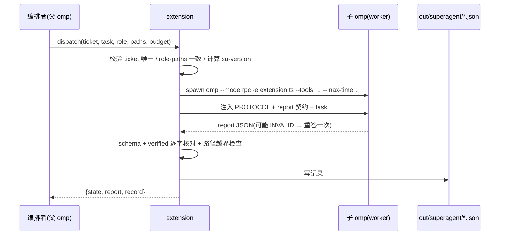

# omp-superagent 设计(2026-11-03)

状态:设计完成,待开发。前身 `out/superharness/` 已归档到 `archive/superharness-exploration-2026-11-02/`。

当前实现状态：只读 scout/reviewer；无法强制写路径隔离，implementer 和 shell 显式拒绝。预算、结构化 think 工具及生成端守卫尚未实现；worker 的推理规范目前仅为提示，不是机器强制。RPC 原始轨迹随记录保存，可能包含敏感信息。下文为目标合同，不代表已实现。

## 0. 为什么重来

旧 superharness 的问题不是功能少,而是"发明了第二套运行时":自己起 SQLite、自己管 PID/PGID 台账、自己写 watchdog、自己实现 trigger/ticket/dispatch 状态机。它把 omp 当成被调用的 CLI,而不是宿主管线。结果:每加一条流程都要新增一张表、一个状态、一个后台循环,测试只能覆盖 fake RPC。

omp-workflow 的路线相反:不新造运行时,只做 omp 的**扩展**:

| 维度 | omp-workflow 做法 | omp-superagent 继承 |
|---|---|---|
| 进程 | 无自有守护进程;omp 本身是宿主 | 同 |
| 状态 | 无 DB;会话 + `out/workflow/<id>.json` 记录 | 无 DB;会话 + `out/superagent/<id>.json` |
| 约束 | 生成端 guard provider 拒掉文本/思考块,不靠劝告 | 同 |
| 输出 | 每轮一条有类型决策(think/choose/ask/block/done/verdict),机器校验 | 同,并加 `dispatch`/`report` |
| 执行 | `workflow` 工具按角色起子 omp(`--mode rpc`),预算限时 | 同,worker 是子 omp |
| 版本 | 源码内容哈希 `wf-xxxxxxxxxxxx`,证据必带 | 同,`sa-xxxxxxxxxxxx` |

## 1. 目标(只做这些)

把 omp 变成"可以自己派活、自己收活"的 super-agent 宿主,且每一步都能被机器校验:

1. **编排者在一轮内可派多个 worker**:`dispatch` 工具起子 omp 执行一个 ticket,返回结构化 report。
2. **worker 的产出是契约**:`report` 决策类型,含 `verified`/`inferred`/`files`/`blocked`/`next`;不符 schema 或 verified 对不上就 INVALID。
3. **人在环**:`ask`/`block` 从 worker 冒泡到顶层会话,不静默吞掉。
4. **可复现**:每次 dispatch 落盘 `out/superagent/<id>.json`(含版本、模型、工具白名单、耗时、tokens、report 原文)。
5. **不碰产品源**:全部新增文件在 `tools/omp-superagent/` 与 `out/superagent/`。

非目标(明确不做):自有 SQLite;常驻 router 守护进程;GitHub/邮件 Source 适配器;跨会话记忆库;预算/配额系统。

## 2. 形态

```
tools/omp-superagent/
├── package.json      { name, omp.extensions: ["./extension.ts"] }
├── extension.ts      pi.registerTool dispatch / report / status + /sa 命令
├── core.ts           角色模板、子 omp 调用、预算、落盘(与 omp-workflow core 同构)
├── report.ts         report 契约的 schema 与机器校验(逐字核对 verified)
├── version.ts        源码内容哈希 sa-xxxxxxxxxxxx
└── test/             bun test:契约、校验、预算、版本
```

加载:`omp -e tools/omp-superagent/extension.ts`(或 package.json 内 `omp.extensions`)。

## 3. 工具契约

### 3.1 `dispatch`

| 字段 | 必填 | 含义 |
|---|---|---|
| `ticket` | 是 | 一句话任务名,同会话内唯一;重复即拒(防重复派活) |
| `task` | 是 | 自包含任务书:目标、读哪些路径、验收命令、非目标 |
| `role` | 否 | `implementer`(默认,可写指定路径) / `reviewer`(只读) / `scout`(只读检索) |
| `model` | 否 | 子 omp 模型,缺省同父;可传数组表示备选 |
| `tools` | 否 | 子 omp 工具白名单,缺省按 role:`scout`=read,grep,glob;`reviewer`=同+`bash`;`implementer`=全部 |
| `paths` | 否 | 允许写的路径前缀;`implementer` 不给则拒 |
| `maxTime` | 否 | 子 omp 墙钟上限,缺省 300s;超时 kill 整组并记 `timeout` |
| `budget` | 否 | `{maxSteps, maxChars}`;超限强制出 report |

返回(机器生成,不是模型写的):`{id, ticket, role, model, state: done|blocked|invalid|timeout|failed, report?, record}`。
`record` = `out/superagent/<id>.json` 路径。

### 3.2 `report`(子 omp 内部使用,由 dispatch 注入的协议要求)

```json
{"t":"report","ticket":"..","state":"done|blocked|failed",
 "summary":"一句",
 "verified":["实际跑过的命令/读过的 path:line 及其关键输出"],
 "inferred":["未验证推断"],
 "files":[{"path":"..","change":".."}],
 "blocked":"阻塞原因(无则空)",
 "next":["可执行的下一步"],
 "tokens":0,"ms":0}
```

校验规则(硬性):
- `state=done` 且 `verified` 为空 → INVALID(不许空口完成)。
- `verified` 每条必须能在本会话工具轨迹里找到逐字片段;对不上 → 该条移入 `inferred`,并记 `verified_dropped`。
- `files` 中 `implementer` 之外的角色非空 → INVALID。
- 出现 `report` 之外的文本 → 该轮作废,重答一次,再犯记 `invalid`。

### 3.3 `status`

列出本会话已派发的 dispatch:`{id, ticket, role, state, ms, tokens, verified_count, record}`,按时间倒序;`status <id>` 打印 record 全文。

## 4. 执行流程



并发:同一会话可同时有多个 dispatch;写冲突域按 `paths` 判定,重叠则第二个直接拒(错因写明冲突的 ticket)。

## 5. 与 omp-workflow 的分工

| | omp-workflow | omp-superagent |
|---|---|---|
| 目的 | 一次决策的规范化(评估/裁决) | 一次执行的规范化(派活/收活) |
| 单位 | 一轮决策 JSON | 一个 ticket 的 dispatch+report |
| 复用 | 直接复用 | 沿用其 guard/角色/校验/版本思路,不 import(两仓独立演化) |

父会话可同时加载两个扩展;`workflow` 用来决策,`dispatch` 用来落地。

## 6. 里程碑

| 里程碑 | 内容 | 验收 |
|---|---|---|
| S1 | 骨架 + version.ts + report.ts 校验器 + 单测 | 契约用例全绿;`sa-version` 随改动变化 |
| S2 | `dispatch` 起子 omp 跑 `scout` 角色,返回 report | 真实 cheap model 一次,verified 非空且逐字可核 |
| S3 | `implementer` + `paths` 越界拒绝 + 并发冲突拒绝 | 三条反例测试 |
| S4 | `status` + record 落盘 + 成本字段 | record 含 version/model/ms/tokens |
| S5 | 人在环:worker `blocked` → 父会话收到可 `ask` 的结构 | 一次真实 blocked 冒泡 |

只做 S1–S5。做完再谈常驻/多源。

## 7. 检查与登记

- `bun test tools/omp-superagent/test` 必须全绿。
- `tools/omp-superagent/check-*.cx` 只做静态约束(无 libc 直调、无平台 `#if`、无 `#include`)——本工具是 TS,检查改为:禁止 import `node:child_process` 以外无编译头;实际以 `tools/ratchets.cx` 覆盖范围为准,若不覆盖 TS 则以 bun test 为准。
- `prd.md` 能力速查补一行:`tools/omp-superagent` dispatch/report,入口 `omp -e tools/omp-superagent/extension.ts`。

## 8. 风险

| 风险 | 处置 |
|---|---|
| 子 omp 无网络/模型不可用 | 单测全 fake;真实调用单独一次,失败记 UNMEASURED,不阻塞 S1/S3/S4 |
| `verified` 逐字核对在子进程轨迹上取不到 | 先在 worker 会话 transcript 里抽工具结果;抽不到就把该条降级 inferred 并暴露计数 |
| 并发 dispatch 写同路径 | `paths` 前缀重叠即拒,宁可少并行也不要静默覆盖 |
| 扩展 API 变动 | 版本哈希只覆盖自有源码,不覆盖 omp 本体;记录 omp 版本 |
