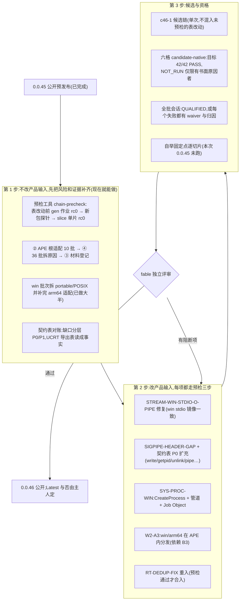

# 0.0.46 unisacc.com 本体计划（2026-11-06 cc 草案，待主人裁定）

范围：只管 `unisacc.com` 本体的平台完整性、契约层、资格和清理。agent harness（cx-csih）是另一条线，归 csih 车道，见 [v0.0.46.md](v0.0.46.md)，本文不动它。

核心需求不变：六个 ISA 切片各有**同候选**原生证据；不降范围。

## 出发点（0.0.45 公开预发布留下的债，事实取自 CHANGELOG 与 ledger）

| 债 | 现状 | 条目 |
|---|---|---|
| win stream-pipe 缺陷 | 带 stdio 的程序 `-o` 与走 stream 管道产出的镜像不一致（win 两格 FAIL，lnx 相等） | STREAM-WIN-STDIO-O-PIPE |
| win 进程模型 | `cx/sys/proc.cx` 在 win 无 fork/waitpid/kill/F_SETFD/environ，stdio-crossunit 与 stream-pipe 只跑 portable 子集 | SYS-PROC-WIN |
| POSIX 头缺口 | `include/signal.h` 缺 `SIGPIPE`；契约表只有 8 行，审计工具报 323 个缺口 | SIGPIPE-HEADER-GAP、libc99posix-audit |
| APE 里没有 win/arm64 分发 | win/arm64 靠独立切片资产 + `pkg.bin` | W2-A3 |
| 全批会话 NOT_QUALIFIED | 215 PASS / 41 FAIL / 9 UNKNOWN / 162 无收据；85 项无 waiver | s2-class（② APE 根 10、④ 批次 36、③ 材料 85） |
| 构造链脆弱 | 一次表改动连续让链红了 3 轮（seed-gen 冲突、`no transition`、`SBCLR` 缺失），每轮约一小时 | 见下「预检」 |
| RT-DEDUP 已撤回 | 第 2–4 刀被撤，去重未做；每个对象各带一份运行库（约 264KB） | RT-DEDUP-FIX |
| 其余 | RES-STREAM-BUDGET 补丁待审、DECODE-SBOUT-STALE、ILLEGAL-ACTION-WRITES-ROOT、UNINIT 扫描器精度 | 各条目 |

## 先后与依赖（看 2～3 步）

## 预检（第 1 步的第一件事，直接来自这次教训）

0.0.45 最贵的损耗是「表改动提交后才发现链红」。预检工具 `tools/chain-precheck.cx`（待建，带 check、登记批次、prd 能力速查一行）：

1. 对改动涉及的网，只重跑受影响的 gen 作业，**逐作业读 `command.status`**，任一非 0 即红（外层 rc 不算）。
2. 用新生成的包做最小探针（相对/绝对/盘符 include、`#pragma unisa use`、对 `tools/entry-build.cx` 的 `-o` 编译）。
3. 对 lnx/x86_64 单片跑 `slice`，rc 0 才允许提交。

规则：没有预检通过记录的 `exec/pp`、`exec/parse2` 等表改动，不得提交；预检结果写入提交说明。

## 0.0.46 的发布门槛（草案）

| 项 | 门槛 |
|---|---|
| 六格原生证据 | 42 项全部有结果；PASS，或 NOT_RUN 且有书面原因；不得有 FAIL |
| portable 子集 | 矩阵格子必须标注「子集」及缺失的原语，不得默默显示 PASS |
| 全批会话 | 对**本候选**跑；QUALIFIED，或每个非 PASS 批次有归因与 waiver |
| 自举固定点 | 六个切片逐片比对，不是只比 lnx |
| 候选与源码 | tag 所在提交与候选源码的产品输入相同，核对差异为 0 |
| 评审 | spawn fable 独立评审，先写阻断项再发布 |

## 需要主人裁定的点

1. 0.0.46 是否按本文的顺序（先平台完整性与资格，harness 另线并行）？
2. 发布是否仍先走预发布？正式（Latest）的门槛是上表全部满足，还是另有要求？
3. win 的 fork 语义：是补 `fork` 的等价物（工作量大、影响面广），还是承认 Windows 用 `CreateProcess` 的子集模型、把需要 fork 的批次永久划为「POSIX 子集」？本文默认后者，因为前者没有原语可映射。
