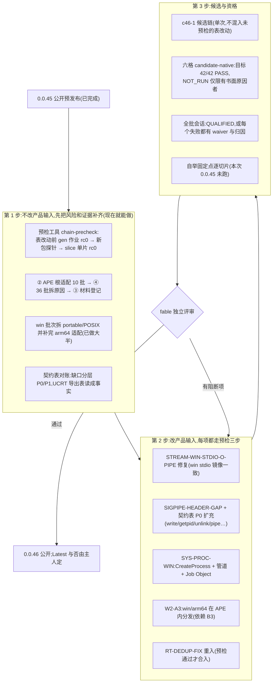
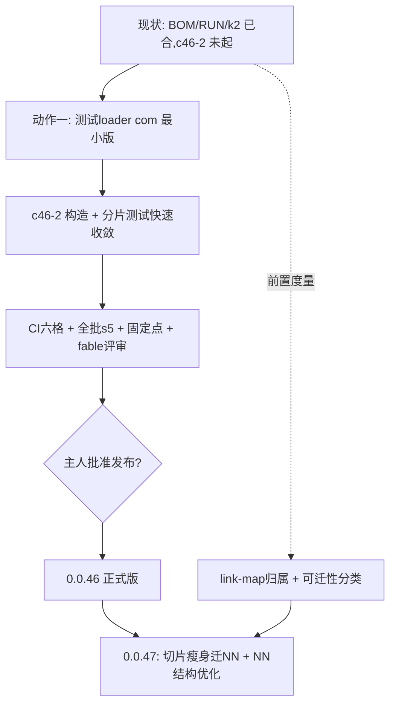

# 0.0.46 unisacc.com 本体计划（2026-11-06 cc；主人定：0.0.45 已公开收口，惯例是公开后进入下一版，已知缺陷的修复全部归入 0.0.46）

> 0.0.46 正式版门槛：六格 42 项无 FAIL（NOT_RUN 须有书面原因、portable 子集须标注）；全批会话对最终候选 QUALIFIED 或每个非 PASS 批次有归因与 waiver（SESSION-INFRA 不算已资格）；逐切片固定点；fable 独立评审。惯例：正式版才公开。不再发 `v0.0.45-stable`。

范围：只管 `unisacc.com` 本体的平台完整性、契约层、资格和清理。agent harness（cx-csih）是另一条线，归 csih 车道，见 [v0.0.46.md](v0.0.46.md)，本文不动它。

核心需求不变：六个 ISA 切片各有**同候选**原生证据；不降范围。

## 出发点（0.0.45 公开预发布留下的债，事实取自 plans/release-notes-0.0.45.md 与 ledger）

| 债 | 现状 | 条目 |
|---|---|---|
| win stream-pipe 缺陷 | 带 stdio 的程序 `-o` 与走 stream 管道产出的镜像不一致（win 两格 FAIL，lnx 相等） | STREAM-WIN-STDIO-O-PIPE |
| win 进程模型 | `cx/sys/proc.cx` 在 win 无 fork/waitpid/kill/F_SETFD/environ，stdio-crossunit 与 stream-pipe 只跑 portable 子集 | SYS-PROC-WIN |
| POSIX 头缺口 | `include/signal.h` 缺 `SIGPIPE`；契约表只有 8 行，审计工具报 323 个缺口 | SIGPIPE-HEADER-GAP、libc99posix-audit |
| APE 里没有 win/arm64 分发 | win/arm64 靠独立切片资产 + `pkg.bin` | W2-A3 |
| 全批会话 NOT_QUALIFIED | 215 PASS / 41 FAIL / 9 UNKNOWN / 162 无收据；85 项无 waiver | s2-class（② APE 根 10、④ 批次 36、③ 材料 85） |
| 构造链脆弱 | 一次表改动连续让链红了 3 轮（seed-gen 冲突、`no transition`、`SBCLR` 缺失），每轮约一小时 | 见下「预检」 |
| RT-DEDUP 已撤回 | 第 2–4 刀被撤，去重未做；每个对象各带一份运行库（约 264KB） | RT-DEDUP-FIX |
| 其余 | RES-STREAM-BUDGET 补丁待审、DECODE-SBOUT-STALE、ILLEGAL-ACTION-WRITES-ROOT、UNINIT 扫描器精度 | 各条目 |

## 先后与依赖（看 2～3 步）

## 预检（第 1 步的第一件事，直接来自这次教训）

0.0.45 最贵的损耗是「表改动提交后才发现链红」。预检工具 `tools/chain-precheck.cx`（待建，带 check、登记批次、prd 能力速查一行）：

1. 对改动涉及的网，只重跑受影响的 gen 作业，**逐作业读 `command.status`**，任一非 0 即红（外层 rc 不算）。
2. 用新生成的包做最小探针（相对/绝对/盘符 include、`#pragma unisa use`、对 `tools/entry-build.cx` 的 `-o` 编译）。
3. 对 lnx/x86_64 单片跑 `slice`，rc 0 才允许提交。

规则：没有预检通过记录的 `exec/pp`、`exec/parse2` 等表改动，不得提交；预检结果写入提交说明。

## 0.0.46 的发布门槛（草案）

| 项 | 门槛 |
|---|---|
| 六格原生证据 | 42 项全部有结果；PASS，或 NOT_RUN 且有书面原因；不得有 FAIL |
| portable 子集 | 矩阵格子必须标注「子集」及缺失的原语，不得默默显示 PASS |
| 全批会话 | 对**本候选**跑；QUALIFIED，或每个非 PASS 批次有归因与 waiver |
| 自举固定点 | 六个切片逐片比对，不是只比 lnx |
| 候选与源码 | tag 所在提交与候选源码的产品输入相同，核对差异为 0 |
| 评审 | spawn fable 独立评审，先写阻断项再发布 |

## 需要主人裁定的点

1. 0.0.46 是否按本文的顺序（先平台完整性与资格，harness 另线并行）？
2. 发布是否仍先走预发布？正式（Latest）的门槛是上表全部满足，还是另有要求？
3. win 的 fork 语义：是补 `fork` 的等价物（工作量大、影响面广），还是承认 Windows 用 `CreateProcess` 的子集模型、把需要 fork 的批次永久划为「POSIX 子集」？本文默认后者，因为前者没有原语可映射。

## 方向备忘（主人 2026-11-06）：libc99posix 之后的形态，类比 cosmopolitan/cosmocc

| cosmopolitan/cosmocc | unisacc 对应 | 现状 |
|---|---|---|
| APE：一个文件到处跑 | `unisacc.com` 本体已是 APE（六切片 + 模型包） | 已做；win/arm64 在 APE 内的分发未做（W2-A3） |
| 自带 libc（C 写，系统调用/NT API 直连） | libc99posix 的 `cx-own` 绑定（cx 写，在极小原语契约之上） | 只有 strdup/pread/pwrite 三个；其余 stdio 等仍前转宿主 libc |
| 对宿主 libc 无依赖 | 契约表 `host-export` 绑定 = 前转宿主 libc | 现在几乎全是这种；这正是 win 上反复踩到宿主差异的来源 |
| cosmocc 把 C 编成一个到处跑的程序 | 输出程序目前是每目标一个原生可执行文件（ELF/Mach-O/PE） | 输出程序做成 APE（fat）是另一步，未排 |

**两种模式共存（契约表的「绑定类型」列已经是这个机制）**：同一份 C/cx 源码，函数绑到 `cx-own` 就是 cosmo 式（行为六目标一致、不依赖宿主），绑到 `host-export` 就是兼容原生 C（可用宿主 libc 和宿主库）。按函数、按目标选，不是全有或全无。

**未解决的难点**：cosmopolitan 为在 Windows 上提供 `fork` 做了大量专门工程；我们的 win 进程模型目前是 CreateProcess 子集。若目标是「统一的 POSIX C99」，进程模型（fork/exec/信号/管道语义）是最难的一块，需要单独设计，不能靠加表行解决。

**验证方式**：先做小实验（stdio 最小子集用 cx 在 read/write/open/close/lseek 契约上实现），量程序体积、头文件体积、六目标是否同字节、编译时间，再决定是否全面推进。

## 把「TSV→网」的优势用足（主人 2026-11-06 指出的差异化，cc 依据 0.0.45 的实际经历整理）

事实依据：这轮 win 上最后一个阻断缺陷（`#include "C:/…"`）的修复是 `directive-body-result.tsv` 里加一个 `["SBCLR"]`，改动一行；但发现它花了多轮构造链。说明「改结构很灵活」成立，「验证改动」是瓶颈。

| 要做的 | 为什么 | 衡量 |
|---|---|---|
| **网的诊断可读性**：`run: no transition` 要打印网名、状态、观察字节、输入偏移（产品里 `cx/core/transition.cx` 的失败路径，A 类诊断改进） | 这轮三次「no transition」都只有这四个字，定位全靠手工二分 | 同一类缺陷从「多轮」降到「一条错误信息即可定位」 |
| **结构/权重改动的度量台**：改一处表之后，自动给出体积、推理步数、编译速度的前后对比，并核对与 gold 逐字节等价 | 「灵活优化权重」只有能量化才不会变成凭感觉；目前只有零散的速度基线 | 每次优化提交说明里带前后数字 |
| **预检（chain-precheck）**：见上文 | 灵活改网的前提是改错能在几分钟内发现，而不是一小时 | 表改动到发现错误的时间 |

另一个潜在优势：模型包是数据，原则上可以只换权重而不重造切片（本版没有验证，需要单独确认包版本与切片的耦合程度，P4 包版本就让参考实现无法读取，说明耦合不为零）。

## 排期决定（主人 2026-11-06）

NN 结构与权重优化（状态最小化、观察字节分类、子网共享、编码紧凑化、盘点各网体积/状态数/透传占比）**放在 0.0.46 甚至 0.0.47**，不进 0.0.45。0.0.45 只做稳定版门槛内的事（stream 目标联动修复、六格 42 项、全批归因与 waiver、固定点、评审）。前置工具（chain-precheck、表的静态检查、结构改动度量台）可以先做，因为它们不改网本身。

## 0.0.46 主线排序（cc 研判，2026-11-07；主人原话是方向和直觉，细节由我定）

主人提出两项：「完善 libc99posix 的 host abi 并做好 tape 的测试」与「把切片中的大部分逻辑迁成 nn（必要时新增 nn 甚至新 stream）」。这两项原先没排进 0.0.46，现补入，顺序与规模如下。

事实依据（本轮实测）：lnx/x86_64 切片 `entry.elf` 1,855,638 字节，对象里手写驱动单元很大：`cxmod.o` 700,560、`host.o` 523,632、`tapegate.o` 450,432、`driveroute.o` 402,912、`driveface.o` 353,728、`runexec.o` 325,648、`stages.o` 240,592、`driveunits.o` 237,456；另有两个模型对象 `m27.o` 1,328,264 与 `m22.o` 570,968。手写 cx 驱动逻辑约：`src` 5,872 行、`cx/compiler` 7,858、`cx/runtime` 5,811、`cx/sys` 3,842、`cx/driver` 2,357。可模型化的部分（纯字节流变换、表驱动的选择）值得迁；`host.o` 这类系统 I/O 属于不能模型化的核心，保留。

| 序 | 项 | 范围与门槛 | 理由 |
|---|---|---|---|
| 0 | 前置：`chain-precheck`、`tsv-lint`、结构度量台 | 已落地或在做 | 迁移要改表和网，没有这些就会重演 0.0.45 的三轮红 |
| 1 | **A. libc99posix 与 tape 测试**（主线 1） | ① 契约表按测试与工具实际调用到的函数补齐（P1：`fcntl` `dup2` 等，win 绑定名以 PE 导出表为证）；② **tape 一致性回归**：同一 C 源码对六目标，tape 的差异必须正好等于契约表绑定列的差异；③ stdio 最小子集用 cx 自带实现的小实验（体积、头文件体积、六目标同字节、编译时间） | 平台差异是这轮最大的损耗来源；增量、风险低，每项都能独立验证 |
| 2 | **B. 逻辑迁成 nn**（主线 2，须先有可证明收益再选试点） | 对象清单81项与机械标签已交付，但整.o含公共运行库、IR与非文件BSS，不能代表可回收镜像贡献。fable评审否决tapegate整体迁移，历史设计保留；旧entry.elf实查无节/符号/map，当前单元贡献明确UNATTRIBUTED，不能列可信libc副本及asmtext占比。**cc已将link-map边车推迟0.0.47 P3**，保留方案、不实施、不挡0.0.46；RT-DEDUP或CORE-MIN-ASMTEXT不能凭旧对象大小选定收益，须另有可证明数据和设计评审；cxmod/source_frame本版不动 | 不将LEB/随机池/33MB渲染机制搬成网中程序；执行器输入属性8倍放大及OOM panic先独立列P2。所有净收益、网增量与构造风险必须同候选实测，不用对象大小预报 |
| 3 | 新增 nn 或新 stream | 仅在盘点显示现有流表达不了时才做；先出设计页（哪段字节流、输入输出、如何用 gold 证明逐字节等价），fable 评审后才动 | 避免为迁移而造网 |

不做的：NN 结构与权重优化（状态最小化、观察字节分类等）仍放 0.0.46 之后，与「迁移」是两件事：迁移改变「逻辑放在哪」，优化改变「网长什么样」。

## 结构反思：为什么看不到收敛，以及两个结构动作（2026-11-07，主人提出方向，cc 研判）

### 症结（本版事实）

- 被测单元只有「整个候选 APE」，反馈慢且归因难（本版多次误归因：drv:1、E2 14 红其实是探针未绑 models）。
- 身份机制多套并存（SID/PC/GEN/context/pins/receipts），每轮靠预检和人工对账；这是 §9.1 已登记但未立项的「身份统一」。
- 切片体积大（lnx/x86_64 entry 1.86MB，手写驱动单元占大头），任何驱动逻辑改动都触发整片重构与重测。

### 动作一：测试专用 loader com（建议纳入 0.0.46，P1）
- 形态：同一份 loader 代码路径，只把字节来源由「APE 内嵌」换成「命令行/环境指定的独立文件」：`--slice FILE`、`--models DIR|pkg`、按需加载单个流/网文件。已有 `UNISA_CONTAINER`、`--models` 是雏形。
- 收益：测试按「片 × 阶段」拆开并行，单阶段/单网改动只重测相关片；E2/tape/stream 批不再依赖整 APE 重建。
- 红线（否则会重演假绿）：① 与产品 loader 共用同一实现，差别只在字节来源，禁止第二套加载逻辑；② 每个部件记 sha256，产品 APE = 确定性函数(loader, 切片, 包)，部件 sha 与 APE 内部件一致才算对该 APE 有效；③ 分片结果只算「开发证据」，正式资格仍须同候选 APE 原生运行；④ 显式绑定缺失必须报错，不得回落读 `./unisacc.com`（本版 E2 14 红的根因）。
- 顺带：为「内容寻址身份统一」铺路（部件即内容寻址对象）。

### 动作二：切片只留 ISA 对接，逻辑迁 NN（建议 0.0.47 主题；0.0.46 只做前置）
- 目标：切片＝执行器＋模型解码＋校验＋host syscall/ABI/FFI/dl 绑定；编译逻辑在「流+网」。unisacc.com 的重心回到 NN 设计，切片随 libc99posix 契约表收敛。
- 与 libc99posix 一致：契约表已是「host 绑定」的真源，切片内 host 部分可由它生成。
- 风险（须先判定，不得凭直觉承诺）：
  1. 可模型化范围未知：纯字节流变换、有限状态选择可迁；需要无界栈/符号表的解析与降低能否在现有网的有界状态里表达，未证明。fable 已否决 tapegate 整体迁移。
  2. 归属未知：旧 entry 无 map，当前单元贡献 UNATTRIBUTED，无法据此选试点。
  3. 自举：编译逻辑搬进网后，网由 gold 表确定性构造，gold 生成器本身仍需可运行环境，须保持构造链可重放。
- 0.0.46 前置（低风险，不改产品行为）：把 link-map 归属从 0.0.47 P3 提到 0.0.46 度量项；出「可迁性分类」（纯变换/有限状态/需无界状态/系统 I/O）；选 1 个试点出设计页并经 fable 评审，通过 gold 逐字节等价才动。

### 对 0.0.46 门槛与排期的影响

- 风险：动作一会推迟 c46-2 一个小窗口；折中是先做最小版（只支持 E2/stream 批与单切片），不阻塞 CI 候选链。
- **待主人裁定**：①动作一是否纳入 0.0.46；②动作二是否定为 0.0.47 主题、0.0.46 仅做前置度量；③身份统一是否随动作一一并立项。

### 主人裁定（2026-11-07）：测试loader与切片瘦身立即在0.0.46开工
- 优先度：分而治之类动作高于 c46-2 链条与其余收尾项；c46-2 候选在测试 loader 最小版可用后再起（避免再花一轮整链才发现问题）。
- 分工：omp-cdx → TEST-LOADER-COM；omp-grk → SLICE-SHRINK-PRE（link-map归属提到0.0.46，SLICE-CONTRIBUTION 由 P3-0.0.47 升为本版）。cc 总控、评审、fable 咨询。
- cc 追加的提速项（待排）：①（更正）作业复用按 ledger 2026-11-05 已定「日常开发开、发布链关」，无需再改，只要日常车道真的设了 UNISACC_WAVE_REUSE=1（SPEED-02 实测 226s→12.7s）；②全批会话按冲突域分片并行，随测试loader 落地；③身份统一随部件sha立项；④harness/探针显式绑定检查进 lint（缺绑定即拒），杜绝 E2 14 红类误归因。

### 迭代速度规则（主人 2026-11-07：迭代足够快才能更快收敛）
1. 反馈环≤15分钟：每个改动先过「当前部件级」检查（测试loader分片/单批/单网），整链候选与CI只在积累一批改动后跑一次。
2. 不整链试错：未经分片验证的改动不得触发候选链、CI、全批。
3. 出红先二分再归因：用最小复现定位，不凭推测写根因；同伴报告标未复跑。
4. 小步提交：一件事一提交，自己路径精确提交；验证绿即合，不攒。
5. 争议不开会：能用命令判定的，命令输出为准；判定不了的交 fable 一次性评审，不来回信件。
6. 每个新障碍先问「能否变成分片可测的一条检查」，是则先做检查再修。
