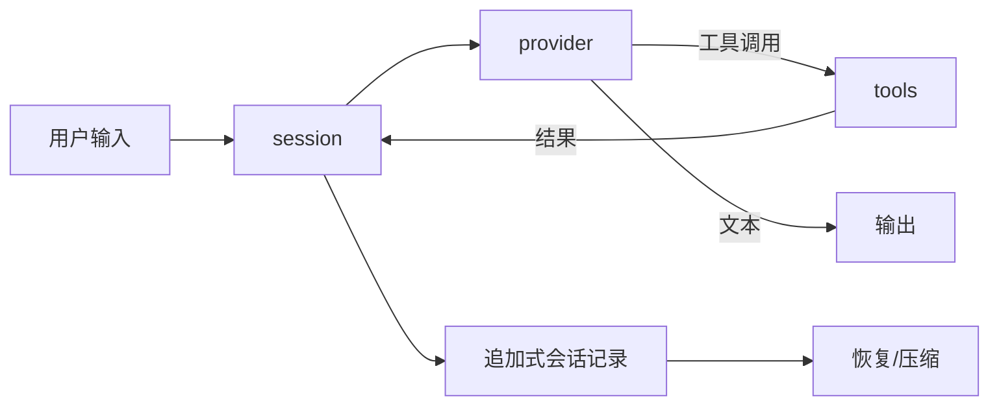

# 0.0.46 计划（待启动）

<a id="registered-requirements"></a>
## 已登记需求（主人2026-10-31）

基于 `unisacc.com`、`gcc_cx.com`、`clang_cx.com` 与 cx 架构，做两个对标 agent harness 的工具：`cx-csih` 对标 Pi（`badlogic/pi-mono` 的最小 harness 路线），`cx-csih-full` 对标 OMP（`oh-my-pi`，把 IDE 与更多工具面接进 agent 的路线）。当前仅登记与设计，未实现，不构成 0.0.43 收口前置。

| 对照 | 路线 |
|---|---|
| Pi（`pi.dev`、`badlogic/pi-mono`） | 最小 agent harness：会话、工具调用、上下文管理，插件面窄 |
| OMP（`oh-my-pi`） | Pi 的 fork，把 IDE 与更多工具面接进 harness，提示词与工具面更厚 |

| 编号 | 需求 | 设计与验收方向 |
|---|---|---|
| C46-HARNESS-01 | `cx-csih`：最小 harness | 会话循环、工具调用、上下文压缩、中断与恢复；工具面按最小集（读、写、改、跑命令、搜）。实现语言为 cx，产物是 `.com`，不引入 Node/Python 运行时。 |
| C46-HARNESS-02 | `cx-csih-full`：带工具面的 harness | 在 `cx-csih` 之上加工具面（诊断、批处理、并行子任务、外部编辑器/IDE 桥），与 `cx-csih` 共用同一套会话与工具合同，不各写一份。 |
| C46-HARNESS-03 | 共用模块与权重 | 两个 harness 复用同一组模块（文本、内存、进程、网络、流＋网），不复制实现；模块边界走 0.0.45 的外部调用合同。 |
| C46-HARNESS-04 | 与自身工具链打通 | harness 把 `.cx` 当一等输入：用 `unisacc.com`/`gcc_cx.com`/`clang_cx.com` 实编、跑 `tests/run.cx` 批次、查 `tools/` 现成工具，而不是靠 shell 拼命令。 |
| C46-HARNESS-05 | 可对照的能力证据 | 与 Pi／OMP 的可比项：工具调用回合、上下文处理、中断恢复、失败拒绝；同一批任务对拍行为，不以功能列表充数。 |

## 设计前提（2026-10-31 实测事实）

harness 所需的四类能力在仓内的现状，都是读过源码而非推断：

| 能力 | 现状 | 位置 |
|---|---|---|
| JSON | 只有 csih 的只读解析器（606 行，无 writer） | `apps/csih/json.cx` |
| HTTPS 传输 | 不在 cx 内：经 `sys.ffi` 调 libcurl（0.0.26 起） | `apps/csih/https_post.cx`、`apps/csih/net.cx` |
| gzip 解压 | 已有（`cxcodec_inflate`） | `cx/runtime/codec.cx` |
| 会话记录 | csih 有读写器（144 行） | `apps/csih/session.cx` |
| 门控/继续判定 | csih 有（85 行） | `apps/csih/gate.cx` |
| 工具目录 | csih 有 capability catalog（153 行，`plugin_register` 注册） | `apps/csih/plugin.cx` |
| 闭环 | csih 有 `loop.cx`（295）→ `llm.cx`（193）→ `net.cx` | `apps/csih/` |
| TUI 原语 | 有原语，无控件层 | `cx/sys/tty.cx`（`sy_tty_raw`、`sy_tty_size`） |
| 网络原语 | TCP 直连（`sy_tcp_dial`），无 TLS | `cx/sys/net.cx` |

结论（主人 2026-10-31 裁定）：**csih 就是基座，cx-csih 不新写——csih 现状即 cx-csih。** 产品名本来就写着 "c-based super intelligence harness"；工具面 `file`/`exec`/`mind` 加 `answer` 比 Pi 的最小集更窄，会话、插件目录、自迭代验证环、HTTP 传输、TUI 都已跑通。因此 0.0.46 的实际工作不是造一个 cx-csih，而是两件事：

1. **认领**：`cx-csih` = csih 内核 + 最小前端（现状）。不新建 `apps/harness/`，不复制一份实现。
2. **补差**：`cx-csih-full` = csih 内核 + 更厚工具面。csih 现状缺三项，实测确认：

| OMP 能力 | csih 现状 | 证据 |
|---|---|---|
| 并行子任务 | **无** | `grep -l 'subagent\|sub_agent\|parallel\|fork_agent' apps/csih/*.cx` 无命中 |
| 上下文压缩 | **无** | 只有 `MAX_ROUNDS`（8）硬拒绝，不是压缩；`compact/compress` 无实现 |
| IDE/编辑器桥 | **无** | TUI 内嵌（`tui.cx` 5874 行），无外部编辑器协议 |

唯一的前置工程是把 csih 的库层从 UI 层剥开，供两个前端共用。可行性有既有事实支撑：`session.cx` 文件头写明 "LIBRARY, NO `main`"，`json.cx`/`llm.cx`/`loop.cx`/`gate.cx`/`plugin.cx` 都是无 `main` 的库，`*_cli.cx` 与库的分离已经是既有惯例。剩下的粘连点是 `agent.c`（3380 行）把回合驱动、提示词、证据账本与 CLI 混在一起。

`apps/csih/` 属 csih 车道：剥库与补差由该车道主人执行，或由主人授权后执行；unisacc 侧只更新设计与登记。

已知依赖缺口，必须在实现版里明确写进文档而不是假装没有：

1. **TLS**：M2 沿用 libcurl（`sys.ffi`）作**可替换的宿主传输**，同时按 `plans/cx-l0-tls.md` 分片实现 cx 原生 TLS；两阶段拆分与逐片验收见该文件。不借 libcurl 冒充 cx 内 TLS，也不把 TLS 塞进 harness 前端。
2. **JSON 编码**：csih 只有 `json_escape`（写字符串体，不带外层引号），没有对象/数组/数字的整值编码器；请求体由 `agent.c` 手工拼接。工具调用参数要结构化写出时，必须补值级 writer（含转义、数字格式化、非法 UTF-8 拒绝），不能让每个调用点自己拼字符串。
3. **libc 边界**：新模块按「层就是目录」，走 `sy_*`/`mm_*`/`tx_*`，六项棘轮为 0。

## 目标结构（csih 即基座，不新建平行实现）

```
apps/csih/              基座 = 现有 csih（属 csih 车道）
  库层（无 main，可直接被别的 .com use）
    json.cx             解析 + json_escape；本版补值级 writer
    net.cx              HTTP(S) via libcurl（sys.ffi）
    llm.cx              模型回合：请求构造、响应解析
    loop.cx             闭环驱动
    session.cx          会话记录读写
    gate.cx             继续/停止判定
    plugin.cx           工具目录（name/help/kind）
  前端层（含 main）
    agent.cx            回合驱动、提示词、证据账本、工具执行
    agent_cli.cx        CLI
    tui.cx              TUI
    csih.cx             入口
```

家族映射只用名字，不复制代码：

| 名字 | 是什么 | 与现状的关系 |
|---|---|---|
| `cx-csih` | 最小 harness 前端：`file`/`exec`/`mind` + `answer` | **就是 csih 现状**，工具面已比 Pi 窄 |
| `cx-csih-full` | 更厚工具面：并行子任务、上下文压缩、IDE 桥 | csih 内核 + 三项补差（见上表） |

差别只在前端层与提示词，不在库层。任何一项补差都必须落在库层或前端层之一，不许两边各写一份。

命名（主人 2026-10-31 裁定）：**家族名用 `cx-csih`，不用 `cx-pi`。** CSIH 本来就是 "c-based super intelligence harness" 的缩写，命名不借用他人产品名，也免掉 `pi.dev` / `pi-mono` 的商标与署名风险。同理，较厚的那一支叫 `cx-csih-full`，不叫 `cx-omp`（OMP 是 `oh-my-pi` 的项目缩写，风险同源）。对外文档里可以写"对标 Pi / OMP 的路线"作为参考对象，但这个名字不进产品名、目录名或构建目标名。

`apps/csih` 目录与 `~/.csih` 状态目录**本版不改名**：改名牵连 `csih.sh`、`moltbaby/bin/rawcsih`、`~/.csih`、tmux 窗口名 `csih-tui`、`apps/csih/MIGRATION.md` 与全仓交叉引用，属于 csih 车道的一次独立迁移，不混在 0.0.46 的应用层工作里。`cx-csih` 现阶段是家族称呼与构建目标名。

## 事件与工具合同（M0 先定，再写码）



- 消息记录：追加式，带身份（内容 sha256）与序号；压缩只重写历史摘要，不动原始记录。
- 工具调用：单一入口 `tools_call(name, json_args, out)`；未注册名字与参数不合法都是具名拒绝，不是静默空结果。
- 工具结果：显式成功/失败 + 字节数；失败不得被当作空字符串继续。
- 中断：未完成的工具调用在恢复时判为 `UNKNOWN`，不自动重试；重试必须来自新的模型回合。

## 里程碑与验收证据

| 阶段 | 内容 | 验收 |
|---|---|---|
| M0 | 合同与目录：上文事件/工具合同、模块清单、给 csih 车道的信封 | 合同文档 + csih 主人确认（或明确拒绝理由） |
| M1 | 提升共享模块：`json`（含 writer）、`session`、`gate`、`transport` 进 `apps/harness/` | 各自 `tools/check-*.cx` 全绿并登记批次；csih 原批次仍 PASS（行为不变） |
| M2 | `cx-csih` 最小闭环：真实 provider、五个工具、会话恢复 | 一次真实会话可跑完「读→改→跑命令→校验」；中断后 `--resume` 不重复已完成调用 |
| M3 | `cx-csih-full` 工具面：并行子任务、诊断、批处理、IDE/编辑器桥 | 同一任务在 `cx-csih-full` 用并行子任务完成，结果与串行一致；拒绝路径有测试 |
| M4 | 自身工具链：`.cx` 一等输入 | harness 内直接 `unisacc.com FILE.cx -- ARGS` 与 `tests/run.cx -- --smoke`，不经 shell 拼字符串 |
| M5 | 与 Pi／OMP 对拍 | 同一任务集的三方结果表：回合数、工具调用数、失败恢复、拒绝正确性 |

M5 之前不得宣称"对标完成"。功能列表、演示截图、单次成功都不算证据。

## 约束（沿用本仓规则）

- 除源码与注释外用中文；工具沉积在 `tools/`，带 `check-*.cx` 并登记批次。
- 不新增 Python/shell 算法；兼容壳只作薄入口。
- 分层走「层就是目录」（`cx/sys/`、`cx/mem/`、`cx/text/` 为 L0），新 `.cx` 六项棘轮计数为 0。
- `apps/csih/`、`ujs/` 是别的车道：改动先发信封，由车道主人执行。
- 未实跑的项记 UNKNOWN，不记 PASS；不为了对拍放宽时限或删断言。

与 0.0.43／0.0.44／0.0.45 的关系：0.0.43 收口当前版本；0.0.44 修 `.cx` 模块化与内存安全；0.0.45 把流＋网能力开成外部可调用模块与权重；本版在其上做应用层工具，并反向验证 0.0.45 的「模块可外用」是否真的成立——如果 `cx-csih-full` 只能靠复制 csih 代码才能工作，那 0.0.45 的合同就没达到。
