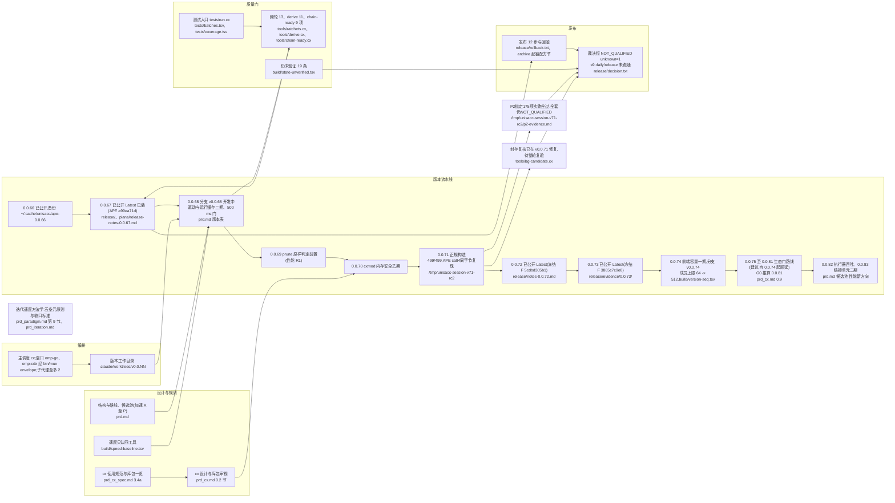

# 记忆宫殿(地图)

本文件是一张图加少量规则,不是账本。主体是下面的流程图:节点是房间(现状一句),连线是依赖与去向,入口写在节点里;过程、取证、重跑记录不进来,放提交说明、链日志目录或 archive/。2026-11-14 之前的全文在 archive/prd_mempalace-2026-11-14.md。

## 写法规则

- 改图只改节点文字或连线,一个节点一句现状加一个入口;过程不入图。
- 只记三类:别人必须遵守的决定、不可逆的对外动作、阻塞发布的未验证项。
- 子代理不提交本文件;主调度只在里程碑(整链结束、公开、装机完成)改一次。
- 版本序在 build/version-seq.tsv,版本内容与验收在 prd.md 版本表,未验证项真源在 build/state-unverified.tsv(tools/state-gen.cx 与下方"仍未验证"逐条对拍)。
- 任务表行 `| 部分落地 | ID、ID |` 与 `| 已落地 | ID、ID |` 供 tools/observe-agents.cx 读取。

## 地图

## 决定(别人必须遵守)

派生查询规则:工具索引与产品全景经 devsvc tool-index、devsvc product-map 取得当前内容身份结果;两个 build/ 导出不再跟踪,自动 --derive 不物化。快照仅显式导出,独立 --check 仍实际现算并逐字节对拍。回退为恢复 derive.tsv 的物化行、显式生成后重新跟踪。读集、外部核验依赖、失效负控与证据入口见 [plans/devsvc.md](plans/devsvc.md) 的 R1 节。

- agentwork 已整体退役到 archive/agentwork-retire-2026-11/:协同决定只进本记忆宫殿,不追加过程账本;ledger-add 默认拒绝,仅显式 --ledger 可维护独立数据。旧 schema 别名只供历史审计,目录缺失合法而负控仍拒绝缺证据。回滚由前向提交恢复原路径,六文件归档保持原字节。

- 版本号跳过 0.0.64。入口 build/version-seq.tsv。
- 起整链的环境只设 UNISACC_IDENT_HELPER,不设 UNISACC_RUN_CACHE 与 UNISACC_CACHE_DIR。
- 版本分支:main 只做集成与发布,一分支一类大改。全文 AGENTS.md。
- 整链会话根在链运行与发布期间勿删,清理只由主调度在公开后做。
- 改产品源的验收必须含引导编译器(bootstrap-0.0.59)多单元编译,不只已装产品 -c。
- 写仓内文件只用 Edit/Write 或 .cx 工具。
- devsvc 主能力已可用(2026-11-15):基础版 1b1b4c4b94、flow 引擎 cbfbb3bd66(flowrun、flowexec、flowfile),omp-go 已持 registry 锁完成登记协同(54eaf4b064)。
- 仓开发服务 devsvc 为当前最高优先的工具线(项目所有者 2026-11-15):基础版落地后所有 agent 改用其写窗口锁与 run,不再靠信封排窗口;路线见 prd.md 候选池 T;成熟后独立成"智能体伴侣"产品并可替代 moltbaby 的 mapp,devsvc 为暂定名;核心不写死本仓路径。
- 仓内的门(precommit、register、derive、ratchets、affected、tlib bump)逐步迁入 devsvc 成为增量并发的 flow 节点,判定强度不降,先对拍再切换(prd.md 候选池 T)。
- build/ 只留构建 unisacc.com 用的表;仓开发元数据改由 devsvc 维护与查询,flow 与关系 DAG 稳定后逐表迁出(先等价对拍再切读者再移除),见 prd.md 候选池 T 决定。
- devsvc 开发只由主调度 cc 及其子代理负责(项目所有者 2026-11-15);omp-go、omp-cdx 专做 unisacc.com 产品与版本线,只作为 devsvc 使用者提缺口,不改 devsvc 源码。
- 0.0.69 改为"编译覆盖缺口修复"(not covered 类产品缺陷:帧槽、单元帧与作用域、常量表达式等;cc 2026-11-15 裁定),原 0.0.69 至 0.0.72 各顺延一号;帧槽修复已在分支 v0.0.69(3babcd8287);分期见 plans/notcovered-plan.md,版本序表在普查落地后同步。0.0.68 不为此打补丁。
- 协同开发唯一接口是 devsvc 的 flow 及其子算子并行执行(项目所有者 2026-11-15);不采用每个 agent 私有工作区或覆盖层,冲突、一致性、回滚与提交都在 flow 执行层解决。
- prd*.md 与 plans/*.md 由 devsvc 文档接口接管(项目所有者 2026-11-15):devsvc doc 子命令与 flow 的 doc.* 算子落地后,所有 agent 只经接口改,不再直接编辑。
- 自 0.0.68 起 s9 commit 档不挡公开:冻结后与整链并行跑,结果补记 release/evidence.tsv,新增 FAIL 走补丁版(prd.md 候选池 Q)。
- 0.0.69、0.0.70、0.0.71 合并为一次发布 0.0.71(速度 R1 与 X1、覆盖缺口一期、生成码一期 X3),0.0.69 与 0.0.70 号跳过(项目所有者 2026-11-16);0.0.68 不等发布即合入 main,此后从 main 开发。
- demo 发布位置=docs/uxe/<id>/(项目所有者 2026-11-17):GitHub Pages 指 main 的 docs/;依据 curl 首页 200 但 ./uxe/asteroid|drone|live 404 且 origin/main docs/uxe 文件数 0;回滚恢复 docs/index.html 原文。里程碑 M7,与 M2 并行优先。docs 改动经 ujs 分支由集成者(主调度 cc)合入 main,不在共享 main 直接改。

- 执行类工作由主调度经 devsvc flow 并发自己做;子代理只开 fable 级(设计、难题);外部窗口 omp-cdx 停止派工(项目所有者 2026-11-16)。并发总量以机器负载不高于 10 为界。
- cx-dev(tools/cx-dev、tools/cx-dev-root)的结果一律只是 LOCAL 证据,不是候选结果:检查可经假根测改过的 exec 表,基座(src、cx、include)改动要重装产品。

### 仍未验证(缺什么 / 清零动作)

- check-stdio-buffer:不覆盖 --link-only 与子集编译的缓存一致性,tty 路径未测。
- osx cache-manager:借用副本来源未证实,候选上首次 osx 实跑核来源。
- tsv-lint 不稳:同日三次实跑 PASS、FAIL、PASS,未定因。
- wt-gate-probe 为 PLANNED:链路超 55 s 批次上限,6 条断言未验证。
- slice-migration-gen:source-missing cx/compiler/frames.cx 旧记述,待复核。
- affected-iface2 批次未取得实跑结果:待跑。
- 已入库工具中 tools/status.cx 的测试夹具曾被 sed -i 改过,内容未重审。
- cx 模块语法缺口:use as alias,排 0.0.70。
- cx 模块身份缺口:软链被当两个模块,排 0.0.70。
- 仓库根 out/:逐项迁移到 sy_tmpdir,清单见归档同名条。
- 大型二维自动数组:已装编译器报 not covered(复现 $CLAUDE_JOB_DIR/tmp/repro-large-2d-auto-array.cx)。
- compile-as-limit:低限额具名拒绝两项未过,候选上实跑,不过则补产品合同。
- cc 额度暂停期间由 cdx 按项目所有者授权临时接班(2026-11-17)：第五条 4c2e7ad167 性能实验已终止、原证据保留，不重起同输入；计划备忘真实末次命中与独立开关对照已核，结论与未验范围见 plans/local-product-0.0.71.md 的第五条链接班核验节。三张额度中断的小单均未完成验收，不把隔离树中的半成品当成已交付补丁；共享 tests 大批纯执行位改动来源未核，提交须排除这些改动。
- ujs `compiler_min.cx` cxraw 实测 96(tsv 基线曾 50,限期 0.0.9 压回 <=50)。决定:不把 96 当合格,不并 G1。依据:d473474f14 与 ujs/prd.md C4。证据:`sh ./unisacc.com -run tests/cxraw.cx -- --check --files ujs/seed/stage0/compiler_min.cx`;host1_vm 实测 34。回滚:到期未压回则拒绝合入 main/公开;不升基线冒充。
- ujs/product 九文件 cxraw/cxapis/cxtrunc 缺行已按实测补基线(2026-11-18,合入请求):gold-ic 18/3, gold-lex 25/3, gold-parse 17/3, gold-rest 15/4, gold-type 17/3, net-gold-check 34/2/6, net-lex-check 13, net-parse-check 18/1, pack-nets 27/4/2。不把缺行当 0。限期 0.0.80 压回各表该行 calls 至少减半(cxraw 优先 sy_*)。证据:`sh ./unisacc.com tests/cxraw.cx -- --check --files ujs/product/gold-ic.cx ...`。回滚:删这九行则棘轮再 FAIL;到期未压回拒绝公开升格。

- core-compat参考源转换:参考执行器cacb65b83e新增P4解析与SBLOAD未经独立核验,旧helper仅批准空copy guard转换,不扩大批准域;入口build/state-unverified.tsv U20。
- 全套入口分片聚合:主线423c274c42的入口与原因分栏已合入,新候选端到端验收未完成;入口build/state-unverified.tsv U21。
- 全套材料与平台证据:118材料族仅47项登记,无生产者与外部主机证据未补齐,全套NOT_QUALIFIED;入口build/state-unverified.tsv U22。
- stages独立金样:五项字节差异的独立oracle尚未完成,保留原断言和失败,下一版补齐;入口build/state-unverified.tsv U23。

- interfaces-lnx-x86_64既有oracle:两轮FAIL且低载复现,接口oracle迁移与独立核验留下一版,保留断言与失败;入口build/state-unverified.tsv U25。
- c-negative 与 pp-negative 静默接受:17项产品约束缺陷(C约束15项、预处理2项),下一诊断专项版本补具名拒绝并逐项保留负控;0.0.67两个代表同样接受,其余15项旧版未跑;入口build/state-unverified.tsv U26,证据release/s9-assert-0.0.71-summary.txt。

### 里程碑与跨窗口约定

- 2026-11-17 v0.0.71 已公开发布并置 Latest(不可逆):标签 v0.0.71 与 v0.0.71-src 绑定冻结提交 0571f88105e5da96335ae4a7add1d9e605d40d7c,公开 unisacc.com sha256 ca84adc0fb36748a7194f5830791f20f1998ff5e6816eab4db55b4f9d7c7c24a,同候选原生 CI run 44072623262 attempt 1 为 42 格 QUALIFIED,公开读回通过;整体裁决 NOT_QUALIFIED(全套 s9 未过,缺口见 release/notes-0.0.71.md)。回滚办法 release/rollback.txt:转回草稿、Latest 移回 0.0.67、前向 revert,不删标签。证据入口 release/evidence.tsv 与 release/decision.txt。
- 2026-11-17 改默认行为(默认档、路由、默认输出)的提交,必须按断言名全仓搜同组检查的其它平台副本(tests/*.ps1、其它宿主版本)并同提交修齐:55cc27a7e8 改默认档走 O1 后只修了 lnx 版 check-stream-pipe,漏掉 tests/win-portable-cell.ps1,首轮发布 CI 两个 Windows 格因此失败并多耗一轮(定因 5493e53e4c)。副本配对登记在 tests/mirror-pairs.tsv,由 tools/check-mirror-pairs.cx 比对(1f8d2bce27)。
- 派生表出 git 与测试分域(cc 2026-11-18,依据开发速度诊断):tool-index 与 product-map 改 query-only(devsvc tool-index、devsvc product-map 按内容身份现算现查,导出文件停止跟踪,本地需要时 derive --write --only),读集缓存必须带清单哈希并有六类失效负控;测试分母分六域(product-qualification、repository-governance、tool-selfcheck、devsvc-selfcheck、release-matrix、external-product),affected --domain 过滤,新批次域由规则表自动推断,显式例外不增(现 108/1393)。证据 release/evidence/r1-final-2026-11-18.tsv、r3-domain-2026-11-18.tsv;回滚:恢复 derive.tsv 对应行与文件跟踪。
- 发布证据与验收纪律(cc 2026-11-18):(1) 发布证据不得只放 /tmp(v0.0.71 登记的 8 个证据全部丢失,已在 release/evidence/0.0.71/INDEX.tsv 逐条标 LOST 并重做可重做项),证据与资格账本落仓内 release/evidence/;(2) 改被多处 use 的模块,验收必须覆盖三种入口 default-run、-c -funit、-S 的受影响运行批次,不止编译分片(7026ecaa4d 的 setpgid 回归因只验 default-run 漏验);(3) 测试夹具创建新工具一律经 check-precommit-gates 的共用夹具助手(三张真表事实行的投影,有与真实 register --tool 的逐字节对拍自检),门每加校验只改助手一处;(4) 同一失败连续两次即停手读发出该码的源码行,PREPARED 与 PASS 严格区分,超窗记 UNKNOWN(窗口)不记 PASS;(5) 方向:持续资格(产品输入变动即后台出候选并跑产品资格域,冻结只核身份加整链加 CI,证据落仓内),见 fable 版本周期诊断。已知限制:sysx.process 与 netpack 为双薄门面共用 processcore,不能同单元共导入(缺模块重导出,pkg-gaps 已登记)。
- 提速路线与 ujs 分工(cc 2026-11-18,项目所有者授权小重构):依据 fable 的两份诊断(版本周期、整体设计),门与派生体系以整体设计调整为主,devsvc 只做载体:(1) 剩余入库派生表(batch-packages、doc-links、iface-hash、links、table-index、batch-domain-index)按 R1 模式停止跟踪、现算现查,合入零派生冲突;(2) tests/run-batch.cx 接受带内容哈希的候选清单与符号链接物料(先取真实路径再核内容哈希,身份更严不更松),版本工作树候选可取严格 BATCH_RUN;(3) 提交门改读集归因,只派生与改动相交的表,棘轮改归因口径加落库后全树实跑(全树覆盖只换时机不取消);(4) 收据绑读集内容身份而非 HEAD 提交号(只限同一事务内自己实跑过的门,批次结论永不复用);R2 同 ref 队列降为回退方案(设计 plans/devsvc.md 第 12 节,基线证据 release/evidence/r2-commit-baseline-2026-11-18.txt);(5) 持续资格流水线在 (2) 与 --warm 合入 main 后做第一步。红线:不复用批次结论、不删断言、不缩全树覆盖、不放宽 55 秒窗口、不抬基线换绿。ujs 车道:全部在 ujs 分支做完并自验收后才合并 main(合并前 ratchets 全绿且基线行同并),main 上不再中途窄合入。回滚:各步独立提交,逐步还原。
- 归档与清理留痕(cc 2026-11-18):plans/round-2026-11-16-b.md、round-2026-11-16-c.md(0.0.71 单轮规划,无入链,已发布)归档到 archive/plans-2026-11g/(README.tsv 记原路径与原因,找回:git mv 回去或 git log --follow);本机 /tmp 陈旧夹具与 4 个已发布版本工作树(v0.0.65、v0.0.66、v0.0.71、v0.0.71-rc2,分支保留)已清;仍留待审的:有未提交改动的旧版本工作树 v0.0.67 到 v0.0.70、仓根 19 个 .o、tools 疑似无用 132 个(清单只列不动)、plans/ 其余约 64 份未逐份审。
- 迭代速度原则(项目所有者 2026-11-18,cc 归纳):迭代越快进化越快,现阶段只聚焦 v0.0.xx 小版本快速迭代。手段七条:(1) 分而治之:测试分域、分片、逐相有界、逐表派生、一版一类大改、写域互不相交并行(私有树、分支工作树、新功能落新文件);(2) 事件触发预制:react 对账后台候选、--warm、prebuild-self、bg-candidate、提交队外预派生,预制只记 PREPARED、验证仍实跑、不缓存测试结论;(3) 前移:版本槽在分支首个提交、严格证据在冻结前、棘轮按本次改动归因;(4) 删除工作:派生表停止跟踪、域与登记自动推断;(5) 内容寻址不重做:读集键与候选身份键;(6) 度量驱动:每次改动记分段耗时,专打最长一段;(7) 快败具名:具名拒绝,同一失败两次即停。速度线收口标准:冻结到公开 30 分钟级、提交门固定税秒级、并发提交不互相作废;每个版本至少一项产品缺口收敛。依据:v0.0.72 冻结到公开 44 分钟(0.0.71 为 151),昨晚主线 159 笔提交 72% 在维护门体系。
- 发布产物与整链现场的保留(cc 2026-11-18):被发布证据或打包引用的产物不得只放在可被清理的 /tmp:cache-manager 持久副本在 ~/.cache/unisacc/release-v072 与 ~/.cache/unisacc/release-v073/cm,发布件六件资产的持久副本在 ~/.cache/unisacc/release-v072;整链会话目录 /tmp/unisacc-session-v072-chain2 到 chain4、v073-chaintest、v073-chain 在对应版本发布后保留 7 天再清理;任何清理单或自动清理(含别的窗口)删除前须先核 release/evidence 与 build/pkg-gaps.tsv 里是否引用该路径,有引用先入仓或迁到持久目录(v0.0.73 发布中 chain2 的 cache-manager 被清理致打包被拒,发布单用 cache-retain.cx 重建逐字节相同才续上)。长期方案:产物创建即登记加 GC 反应(追踪表 N 项与 prd_iteration.md 清理节)。

