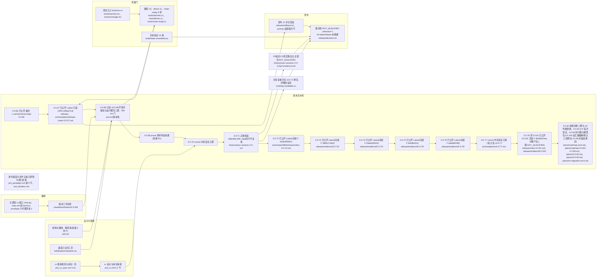

# 记忆宫殿(地图)

本文件是一张图加少量规则,不是账本。主体是下面的流程图:节点是房间(现状一句),连线是依赖与去向,入口写在节点里;过程、取证、重跑记录不进来,放提交说明、链日志目录或 archive/。2026-11-14 之前的全文在 archive/prd_mempalace-2026-11-14.md。

## 写法规则

- 改图只改节点文字或连线,一个节点一句现状加一个入口;过程不入图。
- 只记三类:别人必须遵守的决定、不可逆的对外动作、阻塞发布的未验证项。
- 子代理不提交本文件;主调度只在里程碑(整链结束、公开、装机完成)改一次。
- 版本序在 build/version-seq.tsv,版本内容与验收在 prd.md 版本表,未验证项真源在 build/state-unverified.tsv(tools/state-gen.cx 与下方"仍未验证"逐条对拍)。
- 任务表行 `| 部分落地 | ID、ID |` 与 `| 已落地 | ID、ID |` 供 tools/observe-agents.cx 读取。

## 地图

当前:0.0.86 已公开(冻结 F3 7e0db28a72,APE e762e82d,Root 已升级),下一版 0.0.87(plans/v0.0.87.md,main 合入 v0.0.87 由主调度做)。固定前缀 P0 因 E2 快照含后续源字节判 NO-GO；重开条件与对拍见 plans/roadmap-0.0.83-0.0.99.md 的 0.0.100 前结构性备忘。

## 决定(别人必须遵守)

- 0.0.87 首链起跑记账(2026-11-21 09:48:53 +0800,start 纪元 1795225733):决定:起 0.0.87 首链 REV=ee595061e7d24ccebd034e22769b66e41d5e2c46,输出目录 /tmp/unisacc-session-v087-chain1/ee595061e7d24ccebd034e22769b66e41d5e2c46,截止 deadline_s=5400(hard_s=6000),环境仅设 UNISACC_IDENT_HELPER=~/.cache/unisacc/ident-helper/identity-helper-real5,显式 cache-manager d34bee6c/0aae3fbc,真实句柄 guard=767840 pid=767841 pgid=767841。回滚:kill -TERM -767841 并移走输出目录。
- 0.0.87 至 0.0.90 规划评审采纳(编排者 cc 2026-11-21):决定:0.0.87 最小路径零失败约 100 到 105 分钟,首链今天上午起,11-22 12:00 为最晚时点而非目标;链 DONE 后并行 ci-early、预跑、冻结合并;链在跑期间列车工具冻结(prerun-drive 例外仅在链 DONE 前过守门人才落,否则本轮预跑用旧版);效率线每版一项零新增工具文件只认真实样本:0.0.88 devsvc git commit 的 args 错回显正确命令与 commit-own 门按相分预算,0.0.89 devsvc events on-change 接 affected --run,0.0.90 预跑监督收进 prerun-drive 子命令且列车终态进事件流;devsvc 下一步三项:列车经 devsvc 作业起且失败摘要 60 秒内进事件、提交用法自纠加门前预演、稳定窗口身份与心跳;提交门线 0.0.88 起由 agy-flow 接手(agyneon 转 P1 归档与回归)。证据入口:plan-review-fable-0087-0090.md。回滚:删该行。
- U5 去 pin 子集落库与列车工具冻结(编排者 cc 2026-11-21):决定:U3 让 0.0.88、U5 去 pin 子集已落(758e8b40e6)、pin 防线在 main(e079ff0fbe)、列车工具自此冻结(chain-ready、candidate-chain、bg-candidate、prerun-drive、commit-own、register、release-exec、release-chain 除非彩排发现缺陷)。证据入口:gatekeeper-u5-r2.md、u5-delivery.md。回滚:git revert 758e8b40e6。
- 编排最小战略层(项目所有者 2026-11-20 要求,编排者决定):决定:北极星表 build/north-star.tsv 与投资组合表 build/portfolio.tsv 落库(在途上限 7 条,新项进入须先移出一项),由编排者在整链终态、公开完成、每天 21:00 更新;复盘只按这三类时点触发,每次至多一停一启一调,不做每 2 小时复盘;督导由 15 分钟定时轮询改为事件驱动(有上限 Monitor 只在停下或终态唤醒,例行巡检 60 分钟)。依据:~/.claude/jobs/2798e440/tmp/pipeline-fastest-path.md 第 3A 节(协调者 115 分钟内 81% 空等、42% 工具调用为盯链、同日在途 30 余项)。证据入口:plans/v0.0.87.md"编排运行模型(2026-11-20)"。回滚:不满意即回到固定轮询督导,删两张表与该节。
- 0.0.86 保留 D2 与止损(编排者 cc 2026-11-20 22:20):决定:0.0.86 保留 D2 四条新拒绝默认生效,不退回告警;fwdstub unsigned 位、split 缓存根、D2 回调 r2 与检查类修复已装后起第九次整链。止损:第九次整链或其预跑再暴露 D2 引起的 A 类缺陷,即把 D2 新拒绝类退回告警,翻转移到 0.0.88 单独一版。依据:修复集合已定位并实测(证据入口 ~/.claude/jobs/2798e440/tmp/d2-v086/gen-10000cc598/defects.md)。回滚:按止损条执行,发布说明如实写。
- 版本内容重排 0.0.87 到 0.0.90(编排者 cc 2026-11-20 22:20):决定:0.0.87 为 D2 收尾(只放宽加告警,5 项,手改 A 类文件不超过 12,冻结 11-22 12:00);0.0.88 为 A1a 内建五单元(4 项,不超过 20,冻结 11-25);0.0.89 为 W2 默认开(3 项,不超过 8,冻结 11-27);0.0.90 为 L0 进程类五件(5 项,不超过 20,冻结 11-30);其后各版后移一位。planned_units 只计进候选键的工作项且必须是数字,类标签与文件数由起链前置强制。取代同日"0.0.87 迭代速度专版"骨架。依据:0.0.86 触及产品路径 56 个文件、至少五类,起链九次;一次过的版本手改产品文件都在 24 个以内。入口 plans/v0.0.87.md、plans/v0.0.88.md、build/version-seq.tsv。回滚:git revert 本决定所在提交。
- 发布节奏(编排者 cc 2026-11-20 22:40,撤销同日 22:20 的降频条):决定:不设发布频率上限,内容就绪即发,目标是高速迭代进化;提速靠产线(起链前置门、预跑装窗与失败批先行、提交门只评估提交树)把每版列车成本压下来,而不是少发版;工具、测试与文档在 main 持续落库,不必触发整链与公开。发布说明照铁律如实写已知缺口与未跑范围(未跑 s9 全套就写明 NOT_QUALIFIED)。依据:项目所有者原话"我要的是高速迭代进化",降频与此相反。回滚:无(降频方案作废)。
- 四道并行的执行口径(编排者 cc 2026-11-20 22:20):决定:项目所有者 2026-11-19"每版内容足量、四道并行"不撤销,按"一个候选只含一类大改"铁律执行:四道照常并行,只有功能道一类 A 类改动进候选;速度、资格、用户三道在 main 持续落库,不计入版本 planned_units;"足量"以封顶内的完成率衡量,不以项数衡量。依据:0.0.82 到 0.0.85 每版 4 到 12 项计划外,计划完成率 0 到 74%。回滚:项目所有者一句话即恢复原口径,删本条。
- 新增拒绝两步走(编排者 cc 2026-11-20 22:20):决定:自 0.0.87 起,任何使原先被接受的程序变为被拒的改动,第 N 版只以告警进入并用候选前端清扫全仓,告警命中连续两版为 0 后才可在单独一版把默认翻成拒绝,该版不带别的 A 类改动。0.0.86 的 D2 是既成例外。依据:0.0.86 第 5、7 次失败链、19 个工具 C99 修正提交与预跑多项 FAIL 均出自新增拒绝直接默认生效。回滚:删本条。
- 证据复用口径不变(编排者 cc 2026-11-20 22:20):决定:工具契约批次"绑定执行编译器身份、跨候选不重跑"暂不采纳,发布证据仍每候选全套实跑;只做影子核算与一次 30 分钟核查(预跑里非候选占位批次实际由哪个编译器执行),数据出来后再议。依据:与"只复用构造产物不复用测试结论"冲突,且 1712 行批次里只有 71 行显式接收候选,其余执行身份未核。回滚:无需,现状未变。
- 造工具的编排护栏(编排者 cc 2026-11-20 22:20):决定:CLAUDE.md"同类事第二遍就造小工具"条文不改;执行时加三条护栏,试行到 2026-12-04:(1) 优先并入现有工具的子命令,不新开文件;(2) 一次性分析脚本仍用 .cx,留会话临时目录不入库;(3) 每天度量 tools 顶层 .cx 净增数,只度量不拦。依据:tools 顶层 1172 个 .cx,其中检查 699 个;每个新工具同时改四到五张共享表,是提交冲突主源。回滚:删本条。
- 读路径不经 devsvc(编排者 cc 2026-11-20 22:20):决定:读仓内文件直接用 Read 工具或只读命令,guard-hook 不再以 DEVSVC-ONLY 拦读;写、提交、拿锁、跑工具、查关系仍只经 devsvc。依据:读不需要锁,每次读起一次编译器进程是纯开销。回滚:恢复 guard-hook 的读拦截。
- 分支规则机制强制(编排者 cc 2026-11-20 22:20):决定:本地与远端只允许 main、v0.0.NN 与论文 B 车道的 ujs;不建单元分支与短命分支;多窗口共用版本工作树 .claude/worktrees/v0.0.NN,各自只提交自己的路径;产线与 devsvc 线直接在 main。guard-hook 拒绝创建其它名字的分支与工作树(规则 GUARD-BRANCH-V1)。本条取代同日"多写者工作树 v0.0.NN-短名"一条。前置:提交门只评估提交树(修缺口 DEVSVC-GATE-READS-SHARED-WORKTREE)上线后钩子才启用;现存不合规分支由集成者核对已合入后删除,已公开版本的分支在下一版公开后删除只留标签。依据:本地 38 条分支中 14 条不合规,版本分支与标签同名造成引用歧义。回滚:关闭 GUARD-BRANCH-V1 一条规则。
- 分析禁令一周(编排者 cc 2026-11-20 22:20):决定:到 2026-11-27 不再开方案类分析报告;只保留顾问每次不超过 300 字的触发式复盘、守门人复核与失败定因。本周的执行依据只有 ~/.claude/jobs/2798e440/tmp/deploy-0087-plan.md 与两张战略表。依据:2026-11-20 一天产出 10 份以上分析加 22 份评审,建议执行情况无人核对。回滚:删本条。
- 在建项处置(编排者 cc 2026-11-20 22:20):决定:砍 T1、T3、U1、U2、U5、U6(并入 J1)、M8、S5a 单元 2B;延后到第 2 周 U4、U7、M5 变异门补强、M6、M9 本体、N3、N4N6;T2 只落安全子集后结束;孤儿进程 v3.1、register 冷跑补丁、precommit 接入并入提交门线由同一写者顺序落;在途以 build/portfolio.tsv 为准。重开 T3 的条件:0.0.87 一次过但槽到公开仍超过 200 分钟。依据与逐项理由见上述部署安排第 4 节。回滚:把对应行在 portfolio.tsv 改回 active 并先移出一项。

- 绝对家目录路径(隐私,主调度 2026-11-20):决定:证据入口与文档一律写 ~/ 或仓内相对路径,不写 /home/<用户名>/、/Users/<用户名>/;新增棘轮 no-home-path(第 16 项,基线 build/no-home-path-baseline.tsv 只降不升)与 tools/no-home-path.cx --staged(暂存新增行守卫,precommit 接入补丁待复核),改写用 tools/scrub-home-paths.cx --write。历史证据保留不改:release/evidence/、research/、archive/(INDEX 记哈希或为历史原件)、apps/csih 与 ujs(他车道)、tests/stream-e1/e2-domain-matrix.tsv(material 身份依赖)、tests/real-inputs.tsv(实参路径)、ape-receipt.txt 与 tools/check-preflight.cx 加 build/preflight-rules.tsv 与 tools/libneed-material.cx 与 tests/check-guard-edit.cx(工具生成或断言字面,后续在生成处规范化)。已公开不可撤回:v0.0.85 树内 227 个文件含 /home/ 路径(非 archive 121 个),其中用户名 devali 的家目录前缀 966 处,另有 CI 机 runner 与 box 的家目录前缀;只泄露系统用户名 devali,无凭据,不重写历史。风险:低(用户名可关联本机账户名,无访问能力)。回滚:删 ratchets.cx 的 no-home-path 项并还原 check-ratchets 计数即可。

- release/decision.txt 发布证据链缺口(清洁线 2026-11-20 查实):release-exec 第 7 步用停在 0.0.74 的陈旧 evidence.tsv 与 decision.txt 比对恒等;不证明裁决对应当前版本。决定:下次发布前必须改为从当次证据重算并写出 decision.txt;未修不得公开。证据入口:清洁线报告与本文件"待核(清洁 2026-11-20)"条;排期 plans/v0.0.87.md S6 子项 S6a。回滚:撤本行与 S6a。
- 分而治之与 devsvc 分布式演进(项目所有者 2026-11-20 方向加主调度决定):并发只是结果,关键是按模块、环节与泳道分割,每个环节写清输入身份、输出身份、等待时做什么;0.0.87 落产物库、合并队列、状态总线,0.0.88 落数据流触发、租约队列、按泳道子门;只复用构造产物不复用测试结论。证据入口:plans/devsvc.md"分布式演进(2026-11-20)"、plans/v0.0.87.md"总纲:按环节分割"、plans/v0.0.88.md 本版项。
  回滚:git revert 本决定所在提交,上述四处计划节随之撤回。
- 提交不带任何署名行(依据:项目所有者 2026-11-20 明令):devsvc git commit、commit-own、dvgitx 与 commit-msg 钩子(.git/hooks/commit-msg 薄入口,由 `tools/commit-msg.cx -- --install` 写,`--check-installed` 核)在落库前剔除 Co-Authored-By:、Signed-off-by: 行与行首为 Generated with [Claude Code] 的工具归属行(tools/cxlib/trailer.cx,整行大小写不敏感,连同前面的空行),剔除后为空按空说明拒绝;历史提交不改;证据 0566008dfb、check-trailer、check-commit-msg、check-devsvc a1。
  回滚:git revert 0566008dfb 并删 .git/hooks/commit-msg;agent 不得再在提交说明里写署名行。

- 废除 load1 负载门(项目所有者 2026-11-20 原话"不要再用什么 load1 这样的机制了,把这个机制停掉归档掉"):一切按 load1 放行、等待、降并发、拒跑的机制已停(dvqualify、prerun-drive --load-cap、flowadmit 减半、flowexec ADMIT 门与 admit_load_* 配置行、dvreact、s9-triage RERUN_ADMIT、s9-nightly-run --load-max、dvledger、perf-baseline、cx-dev watch),改为固定显式并发上限(--jobs/--max-jobs/--par/S9_WIDTH),load1 只作记录字段;取代下文"并发总量以机器负载不高于 10 为界"。
  回滚:git revert 本决定所在三批提交(dvqualify 加 prerun-drive ecb8cb246f、flow 系 de000a79d6、其余 39cba77ba6);新工具不得再引入 load1 判定。
- 起链即内容截止(项目所有者授权的调度裁定 2026-11-19,依据 plans/speed-first-rev4.md:0.0.81 整链只占单版 8.5%,链后到公开占 37%,计划完成率 55%、未计划项占 57%):整链起点之后产品输入一律冻结,链后只收阻塞修复(产品输入变更须重起链);工具与测试与文档项可并行但不进候选键;0.0.83 目标压到 10 单位;R1 release-flow 与 R2 增量预跑兑现前速度道不加新大项。
- 发布工具提前修复(R0,0.0.82):RELEASE-PREP-STRICT-NEEDS-FLAG 与 RELEASE-EXEC-X-COMMIT-EMPTY 两条缺口在 0.0.82 公开前修。
- 提交门类与共用发布路径的变更验收:夹具绿不等于真实提交绿,必须在共享检出同款条件下真实提交一次成功(derive_gate、table-index、doc-links 三次假漂移都是靠真实提交抓到);共用路径(dvqualify、release-exec、release-prep、register)的补丁必须独立复核并做原版与补丁版真实发车对拍。

- 版本编排(项目所有者 2026-11-19):每版内容要足量,四道并行(功能、速度、资格、用户),容量与逐版编排见 plans/roadmap-0.0.83-0.0.99.md(估计值,0.0.85 公开后用 S5 速度账实测替换);0.0.100 起汇编级精修的入口准则写在同一文件,0.0.99 封板必须满足。
- 迭代速度主线 S0 事件触发预制(项目所有者提出,依据 plans/roadmap-rev3.md):内容寻址的输入身份做键,复用同候选同输入的真实实跑证据,冻结时只核身份;S1 起链预检与 S5 速度账已落库(0.0.81 公开后),S2 令牌调度是 S0 推测作业的前置。devsvc 工具线在 main 上独立开发,但不在冻结到公开期间落库(会触发 MAIN_ADVANCED)。
- 起链前置:版本工作树的 unisacc.com 与 unisacc.com.build.json 必须是真实文件副本(不是符号链接);Root 升级后同步各工作树并把 ~/.cache/unisacc/chains/snap/<rev10>-<根哈希8> 旧快照移走;chain-ready 的 12 到 14 前置会拦截(缺口 WORKTREE-ROOT-FILES-MUST-BE-REGULAR、INSTALL-APE-RECORD-STALE-COMMIT)。
- 0.0.81 登记 21 行 expected-fail(c-negative 53/9 加 20 个 ref 旧判据批,到期 0.0.82):ref 类判据替换已批准,"镜像字节等于冻结经典参考"口径过时(X3 起指令选择有意变化),替代判据与 netregen 优化档作跨版本字节防线;0.0.82 发布门要求清零,到期未清则发布门红。
- arm64 -funit 对象已用 qemu 实跑验证(0.0.81 入口桥),已知缺口 OBJABI-ARM64-X7-STACK-BELOW-SP-SIGNAL(x7 栈在 sp 之下,0.0.82 起修)。
- 窗口协同:cdx 的 harness 自动压缩上下文,不因上下文占用高要求交接或改派;交接加重置只在话题大幅切换、旧会话压缩后无用信息偏多时才用。给常驻窗口派整块任务(做完整块再停),不派一次一个小样例。

派生查询规则:工具索引与产品全景经 devsvc tool-index、devsvc product-map 取得当前内容身份结果;两个 build/ 导出不再跟踪,自动 --derive 不物化。快照仅显式导出,独立 --check 仍实际现算并逐字节对拍。回退为恢复 derive.tsv 的物化行、显式生成后重新跟踪。读集、外部核验依赖、失效负控与证据入口见 [plans/devsvc.md](plans/devsvc.md) 的 R1 节。

- agentwork 已整体退役到 archive/agentwork-retire-2026-11/:协同决定只进本记忆宫殿,不追加过程账本;ledger-add 默认拒绝,仅显式 --ledger 可维护独立数据。旧 schema 别名只供历史审计,目录缺失合法而负控仍拒绝缺证据。回滚由前向提交恢复原路径,六文件归档保持原字节。

- 版本号跳过 0.0.64。入口 build/version-seq.tsv。
- 起整链的环境只设 UNISACC_IDENT_HELPER,不设 UNISACC_RUN_CACHE 与 UNISACC_CACHE_DIR。
- 版本分支:main 只做集成与发布,一分支一类大改。全文 AGENTS.md。
- 整链会话根在链运行与发布期间勿删,清理只由主调度在公开后做。
- 改产品源的验收必须含引导编译器(bootstrap-0.0.59)多单元编译,不只已装产品 -c。
- 写仓内文件只用 Edit/Write 或 .cx 工具。
- devsvc 主能力已可用(2026-11-15):基础版 1b1b4c4b94、flow 引擎 cbfbb3bd66(flowrun、flowexec、flowfile),omp-go 已持 registry 锁完成登记协同(54eaf4b064)。
- 仓开发服务 devsvc 为当前最高优先的工具线(项目所有者 2026-11-15):基础版落地后所有 agent 改用其写窗口锁与 run,不再靠信封排窗口;路线见 prd.md 候选池 T;成熟后独立成"智能体伴侣"产品并可替代 moltbaby 的 mapp,devsvc 为暂定名;核心不写死本仓路径。
- 仓内的门(precommit、register、derive、ratchets、affected、tlib bump)逐步迁入 devsvc 成为增量并发的 flow 节点,判定强度不降,先对拍再切换(prd.md 候选池 T)。
- build/ 只留构建 unisacc.com 用的表;仓开发元数据改由 devsvc 维护与查询,flow 与关系 DAG 稳定后逐表迁出(先等价对拍再切读者再移除),见 prd.md 候选池 T 决定。
- devsvc 开发只由主调度 cc 及其子代理负责(项目所有者 2026-11-15);omp-go、omp-cdx 专做 unisacc.com 产品与版本线,只作为 devsvc 使用者提缺口,不改 devsvc 源码。
- 勘误(主调度 2026-11-20,依据 plans/devsvc.md 2026-11-20 演进评审):上条与事实不符,agyneon 已在改提交门;现状为 agyneon 实现、cc 集成(opus 做夹具,cdx 只提缺口)。原文保留。
- 0.0.69 改为"编译覆盖缺口修复"(not covered 类产品缺陷:帧槽、单元帧与作用域、常量表达式等;cc 2026-11-15 裁定),原 0.0.69 至 0.0.72 各顺延一号;帧槽修复已在分支 v0.0.69(3babcd8287);分期见 plans/notcovered-plan.md,版本序表在普查落地后同步。0.0.68 不为此打补丁。
- 协同开发唯一接口是 devsvc 的 flow 及其子算子并行执行(项目所有者 2026-11-15);不采用每个 agent 私有工作区或覆盖层,冲突、一致性、回滚与提交都在 flow 执行层解决。
- prd*.md 与 plans/*.md 由 devsvc 文档接口接管(项目所有者 2026-11-15):devsvc doc 子命令与 flow 的 doc.* 算子落地后,所有 agent 只经接口改,不再直接编辑。
- 自 0.0.68 起 s9 commit 档不挡公开:冻结后与整链并行跑,结果补记 release/evidence.tsv,新增 FAIL 走补丁版(prd.md 候选池 Q)。
- 0.0.69、0.0.70、0.0.71 合并为一次发布 0.0.71(速度 R1 与 X1、覆盖缺口一期、生成码一期 X3),0.0.69 与 0.0.70 号跳过(项目所有者 2026-11-16);0.0.68 不等发布即合入 main,此后从 main 开发。
- demo 发布位置=docs/uxe/<id>/(项目所有者 2026-11-17):GitHub Pages 指 main 的 docs/;依据 curl 首页 200 但 ./uxe/asteroid|drone|live 404 且 origin/main docs/uxe 文件数 0;回滚恢复 docs/index.html 原文。里程碑 M7,与 M2 并行优先。docs 改动经 ujs 分支由集成者(主调度 cc)合入 main,不在共享 main 直接改。

- 执行类工作由主调度经 devsvc flow 并发自己做;子代理只开 fable 级(设计、难题);外部窗口 omp-cdx 停止派工(项目所有者 2026-11-16)。并发总量以机器负载不高于 10 为界。
- cx-dev(tools/cx-dev、tools/cx-dev-root)的结果一律只是 LOCAL 证据,不是候选结果:检查可经假根测改过的 exec 表,基座(src、cx、include)改动要重装产品。
- 整链预制路线(主调度 2026-11-20):事件触发预制对整链真实命中 0 次,react 从未真起(59 小时 67906 条事件中 react/bg-candidate/chain.done/PREPARED 均为 0;四因:触发键按内容而采纳键按提交、准入 load1 小于 6 而本机常 9 到 15、放行要求影子满 24 小时而常驻上限 7200 秒无人重拉、正规链不经 devsvc 无链事件;prebuild-self 只预制 devsvc 自身)。改走:0.0.86 推测链真起加并行确认(工具线第三项 T3)与周节奏命令,0.0.87 预跑发车去 load1 阈值,0.0.88 后再定采纳内容键;依据 plans/reviews/2026-11-20-chain-incremental.md(原入口 ~/.claude/jobs/2798e440/tmp/chain-incremental.md 已被取代)第 9 节,plans/v0.0.86.md;回滚:停反应器(devsvc react stop),正规链冷起照旧,推测 APE 与正规 APE sha256 不等则证据自动 INVALID。
- 多写者工作树(主调度 2026-11-20;已被同日 22:20"分支规则机制强制"一条取代,仅作历史):同一版本两个及以上写者时,每个写者一个工作树 .claude/worktrees/v0.0.NN-短名(分支 v0.0.NN-短名),由 cc 合入 v0.0.NN;依据 2026-11-20 agyneon 在共享 v0.0.86 工作树提交被 cdx 未提交 exec/parse2 改动触发 batch-domains 与 k2-gen2 DIFF 拦下(缺口 DEVSVC-GATE-READS-SHARED-WORKTREE)。
- 三层分车道事实与采纳(主调度 2026-11-20):事实:症结不是 ext 目录本身而是产品输入有四套互不一致的口径(候选触发键八棵树只被 tools/dvreact.cx 用、seed/ident.c 的 SID、tools/dev-lane.cx 五棵树、build/freeze.tsv 手写路径);0.0.75 到 0.0.85 共 604 个非合并提交 A 类 32、纯 ext 1(ebdc15a0e7)、C 类 476,近三版每版都有 A 类提交,没有一次整链只因 ext 而跑;身份对拍:ext/sysx/linuxns.cx 候选键与 SID 都变(src/sysx 等四个目录别名指向 ext/sysx,seed/ident.c 按目录递归),ext/crypto/sha256.cx 与 ext/net/tcp.cx 候选键变 SID 不变(误触发),tools/cxlib/netpack.cx 候选键不变 SID 变(漏触发);ext 不是纯 B:ext/memx/arena.cx、ext/textx 四个文件、ext/sysx 九个文件是 cx/mem cx/text cx/sys 的符号链接目标实为 A;纯 B:crypto net tsvx testx argx fsx 加 sysx 六个非链接文件;pkg.bin 是 P3 模型包在 APE 内不是 ext 源码包;分车道收益在未来不在历史。未核:APE 字节对 ext 改动不变只是推断、14 个链接目标文件是否进隐式运行库前缀、四个 sysx 别名是否有非 use 形式使用者(去别名前必须先查)、整链与预跑耗时取自简报未复测。采纳:以 SID 的 list-current 为唯一事实源生成 build/lane-inputs.tsv,其余口径都读它,五个探针登记为先红后绿批次;promote 改为 A 键相同即复用候选(近三版 273 个提交里只有 14 个会使候选失效),收益大于整个 B 车道,是 T3 推测链直接前置;B 车道最小验收:六目标实编、layer-api 版本同步、affected 选批、上一公开 APE 兼容实编,目标 15 分钟内,交付就是 main 提交号加 build/pkg-release.tsv 一行,不做 submodule 不发 tar;ext 不合并给应用层(纯 B 包将来作为应用层包候选,14 个链接目标文件搬回 cx,平台与协议库留 unisacc 侧)。证据入口:plans/reviews/2026-11-20-layer-lanes.md。回滚:撤本条与 roadmap 修订注"三层分车道"小节、plans/v0.0.86.md T4 行、plans/v0.0.87.md LN1 到 LN5 行。
- 三层分车道编排与条文(主调度 2026-11-20):不立即改 CLAUDE.md,三处改写稿存 plans/claude-md-layer-lanes-draft.md,暂不生效,待 lane-inputs 生成器与包门工具就位(0.0.87)由主调度改 CLAUDE.md 并记决定,此前版本分支规则不变;L1(ext/sysx/linuxns.cx sy_seccomp_allowlist)仍落 v0.0.86 分支、起链前合入,赶不上推 0.0.87,不为它重起链,不直接提交 main,agy-cage 按分支提交号取源,三个派生表随 L1 一并提交;编排约 7 单位:0.0.86 工具线 lane-inputs 生成器与探针 1(agyneon,W2 默认开关判定之后,不占每版两项名额,理由 T3 前置),0.0.87 promote 按 A 键复用 2(cdx)、去别名搬实体 1.5(agyneon,A 类随整链)、包门工具 1.5(agy-flow)、条文生效 0.5(主调度)、复核 0.5(opus);团队编排骨架见 plans/layer-orchestration.md。证据入口:plans/reviews/2026-11-20-layer-lanes.md。回滚:删改写稿与编排骨架,撤 plans/v0.0.86.md L1 注。

### 仍未验证(缺什么 / 清零动作)

- check-stdio-buffer:不覆盖 --link-only 与子集编译的缓存一致性,tty 路径未测。
- osx cache-manager:借用副本来源未证实,候选上首次 osx 实跑核来源。
- tsv-lint 不稳:同日三次实跑 PASS、FAIL、PASS,未定因。
- wt-gate-probe 为 PLANNED:链路超 55 s 批次上限,6 条断言未验证。
- slice-migration-gen:source-missing cx/compiler/frames.cx 旧记述,待复核。
- affected-iface2 批次未取得实跑结果:待跑。
- 已入库工具中 tools/status.cx 的测试夹具曾被 sed -i 改过,内容未重审。
- cx 模块语法缺口:use as alias,排 0.0.70。
- cx 模块身份缺口:软链被当两个模块,排 0.0.70。
- 仓库根 out/:逐项迁移到 sy_tmpdir,清单见归档同名条。
- 大型二维自动数组:已装编译器报 not covered(复现 $CLAUDE_JOB_DIR/tmp/repro-large-2d-auto-array.cx)。
- compile-as-limit:低限额具名拒绝两项未过,候选上实跑,不过则补产品合同。
- cc 额度暂停期间由 cdx 按项目所有者授权临时接班(2026-11-17)：第五条 4c2e7ad167 性能实验已终止、原证据保留，不重起同输入；计划备忘真实末次命中与独立开关对照已核，结论与未验范围见 archive/plans/local-product-0.0.71.md 的第五条链接班核验节。三张额度中断的小单均未完成验收，不把隔离树中的半成品当成已交付补丁；共享 tests 大批纯执行位改动来源未核，提交须排除这些改动。
- ujs `compiler_min.cx` cxraw 实测 96(tsv 基线曾 50,限期 0.0.9 压回 <=50)。决定:不把 96 当合格,不并 G1。依据:d473474f14 与 ujs/prd.md C4。证据:`sh ./unisacc.com -run tests/cxraw.cx -- --check --files ujs/seed/stage0/compiler_min.cx`;host1_vm 实测 34。回滚:到期未压回则拒绝合入 main/公开;不升基线冒充。
- ujs/product 九文件 cxraw/cxapis/cxtrunc 缺行已按实测补基线(2026-11-18,合入请求):gold-ic 18/3, gold-lex 25/3, gold-parse 17/3, gold-rest 15/4, gold-type 17/3, net-gold-check 34/2/6, net-lex-check 13, net-parse-check 18/1, pack-nets 27/4/2。不把缺行当 0。限期 0.0.80 压回各表该行 calls 至少减半(cxraw 优先 sy_*)。证据:`sh ./unisacc.com tests/cxraw.cx -- --check --files ujs/product/gold-ic.cx ...`。回滚:删这九行则棘轮再 FAIL;到期未压回拒绝公开升格。

- core-compat参考源转换:参考执行器cacb65b83e新增P4解析与SBLOAD未经独立核验,旧helper仅批准空copy guard转换,不扩大批准域;入口build/state-unverified.tsv U20。
- 全套入口分片聚合:主线423c274c42的入口与原因分栏已合入,新候选端到端验收未完成;入口build/state-unverified.tsv U21。
- 全套材料与平台证据:118材料族仅47项登记,无生产者与外部主机证据未补齐,全套NOT_QUALIFIED;入口build/state-unverified.tsv U22。
- stages独立金样:五项字节差异的独立oracle尚未完成,保留原断言和失败,下一版补齐;入口build/state-unverified.tsv U23。

- interfaces-lnx-x86_64既有oracle:两轮FAIL且低载复现,接口oracle迁移与独立核验留下一版,保留断言与失败;入口build/state-unverified.tsv U25。
- c-negative 与 pp-negative 静默接受:17项产品约束缺陷(C约束15项、预处理2项),下一诊断专项版本补具名拒绝并逐项保留负控;0.0.67两个代表同样接受,其余15项旧版未跑;入口build/state-unverified.tsv U26,证据release/s9-assert-0.0.71-summary.txt。
- release-chain 端到端 --dry:未用 0.0.85 真实证据复刻形态跑全五步,仅夹具与分项检查绿;入口build/state-unverified.tsv U30。
- 待核(清洁 2026-11-20):release/decision.txt 与 release/evidence.tsv 仓内都停在 v0.0.74 Y1(3115389996,evidence.tsv 含 0.0.74 十处、0.0.85 零处)。tools/release-exec.cx 第 4 步(约 1236 行)用 release-decide --candidate release/candidate.tsv --evidence release/evidence.tsv 重写 release/decision.txt 后随 Y1 提交;第 7 步(约 1356 行)再用同两份输入重算到 decision-recompute.txt 与 release/decision.txt 逐字节比对。两边输入同为陈旧 evidence.tsv,比对恒等,只证明可重算,不证明裁决对应本版;0.0.75 起 Y1 未改动这两份文件的原因未查。清零动作:release-exec 第 4 步断言 evidence.tsv 与 decision.txt 含本候选版本号,否则具名拒绝。

### 里程碑与跨窗口约定

- 2026-11-17 v0.0.71 已公开发布并置 Latest(不可逆):标签 v0.0.71 与 v0.0.71-src 绑定冻结提交 0571f88105e5da96335ae4a7add1d9e605d40d7c,公开 unisacc.com sha256 ca84adc0fb36748a7194f5830791f20f1998ff5e6816eab4db55b4f9d7c7c24a,同候选原生 CI run 44072623262 attempt 1 为 42 格 QUALIFIED,公开读回通过;整体裁决 NOT_QUALIFIED(全套 s9 未过,缺口见 release/notes-0.0.71.md)。回滚办法 release/rollback.txt:转回草稿、Latest 移回 0.0.67、前向 revert,不删标签。证据入口 release/evidence.tsv 与 release/decision.txt。
- 2026-11-17 改默认行为(默认档、路由、默认输出)的提交,必须按断言名全仓搜同组检查的其它平台副本(tests/*.ps1、其它宿主版本)并同提交修齐:55cc27a7e8 改默认档走 O1 后只修了 lnx 版 check-stream-pipe,漏掉 tests/win-portable-cell.ps1,首轮发布 CI 两个 Windows 格因此失败并多耗一轮(定因 5493e53e4c)。副本配对登记在 tests/mirror-pairs.tsv,由 tools/check-mirror-pairs.cx 比对(1f8d2bce27)。
- 派生表出 git 与测试分域(cc 2026-11-18,依据开发速度诊断):tool-index 与 product-map 改 query-only(devsvc tool-index、devsvc product-map 按内容身份现算现查,导出文件停止跟踪,本地需要时 derive --write --only),读集缓存必须带清单哈希并有六类失效负控;测试分母分六域(product-qualification、repository-governance、tool-selfcheck、devsvc-selfcheck、release-matrix、external-product),affected --domain 过滤,新批次域由规则表自动推断,显式例外不增(现 108/1393)。证据 release/evidence/r1-final-2026-11-18.tsv、r3-domain-2026-11-18.tsv;回滚:恢复 derive.tsv 对应行与文件跟踪。
- 发布证据与验收纪律(cc 2026-11-18):(1) 发布证据不得只放 /tmp(v0.0.71 登记的 8 个证据全部丢失,已在 release/evidence/0.0.71/INDEX.tsv 逐条标 LOST 并重做可重做项),证据与资格账本落仓内 release/evidence/;(2) 改被多处 use 的模块,验收必须覆盖三种入口 default-run、-c -funit、-S 的受影响运行批次,不止编译分片(7026ecaa4d 的 setpgid 回归因只验 default-run 漏验);(3) 测试夹具创建新工具一律经 check-precommit-gates 的共用夹具助手(三张真表事实行的投影,有与真实 register --tool 的逐字节对拍自检),门每加校验只改助手一处;(4) 同一失败连续两次即停手读发出该码的源码行,PREPARED 与 PASS 严格区分,超窗记 UNKNOWN(窗口)不记 PASS;(5) 方向:持续资格(产品输入变动即后台出候选并跑产品资格域,冻结只核身份加整链加 CI,证据落仓内),见 fable 版本周期诊断。已知限制:sysx.process 与 netpack 为双薄门面共用 processcore,不能同单元共导入(缺模块重导出,pkg-gaps 已登记)。
- 提速路线与 ujs 分工(cc 2026-11-18,项目所有者授权小重构):依据 fable 的两份诊断(版本周期、整体设计),门与派生体系以整体设计调整为主,devsvc 只做载体:(1) 剩余入库派生表(batch-packages、doc-links、iface-hash、links、table-index、batch-domain-index)按 R1 模式停止跟踪、现算现查,合入零派生冲突;(2) tests/run-batch.cx 接受带内容哈希的候选清单与符号链接物料(先取真实路径再核内容哈希,身份更严不更松),版本工作树候选可取严格 BATCH_RUN;(3) 提交门改读集归因,只派生与改动相交的表,棘轮改归因口径加落库后全树实跑(全树覆盖只换时机不取消);(4) 收据绑读集内容身份而非 HEAD 提交号(只限同一事务内自己实跑过的门,批次结论永不复用);R2 同 ref 队列降为回退方案(设计 plans/devsvc.md 第 12 节,基线证据 release/evidence/r2-commit-baseline-2026-11-18.txt);(5) 持续资格流水线在 (2) 与 --warm 合入 main 后做第一步。红线:不复用批次结论、不删断言、不缩全树覆盖、不放宽 55 秒窗口、不抬基线换绿。ujs 车道:全部在 ujs 分支做完并自验收后才合并 main(合并前 ratchets 全绿且基线行同并),main 上不再中途窄合入。回滚:各步独立提交,逐步还原。
- 归档与清理留痕(cc 2026-11-18):plans/round-2026-11-16-b.md、round-2026-11-16-c.md(0.0.71 单轮规划,无入链,已发布)归档到 archive/plans-2026-11g/(README.tsv 记原路径与原因,找回:git mv 回去或 git log --follow);本机 /tmp 陈旧夹具与 4 个已发布版本工作树(v0.0.65、v0.0.66、v0.0.71、v0.0.71-rc2,分支保留)已清;仍留待审的:有未提交改动的旧版本工作树 v0.0.67 到 v0.0.70、仓根 19 个 .o、tools 疑似无用 132 个(清单只列不动)、plans/ 其余约 64 份未逐份审。
- 迭代速度原则(项目所有者 2026-11-18,cc 归纳):迭代越快进化越快,现阶段只聚焦 v0.0.xx 小版本快速迭代。手段七条:(1) 分而治之:测试分域、分片、逐相有界、逐表派生、一版一类大改、写域互不相交并行(私有树、分支工作树、新功能落新文件);(2) 事件触发预制:react 对账后台候选、--warm、prebuild-self、bg-candidate、提交队外预派生,预制只记 PREPARED、验证仍实跑、不缓存测试结论;(3) 前移:版本槽在分支首个提交、严格证据在冻结前、棘轮按本次改动归因;(4) 删除工作:派生表停止跟踪、域与登记自动推断;(5) 内容寻址不重做:读集键与候选身份键;(6) 度量驱动:每次改动记分段耗时,专打最长一段;(7) 快败具名:具名拒绝,同一失败两次即停。速度线收口标准:冻结到公开 30 分钟级、提交门固定税秒级、并发提交不互相作废;每个版本至少一项产品缺口收敛。依据:v0.0.72 冻结到公开 44 分钟(0.0.71 为 151),昨晚主线 159 笔提交 72% 在维护门体系。
- 发布产物与整链现场的保留(cc 2026-11-18):被发布证据或打包引用的产物不得只放在可被清理的 /tmp:cache-manager 持久副本在 ~/.cache/unisacc/release-v072 与 ~/.cache/unisacc/release-v073/cm,发布件六件资产的持久副本在 ~/.cache/unisacc/release-v072;整链会话目录 /tmp/unisacc-session-v072-chain2 到 chain4、v073-chaintest、v073-chain 在对应版本发布后保留 7 天再清理;任何清理单或自动清理(含别的窗口)删除前须先核 release/evidence 与 build/pkg-gaps.tsv 里是否引用该路径,有引用先入仓或迁到持久目录(v0.0.73 发布中 chain2 的 cache-manager 被清理致打包被拒,发布单用 cache-retain.cx 重建逐字节相同才续上)。长期方案:产物创建即登记加 GC 反应(追踪表 N 项与 prd_iteration.md 清理节)。

- 0.0.82 公开后评审与覆盖缺口(cc 2026-11-19):(1) R1 release-flow 与 R2 增量预跑设计稿(cdx r1-r2-design.md,sha256 53307b7a...)评审通过,0.0.83 落地顺序为 R1 先(用 0.0.81 与 0.0.82 离线重放对拍),R2 先只出补跑建议并在新布局全量对拍,两个开关独立默认关,一例漏选即停用复用。(2) 拆分父批 r4 已落库(3dfed8d55d),旁表 since 取 0.0.83:独立复核实测 since=0.0.82 会误拒已公开的 0.0.82 证据。(3) 覆盖缺口:0.0.82 严格证据里没有 signal-targets 与 snapshots-cx 两个拆分父批及其 5 个分片(win-argv 有且三分片 PASS),原有 G1 对"拆分后父批与分片都缺席"不报,0.0.82 公开件对这两批的资格未覆盖;0.0.83 首次整域实跑与 G1 r4 起补上,发布说明已写已知缺口口径不得称全批资格。回滚:本条仅记账。
- netregen 字节栅栏的结构问题与指纹机制决定(cc 2026-11-20):0.0.83 预跑 12 格(netregen-module 与 netregen-opt-module 各 6 目标)确定性 FAIL,原因是本版 POSIX 小修改 include 头(经 cx-flat.h 进 .cx 单元),.cx 模块镜像可写段 memsz 0x22a20 -> 0x227b0 并使地址立即数移位,代码长度不变;0.0.80 与 0.0.82 公开件编出镜像相同,其余 48 格对 0.0.82 全 SAME;证据 $CLAUDE_JOB_DIR/tmp/netregen083 与 prerun083。结构问题:任何有意改变 .cx 镜像的版本都撞这道逐字节栅栏(换成最近前代参照无效,下版参照 0.0.83 公开件同样 DIFF)。决定(fable 评判 B 的变体,否决 A 因 .cx 拿不到 POSIX 修复,否决 C 因只是推迟):不改判据文本,新增"精确指纹预期差异"登记:G1 的 expected-fail 允许 image=OLDSHA256->NEWSHA256 形式,严格证据 NETREGEN_DIFF 行指纹逐字相等才放行,带到期,过期拒绝;不加优化的组也打印 NETREGEN_DIFF。依据:判据不放宽,只对特定字节差异精确登记。证据入口:prerun083 与 netregen083。回滚:撤销 G1 指纹分支与登记行即回到原判据(此时 12 格 FAIL 阻塞发布)。责任:agyneon 第 20 题实现,cc 独立复核后落库,冻结前完成。
- 0.0.83 公开后记账与 CI 首次失败定因(cc 2026-11-20):决定:CI run 44589130353 首次运行 osx/x86_64 格 stream-pipe 部件 e 撞 55 秒单部件界限失败(osx/arm64 被取消),判为慢 runner 计时余量不足而非产品回归,依据是本机对照 SP_PART=e 在 0.0.82 与候选上各约 4.8 秒(三次重复,首次冷 15 秒)且 0.0.79 有同因先例;处置为 gh run rerun --failed 同 run 重跑失败格,六目标 success 后 release-exec --from-step 3 重做,CI_VERDICT PASS;发布说明如实写非一次通过。netregen 精确指纹机制本版实际使用结果:12 格 FAIL 经指纹逐字相等放行(G1 STRICT PASS rows=417 expected_fail=26 superseded=1),到期 0.0.84,下版以 0.0.83 公开件为参照应回到相同,否则不得续期而须定因。工作项口径:plans/v0.0.83.md 四道表 0/10 完成、12 项计划外(Q-P 报告与 ci-cell-map 未做,转 0.0.84 评估)。新缺口登记 pkg-gaps:STREAM-PIPE-OSX-X86_64-55S-BOUND-THIN-MARGIN、DERIVE-FLOW-BATCH-UNMEASURED-AT-5MIN-BOUND、DVQUALIFY-IDS-BUFFER-8192、RT-SHARED-LBIN-NOT-REGISTERED、RELEASE-EXEC-STEP3-REUSES-FAILED-RUN。Root 升级到 0.0.83 公开件(APE 12fd0c57,7399573 字节)。证据入口:release/evidence/0.0.83/(INDEX.tsv、ci-44589130353.json 与 .log、expected-fail.tsv)与 release/notes-0.0.83.md。回滚办法:(被取代 2026-11-20:原文"Root 用 tools/install-ape.cx --rollback"对公开安装已不成立,公开安装不做备份,--rollback 无候选备份时拒绝 REFUSED no-candidate-backup)Root 回退改为重装上一版公开 APE(tools/install-ape.cx 以上一版公开件安装);发布撤回见 release/rollback.txt。
- 0.0.83 教训与 0.0.84 计划落库(cc 2026-11-20):教训:0.0.83 计划表与实际范围脱节(done=0 unplanned=12),原因是中途改范围未写回计划文件。新规程(别的 agent 必须遵守):(1) 范围变更由主调度在派工前写回计划文件四道表与 planned 键值,内容截止、冻结、公开后三点对账,计划外满 3 项停收;(2) 起链前置加产品表生成器总闸(gen-all-check --check 成 chain-ready 第十条,未落库不起链);(3) CI 单格超时处置:读发码源码行 -> 本机上一公开件与候选各三次对照 -> gh run rerun --failed 只一次 -> release-exec --from-step 3(它复用失败 run,须先 rerun)-> 发布说明如实写非一次通过与定因,第二次失败即停手按确定性缺陷处理;(4) stream-pipe 55 秒界限不放宽,靠拆部件取余量。0.0.84 计划决定:主题冷启动第一块(模型装载与前端网 E3 与 E2 固定工作量削减,产物字节不变),planned=9(F2 S2 Q2 可砍),另留 3 个计划外位;nn-migration-rev3 六片 .text 重量与执行器资源合同门不顶替 Q2,顺延 0.0.85;Q-P 转阻塞顺延 0.0.85;F1 产物字节不变与 netregen 60 格对 0.0.83 公开件全 SAME 为本版资格线。依据:hello.cx 冷态 619 ms 中推理 76.3%、装载 14.8%,冷启动对 node 42 ms 为唯一数量级短板;0.0.83 返工约 5.5 小时。证据入口:plans/v0.0.84.md、build/version-seq.tsv 第 19 行、release/notes-0.0.83.md。回滚:按 git 历史恢复上述文件。
- 产品表生成器总闸 gen-all-check 与两项 GEN_UNCOVERED 豁免到期(agyneon 2026-11-20,0.0.84 S1):决定:tools/gen-all-check.cx 纳管 41 个产品表生成器并接入 chain-ready 前置 15-gen-all 与 precommit derive_gate(在 git write-tree 暂存索引树上经 tools/bound 25 限时检查,仅改 tools/*-gen.cx 时只跑被改生成器,不误拦工作区他人未暂存改动,超时按 GEN_ALL_GATE_UNAVAILABLE 放行且零孤儿);两项未覆盖生成器显式列 GEN_UNCOVERED 并带到期:tools/rt-shared-gen.cx(known-gap:_unisa_lbin-not-in-rt-shared.tsv,expires=0.0.85)与 tools/ucn-pp-gen.cx(needs-pristine-root,expires=0.0.86)。依据:0.0.82 win-argv 与 0.0.83 k2-gen2 两次因来源戳过期重起整链;两项豁免不静默跳过。证据入口:tools/check-gen-all-check.cx(10/0,含 d20a8f64af 与 8d79aea9b9 重放、他人未暂存改动不误拦、死循环替身 <40s 零孤儿)与 build/pkg-gaps.tsv RT-SHARED-LBIN-NOT-REGISTERED。回滚:git revert 对应提交或 tests/derive-gate-waivers.tsv 临时豁免 gen-all。

- ext/sysx/linuxns.cx 与 r2 复核加固(agy-cage 2026-11-20,基线 14359b6cf6):决定:在 ext/sysx/linuxns.cx 提供第 5 类 9 原语与第 4 类 4 原语(lns_targets[] 表驱动,win_x86_64 与 osx_x86_64 编译降为 -ENOSYS,sy_sethostname 校验 len==strlen,sy_drop_all_caps/sy_seccomp_filter/sy_pivot_root 补合同注释);L0 缺 sy_syscall6 记入 build/pkg-gaps.tsv L0-LACKS-SY-SYSCALL6(到期 0.0.86,L0 加入口后 lns_sys 改一行);lnx_arm64 实跑记 UNMEASURED(产品 `-b linux/arm64` 当前 NOT_IMPLEMENTED units,qemu 用不上;系统调用号已对照内核头)。证据:tools/check-ext-sysx-linuxns.cx 25/0(含 win_x86_64、osx_x86_64 编译与越界/非特权拒绝)、批次 ext-sysx-linuxns PASS。回滚:git revert 对应提交。
- 0.0.84 公开与发布后记账(cc 2026-11-20):决定与结果:0.0.84 已公开(release-exec EXECUTED steps=7,公开读回 SHA256 3a226945354604440e4392d85c54548f92e9f19a3e73ebc3b263c67daef9c7db,8417722 字节,冻结 F=df14f1e334,Y1=f708c82ddd,Y2=f65c432114);F1 采纳:七个热模型改存原始表示,装载页冷中位净省 47 到 52 ms(93.8 -> 46.3、94.2 -> 42.9),产物逐字节不变,30 个篡改样本具名拒绝;限制:总墙钟有负收益轮次,热态 8.4 ms 未达 7.5 ms,冷启动仍约为 Node 13 倍,APE 增 1018149 字节。CI run 44647659602 一次通过(六目标约 7.5 分钟);stream-pipe 最大部件 osx/x86_64 multi 26.8 秒,三个非 lnx/x86_64 POSIX 格 STREAM_PREPARE FALLBACK(缺口 STREAM-PREPARE-OSX-FALLBACK,0.0.85)。工作项 6/9 完成、6 项计划外(逐项依据在 plans/v0.0.84.md 头注释)。预跑三次的教训(别人必须遵守):(1) 新增批次必须先在 dvqualify 单提交资格布局自测再登记(NEW-BATCH-QUALIFY-LAYOUT-SELFTEST-GATE);(2) 包格式变更必须附工具侧消费者清扫清单并全部实跑;(3) 范围变更先写回计划文件再派工(本版已执行)。仓根 Root 升级到 0.0.84 公开件。证据入口:release/evidence/0.0.84/、release/notes-0.0.84.md、build/version-seq.tsv 第 19 行。回滚:release/rollback.txt;Root 回退以 tools/install-ape.cx 装 0.0.83 公开件 12fd0c57。
- 0.0.85 计划落库(cc 2026-11-20,基线 1ae28737fe):决定:0.0.85 主题定为冷启动第二块,前端固定前缀(隐式运行库与内置头的 E2、E3 固定推理)按内容身份预制入包,编译产物逐字节不变,planned=8,槽到公开目标 300 分钟、硬上限 420 分钟;开槽前 P0 判定门由 cdx 执行(45 分钟,约 07:00 出结论),固定占比低于 50% 或状态不可续接即 NO-GO;槽前工具线 agyneon 四项(OLD-PRODUCT-MATERIAL-CACHE-KEY-LACKS-LAYOUT-PATH、S1 新增批次布局自测登记门、S4 unit-frontcache-equiv3 拆分、S2 tools/prerun-drive.cx),derive 全量 --check 并行化提为槽前工具线,S3 修复半项可砍;到期项裁决位:c-negative 53/9 建议续期 0.0.87 并写明原因与计划,rt-shared-gen 的 _unisa_lbin 在 0.0.85 内修掉不续期,开槽前由主调度回填;R2 三块补丁(efa1a6adff 等)为储备 (1)(5)。依据:fable 草稿经评审通过;0.0.84 冷 hello.cx 557.7 ms 中 E3 加 E2 约 285.7 ms(固定占比为推断,待 P0 实测)。证据入口:plans/v0.0.85.md、build/version-seq.tsv 第 20 行、plans/INDEX.md。回滚:P0 判否即按 plans/v0.0.85.md (b) 功能道说明把 F1 换为路线判定入表(nn 迁移第一块),同步改写本计划 (a)(b) 与 version-seq 第 20 行;计划文件本身可按提交回退。
- 0.0.85 主题终稿(cc 2026-11-20,基线 098f43aec9):决定:0.0.85 改为前端诊断三期(c-negative 53/9 -> 62/0 不再续期、拒绝文案带 文件:行:列、-Werror 升级与 C99WARN-IMPLICIT-BUILTIN-FALSE-POSITIVE 修复),planned=11,槽前硬前置只留 S1 S2 S4,Q2 改 opt-frame4 生产者(UNKNOWN 10 -> 2),Q3 Q-P 首次报告不可砍;固定前缀预制与路线判定入表不进本版。依据:cdx P0 NO-GO(头集固定占比可过半,但 E2 头末状态含整源复制,续接后缀沿用旧字节);fable 全局审视 (7)(8)。证据入口:plans/v0.0.85.md 附录 B、~/.claude/jobs/2798e440/tmp/p0-085/report.md、~/.claude/jobs/2798e440/tmp/global-review-085.md。回滚:回到原主题须重新做 P0(按结构备忘重设计输入边界后重测两条件)。
- 0.0.85 公开与发布后记账(cc-post 2026-11-20):决定与结果:0.0.85 已公开(release-exec EXECUTED,公开读回 SHA256 751a40ac556e4a1d617a15dea3975cb3951edec6387e46fb84de6b41f9435324,8425614 字节,冻结 F=f6c688d2cb,Y1=99eab18166,Y2=3b0a5ec143);CI run 44680404617 一次通过(六目标约 7.3 分钟,只覆盖冒烟子集);整体裁决 NOT_QUALIFIED(全套 s9 未跑,产品资格域非整域)。计划未达(别人须知):c-negative 55/7 未清零,原"不再续期"裁定未守,剩余 7 例逐例 expected-fail 到期 0.0.86,0.0.86 不得再续;F2 25/26;Q3 Q-P 报告第三次欠账;工作项 6/11 完成、4 项计划外(超计划外位 2,逐项在 plans/v0.0.85.md 头注释)。公开 release 正文为空,未改,已报主调度;release/decision.txt 仍为 0.0.74 旧件。阻塞与下一动作:0.0.86 按 plans/v0.0.86.md,v0.0.86 分支槽行 commit=f6c688d2cb(21 列零哈希)已填,分支先合 main 再推进;各窗口冻结解除。仓根 Root 升级到 0.0.85 公开件(INSTALLED,check-install-ape failed=0,smoke 16/0 前后均过)。证据入口:release/evidence/0.0.85/、release/notes-0.0.85.md、build/version-seq.tsv 第 20 行。回滚:发布撤回见 release/rollback.txt;Root 回退以 tools/install-ape.cx 装 0.0.84 公开件 3a226945。
- 0.0.86 公开与发布后记账(cc 2026-11-21):决定与结果:0.0.86 已公开(release-exec EXECUTED steps=7,公开读回 SHA256 e762e82d953fbc39076fbb5736cbfa7760759c50b8ac4a59e53447b437013669,8784985 字节,冻结 F3=7e0db28a72,X=ddac2846bc,Y1=f602f00244,Y2=881770ecf8,CI run 44801397852 六目标 success verdict=QUALIFIED,只覆盖冒烟子集);整体裁决 NOT_QUALIFIED。严格证据 441 批:PASS 438、FAIL 1、UNKNOWN 2。已知缺口(别人须知):env-semantics 2/86 FAIL(APE 启动头相对缓存根缺陷,expected-fail 到期 0.0.87,0.0.87 必修);cx-booter-ape 与 tools-default-regression 未覆盖(no-producer);D2 新拒绝类假拒与假接受见 build/pkg-gaps.tsv 的 D2-FUNCTION-TYPEDEF-PARAM-DECAY、D2-NONFIRST-UNNAMED-VOID、D2-CALLBACK-POINTEE-FALSE-ACCEPT,D2 单元修复在 0.0.87 线。首个候选 ad7bc06b(冻结 cdc49bfe7f)因 Windows 头 unlinkat 调未声明 rmdir 被 D2 隐式函数拒绝,CI 44772879607 win 两格失败,未公开,其草稿已删(tag 未建),日志保留为 release/evidence/0.0.86/ci-failed-44772879607.*;修复 38feea2ad3 后整链第十一次重做。须同步到 0.0.87 的提交:F' cdc49bfe7f(check-env-semantics 计数行)、F2 e2f815e816、F3 7e0db28a72、Y2 881770ecf8。仓根 Root 升级到 0.0.86 公开件(INSTALLED,smoke 16/0),旧件备份 .unisacc-root-backups/0.0.85-public/。release/state.tsv 已入 .gitignore 并记 public。证据入口:release/evidence/0.0.86/、release/notes-0.0.86.md。回滚:发布撤回按 release/rollback.txt(改回草稿、Latest 回 0.0.85,tag 不删);Root 回退以 tools/install-ape.cx 装 0.0.85 公开件 751a40ac(备份同上)。
- 风险登记(cc 2026-11-20,依据 fable 全局审视报告):(1) 引导编译器 0.0.59 换基排 0.0.94,与 0.0.87 新关键字可能相撞(推断);(2) SHA256SUMS 无独立签名或来源证明(未核);(3) 缓存目录即执行面的同用户篡改威胁模型未成文(未核);(4) 0.0.87 线程设计只写 ELF TLS,Mach-O 与 PE 的 TLS 未提(推断);(5) 前端硬上限到达时具名拒绝的普查未排,宜早于 0.0.96(推断)。
- 战略决定(cc 2026-11-20,依据 fable 深度反思 ~/.claude/jobs/2798e440/tmp/deep-review-085.md 与三项核实结论):路线 A 脚本运行时优先(0.0.86 改一行再跑、0.0.87 脚本地板库走库快车道、0.0.88 epoll 加 https 端到端),执行器内层循环实验出结论前冻结一切逻辑转网,原子 TLS pthread 推后 0.0.90 以后、__int128 砍;
  发布节奏改为日常装机投放加每周一到两次正式公开,0.0.86 起视里程碑合并发布;详见 plans/roadmap-0.0.83-0.0.99.md 末节修订注与 plans/v0.0.86.md;回滚:撤该修订注并恢复 build/version-seq.tsv 第 21 到 24 行旧主题。
- 风险登记二(cc 2026-11-20,fable 深度反思前五):(1) 流程自我消耗,预警为周产品路径提交占比低于 10%(现 5.8%,推断);(2) 网推理吞吐是硬顶,模块一多就上秒(推断);(3) 主调度单点与磁盘余量(现 31G,低于 20G 预警,未核);(4) 需求来源内循环,用户来源缺口行为 0(推断);(5) 自举与字节线锁定,语言与生成码不敢动(推断)。
- 决定(主调度 cc 2026-11-20,devsvc 演进):事实修正,提交门超窗归因负载数据不支持(793 次提交失败 30.5%,三档负载失败率 29.9%、37.7%、31.0%,不支持非证伪),不做按负载伸缩的门;前五项 (a) 门拒绝回执与事件 (b) 提交自愈 (c) 持久作业与 status --tsv (d) merge --continue 加登记表由清单生成 (e) 门按相分预算,单条命令仍不超 60 秒;节奏为公开后到下次起链前每版最多两项,0.0.86 T1 T2、0.0.87 自愈加合并收尾、0.0.88 作业与清单,agyneon 实现、cc 集成。
- 决定(主调度 2026-11-20,devsvc 对接编排者):项目所有者提出把 devsvc 从工具进化为 harness,接上 rawagy-flow 与 omp-workflow 一类工作流,让编排者直接对接;采纳 B(概念采纳,用 cx 重实现任务合同、窗口状态机、升级、按身份引用证据)为主,加 C 的窗口上报与拉取,不选 A(omp 状态在进程内无版本化协议,且 unisacc 不依赖 bun/TypeScript);第一刀为最小切片 lease、pull、ack 加复核节点(约 7.5 单位),win state 列为 0.0.87 S6 前置,lease 切片挂 0.0.88 (C)(5);moltbaby 侧钩子接线由其维护者改。证据入口:plans/devsvc.md "(C)(7) 编排者对接"。回滚:撤本条与该子节、plans/v0.0.87.md S6 与 plans/v0.0.88.md (C)(5) 的挂接注;已实现的子命令按开关停用,派工回退信封。
- 决定(主调度 2026-11-20,devsvc 产线化,项目所有者比喻"devsvc 是软件流水线的物理承载,编排者与 agent-team 是工人"):从 0.0.87 开工产线,第 0 阶段今天起在 main 写新文件(tools/ 与 plans/,C 类轻车道;0.0.86 冻结到公开期间不动 A 类输入,整链中不动 main 上 A 类输入,提交前核 build/lane-inputs.tsv 非 A);产线是磁盘状态机加有界对账命令 line tick,不新增常驻,不做调度器;产线逻辑不进 devsvc-core,由入口转独立小工具 tools/line.cx、tools/winstate.cx、tools/art.cx;现有列车工具原样做工位命令;0.0.88 的 lease、pull、ack 切片、win state 与持久作业记录整体提前到 0.0.87(U2、U3、U6);盘上合同只以 plans/devsvc.md "产线化(2026-11-20 决定)" (2) 为准,各单元检查引用同一列头常量;每单元交付必带变异回执。
- 产线化依据与回滚:依据为 fable 产线化报告(~/.claude/jobs/2798e440/tmp/devsvc-pipeline.md;0.0.85 列车 138 分钟在 devsvc 事件流 0 条,预跑并行度 1.72,0.0.86 窗提交失败率 40.1% 带 load1 313 异常负载,不作干净基线);证伪:0.0.88 截止到公开仍高于 100 分钟或列车手敲命令数没降即停止第 2、3 阶段投入。证据入口:plans/devsvc.md 产线化节、plans/line-phase0-units.md、plans/v0.0.87.md L 线。回滚:产线工具是独立入口,不接即退回手工(line next --print 打印手工命令,工位命令全是现有工具);撤本两条与上述三处文档节,line/ 实例目录可整目录删除,不影响 devtask 与现有列车。
- 候选池 T 编排者角色升级前置条件(只列,不立项):租约队列与窗口状态总线实跑超一个版本且有送达率与心跳丢失率数据;升级档位与复核判据只看验收命令;合同摘要防篡改有负控夹具;有真实模型路由与额度事实表;信封派工量降到接近零有统计;devsvc 截止自退与持锁在多实例下有检查;决策留痕写在本文件。详见 plans/devsvc.md "(C)(7)" 第 (6) 条。
- 决定(项目所有者 2026-11-20,汇编支持为基本需求):原话"我觉得 cx 的核心层不是支持 #include 以及对接 libc、posix 了么,所以我是觉得核心层对 asm 支持得更完善才对";"然后 unisacc.com 对 .c 系列的 c99 posix 也应该更完整的支持汇编哦,这是基本需求"。含义:内联 asm、.s/.S 与 gcc .o 混编、汇编标签、SIMD 与原子内建是 C99 加 POSIX 基本需求,不再延到 0.0.100 之后;现状:0.0.83 起基本 asm 与未实现 __attribute__ 具名拒绝(原静默忽略)。
  影响:路线图重排待 fable 汇编报告 ~/.claude/jobs/2798e440/tmp/asm-acceleration.md(此入口已被取代,现为 plans/reviews/2026-11-20-asm-acceleration.md;重排已由下条"汇编版本编排"兑现),0.0.90 后原子 TLS pthread 依赖它,见 plans/roadmap-0.0.83-0.0.99.md 修订注;回滚:本条标作废并撤该修订注。
- 决定(主调度 2026-11-20,汇编版本编排):语言侧接受 A1 到 A4(达标为 lnx 两 ISA 全部对 gcc 对拍通过,合计约 24 到 29 单位,推断;SIMD 内建与 -S 输出 GAS 文本不进基本需求;四片登记内部来源,不占用户来源名额;现有数据不显示用户今天被内联 asm 卡住),编排 0.0.87 A1(库快车道并行)、0.0.88 执行器内核产品化(仅当 M2 为 go,否则 A2)加 epoll 与 netraw、0.0.89 A2、0.0.90 A3、0.0.91 A4、0.0.92 pthread,让位 D1 D2 储备、门面重导出与包根、换基只留评估;加速侧 M2 先补度量再三刀分别量,0.0.86 只做实验,内核 .S 产品化前 layout 偏移与动作元数据先改生成物,0.0.100 只提前执行器内核、入口准则 (1) 改按模块设门。
  证据入口 plans/reviews/2026-11-20-asm-acceleration.md,细节见 plans/roadmap-0.0.83-0.0.99.md 末节"版本编排与让位"、plans/v0.0.86.md M2、plans/v0.0.87.md;回滚:撤该小节与本条,build/version-seq.tsv 第 22 到 27 行恢复本提交前内容。
- 决定(主调度 2026-11-20,核心层强制):所有者方向成立,缺的是强制与授权不是标记(无 dock 模块写 #include、libc、平台 #if 被 use 后 rc=0 照常运行;#pragma unisa dock 66 个文件自我授权,dock-audit 98 行里 89 行 UNAUDITED;对接层定义至少六处不一致);不采用换后缀 .cxd;采用层列放 cxroot.tsv 加编译器强制(dock、upper、tool、非模块脚本四档);步骤 0.0.86 储备 K1 约 1 单位只动工具与表,0.0.87 约 2 单位三源同改具名拒绝(与 A1 同窗口,排在 W2 合入与 2026-11-22 冻结到期之后),第三步裸 libc 编译期拒绝不早于 0.0.89 先出设计;sys.dl sys.ffi sys.dlcall 标特权接口;未核:cxroot.tsv 加列是否被现产品接受、宏是否随模块接口导出、各单位数均为推断。
  证据入口 plans/reviews/2026-11-20-core-layer-marking.md,细节见 plans/roadmap-0.0.83-0.0.99.md 末节"版本编排与让位"第 (5) 条、plans/v0.0.86.md K1、plans/v0.0.87.md;回滚:撤该条与本条,删 K1 行,version-seq 第 22 行恢复本提交前内容。
- 决定(主调度 2026-11-20,汇编编排改排,取代上两条中的版本号):A1 与 K2 不同版、A1 拆两版。理由:A1 是前端语言能力扩展(内建、符号属性、asm 标签,改 gold 文法与 elf 符号),K2 是模块层授权与拒绝合同(cxroot.tsv 层列、三源同改的具名拒绝),改动面与验收判据不同,不是一类大改;铁律"一个候选只含一类大改",且 B2 规定产品大改超过 3 单位必须拆两版,A1 估 5 到 6 单位。新排法:0.0.87 A1a、0.0.88 执行器内核产品化(M2 GO 的产物,先改生成物,两 ISA 对等)、0.0.89 K2、0.0.90 A1b、0.0.91 与 0.0.92 A2a A2b、0.0.93 A3、0.0.94 与 0.0.95 A4a A4b、0.0.96 pthread;K1 在 0.0.86 有富余才做,否则并入 0.0.87 工具线;库快车道并行,epoll 与 netraw 走库车道待定;被让位主题不删,逐项顺延,0.0.99 封板时点待重算。
  证据入口 plans/roadmap-0.0.83-0.0.99.md 末节"版本编排与让位"第 (2) 条、build/version-seq.tsv 第 22 到 31 行、plans/v0.0.87.md;回滚:roadmap 第 (2) 条恢复第一版(原文保留在其下),version-seq 恢复本提交前内容。
- 决定(主调度 2026-11-20,核心层与扩展应用层矩阵与版本调整,取代上条 0.0.88 以后的版本号):事实:核心层对 cx 使用者供给基本够(sandbox-cx 11774 行去打印后裸 libc 只有 3 处),真问题是采用率与登记不全;0.0.87 到 0.0.96 十版几乎全给了外部 C 程序,内部使用者要的 L0 小件没有槽位。新排法:0.0.87 A1a;0.0.88 核心层库面小件包(L0 进程等待集、rusage、stderr 分离、杀树接超时、PDEATHSIG、sy_syscall6、熵源、mtime 纳秒 2 单位,加模块解析与 testx argx fsx 三包登记及仓外脚本包根 1 单位);0.0.89 执行器内核产品化;0.0.90 K2(须在 sy_syscall6 之后,否则 sandbox-cx 被拒或自授权);0.0.91 A1b;0.0.92 到 0.0.93 A2a A2b;0.0.94 A3;0.0.95 到 0.0.96 A4a A4b;0.0.97 pthread;前端硬上限插到 A1b 之前由前端组评估(待评估,不排单位);A4 在 A1 到 A3 对拍通过后重过采用门。流程:需求单复用 build/pkg-gaps.tsv(先修表再加列),核心层每版开槽前对每条需求四选一响应;接口变更前用 layer-api 判类并列受影响使用者,仓外使用者登记 build/external-users.tsv;每周 gcc 差分普查、矩阵差分、陈旧缺口扫描、realprog 一项。未核:归类条数未逐条回源、regex.h 实现程度、工作者进程池替代线程未做原型、工具裸 libc 是习惯而非缺口只有一个样本、信号定时器槽位、export 名单是否强制。
  证据入口 plans/reviews/2026-11-20-core-ext-matrix.md、plans/roadmap-0.0.83-0.0.99.md 修订注"核心层与扩展应用层矩阵与版本调整"、build/version-seq.tsv 第 22 到 32 行、plans/v0.0.88.md、plans/layer-orchestration.md;回滚:撤该修订注与本条,version-seq 第 22 到 32 行恢复本提交前内容(第 32 行删除),删 plans/v0.0.88.md 与 build/external-users.tsv,v0.0.87.md 删第三版修订段。
- 决定(主调度 2026-11-20,迭代速度专版,取代上条 0.0.87 以后的版本号):诊断为 0.0.86 并不慢(约 3.3 单位每小时,近六版最快),慢的是公开动作,结构性问题在发布列车(0.0.85 列车 138/267 分钟即 52%,每版约 140 分钟固定流水;占比为按提交时间线推断);0.0.87 改为迭代速度专版,整版不排产品特性,只做 S1 发布列车去中心化(持续候选加每天最多一次公开)、S2 预跑并行度恢复(dvqualify 默认 --jobs 按核数,不改任何单命令时限;按 CPU 秒计量须项目所有者裁定,未替定)、S3 消费者清扫左移、S4 仓根升级与公开脱钩、S5 lane-inputs 与包门工具与按 A 键复用、S6 度量补账、S7 内容截止执行规则(planned 封顶,超出新开版,起链即内容截止,别人必须遵守);双轨前端不做;原 0.0.87 A1a 起各版顺延一位到 pthread 0.0.98,0.0.99 封板时点再次顺延待重算;目标态数字为目标不是承诺。
  证据入口 plans/reviews/2026-11-20-fast-iteration.md,细节见 plans/v0.0.87.md、plans/roadmap-0.0.83-0.0.99.md 修订注"迭代速度专版"、build/version-seq.tsv 第 22 到 33 行、plans/layer-orchestration.md 第 (12) 节;回滚:撤该修订注与本条,version-seq 第 22 到 33 行恢复本提交前内容(第 33 行删除),v0.0.87.md 与 v0.0.88.md 按提交回退,删 plans/v0.0.89.md。
- 证据入口 plans/reviews/2026-11-20-devsvc-evolution.md(原入口 ~/.claude/jobs/2798e440/tmp/devsvc-evolution.md 已被取代)与 plans/devsvc.md"2026-11-20 演进评审";判据 0.0.88 提交失败率低于 15%、用法错低于 2%,两版不动就回退该项;回滚办法:工具线项均为 main 上独立提交,git revert 对应提交并在本条下注明。
