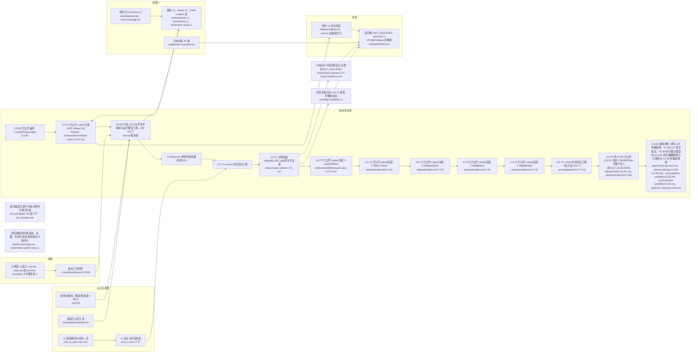

# 记忆宫殿(地图)

本文件是一张图加少量规则,不是账本。主体是下面的流程图:节点是房间(现状一句),连线是依赖与去向,入口写在节点里;过程、取证、重跑记录不进来,放提交说明、链日志目录或 archive/。2026-11-14 之前的全文在 archive/prd_mempalace-2026-11-14.md。

## 写法规则

- 改图只改节点文字或连线,一个节点一句现状加一个入口;过程不入图。
- 只记三类:别人必须遵守的决定、不可逆的对外动作、阻塞发布的未验证项。
- 子代理不提交本文件;主调度只在里程碑(整链结束、公开、装机完成)改一次。
- 版本序在 build/version-seq.tsv,各版内容与验收见对应 plans/v0.0.NN.md(prd.md 9.4 版本表为 0.0.65 至 0.0.80 历史记录),未验证项真源在 build/state-unverified.tsv(tools/state-gen.cx 与下方"仍未验证"逐条对拍)。
- 任务表行 `| 部分落地 | ID、ID |` 与 `| 已落地 | ID、ID |` 供 tools/observe-agents.cx 读取。

## 地图

当前:0.0.91 已公开(冻结 F a7b8ffe328,源构造 T 7be3cc5d4b,APE eb18eb43,CI 44997990448,Y2 6a270c9ae7,Root 已升级),下一版 0.0.92(plans/v0.0.92.md,事实表整理)。固定前缀 P0 因 E2 快照含后续源字节判 NO-GO；重开条件与对拍见 plans/roadmap-0.0.83-0.0.99.md 的 0.0.100 前结构性备忘。
- 在途整链(0.0.92):REV=96d0c6dd2eb77b51e4ecba52903df72aefb6a92f,guard=2398177,PID/PGID=2398178/2398178,deadline_s=9000(hard_s=9600,截止 2026-11-22 18:43),out=~/.cache/unisacc/chains/bg-b1/96d0c6dd2eb77b51e4ecba52903df72aefb6a92f。

## 决定(别人必须遵守)

### 所有者需求登记

- 所有者需求不得静默砍掉:砍掉或顺延所有者提出的需求,必须在本节记一行(需求、原排期、新排期或砍掉、理由、日期),并在给所有者的回复里写明;只写进路线图"不做"行或风险节不算告知。依据:内存安全线曾被静默砍掉。入口:plans/memory-safety.md 第 0 节。
- 登记:向 Rust 学习内存安全(所有者 2026-10-23 提出,曾在 roadmap 与 v0.0.85 计划里被列为不做):已重新编排,路线权威 plans/memory-safety.md(五期、六项采用门指标);甲、乙期为快车道工具期不占版本槽;丙一期条件并入 0.0.95,入口门不过则不并入;丙二期起在 0.0.102 之后新增版号。回滚:恢复 roadmap-0.0.83-0.0.99.md:122 修订注之前口径并在此记一行。
- 登记:四道并行、每版足量(所有者 2026-11-19)不撤销,按"一个候选只含一类大改"执行:只有功能道一类 A 类改动进候选,速度、资格、用户三道在 main 持续落库且不计 planned_units;足量以封顶内完成率衡量。入口:plans/roadmap-0.0.83-0.0.99.md(含 0.0.100 起汇编级精修入口准则)。回滚:所有者一句话即恢复原口径。

### 版本与发布

- 版本序唯一入口:build/version-seq.tsv;各版内容、顺延与对调只在该表改,本节不再记逐版重排。跳号:0.0.64、0.0.69、0.0.70(后两号并入 0.0.71 一次发布)。
- 发布节奏:不设发布频率上限,内容就绪即发;提速靠产线(起链前置门、预跑、提交门只评估提交树),不靠少发版;工具、测试、文档在 main 持续落库,不必触发整链与公开。发布说明如实写已知缺口(未跑 s9 全套就写 NOT_QUALIFIED)。依据:所有者"高速迭代进化"。
- 起链即内容截止:整链起点之后产品输入一律冻结,链后只收阻塞修复(产品输入变更须重起链);工具、测试、文档可并行但不进候选键。依据:plans/speed-first-rev4.md。
- planned_units 只计进候选键的工作项且必须是数字;类标签与手改 A 类文件封顶由起链前置强制。入口:build/version-seq.tsv、tools/chain-ready.cx。
- 新增拒绝两步走:使原先被接受的程序变为被拒的改动,第 N 版只以告警进入并用候选前端清扫全仓;告警命中连续两版为 0 后,才可在单独一版把默认翻成拒绝,该版不带别的 A 类改动。依据:0.0.86 的 D2 直接默认拒绝导致两次失败链。回滚:删本条。
- s9 commit 档不挡公开(自 0.0.68):冻结后与整链并行跑,结果补记 release/evidence.tsv,新增 FAIL 走补丁版。入口:prd.md 候选池 Q。
- decision.txt 必须从当次证据重算并写出,未修不得公开。依据:release-exec 第 7 步曾用停在 0.0.74 的陈旧文件比对恒等。入口:tools/release-exec.cx(现有 check_decision_current 只核引用当前版本号,是否已满足"当次重算"待核)。
- devsvc 工具线不在冻结到公开期间向 main 落库(会触发 MAIN_ADVANCED);列车工具(chain-ready、candidate-chain、bg-candidate、prerun-drive、commit-own、register、release-exec、release-chain)链在跑期间冻结,只修彩排暴露的缺陷。待核:常态冻结是否仍有效。
- demo 发布位置为 docs/uxe/<id>/(GitHub Pages 指 main 的 docs/);docs 改动经 ujs 分支由集成者合入 main,不在共享 main 直接改。回滚:恢复 docs/index.html 原文。

### 不可逆对外动作

- v0.0.88 已公开(2026-11-21,tag v0.0.88,冻结 F=3038dc3e73,发布提交 X=60c5a4dba3,Y1=0d63ceccd9,Y2=4cbf2a5a53,CI 44902485264 QUALIFIED 42/42)。入口:release/evidence/0.0.88/INDEX.tsv。
- v0.0.88 回滚:按 release/evidence/0.0.88/rollback.txt,release 改回 draft、前向 git revert Y2 Y1 X、Root 从 ~/.unisacc-root-backups/ 经 tools/install-ape.cx 写回;不删 tag、不 force push。待核:其后 0.0.89、0.0.90 已公开(Latest 现为 v0.0.90),Latest 回指步骤需按现状重写。
- 已公开不可撤回的路径泄露:v0.0.85 树内 227 个文件含 /home/ 路径,只泄露系统用户名,无凭据,不重写历史。风险低。

### 证据与门

- 发布证据每候选全套实跑,只复用构造产物,不复用测试结论;"工具契约批次绑定执行编译器身份、跨候选不重跑"未采纳,只做影子核算。依据:1712 行批次里只有 71 行显式接收候选。
- 提交门类与共用发布路径(dvqualify、release-exec、release-prep、register)的变更验收:夹具绿不算,必须在共享检出同款条件下真实提交一次成功;补丁须独立复核并做原版与补丁版真实发车对拍。依据:三次假漂移都靠真实提交抓到。
- 改产品源的验收必须含引导编译器(bootstrap-0.0.59)多单元编译,不只已装产品 -c。
- cx-dev(tools/cx-dev、tools/cx-dev-root)的结果只是 LOCAL 证据,不是候选结果;基座(src、cx、include)改动要重装产品。
- ref 类判据:"镜像字节等于冻结经典参考"口径已废(X3 起指令选择有意变化),跨版本字节防线用替代判据与 netregen 优化档。
- 整链会话根在链运行与发布期间勿删,清理只由主调度在公开后做。
- 起整链的环境只设 UNISACC_IDENT_HELPER,不设 UNISACC_RUN_CACHE 与 UNISACC_CACHE_DIR。
- 起链前置:版本工作树的 unisacc.com 与 unisacc.com.build.json 必须是真实文件副本,不是符号链接;Root 升级后同步各工作树并移走 ~/.cache/unisacc/chains/snap/ 下旧快照。入口:tools/chain-ready.cx 前置 12 到 14。日常跑工具可放指向共享检出的符号链接(CLAUDE.md),起链前必须换成真实副本,以前置 12 到 14 的检查为准。
- 废除 load1 负载门(所有者 2026-11-20 明令):不得按 load1 放行、等待、降并发或拒跑,只用固定显式并发上限(--jobs、--max-jobs、--par、S9_WIDTH),load1 只作记录字段;新工具不得再引入。回滚:git revert ecb8cb246f de000a79d6 39cba77ba6。
- 整链预制:事件触发预制真实命中 0 次,不作依赖;改走推测链加并行确认,采纳内容键待定;推测 APE 与正规 APE sha256 不等则证据自动 INVALID。入口:plans/reviews/2026-11-20-chain-incremental.md 第 9 节。回滚:devsvc react stop,正规链冷起照旧。

### 分支与提交

- 分支规则:本地与远端只允许 main、v0.0.NN 与论文 B 车道的 ujs,不建单元分支与短命分支;main 只做集成与发布,一分支一类大改;多窗口共用 .claude/worktrees/v0.0.NN,各自只提交自己的路径;已公开版本的分支在下一版公开后删,只留标签。回滚:关 GUARD-BRANCH-V1。待核:tools/guard-hook.cx 内未见该规则名,且现存 v0.0.89-old。
- 提交不带任何署名行(所有者 2026-11-20 明令):agent 不得在提交说明里写 Co-Authored-By、Signed-off-by 或工具归属行;devsvc git commit、commit-own、dvgitx 与 commit-msg 钩子落库前剔除。入口:tools/cxlib/trailer.cx、`tools/commit-msg.cx -- --check-installed`。回滚:git revert 0566008dfb 并删 .git/hooks/commit-msg。
- 绝对家目录路径(隐私):证据入口与文档一律写 ~/ 或仓内相对路径,不写 /home/<用户名>/、/Users/<用户名>/。入口:棘轮 no-home-path(基线 build/no-home-path-baseline.tsv 只降不升)、tools/no-home-path.cx --staged、改写用 tools/scrub-home-paths.cx --write。回滚:删 ratchets.cx 的 no-home-path 项并还原 check-ratchets 计数。
- 家目录路径豁免(历史证据不改):release/evidence/、research/、archive/、apps/csih、ujs、tests/stream-e1/e2-domain-matrix.tsv、tests/real-inputs.tsv、ape-receipt.txt、tools/check-preflight.cx、build/preflight-rules.tsv、tools/libneed-material.cx、tests/check-guard-edit.cx;后几项为工具生成或断言字面,后续在生成处规范化。
- 写仓内文件只用 Edit/Write 或 .cx 工具。入口:CLAUDE.md。

### devsvc 与协同方式

- devsvc 是最高优先工具线与协同唯一接口(所有者 2026-11-15):写、提交、拿锁、跑工具、查关系只经 devsvc 的 flow 及其子算子;不采用每个 agent 私有工作区或覆盖层;核心不写死本仓路径,成熟后独立成产品。入口:plans/devsvc.md、prd.md 候选池 T。
- 读路径不经 devsvc:读仓内文件直接用 Read 或只读命令。依据:读不需要锁。回滚:恢复 guard-hook 读拦截。待核:guard-hook.cx 的 DEVSVC-ONLY 注释仍列 Read。
- devsvc 源码归属:agyneon 实现、cc 集成(opus 做夹具);omp-go、omp-cdx 只作为使用者提缺口,不改 devsvc 源码。依据:plans/devsvc.md 2026-11-20 演进评审。待核:提交门线 0.0.88 起由 agy-flow 接手是否仍是现状。
- 门迁入 devsvc:precommit、register、derive、ratchets、affected、tlib bump 逐步成为 flow 节点,判定强度不降,先对拍再切换;build/ 只留构建 unisacc.com 用的表,开发元数据逐表迁出(先等价对拍、再切读者、再移除)。入口:prd.md 候选池 T。
- prd*.md 与 plans/*.md 在 devsvc doc 子命令与 flow 的 doc.* 算子落地后只经接口改,不直接编辑。待核:接口是否已落地。
- 派生查询:工具索引与产品全景经 devsvc tool-index、devsvc product-map 现查;两个 build/ 导出不再跟踪,快照仅显式导出,--check 仍现算并逐字节对拍。入口:plans/devsvc.md R1 节。回滚:恢复 derive.tsv 物化行并重新跟踪。
- 分而治之(所有者 2026-11-20 方向):按模块、环节与泳道分割,每个环节写清输入身份、输出身份、等待时做什么;并发只是结果。入口:plans/devsvc.md"分布式演进(2026-11-20)"。回滚:git revert 该决定所在提交。
- agentwork 已退役到 archive/agentwork-retire-2026-11/:协同决定只进本文件,不追加过程账本;ledger-add 默认拒绝,仅显式 --ledger 可用。回滚:前向提交恢复原路径。

### 编排与工作方式

- 战略层两张表:build/north-star.tsv 与 build/portfolio.tsv(在途上限 7 条,新项进入须先移出一项),编排者只在整链终态、公开完成、每天 21:00 更新;复盘只按这三类时点触发,每次至多一停一启一调;督导用事件驱动,例行巡检 60 分钟。入口:plans/v0.0.87.md"编排运行模型"。回滚:回到固定轮询,删两表。
- 在建项以 build/portfolio.tsv 为准;重开 T3(推测链)的条件:一次过的版本槽到公开仍超过 200 分钟。回滚:对应行改回 active 并先移出一项。
- 分析禁令到 2026-11-27:不开方案类分析报告,只保留顾问每次不超过 300 字的触发式复盘、守门人复核与失败定因。依据:一天 10 份分析加 22 份评审无人核对执行。回滚:删本条。
- 造工具护栏(试行到 2026-12-04):(1) 优先并入现有工具的子命令,不新开文件;(2) 一次性分析脚本仍用 .cx,留会话临时目录不入库;(3) 每天度量 tools 顶层 .cx 净增数,只度量不拦。依据:每个新工具同时改四到五张共享表,是提交冲突主源。
- 派工:执行类工作由主调度经 devsvc flow 并发自己做,子代理只开 fable 级(设计、难题);给常驻窗口派整块任务,不派一次一个小样例;不因上下文占用高要求 cdx 交接或改派。待核:"omp-cdx 停止派工"(2026-11-16)与其后给 cdx 派版本项不一致。
- 三层分车道(已采纳):产品输入口径以 SID 的 list-current 为唯一事实源生成 build/lane-inputs.tsv,其余口径都读它;promote 按 A 键相同即复用候选;ext 不是纯 B(ext/memx/arena.cx、ext/textx 四文件、ext/sysx 九文件实为 A);B 车道交付不做 submodule 不发 tar。入口:plans/reviews/2026-11-20-layer-lanes.md。
- 三层分车道条文未生效:CLAUDE.md 改写稿在 plans/claude-md-layer-lanes-draft.md,待 lane-inputs 生成器与包门工具就位后由主调度改 CLAUDE.md 并记决定,此前版本分支规则不变。入口:plans/layer-orchestration.md。待核:build/pkg-release.tsv 尚不存在。

### 仍未验证或未关闭

- 分车道未核项:APE 字节对 ext 改动不变只是推断;14 个链接目标文件是否进隐式运行库前缀;四个 sysx 别名是否有非 use 形式使用者(去别名前必须先查)。入口:plans/reviews/2026-11-20-layer-lanes.md。
- 缺口 OBJABI-ARM64-X7-STACK-BELOW-SP-SIGNAL(arm64 -funit 单元 x7 栈在 sp 之下,异步信号可覆盖):build/pkg-gaps.tsv 仍记 OPEN。待核:0.0.82 版本行写有 x7 修复,是否可关。

### 仍未验证(缺什么 / 清零动作)

真源是 build/state-unverified.tsv(逐条带缺什么、清零动作、写域、证据);本节只留阻塞发布或带约束的项,其余只列编号。

- 全套资格:118 材料族仅 47 项登记,无生产者与外部主机证据未补齐,全套 NOT_QUALIFIED;入口分片聚合在新候选上端到端未验收。入口:state-unverified.tsv U21 U22。
- 负例静默接受:c-negative 与 pp-negative 共 17 项产品约束缺陷须补具名拒绝并逐项保留负控。入口:U26、release/s9-assert-0.0.71-summary.txt。待核(0.0.87 严格证据称 expected-fail 已清零,U26 未同步)。
- 保留断言与失败的 oracle 缺口:stages 五项字节差异的独立金样、interfaces-lnx-x86_64 既有 oracle 两轮 FAIL,均不删断言不改判。入口:U23 U25。
- core-compat 参考源转换:P4 解析与 SBLOAD 未经独立核验,旧 helper 只批准空 copy guard 转换,不扩大批准域。入口:U20。
- release-chain 端到端 --dry:未用真实证据形态跑全五步,仅夹具与分项检查绿。入口:U30。
- 发布裁决文件陈旧:release/decision.txt 与 release/evidence.tsv 停在 0.0.74,release-exec 第 4 步与第 7 步用同一份旧输入互比恒等,不证明裁决对应本版。清零:第 4 步断言两文件含本候选版本号,否则具名拒绝。入口:tools/release-exec.cx。未入 state-unverified.tsv,待补行。
- ujs compiler_min.cx cxraw 实测 96:不把 96 当合格,不并 G1,不升基线冒充。依据:d473474f14 与 ujs/prd.md C4。入口:U28。回滚:到期未压回则拒绝合入 main 与公开。待核(原文限期写作 0.0.9,疑为笔误)。
- ujs/product 九文件棘轮基线:缺行按实测补,不把缺行当 0;各行 calls 须至少减半。入口:U29。回滚:删这九行棘轮即 FAIL;到期未压回拒绝公开升格。待核(限期 0.0.80 已过,是否已压回未查)。
- 来源未核的改动:共享 tests 下大批纯执行位改动来源未核,提交须排除;额度中断留下的三张小单未验收,隔离树半成品不算已交付。入口:U27、archive/plans/local-product-0.0.71.md。
- 模块接口摘要与缓存键:单元缓存与预构建对象的键是否覆盖所用模块接口摘要未查(结构体扩字段后旧布局对象被复用属同类风险)。未入 state-unverified.tsv,待补行。
- ext/sysx/linuxns.cx:lnx_arm64 实跑 UNMEASURED;私有 lns_sys 带 dock 直调,L0 有 sy_syscall6 后须改一行去 dock。入口:build/pkg-gaps.tsv L0-LACKS-SY-SYSCALL6。待核(0.0.88 已含 sy_syscall6,是否已改未查)。
- 其余不阻塞发布,只见真源:U02 U05 U06 U07 U08 U09 U11 U12 U13 U14 U18 U19。

### 里程碑与跨窗口约定

哪一版何时公开、冻结提交、资产哈希、CI 编号一律查 build/version-seq.tsv、release/notes-X.md 与 release/evidence/X/,本节不重复。

#### 发布与回滚

- 发布撤回(对已公开的每一版通用):转回草稿、Latest 移回上一公开版、前向 revert,不删标签。依据:公开不可逆。入口:release/rollback.txt。
- Root 回退:用 tools/install-ape.cx 重装上一版公开 APE;公开安装不留候选备份,--rollback 会拒绝(REFUSED no-candidate-backup)。旧件备份在 .unisacc-root-backups/<版本>-public/。
- 资格口径:0.0.71 至 0.0.87 各公开版整体裁决均为 NOT_QUALIFIED(全套 s9 未过或未跑,原生 CI 只覆盖冒烟子集);发布说明须如实写已知缺口,不得称全批资格。入口:release/notes-X.md。
- CI 单格超时处置:先读发码源码行,再用上一公开件与候选在本机各跑三次对照,gh run rerun --failed 只一次,然后 release-exec --from-step 3;第二次失败按确定性缺陷停手;发布说明写明非一次通过。依据:0.0.83 定因。
- stream-pipe 55 秒单部件界限不放宽,余量靠拆部件取得。入口:build/pkg-gaps.tsv STREAM-PIPE-OSX-X86_64-55S-BOUND-THIN-MARGIN。
- netregen 字节栅栏:判据文本不改;有意改变 .cx 镜像的版本只能在 G1 expected-fail 登记 image=旧SHA256->新SHA256 精确指纹并带到期,逐字相等才放行,过期拒绝,下版不同须定因不得续期。回滚:撤 G1 指纹分支与登记行。
- 发布节奏:日常装机投放加每周一到两次正式公开,公开最多每天一次;仓根 Root 升级与公开脱钩。入口:plans/roadmap-0.0.83-0.0.99.md 末节修订注、plans/v0.0.87.md S1 S4。
- 内容截止:planned 封顶,超出另开新版;起链即内容截止;计划外满 3 项停收。范围变更由主调度先写回计划文件(四道表与 planned 键值)再派工,内容截止、冻结、公开后三点对账。依据:0.0.83 计划 0/10 而计划外 12 项。
- 无生产者挂账:cx-booter-ape 与 tools-default-regression 已连续 11 版 UNKNOWN,须补材料生产者。入口:build/owner-reqs.tsv R56。
- 0.0.85 公开 release 正文为空且未改。待核(是否已补)。

#### 证据与验收

- 发布证据与资格账本落仓内 release/evidence/,不得只放 /tmp。依据:0.0.71 登记的 8 个证据全部丢失。入口:release/evidence/0.0.71/INDEX.tsv。
- 被发布证据或打包引用的产物须有持久副本(~/.cache/unisacc/release-vNNN、~/.cache/unisacc/candidates/X/);整链会话目录发布后留 7 天;任何清理前先核 release/evidence 与 build/pkg-gaps.tsv 是否引用该路径,有引用先入仓或迁走。入口:tools/cache-retain.cx。
- 改默认行为(默认档、路由、默认输出)的提交,须按断言名全仓搜同组检查的其它平台副本并同提交修齐。入口:tests/mirror-pairs.tsv、tools/check-mirror-pairs.cx。
- 改被多处 use 的模块,验收须覆盖 default-run、-c -funit、-S 三种入口的受影响运行批次,不止编译分片。依据:7026ecaa4d 的 setpgid 回归。
- 扩结构体或改接口须遍历全部消费者;不得手写私有 sy_stat 类结构与原型。依据:0.0.88 首候选因 56 与 88 字节不一致栈溢出作废。入口:tools/check-sy-stat-struct.cx。
- 包格式变更须附工具侧消费者清扫清单并全部实跑。
- 新增批次先在 dvqualify 单提交资格布局自测,再登记。入口:build/pkg-gaps.tsv NEW-BATCH-QUALIFY-LAYOUT-SELFTEST-GATE。
- 测试夹具创建新工具一律经 check-precommit-gates 的共用夹具助手,门加校验只改助手一处。
- PREPARED 与 PASS 严格区分,超窗记 UNKNOWN(窗口)不记 PASS;同一失败连续两次即停手读发码源码行。
- 产品表生成器总闸:tools/gen-all-check.cx 管全部产品表生成器,接 chain-ready 前置与提交门,未落库不起链;未覆盖项须显式列 GEN_UNCOVERED 并带到期,不静默跳过。入口:tools/check-gen-all-check.cx。回滚:git revert。待核(源码内 rt-shared-gen 与 ucn-pp-gen 两项到期写 0.0.87,已过期)。
- R1 release-flow 与 R2 增量预跑两个开关独立、默认关;R2 一例漏选即停用复用。待核(现行开关状态)。
- 已知限制:sysx.process 与 netpack 共用 processcore,不能同单元共导入。入口:build/pkg-gaps.tsv。

#### 派生表与提交门

- 派生表不入 git:tool-index、product-map 等按内容身份现算现查(devsvc tool-index、devsvc product-map,本地需要时 derive --write --only);读集缓存须带清单哈希并有失效负控。回滚:恢复 derive.tsv 对应行与文件跟踪。
- 测试分六域(product-qualification、repository-governance、tool-selfcheck、devsvc-selfcheck、release-matrix、external-product),affected --domain 过滤;新批次域由规则表推断,显式例外不增。
- 提交门方向:只派生与改动相交的表,棘轮按改动归因加落库后全树实跑;收据绑读集内容身份,只限同一事务内自己实跑过的门。红线:不复用批次结论、不删断言、不缩全树覆盖、不放宽 55 秒窗口、不抬基线换绿。
- 不做按负载伸缩的门(失败率与负载档无关,793 次提交实测);单条命令仍不超 60 秒。判据:提交失败率低于 15%、用法错低于 2%,两版不动即回退该项。入口:plans/reviews/2026-11-20-devsvc-evolution.md。
- ujs 车道:全部在 ujs 分支做完并自验收后才合 main(合并前 ratchets 全绿,基线行同并),main 上不中途窄合入。

#### 迭代方式

- 现阶段只聚焦小版本快速迭代:分而治之、事件触发预制(只记 PREPARED,验证仍实跑)、前移、删除工作、内容寻址不重做、度量驱动、快败具名;每版至少收敛一项产品缺口。目标:冻结到公开 30 分钟级,提交门固定税秒级。依据:项目所有者 2026-11-18。
- 预跑并行度可按核数提高,但不改任何单命令时限;按 CPU 秒计量须项目所有者裁定,未替定。入口:plans/v0.0.87.md S2。

#### devsvc 与产线

- 编排者对接:概念采纳并用 cx 重实现(任务合同、窗口状态机、升级、按身份引用证据),加窗口上报与拉取;不依赖 bun 或 TypeScript;moltbaby 侧钩子由其维护者改。入口:plans/devsvc.md (C)(7)。回滚:子命令按开关停用,派工回退信封。
- 产线是磁盘状态机加有界对账命令,不新增常驻,不做调度器;产线逻辑不进 devsvc-core,走独立小工具;盘上合同只以 plans/devsvc.md 产线化节 (2) 为准;每单元交付必带变异回执;整链期间不动 main 上 A 类输入,提交前核 build/lane-inputs.tsv。
- 产线证伪条件:0.0.88 截止到公开仍高于 100 分钟或列车手敲命令数没降,即停第 2、3 阶段投入。回滚:不接即退回手工。入口:plans/line-phase0-units.md。待核(tools/winstate.cx 在,tools/line.cx 与 tools/art.cx 不存在;判据是否已评)。
- 编排者角色升级只列前置不立项:租约队列与状态总线实跑超一版且有送达率数据、合同摘要防篡改有负控、多实例下截止自退与持锁有检查等。入口:plans/devsvc.md (C)(7) 第 (6) 条。

#### 路线与版本序

- 版本序与各版主题只以 build/version-seq.tsv 为准;改序须同步 plans/vX.md 与路线图修订注。回滚:按提交还原这些文件。入口:plans/roadmap-0.0.83-0.0.99.md。
- 所有者需求(2026-11-20,不得静默砍):汇编支持是 C99 加 POSIX 基本需求,内联 asm、.s/.S 与 gcc .o 混编、汇编标签、原子内建不延到 0.0.100 之后;核心层对 asm 的支持应更完善。入口:build/owner-reqs.tsv R20。
- 汇编范围:接受 A1 到 A4,达标线为 lnx 两 ISA 对 gcc 对拍通过;SIMD 内建与 -S 输出 GAS 文本不进基本需求;A4 在 A1 到 A3 对拍通过后重过采用门。入口:plans/reviews/2026-11-20-asm-acceleration.md。
- U4 asm 标签只做 lnx ELF 函数改名,变量改名砍,osx 与 win 具名拒绝;A1 与 K2 不同版(一个候选只含一类大改,产品大改超过 3 单位拆两版)。入口:plans/v0.0.90.md。
- 核心层强制:层列放 cxroot.tsv 并由编译器强制(dock、upper、tool、非模块脚本四档),不用换后缀;sys.dl、sys.ffi、sys.dlcall 标特权接口;K2 须排在 sy_syscall6 之后;裸 libc 编译期拒绝先出设计。入口:plans/reviews/2026-11-20-core-layer-marking.md。
- 核心层范围:只含 cx 语言支持、libc 对接、系统调用与宿主 ABI 对接、posix 封装,其余归扩展层。依据:核心越小 A 类输入越窄。入口:plans/layer-orchestration.md。
- 核心层需求流程:需求单复用 build/pkg-gaps.tsv,每版开槽前对每条需求四选一响应;接口变更前用 layer-api 判类并列受影响使用者;仓外使用者登记 build/external-users.tsv。入口:plans/reviews/2026-11-20-core-ext-matrix.md。
- 战略:脚本运行时优先;执行器内层循环实验出结论前冻结一切逻辑转网;__int128 砍。入口:plans/roadmap-0.0.83-0.0.99.md 末节修订注。待核(实验是否已出结论)。
- 0.0.91 身份与构建边界:严格先合 L.1 取 SID 快照,再另起提交做 Z5,不可反向;B3 收回 dock 授权的名单待核。入口:build/version-seq.tsv 第 26 行。
- 删 cx/text 下 build、deflate、json、num 四链接:同批提交加 cxroot.tsv 整名行与删链接,绝不先删后加;前后跑 symindex、check-cx-layers、product-links、core-closure;仓外消费者先在 build/external-users.tsv 逐一确认。现状:四文件仍在。
- 冷跑缓存:0.0.94 只做 L5(a) 前导预制;L1 闭包复用本期不开(e4 原字节同率 60%,另有三项挡路点);固定前缀预制曾判 NO-GO,重启须重做 P0。入口:plans/v0.0.94.md、build/owner-reqs.tsv R60。
- 风险登记(均为推断或未核):引导编译器换基与新关键字相撞;SHA256SUMS 无独立签名;缓存目录同用户篡改威胁模型未成文;Mach-O 与 PE 的 TLS 未设计;前端硬上限具名拒绝未普查;主调度单点与磁盘余量低于 20G 预警;用户来源需求为 0。

#### 清理留痕

- 归档找回:archive/plans-2026-11g/README.tsv 记原路径与原因,git mv 回去或 git log --follow。清理候选(仓根 .o、tools 疑似无用清单、未逐份审的 plans)只列不动。待核(旧版本工作树 v0.0.67 至 v0.0.70 是否仍在)。

## 编排稳定约定与近两版发布事实(原"编排交接 2026-11-21 21:10")

当前版本状态不在本节维护:以 `build/version-seq.tsv`、`plans/v0.0.NN.md`、`build/owner-reqs.tsv` 为准。

### (1) 窗口职责与合入
- 回信地址:各窗口回报统一发给主调度窗口;主调度停摆时由接班者在 `mux` 声明新地址。 依据:编排约定 入口:`mux`
- 角色分工:主调度管派工与裁决;流程窗口管提交门、合并工作流、预跑工具;发布窗口管发布列车、文档台账、CI 工具、清扫;库窗口管 `ext/` 库;分析窗口管深度审计与补丁;`ujs` 为论文 B 独立车道。 依据:编排约定 入口:`plans/devsvc.md`
- `ujs` 合入:收到合入请求后在共享 `main` 经 `devsvc git merge origin/ujs` 合入,再 `devsvc git push <完整40位SHA>`;绝不直接改 `ujs/` 文件。 依据:车道归属 入口:`tools/devsvc.cx`
- `apps/csih` 待认领:探针中仓根相对层数疑似差一层(`deepseek_proxy.cx`、`libc_cover.cx`),核心仓不动,等 csih 维护者核实。待核(原行号已漂移)。 依据:只读扫描 入口:`apps/csih/probes/`

### (2) 不变式
- 验收:未实跑不记 PASS,未证实不宣称 QUALIFIED;不删断言、不缩覆盖、不放宽时限。 依据:项目铁律 入口:`CLAUDE.md`
- git 写操作:全部经 `devsvc`;共享暂存区只提交自己的明确路径(`--whole`/`--keyed`);严禁 `git add -A`、`git add .`、`git commit -a`。 依据:防卷走他人暂存 入口:`tools/commit-own.cx`
- 发布冻结:冻结期间 `main` 冻结,仅发布提交例外;一个候选只含一类大改。 依据:项目铁律 入口:`plans/v0.0.NN.md`
- 预算口径:由推断得出的"可缩短"数字一律对折后计入时间预算。 依据:编排约定 入口:`build/phase-times.tsv`
- 起链前置:`chain-ready` 必须 20/20,版本槽 `release/candidate.tsv` 须先切到本版;不接受"冻结时再切"。 依据:R80(0.0.90 首链自报旧版号作废) 入口:`tools/bg-candidate.cx`
- 整链续跑:只按原参数续跑,不增删开关;续跑前核前段清单与 `--base/src` 干净树仍在,前置流程不得清空在途链的快照目录。 依据:0.0.89 首链四次 rc=2 入口:`tools/chain-run.cx`
- 证据留存:链与预跑证据产生后立即备份到仓外 `~/.unisacc-release-evidence-backups/<版本>/`,清单入 `release/evidence/<版本>/backup-evidence.tsv`;作废产物保留并标作废,不作发布证据。 依据:R71 入口:`tools/release-chain.cx`
- 重复代码:重复是测量,合并是决定;契约不同或合并净亏的重复组登记白名单,不为降数字合并。 依据:ccogw 盘点 入口:`tools/dup-census.cx`

### (3) 已公开版本(不可逆动作)
- 0.0.89 已公开:候选 `f77e64a25b`,冻结 `74f541c6cc`,Y2 `57de2b4ddd`,六格 CI `44935566045` QUALIFIED;严格预跑 440 PASS/0 FAIL/2 UNKNOWN(无生产者)。 入口:`release/notes-0.0.89.md`、`release/evidence/0.0.89/`
- 0.0.90 已公开并置 Latest:候选 `9109473641`,冻结 `5d1e492d7e`,阶段 A `6d7f11d22c`,Y1 `c438b6d628`,Y2 `13a48bb870`,六格 CI `44973535033`;APE sha256 前缀 `46fd3db95f97`(8991222 字节)。 入口:`release/evidence/0.0.90/`
- 0.0.90 证据:严格预跑 459 批 457 PASS/0 FAIL/2 UNKNOWN(`cx-booter-ape`、`tools-default-regression` 无生产者)。 入口:`release/evidence/v0.0.90-strict-2026-11-22.tsv`、`release/evidence/0.0.90/backup-evidence.tsv`
- 0.0.90 回滚:(1) `gh release edit v0.0.90 --draft=true` 并把 `v0.0.89` 置 Latest 后读回;(2) `main` 从新到旧 `git revert` 后推送;(3) `tools/install-ape.cx` 用 `~/.unisacc-root-backups/0.0.89-public/unisacc.com` 回装并核版本。 入口:`release/evidence/0.0.90/rollback.txt`
- 分支与 Root 备份:分支 `v0.0.90` 保留到 0.0.91 公开;旧 Root 备份在 `~/.unisacc-root-backups/{0.0.87,0.0.88,0.0.89}-public/`,回滚依赖它们,不得清扫。 依据:版本分支规则 入口:`git branch`
- U4 汇编标签裁定:仅支持 `__asm__`/`__asm`;裸 `asm` 具名拒绝但保留作普通标识符;`osx`/`win` 具名拒绝;4 处比 GCC 11.4 更严属有意差异,须留在发布说明。 依据:0.0.90 开版评审 入口:`plans/a1a-design/u4-decisions.md`

### (4) 0.0.90 已知缺口与未验证项
- 资格:0.0.90 整体裁决 NOT_QUALIFIED,全套 `s9` 的 `daily`/`release` 未跑通;`daily` 仅有 15 片编译冒烟,完整运行态未验。 入口:`release/notes-0.0.90.md`
- R75:`tools/tsv-lint.cx` 未解析引用实测 11351(0.0.89 的 11277 到 0.0.90 涨 74,来自 U4 新增的动态绑定表行,每个新行必计一条),上限由所有者 2026-11-22 从 11050 放宽到 13260(11050 加 20%,为不阻塞版本);0.0.92 只做门执行(上限必须有门拦)加 asm volatile 行列号,削表(F 绑定)延后;增长必须拦:基线固化为实测值只降不升。 入口:`build/owner-reqs.tsv` R75
- R78:变异门真实杀伤率已由 0.0.90 四补丁补 `--expect-fail` 与 `release-chain.cx` `sy_realpath>0` 补强至 `[57/82,59/82]=[69.51%,71.95%]` 高于 0.60 线(`release-chain` 20/26=0.77 PASS)。 入口:`tools/mutation-gate.cx`、`research/2026-11-22/r78-v090-named/summary.md`
- 诊断行列号:U4 差异项与 `asm volatile` 拒绝缺 `file:line:col`,排 0.0.92。 入口:`build/owner-reqs.tsv` R55
- 字面量长度:41 条真缺陷的全套补丁未落(顺序:检查器与棘轮 -> 越界读 -> 工具 -> 检查 -> 注解;`gate` 须在 `annotations` 之后)。 入口:`plans/v0.0.91.md`、`research/2026-11-22/litlen-089/handoff.md`、`research/2026-11-22/litlen/real-bugs-41.tsv`
- R69 普查余项:24 个不可达 `*-gen` 待核,约 22 个二级死传递进候选清理;28 批未接线检查已登记。 入口:`build/owner-reqs.tsv` R69、`research/2026-11-22/r69-report/report.md`
- 共享写治理:`tools/check-shared-writes.cx`、预提交门与 `build/shared-writes-baseline.tsv`(27 行只减不增)均未落库(ls 核不存在);R71 的 M3/M4/M6 未收口。 入口:`build/owner-reqs.tsv` R71、R73
- `textx.isotime`:缺 JS 引擎对拍夹具(`tests/fixtures/textx-isotime/` 不存在),解析取舍(无时区返 `-EINVAL`、越界严格拒绝)仅按规范编写;未经 `affected --run` 整批。 入口:`tools/check-textx-isotime.cx`
- 死 C 源码:`tools/cx-pipeline-stage.c:5`、`tools/cx0-e2.c:9,44` 引用已迁走的 `../exec/c/`;须先查调用与批次再决定退役,不自动删。 入口:`tools/refactor.cx sites`

### (5) 后续版本与评审要点
- 0.0.91 范围:只收"身份与构建边界"(L.1 + Z5 + B3),A 类封顶 20;L.1 + Z5 + B3 不超过 17 文件时才并入 litlen 注解补丁(3 个 A 类文件)。 依据:开版拍板 入口:`plans/v0.0.91.md`
- 0.0.92 至 0.0.94 主题:两处口径不一致,见 report-C;以 `build/version-seq.tsv` 为准,待核。 入口:`build/version-seq.tsv`
- R69.6 零断言守卫:第一阶段 `run-batch`/`allsession` 影子计数 `assertions=N` 已落 `22b2c76688`;第二阶段路线定为 0.0.92 十批试点(`cdx` 主刀)、0.0.93 迁移与首轮影子、0.0.94 继续影子、最早 0.0.96 满足总量门 268 加分层数据门槛后对新批强制;豁免须写可核查条件,未报存量只降不升。 依据:守门人评审 入口:`tests/run-batch.cx`、`research/2026-11-22/zero-assert/phase2-design-v2.md`
- R69.6 计数自保:`assertions=N` 须在共享断言库自增,不许手写常量;变异须覆盖"删总结字段必红""删自增必红";流式计数须对任意切分点不变;区分"只报失败"与"真零断言",存量分阶段迁。 入口:`build/owner-reqs.tsv` R69、`research/2026-11-22/r69-6-shadow/report.md`
- R78 存活变异分类:分支不可达(`UNREACHABLE_BRANCH`)、夹具无法区分(`EQUIV_OR_DEGENERATE_FIXTURE`)、弱检查(`WEAK_CHECK`)三类分报。 依据:ccogw 经验 入口:`tools/mutation-gate.cx`
- R79 释放后使用粗检:排 0.0.92 后;先报告模式不进 `chain-ready`,基线只降不升,保守规则与漏报面须写明;工具尚未建(`tools/uaf-census.cx` 不存在)。 入口:`build/owner-reqs.tsv` R79、`plans/memory-safety.md`
- R81 断言质量:阈值断言须能说出哪种可达状态会让它变红;关键门(`release-chain`、`chain-ready`、`precommit`)自测须是行为探针,不是文本存在性。 依据:R81 盘点(27 处疑似永不失败) 入口:`build/owner-reqs.tsv` R81、`research/2026-11-22/r81-census/report.md`
- 待定项治理:台账与本文件中每个待定条目须有结论,或下一动作加到期版本;缺者列清单,存量只降不升。待核扫描工具是否已落。 入口:`build/owner-reqs.tsv`
- 体验候选(不排期):块注释被 `*/` 提前关闭且同行紧跟不匹配引号时附一行提示。 入口:无

### (6) 待所有者裁定或告知
- R20 汇编拆版:U4 拆为 0.0.90、其后版本顺延一号,尚未告知所有者;`build/owner-reqs.tsv` 的 `told_owner` 列 72 行全空,统一告知后才可填。待核。 入口:`build/owner-reqs.tsv`
- `sync-company` 等脱敏源码问题:归项目所有者裁定,agent 不自行处置。待核。 入口:无
- `lz-unisacc` 窗口:须提醒改用明确路径或 `devsvc` 提交。待核是否已提醒。 入口:`mux`

### (7) 研究产物入口
- 归档现状:`research/2026-11-22/` 已入仓收录 34 份设计、评审、变异与盘点底稿(索引见 `research/2026-11-22/README.md`,记忆宫殿瘦身映射见 `research/2026-11-22/mempalace-rewrite/dropped.tsv`);历史已丢失的 38 处临时目录引用已清。
- 仓内持久入口:A1a 与 U4 设计 `plans/a1a-design/` 及 `research/2026-11-22/u4-slices/`;`cxpkg` 设计 `plans/cxpkg.md`;`devsvc` 迁 Windows 路线 `plans/devsvc.md`;速度候选池与热启动定因 `plans/v0.0.94.md` 及 `research/2026-11-22/r70-review/review.md`;R76 HTTP 服务端设计与二审 `research/2026-11-22/r76-design/design.md`、`research/2026-11-22/r76-review2/review.md`;R69.6 零断言守卫 `research/2026-11-22/zero-assert/phase2-design-v2.md`;发布证据 `release/evidence/`。
