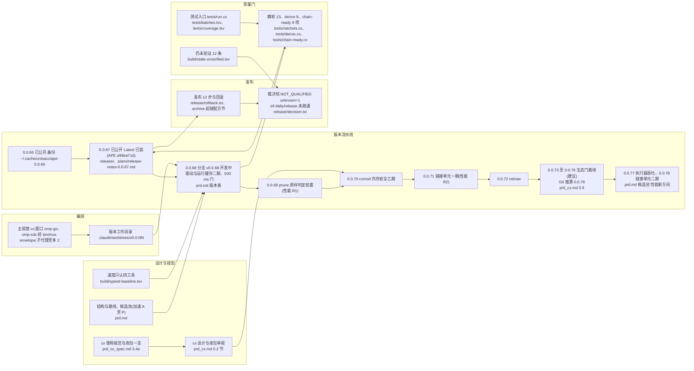

# 记忆宫殿(地图)

本文件是一张图加少量规则,不是账本。主体是下面的流程图:节点是房间(现状一句),连线是依赖与去向,入口写在节点里;过程、取证、重跑记录不进来,放提交说明、链日志目录或 archive/。2026-11-14 之前的全文在 archive/prd_mempalace-2026-11-14.md。

## 写法规则

- 改图只改节点文字或连线,一个节点一句现状加一个入口;过程不入图。
- 只记三类:别人必须遵守的决定、不可逆的对外动作、阻塞发布的未验证项。
- 子代理不提交本文件;主调度只在里程碑(整链结束、公开、装机完成)改一次。
- 版本序在 build/version-seq.tsv,版本内容与验收在 prd.md 版本表,未验证项真源在 build/state-unverified.tsv(tools/state-gen.cx 与下方"仍未验证"逐条对拍)。
- 任务表行 `| 部分落地 | ID、ID |` 与 `| 已落地 | ID、ID |` 供 tools/observe-agents.cx 读取。

## 地图

## 决定(别人必须遵守)

- 版本号跳过 0.0.64。入口 build/version-seq.tsv。
- 起整链的环境只设 UNISACC_IDENT_HELPER,不设 UNISACC_RUN_CACHE 与 UNISACC_CACHE_DIR。
- 版本分支:main 只做集成与发布,一分支一类大改。全文 AGENTS.md。
- 整链会话根在链运行与发布期间勿删,清理只由主调度在公开后做。
- 改产品源的验收必须含引导编译器(bootstrap-0.0.59)多单元编译,不只已装产品 -c。
- 写仓内文件只用 Edit/Write 或 .cx 工具。
- devsvc 主能力已可用(2026-11-15):基础版 1b1b4c4b94、flow 引擎 cbfbb3bd66(flowrun、flowexec、flowfile),omp-go 已持 registry 锁完成登记协同(54eaf4b064)。
- 仓开发服务 devsvc 为当前最高优先的工具线(项目所有者 2026-11-15):基础版落地后所有 agent 改用其写窗口锁与 run,不再靠信封排窗口;路线见 prd.md 候选池 T;成熟后独立成"智能体伴侣"产品并可替代 moltbaby 的 mapp,devsvc 为暂定名;核心不写死本仓路径。
- 仓内的门(precommit、register、derive、ratchets、affected、tlib bump)逐步迁入 devsvc 成为增量并发的 flow 节点,判定强度不降,先对拍再切换(prd.md 候选池 T)。
- build/ 只留构建 unisacc.com 用的表;仓开发元数据改由 devsvc 维护与查询,flow 与关系 DAG 稳定后逐表迁出(先等价对拍再切读者再移除),见 prd.md 候选池 T 决定。
- devsvc 开发只由主调度 cc 及其子代理负责(项目所有者 2026-11-15);omp-go、omp-cdx 专做 unisacc.com 产品与版本线,只作为 devsvc 使用者提缺口,不改 devsvc 源码。
- prd*.md 与 plans/*.md 由 devsvc 文档接口接管(项目所有者 2026-11-15):devsvc doc 子命令与 flow 的 doc.* 算子落地后,所有 agent 只经接口改,不再直接编辑。
- 自 0.0.68 起 s9 commit 档不挡公开:冻结后与整链并行跑,结果补记 release/evidence.tsv,新增 FAIL 走补丁版(prd.md 候选池 Q)。

### 仍未验证(缺什么 / 清零动作)

- check-stdio-buffer:不覆盖 --link-only 与子集编译的缓存一致性,tty 路径未测。
- osx cache-manager:借用副本来源未证实,候选上首次 osx 实跑核来源。
- tsv-lint 不稳:同日三次实跑 PASS、FAIL、PASS,未定因。
- wt-gate-probe 为 PLANNED:链路超 55 s 批次上限,6 条断言未验证。
- slice-migration-gen:source-missing cx/compiler/frames.cx 旧记述,待复核。
- affected-iface2 批次未取得实跑结果:待跑。
- 已入库工具中 tools/status.cx 的测试夹具曾被 sed -i 改过,内容未重审。
- cx 模块语法缺口:use as alias,排 0.0.70。
- cx 模块身份缺口:软链被当两个模块,排 0.0.70。
- 仓库根 out/:逐项迁移到 sy_tmpdir,清单见归档同名条。
- 多单元函数指针形参:跨单元函数指针形参含结构体指针被拒,R3 去强转待补。
- 大型二维自动数组:已装编译器报 not covered(复现 $CLAUDE_JOB_DIR/tmp/repro-large-2d-auto-array.cx)。
