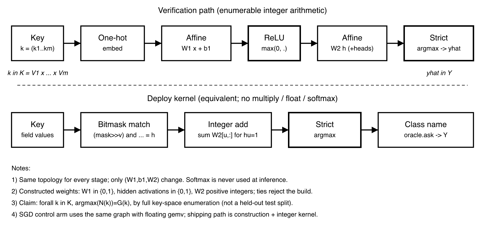

# Tables as Networks: A Byte-for-Byte Self-Hosting C Compiler Whose Weights Are Constructed, Not Trained

September 2026 · Code, weights and all evidence: this repository (Appendix A)

> English version of [`unisacc-paper.md`](unisacc-paper.md), aligned to main `8a3dddac` (`UNISACC_VERSION` 0.0.42). Not a sealed release measurement.

**arXiv (when submitted):** primary **cs.AI** (Artificial Intelligence); optional cross-list **cs.PL** (Programming Languages). Primary was cs.PL; aligned to cs.AI per 政委 2026-10-16.

---

## Abstract

We study a neural-network-based compiler: its compilation stages run on integer threshold networks and a generic executor, while the weights are deterministically constructed from a TSV table DSL, without training. Compiler decisions such as character classes, production choice, type promotion, instruction and calling-convention selection, and image field layout are finite functions. Each such decision is written as a truth table that is **total** on a finite Cartesian product; a deterministic integer network is **constructed directly** from the table; and the network is proved equal to the table by enumerating every key of its domain. **Our core claim** is that there exist constructed weights, derived from the table, such that on the table's declared domain the integer threshold network yields the table's exact executable form (identical key-by-key), not a learned approximation; layers, thresholds and width are chosen network structure, not compiler behaviour learned from data. Work that depends on unbounded structure is decomposed into finite control plus generic storage, so that the transition function of the finite control becomes, again, a table that can be constructed and enumerated.

We implement the method in unisacc, a C99-subset compiler for {Linux, macOS, Windows} × {x86-64, arm64}, in two instances. In the **decision-network instance**, each fact table is realised by a one-hot → integer affine → ReLU → integer affine → strict-argmax network. T1 is exhaustive key-by-key equality on that table's declared domain, not sample fit or training accuracy. Classic code queries a dense answer table produced by enumerating those networks. Direct inference remains a checked construction artifact. The neural-network-based label is anchored on construction and T1, not on live weight inference at every product ask. The instance self-hosts byte-for-byte on five targets without Python (N1 = N2 = N3). That criterion is not a semantic self-hosting theorem and not a proof that the tables are C. In the **network-compiler instance**, the pipeline is split into byte-stream stages. Each stage is a constructed threshold network run by one generic executor. An uncovered key is rejected; there is no fallback to a classic compiler.

The source identity of this draft is main `8a3dddac`, `src/version.h` `0.0.42`. That is a source-tree identity, not a sealed release measurement. The text does not cite older byte sizes, gate counts, vocabulary key totals, or a cross-artifact speed band as current results.

**The product and our claims rely on construction, not training.** Construction plus enumeration is a verification discipline distinct from training. After a table changes, a full deterministic reconstruction must again match every key (T1). That is not a locality theorem for single-rule edits. Systematic training comparisons belong to preregistered study A2. Enumeration proves network = table, not table = C.

**Keywords**: neural-network-based compiler; TSV table DSL; weight construction; exact networks; exhaustive verification; finite control; byte-for-byte self-hosting

---

## 1 Introduction

There are two mainstream ways to put neural networks into a compiler. One learns the source-to-target mapping end to end and cannot give correctness guarantees. The other uses learned models to assist heuristic decisions (register allocation, inlining, scheduling), while hand-written code still determines the final behaviour. Both share a premise: the weights come from training, so the network's behaviour can only be characterised statistically.

We call this a neural-network-based compiler because constructed threshold networks are the execution path for compilation stages; its weights come from declarative TSV tables and a constructor, not from sample training. We do **not** claim to have "learned a compiler": on the table-covered domain, the threshold network is an exact executable form of the table (identical key-by-key on the declared domain, not a learned statistical surrogate), with weights exported by the constructor. We observe that the "table-shaped" decisions in a compiler — given a discrete description, choose a discrete action — can have their inputs **designed** to be a finite Cartesian product. On such a domain, whether the network is correct is no longer a question of generalisation but a **model-checking problem** decidable by exhaustion: run the deployed inference once on every key and compare with the truth table. Moreover, the weights need not be trained: every finite total function has a constructive exact network, and the only engineering question left is how to make it small.

The consequence is not limited to "replacing a single table with a single network". By the classic decomposition of computation theory, any deterministic algorithm can be written as finite control plus unbounded storage. A single transition of the finite control is a finite function, so it too can be constructed as a network and driven by a language-independent executor. In principle, therefore, constructed networks can carry the declared finite transitions of compilation stages, while classic code remains responsible for storage, I/O, host adaptation, and the product routes enumerated in §4.4.

**Contributions.**

1. **Method.** A "TSV table DSL → network construction → enumeration" method: decisions are total functions on finite domains; weights are constructed from tables rather than trained—on the declared domain they yield the table's exact executable form (identical key-by-key), not a learned approximation / statistical surrogate; the release criterion is key-by-key equality decided by exhaustion on the declared domain (T1 / model checking), not sample fit or training accuracy (§2, §3).
2. **From decisions to a pipeline.** The whole compilation pipeline is expressed as finite transition functions δ composed with one generic executor E, together with two runtime improvements that change no answer: threshold-prefix evaluation and declared returns (§4).
3. **Implementation.** unisacc, a six-target C99-subset compiler with both a decision-network instance and a network-compiler instance; the former self-hosts byte-for-byte on five targets without Python. The source identity is Appendix A; an older single-file size is not the current product.
4. **A verification discipline and its findings.** Construction plus enumeration is not a substitute for—or approximation of—training, but a distinct verification discipline (weights constructed from tables, not trained—on the declared domain they yield the table's exact executable form (identical key-by-key), not a learned approximation); layered verification by exhaustive enumeration, byte-level differential testing and external referees, including defects in hand-written code that enumeration found and sampling could not (§6, §7.4).
5. **Construction versus training (illustrative).** §7.3 records one historical Adam schedule under stated limits; preregistered study A2 may later widen or narrow any claim about training comparisons (§7.3).

We deliberately do **not** claim that the tables agree with C99 semantics, that whole-compiler semantics is preserved, or that the network compiler is fast. These boundaries are discussed in §8.

## 2 Problem Formulation

### 2.1 Finite decisions and exactness

**Definition 1 (stage).** A stage $s$ consists of fields $(f_1{:}V_1,\dots,f_m{:}V_m)$, an output vocabulary $Y$, and a truth table $G_s:K_s\to Y$, where $K_s=V_1\times\cdots\times V_m$ is a finite Cartesian product and $G_s$ is total on $K_s$. A multi-head stage has several output vocabularies, one table per head.

**Definition 2 (exactness).** A network $N$ is exact for stage $s$ iff for every $k\in K_s$, $\operatorname{argmax}N(k)$ is unique and equals $G_s(k)$. This criterion is key-by-key equality decided by exhaustion on the declared domain (T1 / model checking), not sample fit or training accuracy.

**Definition 3 (query discipline).** The compiler uses networks only through an opaque interface `ask(s, k)`: it never reads logits and never falls back to the truth table when a network rejects; every queried $k$ satisfies $k\in K_s$, otherwise an assertion fails immediately. A query with $k\notin K_s$ is not a test of learning or generalisation but partial coverage and explicit failure: semantics are fixed by the declared domain and rejection discipline, not by inferring rules from unseen keys. Relative to a larger ambient space of observations or keys, deployed `ask` is a partial function: defined and exact on the declared $K_s$, and an error outside; this is intentional design, not holdout generalisation, and leave-out or training-based generalisation experiments belong to preregistered A2, not Paper A's product claim.

Under the query discipline, if every stage is exact, the network-driven compiler behaves identically to the table-driven compiler (P-5 in §3.4). Because $K_s$ is finite, exactness is fully decidable and needs no statistical argument.

### 2.2 Finite control and generic execution

Work that depends on unbounded structure is decomposed into finite control and generic storage. Compilation is written as

$$
\mathrm{Compile}(x)=\mathrm{dec}\bigl(\mathrm{Run}_{E,\delta}(\mathrm{enc}(x))\bigr),
$$

where δ is the transition function of the finite control: its input is the current control state and a **finite** observation (the next input byte, the top stack symbol, or the comparison result of the previous action); its output is the next state and the index of an action sequence. E is a language-independent executor performing generic actions — reading and writing, stack operations, output; `enc` and `dec` perform only explicit representation changes. `Run` repeatedly observes, evaluates δ and executes actions; its outcome is accept, reject or divergence.

The decomposition rests on a standard result of computation theory: a deterministic algorithm can be realised by finite control, a finite alphabet and unbounded tape storage, and each step reads only finite information. A single transition is therefore a finite function, and can be constructed as an exact network as in §3.1. Existence does not imply that the network is small or fast, and it has explicit preconditions: unbounded constants, identifiers, addresses and type structures must be encoded as finite symbol sequences accessed through generic storage, never as a single input value of δ; language-specific work such as "is this a typedef" or "convert types by C rules" must be unfolded into δ, not hidden inside E.

**Syntax and semantics of the TSV table DSL.** A basic product-pipeline row has `state, observation, next, actions`, with a leading `section` in sectioned tables: an observation is a value, a finite set, or a `*` default, and actions form an ordered sequence. Parameterised template rows may refer to build-time facts and declare repeated expansion, continuation labels, and state hooks. The constructor instantiates those variables at build time; runtime Python does not evaluate them. Expansion gives exactly one transition for every state and key in the declared observation domain; duplicate explicit keys and missing defaults are rejected. Thus the DSL denotes a finite total function $G_s:(q,o)\mapsto(q',a^*)$. The constructor writes the complete `.tbl`, deterministically builds a threshold network $N_s$, and enumerates the domain to check $N_s=G_s$. This establishes equality with the table, not C99 correctness. The build-time Python expander, fact binding and packer belong to the trusted base; compilation decisions at runtime use the networks and generic executor.

**Core claim and construction method.** Paper A studies a neural-network-based compiler: networks and a generic executor advance the control and decisions of compilation stages. TSV declarations and expanded finite transition tables are the construction, inspection and verification tools used here, not a defining requirement for this class of compiler. Direct construction from rules, programs or IR is a possible research route, not an implemented or validated result of this paper. Our exact-construction and exhaustive-verification results remain scoped to the given finite tables and execution conditions.

**Relationship to Paper E.** This paper studies a neural-network-based compiler, using exact construction from given finite control tables as its method and implementation evidence. It does not claim automatic synthesis of complete C99 control tables or a proof of their language semantics. Systematic construction of reliable tables from grammars, attribute rules, explicit context and state invariants is a separate research candidate, [Paper E](paper-e-intent.md), to be investigated through continued unisacc development. This paper remains responsible for documenting table provenance, the constructor trusted base, coverage boundaries and known defects; network–table equality does not establish C99 correctness.

T2a assumes identical initialisation, observations, action catalogues and primitive semantics, complete interfaces, integer ranges and logical resource budgets, with coupled external inputs. Pointwise equality selects identical actions at each step; induction yields identical traces and acceptance, rejection or divergence. This argument does not establish that the C/assembly implementations satisfy the assumptions or consume identical physical resources.

### 2.3 Levels of assurance

| Level | Content | Status |
|---|---|---|
| **T1** | Every released network equals its table on its declared domain (Definition 2's $K_s$; the pipeline DSL's "declared observation domain" names that same finite key domain) | Proved: constructive existence + full-domain enumeration (= T1 / exhaustive key-by-key equality on the declared domain / Definition 2, not sample fit or training accuracy) |
| **E** | Byte-level comparison with the classic reference on measured inputs | Empirical evidence, scoped by the named gates of this source, not by an older ledger |
| **T2a** | Pointwise-equal controller substitution in the same executor | Conditional stepwise induction; implementation assumptions not mechanised |
| **T2b** | The network compiler simulates an independent reference compiler over whole runs | Open: needs initial-state relation, state invariants, final-state match and divergence sensitivity |
| **T3** | Compilation preserves the observable behaviour of the declared source language | Open: requires fixing the language subset, ABI and undefined behaviour first |

T1 is the theorem-level result of this paper; E is engineering evidence; the implementation bridge for T2a, T2b and T3 are explicit open obligations.

## 3 Weight Construction

### 3.1 Existence

One-hot encode a key $k=(k_1,\dots,k_m)$ and allocate one hidden unit $u_k$ per key:

$$
W_1[\mathrm{coord}(i,k_i),u_k]=1,\quad b_1[u_k]=-(m-\tfrac12),\quad W_2[u_k,G(k)]=1 .
$$

On input $k$, exactly $u_k$ has pre-activation $\tfrac12$; every other unit is at most $-\tfrac12$. After ReLU only $u_k$ survives, and argmax is $G(k)$. An exact network therefore always exists, with width at most $|K|$. This is known (network encodings of finite-state machines, and the lookup-style MLP construction in Tracr); our work is to make it small and to use it for a complete compiler. The released construction (cube cover in §3.2 and byte-stream threshold networks) exports weights from the table within an explicitly chosen layer-and-threshold form; runtime DENSE lookup is a different deployment shape, but the T1 criterion is unchanged: on the declared domain, deployed integer-threshold inference agrees with the table key-by-key.

### 3.2 Minimum cover

The naive construction needs 796,490 parameters across the 18 tables. We regard each hidden unit as a **cube** in key space — a conjunction of value sets, one per field, with unconstrained fields as "don't care" — so construction becomes a prioritised set cover:

```
Algorithm 1  Decision-list construction
Input: truth table G : K → Y
1  Quotient: merge field values indistinguishable by the labels
2  R ← empty list; U ← K
3  while U ≠ ∅:
4      c ← the cube (fields may take value sets) covering the most keys of U with
           one label, without conflicting with earlier rules
5      R.append((c, that label)); U ← U \ c
6  Remove redundant cubes; assign positive integer output weights in reverse order
   of R so that more specific rules win strictly
7  Multi-head stages: share cubes across heads
8  Enumerate every key of the original (unquotiented) K; reject on any error or tie
```

The Lean theorem `decision_list_exact` applies to a first-hit decision list only when its cubes cover the domain and every hit is globally monochrome under $G$. The released construction permits overlapping cubes and uses weighted votes, and some heads use additive decomposition; that theorem does not prove Algorithm 1 or the released network. `naive_exact` directly restates the one-unit-per-key construction, and the L3 domain-closure example is a typed toy walker. For the released weights, the release check exhaustively evaluates every original key with strict argmax, rejecting any wrong answer or tie.

The greedy cover of lines 3–5 alone reduces the parameter count from 796,490 to 71,828. The resulting networks satisfy $W_1\in\lbrace 0,1\rbrace $; the threshold $b_1=-(|F|-1)$ is determined by the number $|F|$ of fields a cube constrains and need not be stored; hidden activations are in $\lbrace 0,1\rbrace $; $W_2$ is a positive integer (at most 16 in most stages, at most 512 in the type stage). The hidden layer degenerates to a **Boolean conjunction** and the output layer to an integer-weighted vote. For five small tables we computed the exact minimum within the cube representation (35 → 20 units); we do not claim this equals the minimum width over arbitrary networks. That aggregate is exact only within the cube representation over those five tables (no per-table breakdown here); it is a separate exact-enumeration control—not a certificate that Algorithm 1's greedy cover is optimal or for the 796,490 → 71,828 reduction on the full 18-stage suite—and Paper A does not elevate either figure into an optimality theorem (greedy runtime and optimality-gap analysis remain open; see `research/paper-a-notes.md`).

The key spaces of the 18 decision stages are the truth tables in `weights/gold` at this commit. The previously printed op-74 total (8,509 keys) and op-87 total (8,769 keys) are not a sealed census of this source, so both tables are withdrawn. This draft does not substitute another unsealed total. The combo row remains a hand-merged isel/abi control, off the ship path, and is not a merge theorem.

### 3.3 Deployment kernel and determinism



Verification runs every key with integer gemv semantics: one-hot input, integer affine, $\max(0,\cdot)$, integer affine, strict argmax. The deployment kernel exploits the Boolean $W_1$ and hidden activations, turning the first layer into a conjunction of stage-local masks and the second into integer addition; it agrees pointwise with the verification path on the domain. It uses no softmax, floating point, multiplication, libm or dynamic memory. The weight-byte total is a property of the constructed weights at this source tip and is not quoted here.

**Axiom of stage-independent representation.** The structure and numeric representation of stage $s$ are determined by its own finite key domain, vocabularies, output heads and value ranges; other stages impose no common shape. Construction chooses the mask width with `maskw(st)` separately for each stage. Q-8 chooses, per stage, the smallest representation by byte size that preserves its outputs and checks the corresponding arithmetic ranges. Stages agree only on category and byte-stream interfaces; they need not share a mask width, weight dtype or accumulator width. The basis is that exactness, $\forall k\in K_s:N_s(k)=G_s(k)$, is decided separately for each $s$. Enumeration of one stage neither requires another to use the same structure nor proves that either truth table agrees with C99.

Byte-level reproducibility rests on two facts: **construction is deterministic** — the same truth tables yield byte-identical weights; and **inference is integer-only** — within the kernel's integer width and accumulation range, the result for a given input is unique. Together they make cross-target folding (§6.2) and the self-hosting fixed point (§5.3) possible; consistency across machines and compilers must still be verified on the target platforms.

### 3.4 Formal obligations

| Proposition | Content | Discharged by |
|---|---|---|
| **P-8** | Every total function $G:K\to Y$ has an exact network | Lean `naive_exact` (restates a known result) |
| **P-3** | Released network ≡ truth table | Full-domain enumeration of the released integer network (= T1 / exhaustive key-by-key equality on the declared domain / Definition 2, not sample fit or training accuracy); `decision_list_exact` proves only the globally monochrome first-hit subcase |
| **P-1** | Query discipline (Definition 3) | Engineering discipline; premise of P-5 |
| **P-5** | Network-driven ≡ table-driven | Lean `cong_of_pointwise`, `p5_of_p3_trace` (under P-1 and P-3) |
| **P-2** | Every queried key ∈ $K_s$ | Runtime assertion; a Lean template on a toy walker; open for the full walkers |
| **P-6** | Truth table ≡ C99 semantics | External referees (§6.3); not claimed |
| **P-7** | Observable behaviour on six targets equals the reference VM | Empirical folding, fault injection and native suites |

Deliberately out of scope: machine proofs of the self-hosting fixed point and the six ABIs, a proof that the truth tables equal C99, and complexity arguments for the minimum number of units.

## 4 From Decisions to a Pipeline: the Network Compiler

### 4.1 Partitioning principle: shape, not difficulty

A decision that is a function from finite keys to finite classes goes into a table. Work that depends on unbounded structure (nesting, recursion, address arithmetic) goes to finite control and generic storage, but only the declared finite transition choices are represented by the constructed network. In the decision-network instance, the deployed C code reads the enumerated DENSE answer table rather than evaluating weights for each query. A common division is **structure proposes, the table decides**: in peephole optimisation, structural code finds a candidate instruction pair and computes their relation (same slot, constant operand, jump to next, dead destination register); whether to rewrite, and how, is answered by the table. Operator precedence, operation classes, and the mapping from operator and signedness to instruction variant were all hard-coded at first and later moved into tables.

### 4.2 Pipeline structure

The network compiler splits compilation into seven **byte-stream-in, byte-stream-out** stages. Each is a finite transition function constructed from declared rules, compiled into an integer threshold network, and run by the same generic executor:

| Stage | Input → output | Main responsibilities |
|---|---|---|
| Preprocessing | source bytes → preprocessed text | line splicing and comments, directives, macro expansion and rescanning, conditional expressions, inclusion |
| Lexing | preprocessed text → typed token stream | keywords and type words, identifiers and operators, literals, longest match |
| Parsing | token stream → tape | declarations and scope, types and conversions, precedence, statements and control, initialisation, calls |
| Optimisation | tape → tape | stack operations to register moves, basic blocks and liveness, peephole fusion |
| Pruning | tape → tape | conservatively removes unreachable whole functions on the image and execution routes, keeping data; public tape output bypasses this stage |
| Lowering | tape → target instructions and data | ABI, register mapping, system-call gates, data layout and relocation |
| Encoding and image | target instructions → ELF / Mach-O / PE (or an in-memory image) | instruction encoding, branch layout, relocation, headers and segments, Mach-O signing |

The tape is a target-independent intermediate representation: eight 64-bit registers (one is the stack pointer) and 71 operations in the current `SHAPE` manifest. Floating-point values travel as IEEE bit patterns in general registers. Tape operation encodings do not bind an ISA; lowering and host-interaction boundaries still handle target ABI facts.

**One executor step.** The current control state selects an observation bank; the observation is the next input byte, the top of the continuation stack, or the comparison result of the previous action; the network maps the observation to the next state and an action-sequence index; the executor then performs the generic actions of that sequence: advance, mark and rewind, register and indexed-memory reads and writes, output, push and pop, string interning. The executor contains no primitive specific to C, the tape, an instruction set or an image format.

**Network form.** These networks use an ordered-threshold representation per state: the units of an observation bank are sorted by threshold, and the next state and action index are a base value plus the accumulated differences of the activated units. It is the same method as the cube networks of §3, in a different form: the former suits finite control over byte streams, the latter classification over multi-field discrete descriptions.

### 4.3 Two runtime improvements that change no answer

Profiling showed that a program containing only `#include <stdio.h>` took 3.29M steps in the parsing stage and scanned 602 million threshold units, 97% of them in a single state — continuation return.

**Threshold-prefix evaluation.** Thresholds within a bank are strictly increasing (the loader rejects anything else), so the units activated by an observation always form a prefix. The executor binary-searches the prefix length and accumulates only those differences — the same network and the same sum, with no answer table stored.

**Declared returns.** Rows of a stack-keyed bank of the form "continuation k → k, sharing one action sequence" mean "pop and continue at the state the stack names". The continuation alphabet of a fixed stage is finite; unbounded stack height does not make the top observation an infinite decision. The constructor factors these rows into a declared return set and a generic pop action, building threshold units only for the remaining rows. The return fast path and threshold path together constitute the complete controller. The network–table check still compares every observation, returns included (1,549,292 in the parsing stage), and is fully equal before and after the change.

With both changes, compiling `fib.c` and the compiler's own source dropped from 10.2× and 25.0× the classic route to 3.9× and 12.8× (§7.2).

### 4.4 What is not the model

Command-line handling, file and resource adaptation, package reading and checking, and network decompression and loading are classic code. In the decision-network instance, `src/front_parse.c::inf` reads DENSE, a table generated by enumerating the constructed networks; direct inference is checked against it, not used for each runtime query. Accordingly, calling this work a neural-network-based compiler is anchored on constructor weights from the TSV table DSL and on T1 (the network equals the table on the declared domain), not on the claim that every product ask in the decision-network instance evaluates live network weights; the DENSE lookup above is a deployment form of that same constructed exact network on the enumerated table—it does not withdraw the naming claim and does not weaken T1. Each threshold bank in a byte-stream stage computes a one-dimensional step function, equivalent to a run-length lookup over that bank's finite key range. In the network-compiler instance, the seven stage transitions do run through constructed networks, but the generic executor also implements storage, action dispatch and declared continuation returns. Selected product routes additionally retain hand-written tape linking (`src/tapelink.c`), assembly-text handling (`src/asmtext.c`) and host-forwarding stubs (`src/fwdstub.c`). The last step of `-run` is not step-by-step network interpretation either: the host reserves an address chosen by the operating system and hands it to the loaded encoding stage; constructed networks and the generic executor emit the final bound memory image in one pass; the host checks the lengths recorded in it, commits, sets permissions, flushes the instruction cache and jumps to the entry, without interpreting C, the tape or instructions, and without a large language model generating source. The offline constructor still binds target facts, vocabularies and parameterised templates. The constructed networks carry the declared finite stage transitions, not all program code or rule information; "the runtime path became networks" and "the language logic to maintain shrank" are two conclusions that must be checked separately.

## 5 Implementation

### 5.1 Two instances

The decision-network instance is driven by classic recursive descent, lowering and image writing, which query the constructed networks at decision points and do not fall back. The network-compiler instance runs each stage network under one generic executor and reports a model rejection as an error. Key counts, unit counts, weight bytes and executable size are whatever a new seal of this source measures. The older 33-network, 1,233,236 B, 193-gate baseline is not the current size.

### 5.2 Stage census withdrawn

The old Table 2 was a static audit of the v0.0.9 `osx/arm64` -O2 image route (33 networks, 1,082 route rows). It is not a measurement of `8a3dddac` and is withdrawn. Whether stages are shared, and whether sharing means identical weight bytes across platforms, has to be remeasured on this source before it can be stated.

### 5.3 Self-hosting

The decision-network instance self-hosts in three layers, each judged by byte equality:

1. **Front-end fixed point.** The compiler compiles itself to tape: A compiles itself to B, B compiles itself to C; we require B = C, identical to the result of an independent implementation (the Python front end).
2. **Back-end closure.** For every probe and target, the image written by the C back end must be byte-identical to the image written by the Python back end from the same tape: 94 probes × 6 targets, 564/564; the compiler itself 6/6.
3. **Native self-hosting without Python.** The native compiler writes itself as N1, N1 writes N2, N2 writes N3; we require N1 = N2 = N3 and consistent cross output for the other five targets. This holds on osx/arm64, lnx/arm64, lnx/x86-64, win/arm64 and win/x86-64 (the latter under system emulation), without invoking Python.

Byte-identical bootstrap (N1 = N2 = N3) asserts only unsigned successive-generation binary identity under the named checks; it is not a semantic self-hosting theorem, not C99 completeness, and not a proof that tables ≡ C semantics (table semantics still rest on external referees and the stated boundaries).

The network compiler self-hosts its driver with a fixed network package (N1 = N2 = N3 on macOS arm64); this does not include self-construction of the network package or of the multi-platform container.

Release notes from 0.0.10 through 0.0.21 (byte sizes, gate counts, named-difference ledgers, commit hashes) are not claims about this source. They stay in `archive/` and the `research/r*` receipts and are not mixed into this draft.

## 6 Verification Methodology

### 6.1 Full-domain enumeration (T1)

Every cube network is run with deployment arithmetic on **every** key of the original domain (this is T1 / exhaustive key-by-key equality on the declared domain / Definition 2, not sample fit or training accuracy); any wrong key or tie fails construction and blocks release. On the normal path, the C side of the decision-network instance queries a dense table obtained by enumeration, and an acceptance command compares table answers with direct inference. The old counts of key–head questions and of transition networks are not reused.

### 6.2 Byte-level differential testing and six-target folding

After the tape is lowered to six targets, each image is executed by a machine model **interpreting that target's ABI**: the model holds the architecture's named registers, and the system-call dispatcher recognises only the (OS, call number) produced by lowering, never looking back at the tape. The six (stdout, exit) pairs must agree with each other and with a tape reference VM. To show that 6/6 is not vacuous we inject a fault: removing the class bits of macOS system-call numbers must degrade the result to 4/6. Six-target folding is a methodological check. Which runs were native and which were emulated has to be recorded on this source identity. This draft does not fill that matrix from an older receipt.

**Are the networks really deciding?** Tests that compare only answers cannot detect "a hand-written rule that happens to agree with the table". Both front ends therefore report how often each stage is queried, and every stage one front end queries on a probe must also be queried by the other. This check caught a drift in which one front end queried only three stages.

### 6.3 External referees

Enumeration closes only "network = table"; it says nothing about "table = C". We register a referee for each stage: eight stages have named external referees (preprocessing, parsing, type, ABI, precedence, type info, binary-operator selection, printf conversion), six have only cross-implementation agreement, two have no direct referee yet (scope, irsel — unnamed in the ledger), and two are not on the main compilation path; the ledger is `research/referee.tsv`.

| External referee | Coverage and limits |
|---|---|
| Preprocessing | Macro-expansion tokens aligned one by one with the host `cc -E -P` (`exec/pp/macrocheck.py`, `tests/ccparity.sh`) |
| Parsing | The (line, kind) diagnostic set equals the host `cc -Wall` in both directions (`tests/warn.sh`, probes and corpus) |
| Type | Result types checked with the host cc's C11 `_Generic`; 1,400 of 4,275 keys |
| ABI | Numbers checked against host system-call headers; only the actual host OS and architecture |
| Precedence | 324 ordered operator pairs: 291 distinguishable on the chosen constants and consistent, 33 indistinguishable |
| Type info | Sizes of 11 types; signedness and narrowness of 8 integer types |
| Binary-operator selection | The host cc compares signed and unsigned 64-bit results per operator: 7 of 16 operators depend on signedness, and the table names an unsigned flavour exactly there (`tests/binsel_audit.py`) |
| printf conversion | The host printf output shape for the 9 conversion letters matches the routine class the table assigns (`tests/pfconv_audit.py`) |

The accurate statement is therefore: 18/18 stages have an enumeration proof of network = table, and 8/18 stages have external referees of stated coverage. **Measurement** is a third kind of evidence: the peephole cost table is revised from measurements (§7.4), but that stage is registered in the ledger as cross-implementation agreement and is not counted among the six.

## 7 Evaluation

We answer four questions. **RQ1**: Can the method support a real compiler? **RQ2**: What does it cost? **RQ3**: How does construction compare with training? **RQ4**: Does this verification discipline find defects that conventional testing misses?

### 7.1 RQ1: Correctness and coverage

**Table 3. Acceptance record of the decision-network instance**

| Item | Criterion | Result |
|---|---|---|
| Stage T1 | Full-domain enumeration (= T1 / exhaustive key-by-key equality on the declared domain / Definition 2, not sample fit or training accuracy) | all 18 stages 1.000 |
| Truth table vs cc | Type table key by key against the system cc | 1,400 keys: 1,399 agree, 1 intentional deviation |
| External corpus c-testsuite | Output equals the system cc | 216 of 220 pass, 0 errors; 4 outside the supported subset |
| C99 probes | One by one against the system cc | 59/59 |
| Differential tests | Against the system cc | 93/93 |
| Optimisation levels | -O0/-O1/-O2 output equals cc -O2 | 279/279 |
| Two optimisers agree | Same tape through both optimisers | 190/190 |
| Real library code | Known-answer tests of crypto-algorithms etc. | 11/11 |
| Back-end closure | Images byte-identical to the reference back end | 564/564; the compiler itself 6/6 |
| Float formatting | `%f/%e/%g` bit-identical to the platform libc | identical; no floating-point arithmetic in the formatter |

### 7.2 RQ2: Cost

Step-by-step interpretation of finite control by a generic executor has a real cost. The old Table 4 mixed identities `c4993fd0…` and `c94cf5fe…` and cannot be summarised as a 4–17× band. The old Table 5 was one historical single-workload measurement of the decision-network instance, not a pipeline timing of this source. Both tables are withdrawn. This draft records no new same-identity timing on `8a3dddac` and claims no speed result.

### 7.3 RQ3: Construction versus training

**The product and our claims do not depend on training**; what follows is illustrative history only. This is not a pre-registered training study; companion work A2 reserves the right to rewrite these claims. In the abstract, ``exact rebuild'' means rerunning the constructor on the updated full table and remaining exact on the whole domain (T1); locality of single-rule weight edits and zero error on unrelated keys is A2/RQ2, not a theorem proved here. The Adam training-run accuracy drops and ``must widen'' figures in the table below are illustrative history under this section's stated protocol and limits—not a Paper A theorem that construction beats training on width or reachability, nor a denial that training could reach exactness under other settings; contests of $W^*$ versus training width and systematic construct-versus-train comparisons belong to A2, and if all three of A2's falsification conditions hold, Paper A's advantage language shrinks to determinism, provability, and cost—do not elevate ``Adam did not hit 1.000'' into a theory claim here. We once ran an **Adam** control on the same cube architecture. Optimizer: Adam (β₁ = 0.9, β₂ = 0.999), batch 16, learning rate stepped 0.032 → 0.014 → 0.006 → 0.0025, **freezing each stage at the first epoch where training-run accuracy hit 1.000** (a keep-as-training control metric under this Adam schedule; ≠ T1 / declared-domain exhaustive key-by-key equality). Only **11 of the 18** compiler stages took part (21,925 θ). The merge, extension and many-target rows used **synthetic targets beyond the six shipping platforms**; only the first six targets are real product targets.

| Situation | Adam (freeze at first training-run accuracy 1.000; keep-as-training, ≠ T1) | Construction |
|---|---|---|
| Single tables (11 stages, 21,925 θ) | all reach training-run accuracy 1.000, 18.8 s | exact |
| Merging adjacent stages | stuck at 0.8143 even with 12.8× the parameters (45,209 θ) | exact |
| Extending a table (adding float types) | the type stage drops to 0.9514 at the original width and must be widened | rebuilt once, 3 s, exact |
| More than 24 targets (synthetic beyond 6) | collapses to 0.4419 | exact (T1); unit-count size grows empirically roughly as $39 + 4.2\log_2(\text{targets})$ (size fit, not table approximation or training surrogate) |

**Stability (different protocol).** With the same Adam hyperparameters but **without** the freeze-at-first-training-run-accuracy-1.000 rule, 30 of 99 runs touched training-run accuracy 1.000 and later fell back. That stopping rule is not the same as the frozen rows above and cannot be read as a single experiment.

**Mechanism illustration.** In the cube representation, changing a rule requires a **joint discrete jump** in $(W_1,b_1)$: adding or removing a field constraint while changing the threshold. Small gradient steps along $W_1$ can only switch units off; they cannot perform this jump in a coordinated way (we call this the trapdoor phenomenon). The trapdoor label here names only an informal mechanism sketch under this section's cube representation—not a Paper A unreachability theorem and not a proof that Adam or SGD cannot reach exactness on compiler-scale table merges and extensions. Construction unfolds rule by rule. This picture aligns with the known family of results that exact solutions can exist yet be unreachable by gradient methods (§9); whether Adam or SGD **systematically** fails on compiler-scale merges and extensions is left to preregistered study A2.

On quantisation, mixed precision saves only 4.5%, and 2-bit quantisation fails in every stage.

### 7.4 RQ4: What the verification discipline found

**Truth tables can be wrong.** The type table once contained a wrong rule: the result type of `int + int` was `long`. It survived the whole project — enumeration 1.000 (= T1 / exhaustive key-by-key equality on the declared domain / Definition 2, not sample fit or training accuracy), every suite green — because evaluation happened to be done in 64 bits and the printed numbers were right; it showed only in `sizeof` and signedness, which no probe asked about. The external referee found 200 wrong keys on its first run (all of the same origin); fixing the truth table and rebuilding the weights was enough. **Enumeration guarantees that the network copies the table exactly; if the table is wrong, it copies the error exactly.** Every cell of a table should therefore have an external referee.

**The referee of a cost table is measurement.** In the peephole table, "multiply by a power of two → shift" is semantically correct, yet it made x86 images 24 KB larger (a tape shift on x86 must go through the `cl` register). The cell was changed to keep the multiplication — the decision lives in the table, so measuring leads to editing the table, not the code. Overall the peephole table made the shipped compiler's arm64 image 29% smaller and brought self-compilation from about 11× to 4.0× relative to cc -O2.

**Turning enumeration back onto hand-written code.** The "enumerate the whole domain" discipline applies equally to hand-written code, provided the object under test is a pure function and an independent implementation exists for differential comparison. The data-layout function (non-zero blocks first, all-zero blocks last, each keeping addresses mod 8) meets both conditions. We enumerated every data-definition sequence of length at most 3 (an alphabet of six representative blocks), plus variants that define one symbol twice: 762 tapes × 6 targets = 4,572 byte-level image comparisons, in 12 seconds.

It immediately found a semantic divergence between the two implementations: when a symbol is defined twice, one interns it (no second allocation) and the other reallocates and moves the symbol, so the images differ by 8 bytes. Why did sampling miss it? The trigger, "declaration order ≠ address order", almost never arises naturally in small programs: 90 probes, 220 external corpus programs and a 540/540 byte-level closure were all green. The only input that naturally grows this shape is the compiler itself — 707 KB, 1,874 data symbols, order regressing at the 282nd — and it made all six targets **segfault**.

**Byte-level criteria expose errors an interpreter cannot see.** Truncated upper 32 bits of multi-level pointers, static locals not preserved, argc read from the wrong place on one platform, 87 MB of zeros written into an image (after the fix the compiler's own image went from 91 MB to 639 KB) — all surfaced only when programs compiled by the compiler itself were run natively.

**The unit of verification is not the unit of failure.** User reports concentrated on combinations of constructs: functions returning structs, used in `return f()`, initialisers, assignments or argument positions, compiled correctly in the reference implementation but were refused by the network product, and reported as "unknown identifier"; with a cross-unit prototype involving `FILE *`, `%.4f` in the same function was refused; two same-named globals with initialisers were silently merged into one object. Full-domain enumeration holds table by table, but what failed were combinations across stages and units, which are keys of no table. These product failures do not falsify Theorem T1: T1 asserts only that each released network equals its own table on that table's declared domain; cross-stage, cross-unit and construct-combination gaps are engineering and product obligations outside any single table's key space (they may inform T2/T3 or later table-key closure) and are not counterexamples to network = table. A gate that generates programs by "construct × type × position" and compares them against the reference found 10 such product failures on its first run (the reference side agreed with cc 42/42). The direction of improvement is in the [design review](../archive/research/r20/design-review-2026-10-01.md): emit a structured refusal record at the first miss and name the construct; fold the state passed between stages into the table keys and check closure; add a link stage for whole-program facts such as duplicate definitions.

Two lessons transfer: construction plus enumeration is not a substitute for—or approximation of—training, but a distinct verification discipline that can run through an entire implementation (weights are constructed from tables, not trained—on the declared domain they yield the table's exact executable form (identical key-by-key), not a learned approximation); and "byte-identical" is far stronger than "same output" — it leaves the implementation no freedom, and differential comparison keeps it checkable without a formal specification.

## 8 Discussion and Limitations

**Correctness of the tables.** Enumeration proves network = table, not table = C. External referees cover only the keys or behaviour they name. Finite-corpus agreement is not full-domain equivalence. Named-difference ledgers of older release identities are not restated here.

**Speed.** This draft does not cite a cross-version speed band, and it does not treat the old Tables 4 and 5 as current results.

**Language and product scope.** The language is a C99 subset. Networks are defined only on enumerated domains: extending the language means extending the tables and rebuilding. An unseen key fails under the query discipline or by structured rejection; that is not described as learning. Object formats, the external ABI and the libc boundary are whatever the current source and its gates say, not a chronicle of the 0.0.16–0.0.21 increments.

**Representation versus maintenance cost.** Encoding control in tables does not by itself shrink the language logic that must be maintained. This draft does not claim that the maintenance surface has shrunk.

**Non-network code and the trusted base.** The generic executor performs storage and output actions. Drivers, loading and host adaptation remain ordinary programs. The build-time Python that reads TSV, binds target facts and constructs networks is in the trusted base.

**Capacity.** The compiler uses static limits and warns when its own use passes half of any limit.

**Threats to validity.** Older single-machine timings and cross-version artifacts are not measurements of this source. Corpus coverage does not extend to arbitrary C99.

**Where the open problems go.** T2/T3, referee coverage, speed, maintenance surface, self-construction of the network package and capacity remain obligations on the roadmap. A plan is not a result.

### 8.1 Conditions not yet met before submission

The source identity is `8a3dddac` / `0.0.42`, not a sealed release measurement. Before submission, key space, size, speed and the platform matrix must be remeasured on this one identity, or the text must keep saying they are unmeasured. Older receipts must not be concatenated into one measurement.

## 9 Related Work

**Network encodings of automata and programs.** Exact encoding of finite-state machines into recurrent networks dates back to Omlin and Giles (1996); Siegelmann and Sontag (1995) proved Turing completeness of rational-weight recurrent networks, a theoretical precedent for neuralising "finite control + storage". RASP (Weiss et al., 2021) is a language for sequence computations, and Tracr (Lindner et al., 2023) compiles RASP programs into transformer weights with known structure. Our TSV table DSL describes finite-state transitions of compiler stages; the target is an integer threshold network repeatedly run by a generic executor. We do not identify the two DSLs or network architectures. Both lines construct weights from explicit programs rather than training them; here each released network is additionally checked against its table over the full declared domain (= T1 / exhaustive key-by-key equality / Definition 2, not sample fit or training accuracy).

**Table-driven compilers.** Compilers have long used tables: LALR parser generators (Johnson, 1975) emit parse tables; Graham and Glanville (1978) drove code generation by tables; BURS and iburg (Fraser, Hanson and Proebsting, 1992) select instructions with tree-pattern tables. Our difference is not "using tables" but **constructing and exhaustively checking networks from tables, then using their enumerated answers or finite transitions in a self-hosting compiler**, and expressing the control of the whole pipeline — not only parsing or instruction selection — as constructible, enumerable finite transitions.

**Learned compilation and neural program execution.** End-to-end neural translation and learned heuristics (for example, MLGO-style work) obtain weights by training, so their behaviour can only be characterised statistically; Neural Turing Machines (Graves et al., 2014) learn a controller that reads and writes memory. Our controller is constructed, and its behaviour is fully decidable.

**Verified compilers and trusted builds.** CompCert (Leroy, 2009) and CakeML (Kumar et al., 2014) prove whole-compiler semantic preservation, the T3 we explicitly do not claim. Wheeler's diverse double-compiling (2009) counters "trusting trust" attacks with byte-level comparison; our self-hosting fixed points and multi-implementation byte-level closures share its spirit.

**Unreachability for gradient methods.** Shalev-Shwartz, Shamir and Shammah (2017), Shamir (2018), Malach and Shalev-Shwartz (2020) and Barak et al. (2022) describe failure modes of gradient methods on several discrete targets. §7.3 gives an illustrative instance on one historical Adam schedule; systematic claims are deferred to study A2.

## 10 Conclusion

For table-shaped decisions in a compiler, exactness is a property that can be decided by exhaustion; the weights are constructed from the tables rather than trained—and on the declared domain those constructed weights yield the table's exact executable form (identical key-by-key), not a learned approximation. Through the decomposition into finite control plus generic storage, the method extends from single decisions to an entire compilation pipeline: unisacc carries the control and decisions of compilation stages on constructed networks, targets six platforms; the decision-network instance self-hosts byte-for-byte under the named checks on five targets (N1 = N2 = N3; five-target list in §5.3, not all six shipping platforms, and not a semantic self-hosting theorem). Named gates constrain byte-level parity with the reference on this source identity. Older ledgers are not restated. Speed can be claimed only after a same-identity remeasurement. The tables themselves still need external referees. We take construction + enumeration + byte-for-byte differencing not as a substitute for—or approximation of—training, but as a distinct verification discipline (weights constructed from tables, not trained), whose value is not limited to neural networks: it also finds defects in hand-written code that sampled testing cannot.

## Appendix A Artifacts and Evidence

| Identity | Content |
|---|---|
| Source tree | main `8a3dddac`; `src/version.h` is `0.0.42`. This is the identity the paper is aligned to. It is not public Latest and not a sealed release measurement. |
| Older release notes | Sizes, hashes and gate counts from 0.0.7–0.0.20 are withdrawn from the body. They remain in `archive/` and the release receipts and must not be read together with this row. |

**Data sources.** Referee registry: [referee.tsv](referee.tsv). Formalisation: [formalization-roadmap.md](formalization-roadmap.md), `research/lean/`. Bibliographic details: `prior-art.md`. Older benchmarks and size ledgers are not data sources of this draft.

**Reproduction.** Constructing and verifying the decision-network instance needs the Python 3.11+ standard library and a system C compiler; using a built compiler, native self-hosting and the network compiler need neither Python nor a GPU. Repository rules limit each step to 60 seconds; long suites run in batches.

```bash
python3 -m unisa build-weights                  # construct all networks from truth tables and enumerate
python3 -m unisa acc                            # Table 1: full-domain accuracy (T1 / exhaustive key-by-key equality on the declared domain / Definition 2, not sample fit or training accuracy)
python3 -m unisa run examples/hello.c --fold    # six-target folding, expect 6/6
./tests/closure.sh examples/*.c tests/c/*.c     # byte-level image closure
./tests/nativeboot.sh                           # N1 = N2 = N3, no Python
./tests/gate.sh --list --com                    # list all gates, then run in batches with --suite
```

The construction and acceptance entry points of the network compiler are in [`exec/c/BUILDING.md`](../exec/c/BUILDING.md). The transfer of the same method to JavaScript and WebAssembly is the companion Paper B ([`ujs-paper.md`](ujs-paper.md)).