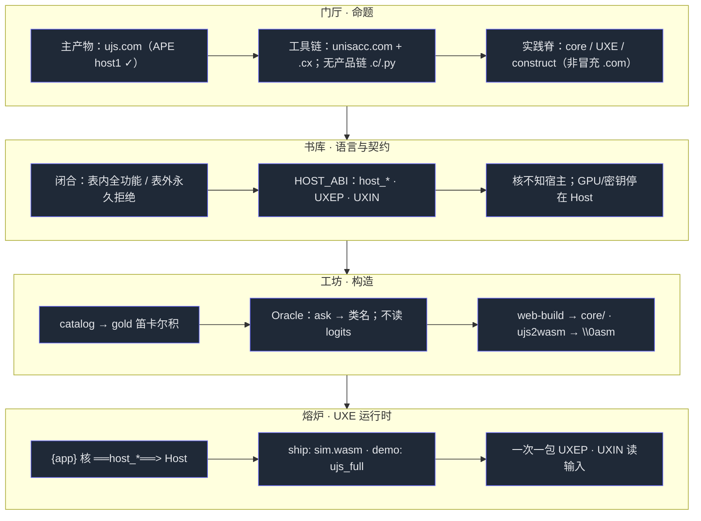
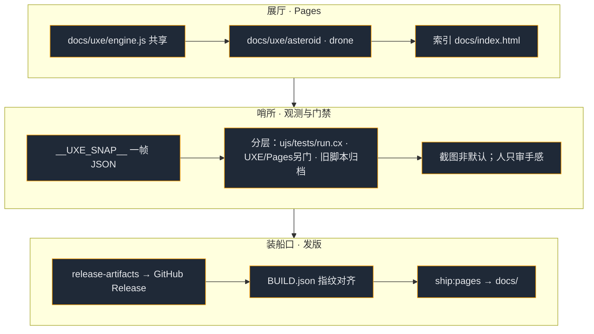
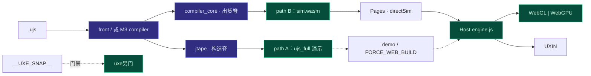
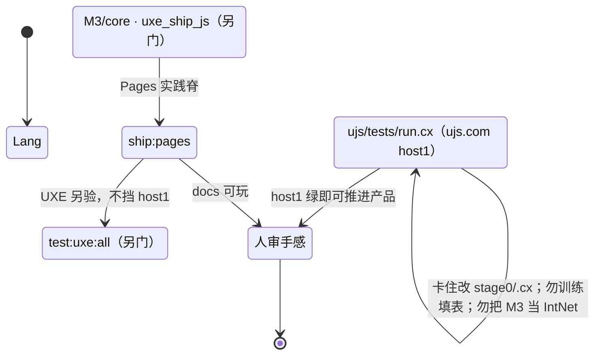
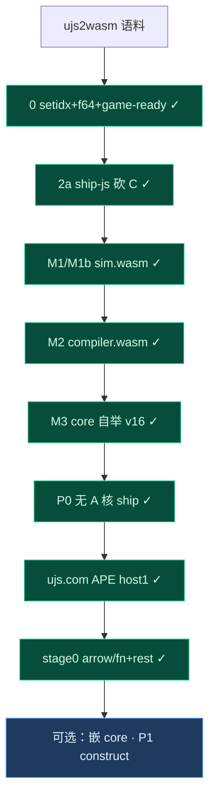
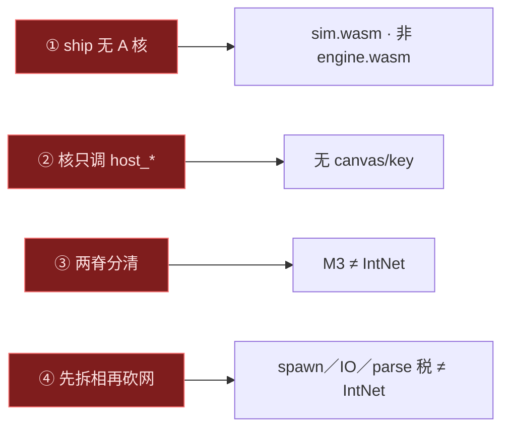

# UJS —— 产品规格 v1.3

> **唯一耦合活文档**（规格 · 目标 · 思维树 · 记忆宫殿）。与代码同会话更新。  
> **版本计划**：[`plans/`](plans/)（`ujs.com` **0.0.4** ✓；下一刀 [`plans/v0.0.5.md`](plans/v0.0.5.md)）  
> **目录板块**：[`ARCHITECTURE.md`](ARCHITECTURE.md) · 开箱：[`README.md`](README.md) · Host：[`uxe/HOST_ABI.md`](uxe/HOST_ABI.md)  
> 归档：[`archive/`](archive/)

---

## 0. 一句话

**UJS** = 闭合 JS 子集 + 构造法确定性推理（理论）+ **`ujs.com` 生产力工具**（产品）。  
验收：版本计划门禁与可机读收据；不以截图猜 UI。

### 0.0 版本（`ujs.com` 0.0.x）

| 版 | 状态 | 计划 |
|---|---|---|
| **0.0.1** | ✓ host1 基线 | [`plans/v0.0.1.md`](plans/v0.0.1.md) |
| **0.0.2** | ✓ 生产力合同 | [`plans/v0.0.2.md`](plans/v0.0.2.md) |
| **0.0.3** | ✓ **`ujs/` 无 `.c`／`.py`** | [`plans/v0.0.3.md`](plans/v0.0.3.md) |
| **0.0.4** | ✓ **host1 wasm 验面** | [`plans/v0.0.4.md`](plans/v0.0.4.md) |
| **0.0.5** | 下一刀 · 跑面／续迁切片 | [`plans/v0.0.5.md`](plans/v0.0.5.md) |

版号真源：`ujs.com --version`（**`ujs.com 0.0.4`**）。

**两个名词**：**host image** = APE／六目标／验面／`host1_package`；**method emit** = 表／流→`\0asm`。勿混。

**语言债**：`ujs/` 内 `.c`／`.py` = **0**；遗留 [`archive/ujs-legacy-py-c/`](../archive/ujs-legacy-py-c/)；续迁 [`plans/cx-migration.md`](plans/cx-migration.md)。

### 0.1 出货主产物（主人 2026-10-25）

| | |
|---|---|
| **主产物** | **`ujs.com`**——**ujs + wasm 类别的生产力工具**（跨架构单文件 `.com`；编／装／跑／自举收进同一壳） |
| **状态** | **0.0.4 已交付**（`ujs.com 0.0.4`）：无 `.c`／`.py`；预言＋**`--verify` 验面**；套件绿。下一版路线 0.0.5 |
| **不是主产物** | 单独的 `ujs2wasm` CLI、`wat2wasm`、`compile.mjs`、零散 `.wasm`——是 **`ujs.com` 的子功能／实践脊**，应收进或由它调度 |

### 0.1b 产品 · 论文 · unisacc 关系（主人 2026-10-25 定调）

> 与旧稿「B 只 cite A、出货脚注」并存时，**以本小节为准**；论文正文改口另裁，不挡 `ujs.com` 产品推进。

| 层 | 角色 |
|---|---|
| **`ujs.com`（产品）** | 打造 **ujs+wasm 生产力工具**：日用入口、门禁、子功能收敛；证据标签 `host1_package`（及日后产品能力标签） |
| **Paper B（理论）** | **对齐并阐述**该产品类别的底层理论（闭合子集 · 构造法确定性推理 · 表／流→`\0asm`）；主张服务产品可辩护性，不是反过来用产品绿冒充理论完成 |
| **Paper A / `unisacc.com`** | **由 B 侧问题派生的 C 实践与形式化承载**；`unisacc.com` 的方向正确性是**同理论在另一语言面的佐证**，不是 UJS 的父产品。形式核／Lean 样本可仍落在 A 文，但**谱系叙述：B→A 派生，A 佐证回 B／unisacc** |

**三面收据仍勿混用**（Grok 评审采纳）：`host1_package` ≠ `m3_scaffold` ≠ `method_construct`。生产力工具主线推 host1；方法弧（m4／构造）写进 B 时单独标 `method_construct`。

**子功能 ↔ 今日入口（将收敛进 `ujs.com`）**

| 子功能 | 今日怎么用 | 将来在 `ujs.com` 里 |
|---|---|---|
| 编 `.ujs`→`\0asm` | **`ujs.com FILE.ujs`**（host1）· `node compile.mjs`／`compiler_core`（m3） | 默认驱动已进 `ujs.com`；全表 emit 见 archive／0.0.4+ |
| WAT→二进制 | 外部 **`wat2wasm`** 或常驻 wabt（仓外床实证） | **内部子步骤**，用户不直接当产品 |
| 跑／fold／acc | archive 遗留 CLI；日用走 `ujs.com`／`unisacc.com -run` | 子命令或 `-run` 类动态路径 |
| path-A 演示核 | `web-build` → `ujs_full.wasm` | 可选子产物，非 ship 必经 |
| 玩法步进核 | **`sim.wasm`** + Pages Host | 由 `ujs.com` 写出或加载的应用核；Pages 仍可吃 `.wasm` |
| UXE Host | `engine.js` + `{app}` | 浏览器侧不变；桌面侧由 `ujs.com` 提供工具链 |

**纪律**：对外说「UJS 产品」时，指 **`ujs.com`**（APE／六目标已可经 `.cx` 构建；覆盖见 §0.1 状态）。说「更全表／Pages」时，指下表实践脊。勿把 `wat2wasm`／`ujs2wasm` 说成最终出货物。进度与宫殿只维护**本文件**，不写进根 `prd.md`。

### 0.2 今日实践脊（已交付能力，非最终产品形）

| 层 | 今日交付 | 不是 |
|---|---|---|
| **core** | `bootRuntime` / `wasm_run` / `compile` · path-A `ujs_full` · **`compiler_core`** | 页内训练 · 完整 ES · 把 M3 说成 IntNet · **冒充已是 ujs.com** |
| **UXE** | Host + `{app}` · Pages 步进 **`sim.wasm`** · 共享 `engine.js` | Three 移植 · 合包 · ship 必经 `engine.wasm`（P0 已弃） |
| **构造** | `construct/` gold → 权重；全表 `ujs2wasm`；`web-build` → path-A | 应用运行时依赖 · 把 Python CLI 当最终产品 |

**路径 A**（共享 VM · 方法/演示）：`web-build` → `ujs_full.wasm`（曾用名 **`engine.wasm`**；**非** P0 ship 必经；内核仍 C+zig）。  
**路径 B**（直出 · 出货步进）：`compile.mjs` → **`compiler_core.wasm`** → `sim.wasm`（已交付；玩法核）。  
开发可先 B 写 `.ujs`，再把 UXE `{app}` 接到 B（§目标）。

**语言（闭合）**：表内全功能，表外永久拒绝。有字面量 / list·dict / let·const / if·while·for·switch / function·箭头 / rest·spread / 算术比较 / 索引成员 / `len`·`keys` / 只读外层闭包。无 `undefined` 双轨、`var`/hoisting、`this`/`class`/prototype、`eval`、async/generator、RegExp 字面量。条款全表见 [`archive/prd-v1.0.md`](archive/prd-v1.0.md)。

**不交付**：完整 ES · Three-in-wasm · 合包 · 用户 LLM key 进核/packet · UJS 直播主线 · **把外部 `wat2wasm` 当 UJS 品牌出货物**。

---

## 目标（按杠杆）

**主线按 `plans/0.0.x` 推进 `ujs.com` 生产力工具**；Pages／`{app}` 仍要可玩，但是实践脊，不挡 0.0.x 产品版号。门禁先于功能。不开新门面游戏。

**北极星（两层）**  
1. **产品形**：把 **`ujs.com`** 打成 **ujs+wasm 生产力工具**（编译／组装／运行／自举／调度），对标该类别的日用壳，而非「只有 ujs2wasm」。  
2. **理论形**：Paper B 写清支撑该工具的底层理论；方法弧（构造／m4）可并行，**收据分标签**；不以 host1 绿宣称 B 主张中心已卸。  

**工具链底座**：日常仍用根 **`unisacc.com` + `.cx`（`-run`）** 造 `ujs.com`（先例与同仓宿主）；`.cx` 只转调 Python **不算**消除依赖。这是工程依赖，**不是**「UJS 从属于 Paper A 产品」。

**域分工**：ujs／`ujs.com` = **JS+wasm 生产力主线** · unisacc／`unisacc.com` = **同理论的 C 佐证与工具链** · **同理论**（构造法确定性推理=编译）· **同产品形纪律**（跨架构 `.com`）· **同工具链纪律**（`unisacc.com`+`.cx`）。

### 自举阶梯

1. **今** Python construct 出 A（`engine`）+ B 工具（`ujs2wasm`）；Asteroid + drone Pages 步进默认 B
2. **#2b / M1 + M1b** 玩法步进直出（B）— **Asteroid ✓ · drone ✓**；build 仍一次 Python emit（M2 去掉）
3. 更多 construct／测试／胶水迁入 **`unisacc.com` + `.cx`** 与 UJS/wasm（front/emit 可在 wasm host 上用）
4. **自举** UJS 编译器：UJS→wasm；并交付 **`ujs.com`**；Python 只留构造/对照，不挡出货

**反漂移**：下一步必须把能力推进 **`unisacc.com`+`.cx`／JS/wasm／`ujs.com`**；Python construct **只许缩或持平**，禁止新增「仅 Python 才出货或才验收」的依赖；禁止用 `.cx` 外壳转调 Python 冒充迁移完成。

### 何时可弃 Python（退出条件）

分两层，**先弃出货、后弃构造**。没达到门闩就还不能喊「脱离 Python」。底座路径：**`unisacc.com` + `.cx`**（动态 `-run`），不是再发明第三套脚本语言。

| 层 | 弃什么 | 做成什么之后可以弃 | 现在卡在 |
|---|---|---|---|
| **P0 弃出货 Python** | `web-build` / `ujs2wasm` CLI / 预编译 embed **不再是 ship 必经** | ① Pages 玩法步进只加载直出 `.wasm`（B），不再 `wasm_run`+bytecode ② 改 `.ujs` 用 **JS/wasm 或将来 `ujs.com`** 重编译，而不是 `python3 -m ujs …` ③ `npm run ship:*` 里无 `python3` | **✓** ship 停拷 `ujs_full`→`engine.wasm`；A 核仅 `FORCE_WEB_BUILD` / `ujs.sh` 重建 |
| **P1 弃构造 Python** | gold / oracle / acc／床上探针也不靠 Python | 构造臂与验收胶水迁到 **`unisacc.com` + `.cx`**（及自举后的 `ujs.com`）；枚举门禁仍在；实际 `-run` 执行、保留拒绝与恢复合同 | unisacc 工具链仍在收口；刻意后置，**不预堆 0.0.44** |

**P0 可检里程碑（每步弃一点）**

| 里程碑 | 做成什么 | 门闩 | 弃掉什么 |
|---|---|---|---|
| **M1** | 运行时步进只跑 B-wasm | `ujs2wasm_step` 绿 · asteroid+drone **默认** B · 热路径无 `wasm_run` | 运行时对 bytecode/`wasm_run`（A）的依赖（**Asteroid+drone ✓**） |
| **M2** | 编译器本身是 wasm，在 Node/浏览器调用 | 输入 `.ujs`→`\0asm`；fold；**ship 脚本无 python3** · `./tests/ujs2wasm_compiler.sh` | 开发/CI 出货对 `python3 -m ujs` 的依赖（生成该编译器 wasm 的一次性 zig/C 尚可忍） — **✓** |
| **M3** | 编译器用 UJS 写并自举 | stage0→stage1→stage2 **字节一致** | Python 作为编译器实现语言 |

**一句话**：能扔掉出货 Python ≠ emit.py 更全，而是 **M1→M2→M3 门闩全绿**；P1＝构造／胶水走上 **`unisacc.com`+`.cx`**，再收进 **`ujs.com`**。

### 产物清单（理论 → 交什么）

**最终交件**问：是不是 **`ujs.com`**（或由其确定性写出的六目标／应用核）？  
**里程碑交件**问：是否把能力推进 JS/wasm／自举，并**可被 `ujs.com` 吸收为子功能**？

| 里程碑 | 必须落地的产物 | 不是产物（别做厚） | 状态 |
|---|---|---|---|
| **已有脚手架** | path-A `ujs_full` · ship-js Host · `ujs2wasm`／`compile.mjs` 等**子功能入口** | 再扩 Python 专属出货链；把 CLI 当最终品牌 | 脚手架 ✓；**≠ ujs.com** |
| **M1** | ① **`sim.wasm`** ② Pages 默认 B 步进 ③ `direct_step.js` ④ `uxe_ship_js` | 只 fold 绿却仍默认 A | **Asteroid ✓ · drone ✓** |
| **M2** | ① **`compiler.wasm`／`compiler_core`** ② **`compile.mjs`** ③ ship 无 python3 emit | 继续把 emit 只留在 `.py` 当日常「产品」 | **✓**；仍是子功能脊 |
| **M3** | ① **`compiler.ujs`** ② stage2≡stage1 ③ 自举门禁 | 「差不多能编」无字节一致 | **v16✓** · **P0✓** |
| **P1** | gold/oracle/acc／验收胶水在 **`unisacc.com`+`.cx`**（或自举构造器） | 在 ujs 里把 Python 构造成产品；`.cx` 转调 Python 冒充完成 | 后置 |
| **ujs.com host1** | 本机原生 CLI；`build.cx` | 冒充已覆盖 core | **✓** stage0 |
| **ujs.com host1-six** | `build-six.cx` 六目标原生 | 冒充 APE 一包 | **✓** |
| **ujs.com APE** | `build-ape.cx` 五片多形态；对齐 `unisacc.com` 容器形 | 冒充已嵌入 core；依赖用户机 Node／Python | **✓**（本机烟测；跨机切片另证） |

**三条线 → 收束到一个 `.com`**

```
用户程序线（玩法）   .ujs ──► sim.wasm ──► Pages          ┐
编译器线（工具）     compiler_core / compiler.ujs           ├──► 最终由 ujs.com 调度或写出
构造线（理论）       gold/acc（对照；P1→unisacc）          ┘
今日工厂             ujs2wasm · wat2wasm · compile.mjs     ──► 子功能，不是主产物名
```

**论文 / 对外叙事：两条脊（同纪律，不同产物）**

| 脊 | 是什么 | 诚实边界 |
|---|---|---|
| **构造 / jtape** | gold→IntNet→oracle；`acc` / fold / icfold；全表 `ujs2wasm` | 方法验收；表阶段仍欠全量 P-2 Lean（继承 Paper A） |
| **M3 出货** | 手写 `compiler.ujs`→`compiler_core.wasm`；stage2≡ · body≡ · ship 无 python emit | **不是** IntNet；交付面 = **UJS-1_ship**（渐扩），≠ 全表 UJS-1 |

写 Paper B / Release 时：出货写 **`ujs.com`**（host1）与／或 core（M3 实践）；`web-build` 是 path-A 残线；**host1 门** = `ujs/tests/run.cx`；UXE／Pages 另门；旧 `ujs.sh` 已归档。

```
0 emit 齐 · 2a ship-js     ✓
        ↓
M1 (=#2b) 步进默认 B       **Asteroid ✓ · drone ✓**
        ↓
M1b drone 切 B             ✓（对称产物）
        ↓
M2 编译器 wasm 化          **✓**（compile+host+sim+ship emit 无 python3）
        ↓
M3 UJS 自举                **v16✓** sim+drone body≡ · ! · &&/|| · ship via core
        ↓
P0 ship 无 A 核            **✓** 停拷 ujs_full；web-build 非 ship 必经
        ↓
P1 构造迁 unisacc          可选
```

（换核模板 / 门禁契约 / Host 加厚仍按杠杆穿插；不改变上表弃 Python 顺序与产物线。）

#### M3（协议；交付面见 v12…v16）

**协议**：stage0=`compiler.wasm`(C) 编 `compiler.ujs` → stage1 core；stage1 再编 `compiler.ujs` → stage2；**main body 字节一致**。host 拼进 `compiler_rt_stub.wasm`。

**v11 基线（仍成立）**

| 件 | 说明 |
|---|---|
| `compiler.ujs` | id>8 drain · GKEYS64 · f64 `(i-j)*TWO52/j` 无溢出 |
| `compiler.wasm` | len u32 · f64 lex ratio · MEM 128 |
| 门禁 | **sim+drone body≡stage0** · stage2≡stage1 |

**P0（✓ ship）**：Pages/ship 只依赖 `compiler_core.wasm` + `sim.wasm`；`compile.mjs` **默认** core。

#### M3 v16（✓ unary ! · &&/|| short-circuit · fold corpus on core）

| 件 | 说明 |
|---|---|
| `compiler_min.c` / `compiler.ujs` | v16：`!e` → i64.eqz+extend（0/1）；`a&&b`/`a\|\|b` 经 IF0/IF1/IF2 + i64 `lscratch`/`lsc` 短路（JS 值语义；仅 i64；ujs op 200/201）；一元 `-`/`!` 用 UNY base3 LIFO（避免额外 list local 撑破自举） |
| 门禁 | fold **logic**→7；stage2≡stage1 · sim+drone body≡stage0；setidx_globals 默认 core |
| 回落 stage0 | `UJS_COMPILER=wasm` 或 `UJS_REQUIRE_COMPILER_WASM=1`（body≡ 对照 / 重建 core） |

#### M3 v17（✓ 短 str · fold corpus on core）

| 件 | 说明 |
|---|---|
| `compiler_min.c` / `compiler.ujs` | v17：`"…"` 字面量 **0–7 ASCII、无转义**（界在字面量，非拼接结果）→ OP_SCONST/pack_key；`str+str` → `$str_cat`（func 18）；str handle 经 OP_HRET 返回 |
| `compiler_rt_stub.wasm` | 与 stage0 同版 host（含 str_cat）；`compile.mjs` splice 模板 |
| 门禁 | fold **str**→`hello ujs`（及边界回归）；stage2≡stage1 / body≡ = **code `fi===1` mainBody**；sim+drone 同 |
| 回落 stage0 | `UJS_COMPILER=wasm` 或 `UJS_REQUIRE_COMPILER_WASM=1`（body≡ 对照 / 重建 core） |

#### M3 v18（✓ ASCII 长 lit 0–255 · fold corpus on core）

| 件 | 说明 |
|---|---|
| 完成判据 | `"…"` **0–255 非 NUL ASCII、无转义**；NUL / ≥256 / `\` / byte>127 → parse reject；**dict/dot 键 ≤8**（RT `dict_get` 按前 8 字节 i64 比；更长显式拒绝，不静默碰撞）；stage0≡core 执行；stage2≡stage1；sim+drone；**不开** `fn` / tinyvm execute |
| `compiler_min.c` | 字面量池 `sdata`；`OP_SCONST a=(off<<16)\|len`；拒 NUL；dict/dot `kn>8` → `dict key too long` |
| `compiler.ujs` | `DKEY` 256（lit）；dict/dot 键 cap 8；len≥64 LEB |
| 门禁 | accept empty/7/8/32/255/cat + `dict_key8`→2；reject 256/escape/nonascii/NUL/`dict_key9` |

#### Practice twin：tinyvm（✓ 可选 module validate）

| 件 | 说明 |
|---|---|
| 角色 | 伴生 `\0asm` 解释器；**校验面** only——证明模块通过该校验器，**不是**语义执行孪生；不是第三 IR |
| 门禁 | `ujs2wasm_compiler.sh`：若找到 `tinyvm`，对 fold + sim/drone 做 `module validate`；`UJS_REQUIRE_TINYVM=1` 时缺二进制 = FAIL |
| 查找 | `PATH` · `../tinyvm/target/{release,debug}/tinyvm` · `$HOME/repos/tinyvm/...` |

**下一刀**：v18 收尾后，**只选一个**由应用推动的缺口（优先 `fn`），写清输入与完成判据；不同时开 tinyvm 执行层。

#### M3 v15（✓ else-if · fold corpus on core）

| 件 | 说明 |
|---|---|
| `compiler_min.c` / `compiler.ujs` | v15：`else if (...)` 复用 if 路径（C：`pstmt`；ujs：CST=4 + 收尾 IF2）；`else {` 不变 |
| 门禁 | fold 含 **elseif**；stage2≡stage1 · sim+drone body≡stage0；setidx_globals 默认 core |
| 回落 stage0 | `UJS_COMPILER=wasm` 或 `UJS_REQUIRE_COMPILER_WASM=1`（body≡ 对照 / 重建 core） |

#### M3 v14（✓ unary minus · fold corpus on core）

| 件 | 说明 |
|---|---|
| `compiler.ujs` | v14：`-x` / `-(e)` / `--x` → OP_NEG（i64.const -1;mul）或 OP_FNEG（f64.neg）；字面量 `-N` 仍走原 lex |
| 门禁 | fold 含 **unary_minus**；stage2≡stage1 · sim+drone body≡stage0；setidx_globals 默认 core |
| 回落 stage0 | `UJS_COMPILER=wasm` 或 `UJS_REQUIRE_COMPILER_WASM=1`（body≡ 对照 / 重建 core） |

#### M3 v13（✓ `[…]` + `dict.field` · fold corpus on core）

| 件 | 说明 |
|---|---|
| `compiler.ujs` | v13：`[e,…]` → MKLIST/BOX/LSET；`.` → SCONST+DOT；`CST[slot]` 区分 dict/f64-list |
| 门禁 | fold 子集经 **compiler_core**；stage2≡stage1 · sim+drone body≡stage0；**setidx_globals 默认 core** |
| 回落 stage0 | `UJS_COMPILER=wasm` 或 `UJS_REQUIRE_COMPILER_WASM=1`（body≡ 对照 / 重建 core） |
| splice | `rebuild-main.mjs` 把 stub 的 `host_set/get_global` 边界从 ng=1 补到 MAXG=64（否则 inject 只写得进 idx0） |

#### M3 v12（✓ core→meta · default compile=core）

| 件 | 说明 |
|---|---|
| `compiler.ujs` | v12：`OUT` 尾部名表 + `MG`；供 host 写 `.meta.json` |
| `compiler_core.wasm` | stage1 入树；`compile.mjs` **默认** |
| ship | asteroid+drone bridge=`compiler_core.wasm` |

#### M2（✓）

**已交付**

| 件 | 路径 | 说明 |
|---|---|---|
| `compiler.wasm` | `ujs/core/compiler.wasm` | C 子集编译器（`native/compiler_min.c`）→ zig 一次性构建 |
| 重建 | `./ujs/scripts/build-compiler-wasm.sh` | 需 zig；**不是**运行时依赖 |
| 宿主 | `ujs/compile.mjs` | 有 artifact → wasm（`UJS_REQUIRE_COMPILER_WASM=1` 禁止回落 Python） |
| ship | `build-{asteroid,drone}-pages.mjs` | `compile.mjs` → `sim.wasm`+meta；**无 python3 emit** |
| 门禁 | `./tests/ujs2wasm_compiler.sh` | PATH 无 python3 · fold · setidx_globals · sim · **ship builders 无 emit_wasm** |

覆盖：`let` / `while` / `if`/`else` / `===` / `return` / i64+f64（混算+比较）/ list·`len`·下标·`setidx` / dict·dot / globals inject / `host_*`·`run_step` / **Asteroid+drone ship Pages**。

**仍非 M2 范围（可后移）**

- 未烘焙 gold/catalog；无通用长 str / fn
- `web-build` / `ujs_full.wasm` 仍一次 Python+zig（引擎 Host，非玩法核 emit）
- 吐出模块与完整 `emit_wasm` 未字节同构

Python 直出管线（对照 / 全量仍用）：

```
.ujs → front + jtape → emit_wat → wat2wasm → \0asm + meta
```

**加速实证（Paper B 床 · 2026-10-25 · 仓外 · 不并表 unisacc 7×18）**

28 语料、NEED5（lex/parse/scope/isel/enc）＋丢 type/shape/ic 死问；字节对拍 b-cli；arith SHA `0b99b103…`。

| 档 | 热语料墙钟 | 做法 |
|---|---|---|
| cli `wat2wasm`×文件 | ≈3.2–3.3s | 每文件一进程 |
| `--jobs=8` 并行 cli | 冷 ≈0.75–0.87s | 只削 spawn 排队 |
| 常驻 wabt.js（`--asm=wabtjs`） | ≈0.09–0.10s | 进程内组装；批量 IPC 无再降 |

热路径拆相（常驻后，约 0.10s）：

| 段 | 墙钟 | 占热 |
|---|---|---|
| front（lex+parse+scope ask＋胶水） | ≈0.02s | ≈20–25% |
| emit_wat（isel+enc ask＋拼 WAT） | ≈0.013s | ≈13–15% |
| 组装（wabt：parseWat 为主） | ≈0.04–0.06s | ≈60% |

四流十网：决策网 ask 合计 ≈0.025s（lex/parse/isel/enc）；type/shape/ic=0；irsel/reloc 直出不问。**encode 流的物理写出不在网里。**

CLI `wat2wasm` 内因：×28 时 spawn／加载 ≈1.9–2.1s（约 2/3）；语料工作增量 ≈0.9s。进程内再拆：parseWat ≈57%、validate ≈16%、toBinary ≈11%。

**REJECT**：跨文件 WAT 缓存（28 互异命中 0）；`lower_wasm.encode_wasm`→`UJS1` 非浏览器 `\0asm`；大 JSON 批量 IPC（不降或更慢）；本刀回灌 unisacc（产品直写映像、无 fork 组装）。

**下一刀唯一明显杠杆**：真直出 `\0asm`（不经文本 WAT），且须逐字节同基线。其余为毫秒级。范式：**先按流／相拆墙钟，先打 spawn／IO，再动网。** 证据 `/tmp/ujs-accel-link-20261025/`（C-batch／J-PHASE／ASM-*／O-wabt*）。未 tip、未改出货默认路径。

**`compiler.wasm` ABI**（已钉）：

```
// JS — 产品契约
compile(src: Uint8Array|string) →
  { wasm: Uint8Array, meta: { locals:string[], globals:string[], slots:string[] } }
  | throw Error(message)

// wasm 导出
// memory; alloc(n)→ptr; compile(src_ptr, src_len)→i32 status
// status=0: out_ptr/out_len + meta_ptr/meta_len（UTF-8 JSON）
// status≠0: err_ptr/err_len
```

| # | 做什么 | 完成判据 / 测试 | 状态 |
|---|---|---|---|
| **0** | `emit_wasm`：`setidx` · `f64` · game-ready | `./tests/ujs2wasm.sh` | ✓ |
| **2a** | Asteroid ship-js（砍 `uxe_*.c` 出货） | `./tests/uxe_ship_js.sh` · `npm run ship:engine` | ✓ |
| **2b / M1** | Asteroid 步进默认 `sim.wasm`（path B） | `ujs2wasm_step` + `uxe_ship_js`（含 sim.wasm） | **✓** |
| **M1b** | drone 对称切 B（`ship/drone/sim.wasm`） | `uxe_ship_js`（drone sim.wasm + directSim） | **✓** |
| **M2** | `compiler.wasm` + 无 python ship | `ujs2wasm_compiler.sh`；ship 无 `python3` emit | **✓** |
| **M3** | `compiler.ujs` 自举 | body≡stage0 → stage2≡stage1 | **v16✓** + fold logic/elseif/… on core |
| **P0** | ship 无 web-build / 无 `engine.wasm`（A） | `ujs2wasm_compiler.sh` · `ship-engine` 拒 A 核 | **✓** |
| **3** | 换核模板 | 按下表抄路径绿 | 骨架 ✓ |
| **4** | 门禁即契约 | **host1**：`ujs/tests/run.cx`。实践脊／UXE 另门；旧 `ujs.sh` 见 `archive/testing-c43-legacy/` | host1 套件 ✓ · UXE 另门 |
| **5–6** | Host / llm | 有玩法再开 | 搁置 |

### 换核模板（#3 可抄）

```
1. 写 ujs/web/game/{name}.ujs          # 只算状态，不画
2. 写 ujs/uxe/app-{name}.js            # 只调 host_* · wasm_run/预编译
3. 写 ujs/uxe/ship/{name}-host-entry.js + build-{name}-pages.mjs
4. package.json 加 ship:{name}；scripts/ship-pages.sh 挂上
5. ./tests/uxe_ship_js.sh 扩展检查 · npm run test:uxe:all
```

对照实现：`asteroid-host-entry.js` · `build-asteroid-pages.mjs` · `drone-host-entry.js` · `build-drone-pages.mjs`。

**已交付**：Host ABI v0 · UXEP/UXIN · WebGL/WebGPU · Pages（Asteroid+无人机 ship-js）· `test:uxe:all` · H1–H3 · snapshot · **ujs2wasm 直出（setidx/f64 + game-ready）** · 双 ship-js 无 C 游戏核。

**门禁（必绿）**

| 门 | 命令 |
|---|---|
| **`ujs.com` host1** | `./unisacc.com -run ujs/tests/run.cx -- --smoke`；发版材料另跑 `--complete` |
| **ship-js 合同**（实践脊） | 旧 `uxe_ship_js`／Pages 另门（脚本或在 archive；不挡 host1） |
| UXE 无人 | `cd ujs && npm run test:uxe:all`（另门） |
| Pages | `npm run ship:pages` 后抽玩感 |
| 旧语言／全表 | `archive/testing-c43-legacy/tests/ujs*.sh`（考古；非 host1 合同） |

**工具（摘）**：`python3 -m ujs web-build` · `ujs2wasm` · `./ujs/scripts/release-artifacts.sh` · `ship-pages.sh` · `uxe-gate.sh`。  
指纹：`core/BUILD.json`。二进制走 GitHub Release，不进主树。

**代理观测**：断言写在数上。`__UXE__` · `__UXE_HOST__` · `host_debug_snapshot` / `__UXE_SNAP__` · `test:uxe:snap`。

---

# 一、思维树（markdown-tree-dag）

> 开工用。约定：`├─` 包含（树），`══>` 跨树依赖（DAG），`⟦门禁⟧` 检查点。

## T1. 系统树 —— 三层切分

任何一行代码必须能归到其中一类，归不了就是走偏。

```
UJS
│
├─ ① 经典代码（algebra）—— 绝不「训练填表」
│   ├─ 前端走查          construct/front/{lex,compile}
│   ├─ jtape / VM        jtape.py · vm.py · bc_vm.py
│   ├─ UXE Host 胶水     host-browser · packet · input · renderer-*
│   ├─ C VM               native/ujs_vm.c（路径 A）；uxe_asteroid.c 遗留不出货
│   └─ 页壳 / ship-js     demo/ · ship/{asteroid,drone} · engine.js
│
├─ ② 模型数据（constructed tables）—— 离散 key → 类
│   ├─ gold 表           catalog → gold 笛卡尔积
│   ├─ IntNet 权重       构造代数（非 SGD 出货）
│   └─ isel / enc …     ujs2wasm 决策表（WAT 形态）
│
└─ ③ 出货面（artifacts）
    ├─ core/ujs_full.wasm (+ compiler.gen.js)   路径 A（非 P0 ship）
    ├─ core/compiler_core.wasm                 M3 出货编译器（默认 bridge）
    ├─ ship/*/sim.wasm                         路径 B 玩法核
    └─ docs/uxe/{engine.js,{game}/}             Pages（无 engine.wasm 必经）
```

**DAG 边**

```
gold ══构造══> 权重 / isel·enc          ← 构造脊
② ══驱动══> ① 走查 / emit（Oracle 只回类名）
① ══产出══> ③ path-A / 全表对照
compiler.ujs ══M3══> compiler_core ══> sim.wasm   ← 出货脊
A (ujs_full) ══Host══> demo（可选）
B (sim.wasm) ══directSim══> Pages
```

## T2. 目录树 —— 文件到职责

```
ujs/                         ★ 树内无 .c／.py；套件在本树
├─ prd.md · README.md · ARCHITECTURE.md · plans/
├─ tests/                    ★ host1 产品套件（不在根 tests/）
│   ├─ run.cx · host1-pass/refuse
│   └─ corpus/ · neg/        语料夹具（自根 tests/ujs2wasm 迁入）
├─ product/                  ★ host image（unisacc.com + .cx）
│   ├─ ujs_main.cx · build*.cx · ape-pack.cx · complete.cx
│   ├─ corpus-host.cx · verify-host.cx · wasm-verify.cx
│   └─ --verify              \\0asm 节／必导出
├─ seed/stage0/              host1 编译器（.cx）
├─ seed/construct|vm/        占位 README；源在 archive/ujs-legacy-py-c/
├─ iterate/                  M3 实践脊（另标签）
├─ practice/ · weights/      实验／表位（无 .c／.py）
├─ ujs.com                   本机构建产物
└─ archive/                  旧规格文稿（非 legacy 源）

仓外：archive/ujs-legacy-py-c/   0.0.3 迁出的 .py／.c 考古
```

**易错 DAG**

```
web-build ══> core/ujs_full.wasm     （A-demo / FORCE_WEB_BUILD；非 ship）
ship B ══> compiler_core → sim.wasm  （无 engine.wasm / 无 python3 emit）
{app} ══只调══> host_*          （不知 canvas / fetch / key）
UXEP ══一次一包══> host_gpu_submit
UXIN ══> host_input_read
ujs/tests/run.cx ══调══> ujs/product/{build,corpus-host,complete}.cx
```

## T3. 出货 DAG —— host image vs 实践脊

```
.ujs 源
 │
 ├──── host image（ujs.com · host1_package）───────────┐
 │    stage0 → \\0asm；APE／六目标                       │
 │    ⟦门禁⟧ ujs/tests/run.cx · host1-pass/refuse       │
 │                                                     │
 ├──── 实践脊 M3（m3_scaffold · 另门）─────────────────┤
 │    compile.mjs → compiler_core → sim.wasm           │
 │    旧门禁已归档；不挡 host1 版号                      │
 │                                                     │
 └──── 方法弧（method_construct · 另弧）───────────────┤
      construct／m4；≠ host1 绿                        │
                                                       ▼
                              Pages／UXE 另门（npm test:uxe）
```

## T4. UXE 积木树

```
UXE Shell
├─ {app|game} 核     调度 · 组 UXEP · 读 UXIN · 只调 host_*
├─ sim.wasm          出货玩法核（path B · UJS-1_ship · core 编）
├─ ujs_full（可选）  path-A 演示 VM；**非** ship 必经（曾名 engine.wasm）
├─ Host（engine.js） GPU / 输入 / 时间 / 资源 /（规划）llm
└─ Pages             docs/uxe/engine.js + docs/uxe/{name}/
```

```
demo：*.ujs → compile(ujs_full) 或页内测 → host_*
ship：index.html → engine.js + game.js + sim.wasm（directSim；无 engine.wasm）
```

## T5. 验收 DAG

```
host1 绿 ── ujs/tests/run.cx ──┬── --smoke（build + oracle）
                               └── --complete（APE + oracle + six）

实践另门 ── M3／uxe（归档脚本或 npm）；不挡 0.0.x 版号
历史对照 ── archive/testing-c43-legacy/tests/ujs*.sh

UXE 绿 ── test:uxe:all ────┬── CDP 探针 · snapshot 数（**另门**）
                           └── 禁代理猜 UI；不挡语言/出货绿

出货 ──── ship:pages ─────── docs/ 与 BUILD 指纹对齐 Release
```

## T6. 三条红线

```
① 双 wasm 永不合包（若仍跑 path-A） → {app} ≠ ujs_full
② 核只调 host_*                      → 无 canvas / key / fetch
③ 出货权重构造、不训练填表            → --drive 默认 built；勿擅跑 train
   + 出货脊 ≠ IntNet；UJS-1_ship ≠ 全表 UJS-1
```

---

# 二、记忆宫殿（mermaid-flowchart-memory-palace）

> 记全局用。按 **门厅 → 书库 → 工坊 → 熔炉 → 展厅 → 哨所 → 装船口** 走一圈。

## 宫殿全景





## 管线真图



**读图**：紫 = 决策/编译路径（构造脊或 M3）；绿 = Host / Pages。出货主杠杆是 **sim.wasm + core**，不是 `engine.wasm`。

## 门禁状态机



## 目标推进图



## 随身卡

| 记 | 是什么 |
|---|---|
| **两脊** | 构造/jtape（IntNet）∥ M3 出货（`compiler_core`，非 IntNet） |
| **A / B** | path-A `ujs_full` 演示 / path-B `sim.wasm` 出货步进 |
| **UJS-1_ship** | M3 已交付子集 ⊂ 全表 UJS-1 |
| **门禁** | `ujs/tests/run.cx`（smoke／complete）· UXE／Pages 另门 · 旧 `ujs.sh` 已归档 |
| **host_*** | 核唯一出入口；GPU/key 停 Host |
| **UXEP / UXIN** | 一次一包提交 / 输入快照 |
| **BUILD.json** | 与 Release 对指纹 |
| **构造不训练** | 出货权重由 gold 代数生成；M3 另用孪生字节门禁 |
| **ujs.com** | **ujs+wasm 生产力工具**；版号见 §0.0／`plans/` |
| **Paper B** | 底层理论对齐该工具；谱系 B→A 派生，A／unisacc 佐证 |
| **计划** | `ujs/plans/v0.0.N.md`；根仓 0.0.4x 是 unisacc 底座 |
| **子功能** | `ujs2wasm`／`compile.mjs`／`sim.wasm`… = 应收进壳的实践脊 |
| **脱 Py** | 新胶水／构造迁 **`unisacc.com` + `.cx`（`-run`）**；只许缩 Python，不许转调冒充 |
| **直出税** | 热语料大头曾是 `wat2wasm` spawn，非常驻后是 parseWat；网 ask 非主税。见「加速实证」 |

## 走出宫殿前默念



---

## 文档角色（收束后）

| 文档 | 角色 |
|---|---|
| **本文件** | 规格 · 目标 · 思维树 · 记忆宫殿 · **当前版号指针** |
| [`plans/`](plans/) | **`ujs.com` 0.0.x 版本计划**（范围／判据／进度） |
| [`uxe/HOST_ABI.md`](uxe/HOST_ABI.md) | Host 符号 / UXEP·UXIN |
| [`README.md`](README.md) | 开箱与分发 |
| [`product/README.md`](product/README.md) · [`tests/README.md`](tests/README.md) | 产品壳 · 套件入口 |
| [`archive/`](archive/) | 历史；不当真源 |

升版：按 `plans/v0.0.N.md` 完成判据 bump `ujs.com` 版本串；破坏性语言/API 另记；旧活规格摘入 `archive/`。
